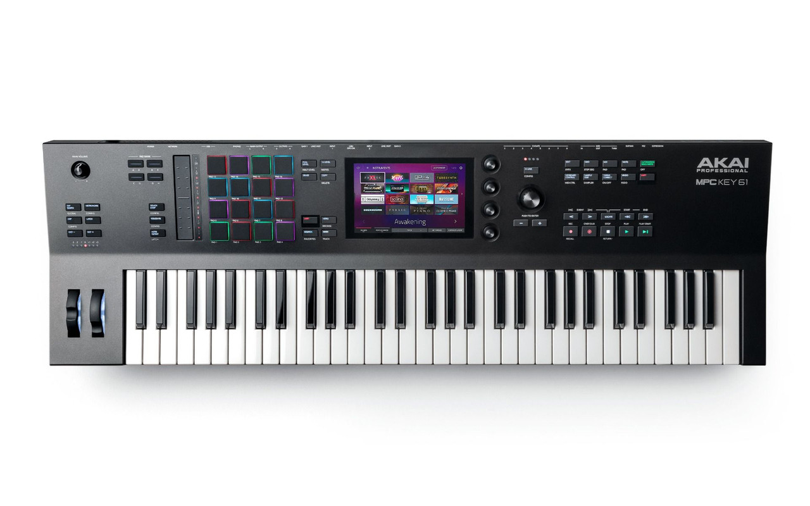

<p align="center">
  
</p>

# Safian Kick – Standalone DAW & Synthesizer Workstation

[](LICENSE)
[](https://github.com/MusicTribeOpenSource/0700-AAM)
[](docs/hardware/key61/pendrive-install.md)
[]()

Independent, enhanced community fork of **Behringer KICK (`MusicTribeOpenSource/0700-AAM`)** developed by **[@Safian](https://github.com/Safian)**.

This project transforms the KICK codebase into a modern, responsive standalone DAW and synthesizer workstation. It removes the fixed 1024×600 hardware chassis constraints, adds native **CLAP / VST plugin hosting**, introduces a multi-touch on-screen keyboard, and delivers verified **61-key polyphonic aftertouch** performance on embedded ARM Linux standalone hardware (such as the **Akai MPC Key 61**) as well as desktop (macOS, Linux) and mobile (iOS) systems.

---

## 🌟 Key Features & Fork Enhancements

- **61-Key Hardware Polyphonic Aftertouch:**
  - Validated sub-millisecond event loop responsiveness under heavy poly-pressure data streams.
  - Zero audio buffer underruns during dense multi-note polyphonic aftertouch and ribbon sweeps.
- **Native CLAP & VST Plugin Host Integration:**
  - Real-time, lock-free event queues for dynamic `.clap` instrument plugin loading.
  - Full support for the CLAP per-note modulation standard (`clap_event_param_mod_t`), bypassing legacy MIDI 1.0 CC choking.
- **Controller-First Scalable Full-Screen UI:**
  - Decoupled from the legacy 1024×600 skeuomorphic plastic chassis.
  - Responsive DAW layout that scales smoothly across 7" (1280×800), 10.1" (1920×1200), and high-resolution desktop displays.
- **Multi-Touch Piano & Screen Keyboard:**
  - Playable on-screen keyboard with polyphonic multi-touch key tracking and octave controls.
- **Clean Upstream Bugfixes & Quality Improvements:**
  - **Procedural Metronome ([PR #43](https://github.com/MusicTribeOpenSource/0700-AAM/pull/43)):** Procedural sound synthesis fallback preventing silent metronomes when sample assets are missing, plus downbeat pitch accents.
  - **ADSR Envelope Precision ([PR #44](https://github.com/MusicTribeOpenSource/0700-AAM/pull/44)):** Exact exponential stage ratios and instantaneous zero-attack handover timing.
  - **Dark Theme Consistency ([PR #46](https://github.com/MusicTribeOpenSource/0700-AAM/pull/46)):** Uniform dark theme rendering across all 18 views, eliminating transparent bleed-through and white canvas flashes.
  - **Touch Hit Target Bounds ([PR #48](https://github.com/MusicTribeOpenSource/0700-AAM/pull/48)):** Expanded touch hit target for modal dialog close buttons for fingertip use on 7" touchscreens.

---

## 🎹 Hardware Compatibility Matrix

| Hardware / Platform | SoC / Architecture | Status | Inputs & Capabilities |
|---|---|:---:|---|
| **Akai MPC Key 61** | Rockchip RK3288 (4× Cortex-A17, 32-bit ARMv7-A) | **Physically Verified** | 61-key semi-weighted keybed with polyphonic aftertouch, 7" 1280×800 multi-touch screen, 16 RGB pads, 4 Q-Link knobs, pitch/mod wheels, touch strip, ALSA audio/MIDI. |
| **Akai MPC Live / Live II** | Rockchip RK3288 (ARMv7-A) | **Compatible** | 16 RGB pads, 7" multi-touch display, internal battery & speakers (Live II), identical SoC and kernel environment. |
| **Akai MPC One / One+** | Rockchip RK3288 (ARMv7-A) | **Compatible** | 16 RGB pads, 7" multi-touch display, CV/Gate jacks, identical SoC and kernel environment. |
| **Akai MPC X / X SE** | Rockchip RK3288 (ARMv7-A) | **Compatible** | 10.1" multi-touch display, 16 touch-sensitive Q-Links with OLEDs, identical SoC. |
| **Akai Force** | Rockchip RK3288 (ARMv7-A) | **Compatible** | 64-pad clip launch matrix, 7" multi-touch display, identical SoC and kernel environment. |
| **Behringer Polykeys 61** | Open-source ARM Linux target | **Architecture Ready** | Targeted directly by this fork's CLAP host and 61-key poly-pressure engine. |
| **Raspberry Pi 4 / 5** | Broadcom BCM2711 / BCM2712 (ARM64) | **Compatible** | Desktop / DRM-KMS Linux, external USB MIDI controllers and class-compliant audio interfaces. |
| **macOS** | Apple Silicon (M1/M2/M3/M4) & Intel (x86_64) | **Verified** | Native JUCE desktop DAW target (macOS 12.0+). |
| **Linux Desktop** | x86_64 (Wayland / X11) | **Verified** | Native ALSA / JACK / PipeWire build. |
| **iOS / iPadOS** | Apple A-series & M-series (iPad) | **In Progress** | Standalone touch DAW build with CoreMIDI support. |

---

## 🚀 Easy USB Pendrive Installation (Akai MPC)

The easiest way to run Safian Kick on an Akai standalone instrument is via a standard **USB flash drive**.

> [!IMPORTANT]
> **100% Non-Destructive Dual-Boot:**
> The factory internal root partition of the instrument remains strictly read-only (`ro`). The bootloader and original firmware are completely untouched.
> - **Power on WITH the USB drive inserted:** Boots directly into **Safian Kick**.
> - **Power on WITHOUT the USB drive:** Boots into the **stock Akai MPC DAW**.

### Quick Start (3 Steps):

1. **Format a USB Flash Drive:**
   - Format any USB flash drive (at least 512 MB) as **FAT32** or **exFAT** (MBR or GPT).

2. **Extract the Package to the USB Root:**
   Download the release archive or build it using the package script:
   ```bash
   ./docs/hardware/key61/tools/make_pendrive_package.sh
   ```
   Extract the contents directly to the root directory of the USB flash drive. The directory tree on the drive should look like this:
   ```text
   /USB_ROOT/
   └── tkgl_bootstrap_[ProjectData]/
       ├── VERSION
       ├── bin/
       │   └── Kick
       ├── scripts/
       │   ├── tkgl_bootstrap
       │   └── uninstall_kick.sh
       └── assets/
           ├── Default/
           └── Proper/
   ```

3. **Insert & Power On:**
   - Plug the USB drive into any rear USB-A port on the MPC and turn the power on.
   - The bootstrap script automatically starts the Kick engine.
   - *(Optional)* Because the engine runs from memory/cached data, you can even unplug the drive after boot!

📖 **For the full step-by-step documentation in Hungarian, read:**  
👉 [**Akai MPC Key 61 Pendrive Telepítési és Használati Útmutató (pendrive-install.md)**](docs/hardware/key61/pendrive-install.md)  
👉 [**Részletes Felhasználói és Fejlesztői Kézikönyv képernyőképekkel (USER_MANUAL.md)**](docs/manual/USER_MANUAL.md)

---

## 🛠️ Repository Scripts & Tools

This repository contains ready-to-use scripts for cross-compiling, packaging, and deploying to embedded ARM hardware:

| Script / Tool | Description |
|---|---|
| [`docs/hardware/key61/tools/make_pendrive_package.sh`](docs/hardware/key61/tools/make_pendrive_package.sh) | Creates a ready-to-copy zip archive and USB folder structure for pendrive deployment. |
| [`docs/hardware/key61/tools/build_arm.sh`](docs/hardware/key61/tools/build_arm.sh) | Cross-compilation script targeting ARMv7-A (Cortex-A17) Linux with ALSA and NEON SIMD. |
| [`docs/hardware/key61/tools/deploy_mpc.sh`](docs/hardware/key61/tools/deploy_mpc.sh) | Fast network deployment tool via SSH/SCP directly to an MPC on the local network. |
| [`docs/hardware/key61/tools/uninstall_kick.sh`](docs/hardware/key61/tools/uninstall_kick.sh) | Safe removal script that clears `/data/Kick` runtime files from the internal flash. |
| [`docs/hardware/key61/tools/mpcsnoop.c`](docs/hardware/key61/tools/mpcsnoop.c) | Low-level Linux hardware diagnostic sniffer for intercepting input events and HID packets. |

---

## 💻 Building from Source

### macOS Desktop Build
Requirements: CMake 3.25+, Ninja, Xcode 14+, JUCE 7.0.12.
```bash
export PATH=/opt/homebrew/bin:$PATH
MACOSX_DEPLOYMENT_TARGET=12.0 cmake -S Kick -B build -G Ninja \
  -DKICK_JUCE_PATH=$PWD/.3rdPartySourceCache/JUCE-7.0.12 \
  -DKICK_SIMULATOR=ON \
  -DTIMESTAMP=OFF \
  -DCMAKE_POLICY_VERSION_MINIMUM=3.5

MACOSX_DEPLOYMENT_TARGET=12.0 ninja -C build Kick
```

Run smoke test:
```bash
KICK_DATA_ROOT=/tmp/kick_data KICK_RESOURCE_ROOT=$PWD/Kick \
KICK_NO_AUDIO_DEVICE=1 KICK_NO_SERIAL_DEVICE=1 KICK_NO_HARDWARE=1 \
build/Kick.app/Contents/MacOS/Kick --smoke-test
```

---

## ⚖️ Legal, Trademarks & Licensing

- **Software License:** All source code and original modifications are licensed under the **GNU Affero General Public License v3.0 or later ([AGPL-3.0-or-later](LICENSE))**.
- **Independent Project:** This repository is an independent open-source initiative created and maintained by **[@Safian](https://github.com/Safian)**. It is **not** affiliated with, sponsored by, or endorsed by MUSIC Tribe Global Services Ltd., Behringer, or inMusic Brands, Inc.
- **Trademarks:**
  - *"Behringer"* and *"KICK"* are trademarks of MUSIC Tribe Global Services Ltd.
  - *"Akai"*, *"MPC"*, *"MPC One"*, *"MPC Live"*, *"MPC X"*, and *"Force"* are registered trademarks of inMusic Brands, Inc.
  - *"TheKikGen"* and *"MPC-LiveXplore"* are property of their respective creators.
  - All product and brand names mentioned are used solely to identify the hardware platforms and software interfaces for interoperability and technical compatibility under fair use.

---

## 🤝 Community & Upstream Collaboration

- **Official Upstream Repository:** [MusicTribeOpenSource/0700-AAM](https://github.com/MusicTribeOpenSource/0700-AAM)
- **Active Community Discussions:**
  - [RFC #26: Native CLAP Plugin Hosting & 61-Key Poly-Aftertouch Roadmap](https://github.com/MusicTribeOpenSource/0700-AAM/issues/26)
  - [Upstream Pull Requests Submitted by @Safian](https://github.com/MusicTribeOpenSource/0700-AAM/pulls/Safian)
- **Author:** [@Safian](https://github.com/Safian)
