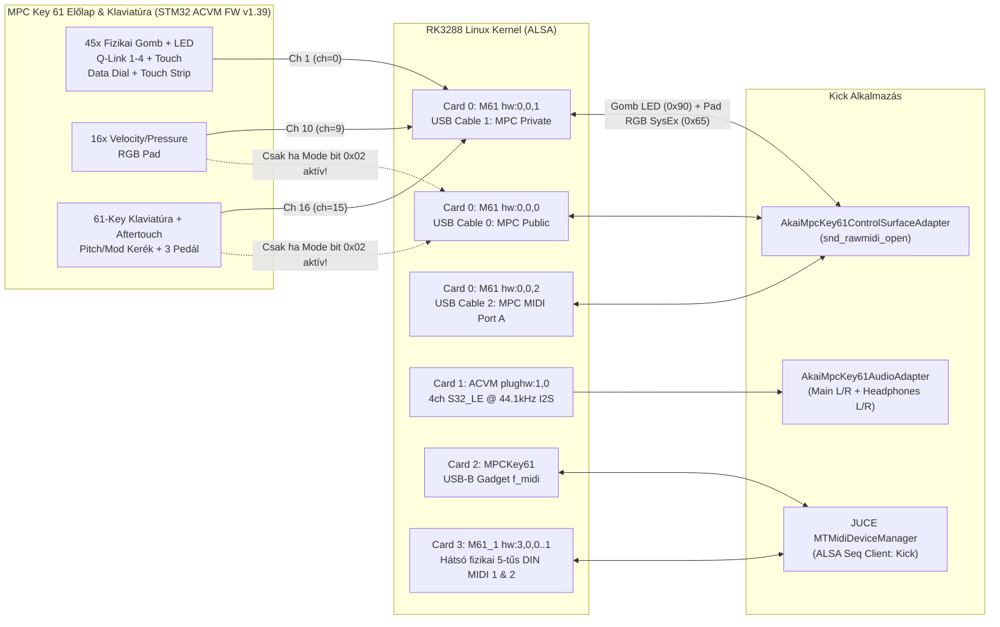
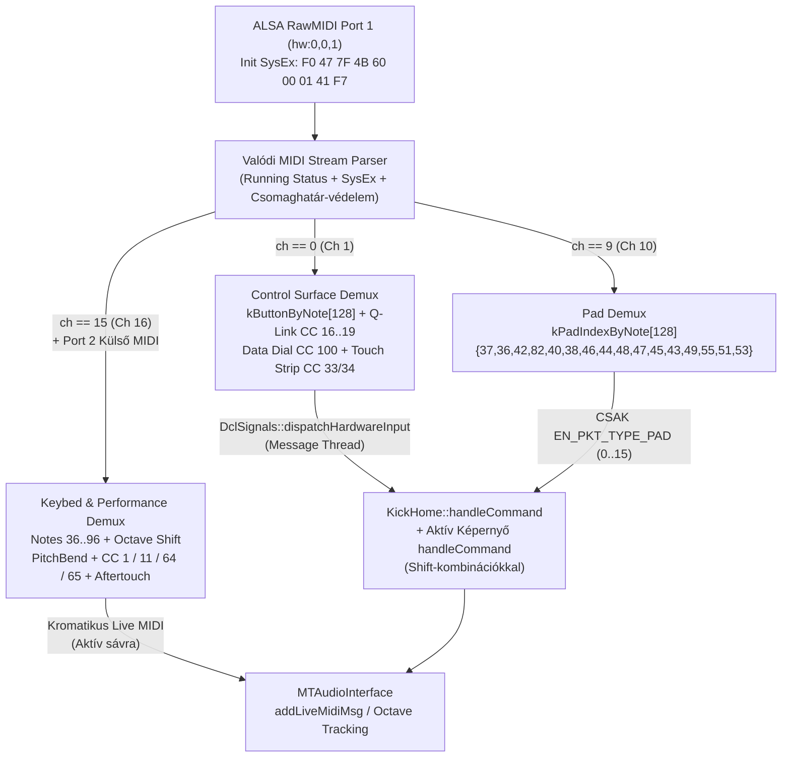

# Akai MPC Key 61 (`ACVM`) Hardveres Protokoll, Jel-térkép és Kick Integrációs Code Review

> [!IMPORTANT]
> Ez a dokumentum az **Akai MPC Key 61** (`ACVM`, USB VID:PID `09e8:004b`, SysEx Device ID `0x4B`, `AcvxHardware::Type = 15`) tényleges vezérlőpanel-firmware-ének (`/usr/share/Akai/SME0/Firmware/ACVM/update.dfu` STM32 bináris) és a gyári `/usr/bin/MPC` (`AcvxHardware`) táblázatainak közvetlen visszafejtésén, valamint a jelenlegi `Kick` és a korábbi `mpc_gui` demó teljes forráskód-auditján alapul.

---

## 1. Vezetői összefoglaló — Miért romlott el, és miért tűnt jónak az első demó?

### 1.1. Miért vált képernyőt most a 61 billentyűs zongora (`C -> Sampler`, `D -> FileBrowser`, `D# -> Track View`), és miért marad ki néha egy-egy hang?
1. **A gyári STM32 firmware Private módban (`hw:0,0,1` / `Port 1`) NEM csak a gombokat küldi át, hanem a 61 billentyűs zongorát, a 16 padot és a kerekeket is — szigorúan MIDI-csatorna (`ch`) szerint szétválasztva:**
   - **`ch == 0` (MIDI Ch 1):** Előlapi fizikai gombok, Q-Link tekerők + érintés, Data Dial, Touch Strip.
   - **`ch == 9` (MIDI Ch 10):** 16 darab nyomásérzékeny RGB Pad.
   - **`ch == 15` (MIDI Ch 16):** 61 billentyűs zongora (`Note 36..96`, `C2..C7`), Pitch Bend, Mod Wheel, Sustain/Expression pedálok.
2. A jelenlegi [`AkaiMpcKey61ControlSurfaceAdapter::handle_packet`](file:///Users/szabi/Documents/Projects/Safian/.worktrees/kick-pr13/Kick/apps/kick/hardware/adapters/akai_mpc_key61_adapter.h#L277-L428) a `port == 1` ágon **teljesen figyelmen kívül hagyja a MIDI-csatornát (`ch`)** (a `ch == 9` pad-ágat leszámítva), kikötötte az `on_keybed_note_on` hívást a `Port 1`-ről, és ~25 darab **találgatott** gomb-Note számot (`37..69`) vett fel, amelyek a valódi MPC Key 61-en nem is léteznek gombként.
3. Ennek következtében amikor a zenész a 61 billentyűs klaviatúrán játszik (`Port 1`, `ch == 15`), az adapter a zongorahangokat előlapi funkciógombnak nézi:
   - **`C3` (`Note 48`)** -> `HW_BTN_SAMPLER` -> átvált **Sampler** képernyőre (`MenuSampler`).
   - **`C#3` (`Note 49`)** -> `HW_BTN_SHIFT` -> lenyeli `SHIFT` módosítóként, képernyőt sem vált és hangot sem ad (**ezért tűnik úgy, hogy „kimarad egy-egy billentyű”!**).
   - **`D3` (`Note 50`)** -> `HW_BTN_BROWSE` -> átvált **File Browser** képernyőre (`MenuFileBrowser`).
   - **`D#3` (`Note 51`)** -> `HW_BTN_MAIN` -> átvált **Main / Track View** képernyőre (`HomeListView`).
   - **`E3` (`Note 52`)** -> `HW_BTN_GRID` -> átvált **Grid View** képernyőre (`HomeGridView`).
   - **`F3` (`Note 53`)** -> `HW_BTN_TAP_TEMPO` -> átállítja a projekt BPM-jét a két billentyűleütés közti időből!
   - **`F#3..G3` (`54..55`)** -> `+/-` gombok (átírja a tempót!).
   - **`G#3..A4` (`56..69`)** -> Kurzorok, Step Seq (`58`), 16 Levels / Next Seq (`59`), Enter / Pad Mute (`60`), Sampler / Track Mute (`61`), Pad Mix (`62`), Track Mix (`63`), Grid (`64`), Undo (`67`).
   - **`B4..C5` (`71..72`), `D5..G5` (`74..79`), `E6..C7` (`88..96`)** -> belefutnak az `else { printf("[AKAI-BTN]..."); }` ágba, így **sem képernyőt nem váltanak, sem hangot nem adnak**.

### 1.2. Miért játszott le korábban minden fizikai gomb magas hangokat (pl. `G8`)?
- A korábbi állapotban (és az `mpc_gui` adapterében: [`akai_mpc_key61_adapter.h`](file:///Users/szabi/Documents/Projects/Safian/.worktrees/kick-pr13/Kick/apps/mpc_gui/hardware/adapters/akai_mpc_key61_adapter.h#L261-L349)) a `Port 1`-en érkező, fel nem ismert `0x90` (Ch 1) gomb-üzenetek beleestek az `else { m_listener->on_keybed_note_on(note, vel); }` ágba.
- Mivel az MPC Key 61 valódi funkciógombjai a `ch == 0` csatornán magas MIDI Note-okat küldenek — pl. **`112` (`G#8` / `G8` környéke) = METRONOME**, **`116` (`G#8`) = MIXER**, **`117` (`A8`) = GRID**, **`121` (`C#9`) = SOUNDS**, **`123` (`D#9`) = MENU** —, ezek gombnyomáskor közvetlenül megszólaltatták a szintetizátort / sávot extrém magas regiszterben.

### 1.3. Miért működött az első demó (`Kick/apps/mpc_gui`) mégis nagyrészt jól?
Az első demó ([`Kick/apps/mpc_gui/main_gui.cpp`](file:///Users/szabi/Documents/Projects/Safian/.worktrees/kick-pr13/Kick/apps/mpc_gui/main_gui.cpp#L1426-L1615)) egy önálló, egyképernyős C/framebuffer prototípus volt, amely három okból elfedte ugyanezeket az adapter-hibákat:
1. **Nem voltak benne képernyőváltások:** A [`KickDawApp::on_button_press`](file:///Users/szabi/Documents/Projects/Safian/.worktrees/kick-pr13/Kick/apps/mpc_gui/main_gui.cpp#L1426-L1531) `switch`-ében a `HW_BTN_MAIN`, `HW_BTN_BROWSE`, `HW_BTN_GRID`, `HW_BTN_SAMPLER` gombokra **nem volt semmilyen képernyőváltó kód** (`default: break;`), így a zongorabillentyűkkel való ütközés nem ugráltatott nézeteket.
2. **Csak ~13 gombot figyelt**, így a 61 billentyű túlnyomó többsége zavartalanul beleesett az `on_keybed_note_on` ágba.
3. **Beépített 21-mintás F9 Grand Piano + 16 WAV dob-motorja volt:** A zongorabillentyűk (`36..96`) azonnal kromatikus zongorahangot szólaltattak meg, a padok pedig fix `36 + pad_idx` dobhangot, függetlenül a `Kick` DAW projekt- és bank-struktúrájától.

---

## 2. Hardver és Linux / ALSA Topológia az MPC Key 61-en

Az MPC Key 61 belsejében egy **Rockchip RK3288** SoC futtatja a Linuxot, amelyhez belső USB-n csatlakozik az előlapi vezérlőpanelt, a 16 RGB padot és a 61 billentyűs Fatar/Akai klaviatúrát kezelő **STM32 (`ACVM`, FW `v1.39`)** mikrokontroller, valamint egy külön USB-hub mögött a hátsó DIN MIDI interfész.



### ALSA Kártyák pontos szerepe
| ALSA Kártya | Eszköznév / Busz | Al-eszközök | Valódi hardveres szerep | Ki nyitja meg? |
|---|---|---|---|---|
| **Card 0 (`M61`)** | `Akai Pro - MPC Key 61` (`USB 1-1`, Full-Speed 12 Mbps, `09e8:004b`) | `hw:0,0,0` (`MPC Public`)<br>`hw:0,0,1` (`MPC Private`)<br>`hw:0,0,2` (`MPC MIDI Port A`) | Az STM32 `ACVM` előlapi és klaviatúra-vezérlő 3 virtuális USB-MIDI kábele | `AkaiMpcKey61ControlSurfaceAdapter` (`snd_rawmidi_open` exkluzívan lefoglalja, így a JUCE ALSA Sequencer nem duplázza meg) |
| **Card 1 (`ACVM`)** | Belső Rockchip Quad I2S kodek | `plughw:1,0` | **4 csatornás** `S32_LE` 44.1 kHz audió: `Ch 0–1` = Hátsó Main Out L/R, `Ch 2–3` = Előlapi Fejhallgató L/R | `AkaiMpcKey61AudioAdapter` |
| **Card 2 (`MPCKey61`)** | Linux USB Gadget `f_midi` | `hw:2,0,0..1` | Hátsó USB-B port számítógép (DAW) felé | JUCE `MTMidiDeviceManager` |
| **Card 3 (`M61_1`)** | `Akai Professional - MPC Key 61` (`USB 3-1.7`, High-Speed hub `09e8:504b` mögött) | `hw:3,0,0` (`MIDI Port 1`)<br>`hw:3,0,1` (`MIDI Port 2`) | A hátlapi fizikai **5-tűs DIN MIDI IN/OUT 1–2** aljzatok! *(Nem a `hw:0,0,2`!)* | JUCE `MTMidiDeviceManager` |

---

## 3. Hitelesített Akai MPC Key 61 (`0x4B`) MIDI Protokoll és Teljes Jel-térkép

### 3.1. SysEx keretformátum és üzemmód-váltás (`msg_id = 0x60`)
Minden Akai MPC Key 61 SysEx üzenet formátuma a `Port 1` (`hw:0,0,1`) csatornán:
```text
F0  47  7F  4B  <msg_id>  <len_msb>  <len_lsb>  <payload...>  F7
│   │   │   │    │         └─── 14-bit hossz ───┘
│   │   │   └── 0x4B = Akai MPC Key 61 (ACVM)
│   │   └────── 0x7F = Broadcast Device ID (válaszban 0x00 vagy 0x7F)
│   └────────── 0x47 = Akai Professional Manufacturer ID
└────────────── SysEx Start
```

Az STM32 firmware (`0x080088A0`, `0x080088D8`) a **`msg_id = 0x60`** üzenet 1 bájtos mód-bitmaszkjával vezérli a portokat:
- **Bekapcsoláskor (alapállapot):** `mode = 0x02` -> csak a **Public (`hw:0,0,0`)** port él, a transzport-gombok pedig nyers gombkódok helyett publikus MMC / CC (`116..119`) üzeneteket küldenek.
- **Bit `0x01`:** Engedélyezi a **Private (`hw:0,0,1`)** portot (minden gomb, LED, RGB pad, Q-Link, Touch Strip **és** a klaviatúra/padok is itt jönnek).
- **Bit `0x02`:** Engedélyezi a **Public (`hw:0,0,0`)** portot is. *(Ha a `0x01` és `0x02` egyszerre 1 — pl. `0x03` vagy `0x43` —, akkor a klaviatúra és a padok **mindkét porton egyszerre** megérkeznek -> dupla hangok!)*
- **Bit `0x40` (`0x20 | 0x40`):** Letiltja a publikus transzport CC-átkódolást (`0x080091A6..0x08009238`), így a `PLAY`, `STOP`, `REC`, `OVERDUB`, `<`, `>`, `<<`, `>>` gombok garantáltan tiszta `0x90 <note> <0x7F/0x00>` gomb-üzeneteket küldenek a `Port 1`-en.

> [!TIP]
> **Ajánlott Standalone Init SysEx (`Port 1` / `hw:0,0,1`):**
> `F0 47 7F 4B 60 00 01 41 F7` (`mode = 0x41` = `0x40 | 0x01`).
> Ez kizárólag a `Port 1` (`MPC Private`) csatornát aktiválja tiszta standalone módban, megszünteti a `Port 0` / `Port 1` duplikációt, és kikapcsolja a publikus CC-transzport átkódolást.

---

### 3.2. Az 1. számú vastörvény: Szigorú MIDI-csatorna multiplexelés (`Port 1`)

Az STM32 firmware minden fizikai bemeneti csoportot **külön, dedikált MIDI-csatornára** ültet. Csatornaszűrés nélkül a gombok, padok és zongorabillentyűk Note-számai átfedik egymást!

| 0-indexelt `ch` | MIDI Csatorna | Státuszbájtok | Fizikai hardver-csoport | Megjegyzés |
|---|---|---|---|---|
| **`ch == 0`** | **Channel 1** | `0x90`, `0x80`, `0xB0` | **Előlapi vezérlőfelület:** 45 fizikai gomb, 4 Q-Link tekerő + 4 érintésérzékelő, Data Dial, Touch Strip (ujj + 14-bit pozíció) | **SOHA** nem hangszeres hang! |
| **`ch == 9`** | **Channel 10** | `0x99`, `0x89`, `0xA9` | **16 RGB Performance Pad** (leütés, felengedés, polifonikus nyomás / Aftertouch) | Nemlineáris Akai Bank A Note-tábla! |
| **`ch == 15`** | **Channel 16** | `0x9F`, `0x8F`, `0xBF`, `0xDF`, `0xEF` | **61 billentyűs zongora (`36..96`)**, Channel Aftertouch, Pitch Bend kerék, Mod Wheel (`CC 1`), Expression (`CC 11`), Sustain (`CC 64`), Footswitch (`CC 65`) | **SOHA** nem előlapi gomb! |

---

### 3.3. Mind a 45 előlapi fizikai gomb hitelesített táblázata (`Port 1`, `ch == 0`)

- **Lenyomás (Press):** `0x90 <note> 0x7F` (`velocity = 127`)
- **Felengedés (Release):** `0x90 <note> 0x00` (`velocity = 0`, egyes esetekben `0x80 <note> 0x00` — mindkettőt felengedésként kell kezelni!)
- Forrás: STM32 `acvm_fw.bin` (`0x0801E460..0x0801E497`) + `/usr/bin/MPC` (`AcvxHardware` `0x01c0b258`).

| MIDI Note (Dec) | Hex | Gyári `ButtonId` (`/usr/bin/MPC`) | Fizikai felirat az MPC Key 61 előlapján *(+Shift felirat)* | Megfelelő `Kick` DCL / Funkció | Jelenlegi `Kick` adapterben mi volt? |
|---:|---|---|---|---|---|
| **`0`** | `0x00` | `QLINK_BANK` (`90`) | **Q-LINK** *(+Shift: Q-Link Edit)* | `EN_LINK` / *+Shift:* `EN_LINK_EDIT` (`MenuKnobEdit`) | ❌ Hiányzott |
| **`2`** | `0x02` | `MODE_PROGRAM_EDIT` (`0`) | **PROGRAM EDIT** *(+Shift: MIDI Control)* | `EN_PROG_EDIT` (`MenuProgramEdit`) / *+Shift:* `EN_MIDI_CONTROL` | ❌ Hibásan `45`-re volt drótozva! |
| **`4`** | `0x04` | `STRIP` (`163`) | **TOUCH STRIP** *(+Shift: Touch Strip Config)* | Touch Strip mód / `EN_FX` | ❌ Hiányzott |
| **`6`** | `0x06` | `MODE_SAMPLE_EDIT` (`3`) | **SAMPLE EDIT** *(+Shift: Sampler)* | `EN_SAMPLE_EDIT` (`MenuSampleEdit`) / *+Shift:* `EN_SAMPLER` (`MenuSampler`) | ❌ Hibásan `46` és `48` volt! |
| **`7`** | `0x07` | `OCT_DOWN` (`169`) | **OCT -** (klaviatúra bal oldalán) | Klaviatúra oktáv le (`-12` félhang, `OCT-` + `OCT+` együtt = `0` reset) | ✅ `7` |
| **`9`** | `0x09` | `ERASE` (`79`) | **ERASE** | `EN_ERASE` | ⚠️ `9 \|\| 21` (`ch` szűrés nélkül) |
| **`10`** | `0x0A` | `OCT_UP` (`170`) | **OCT +** (klaviatúra bal oldalán) | Klaviatúra oktáv fel (`+12` félhang) | ✅ `10` |
| **`11`** | `0x0B` | `NOTE_REPEAT` (`80`) | **NOTE REPEAT** *(+Shift: Latch)* | `EN_NOTE_REPEAT` / *+Shift:* `EN_LATCH` | ✅ `11` |
| **`12`** | `0x0C` | `TC` (`108`) | **TIMING CORRECT** *(+Shift: On/Off)* | `EN_TC` / *+Shift:* `EN_ON_OFF` | ❌ Hiányzott |
| **`35`** | `0x23` | `PAD_BANK_A` (`11`) | **BANK A** *(+Shift: Bank E)* | `EN_BANK_A` / *+Shift:* `EN_BANK_E` | ❌ Hibásan `35` Tap Tempo volt, Bank A pedig `106`! |
| **`36`** | `0x24` | `PAD_BANK_B` (`12`) | **BANK B** *(+Shift: Bank F)* | `EN_BANK_B` / *+Shift:* `EN_BANK_F` | ❌ Hibásan `107` volt (`36` pedig `C2` zongorahanggal ütközött volna!) |
| **`37`** | `0x25` | `PAD_BANK_C` (`13`) | **BANK C** *(+Shift: Bank G)* | `EN_BANK_C` / *+Shift:* `EN_BANK_G` | ❌ Hibásan `37` `MENU` volt, Bank C pedig `108`! |
| **`38`** | `0x26` | `PAD_BANK_D` (`14`) | **BANK D** *(+Shift: Bank H)* | `EN_BANK_D` / *+Shift:* `EN_BANK_H` | ❌ Hibásan `38` `NEXT_SEQ` volt, Bank D pedig `109`! |
| **`39`** | `0x27` | `FULL_LEVEL` (`16`) | **FULL LEVEL** *(+Shift: Half Level)* | `EN_FULL_LEVEL` / *+Shift:* `EN_HALF_LEVEL` | ⚠️ `39`, de `ch` szűrés nélkül elkapta a `D#2` zongorahangot! |
| **`40`** | `0x28` | `SIXTEEN_LEVEL` (`17`) | **16 LEVEL** *(+Shift: Notes / Pad Perform)* | `EN_16LEVELS` / *+Shift:* `EN_NOTES` (`MenuPadPerform`) | ⚠️ `40`, de `ch` szűrés nélkül elkapta az `E2` zongorahangot! |
| **`42`** | `0x2A` | `TOUCHFX` (`165`) | **TOUCH FX** *(+Shift: XYFX)* | `EN_FX` (`HomeXYView`) | ❌ Hibásan `TRACK_MUTE` volt, és elkapta az `F#2` billentyűt! |
| **`43`** | `0x2B` | `ACVM_MUTE` (`175`) | **MUTE** *(+Shift: Pad Mute)* | `EN_TRACK_MUTE` (`MenuTrackMute`) / *+Shift:* `EN_PAD_MUTE` (`MenuPadMute`) | ❌ Hibásan `PAD_MIX` volt, és elkapta a `G2` billentyűt! |
| **`49`** | `0x31` | `SHIFT` (`72`) | **SHIFT** (jobb oldali fő Shift gomb) | `EN_SHIFT` (módosító #1) | ⚠️ `49`, de `ch` szűrés nélkül lenyelte a `C#3` billentyűt! |
| **`50`** | `0x32` | `SHIFT2` (`174`) | **SHIFT** (bal oldali, klaviatúra melletti Shift) | `EN_SHIFT` (módosító #2) | ❌ Hibásan `HW_BTN_BROWSE` volt -> `D3` zongorabillentyű File Browsert nyitott! |
| **`52`** | `0x34` | `MAIN` (`76`) | **MAIN** *(+Shift: Track View / Grid)* | `EN_MAINMODE` (`HomeListView`) | ❌ Hibásan `51` volt `MAIN`, `52` pedig `GRID` (`D#3` és `E3` billentyűk!) |
| **`53`** | `0x35` | `TAP_TEMPO` (`77`) | **TAP** *(+Shift: Master)* | `EN_TAP_TEMPO` / *+Shift:* `EN_MASTER` | ⚠️ `53`, de `ch == 15` engedélyezve volt -> az `F3` zongorabillentyű elállította a BPM-et! |
| **`54`** | `0x36` | `DATA_PLUS` (`26`) | **+** (Data Dial alatt) | `EN_PLUS` | ⚠️ `54`, de `ch` szűrés nélkül elkapta az `F#3` billentyűt! |
| **`55`** | `0x37` | `DATA_MINUS` (`27`) | **-** (Data Dial alatt) | `EN_MINUS` | ⚠️ `55`, de `ch` szűrés nélkül elkapta a `G3` billentyűt! |
| **`67`** | `0x43` | `UNDO` (`78`) | **UNDO** *(+Shift: Redo)* | Undo / *+Shift:* Redo | ⚠️ `67`, de `ch` szűrés nélkül elkapta a `G4` billentyűt! |
| **`68`** | `0x44` | `STEP_PREV` (`33`) | **<** (Step / Event balra) | Step hátra / Kurzor balra | ⚠️ `68`, de `ch` szűrés nélkül elkapta a `G#4` billentyűt! |
| **`69`** | `0x45` | `STEP_NEXT` (`34`) | **>** (Step / Event jobbra) | Step előre / Kurzor jobbra | ⚠️ `69`, de `ch` szűrés nélkül elkapta az `A4` billentyűt! |
| **`70`** | `0x46` | `LOCATE` (`35`) | **LOCATE** | Locate / Ugrás ütemre | ❌ Hiányzott (`A#4` billentyű is `70`) |
| **`71`** | `0x47` | `BAR_PREV` (`36`) | **<<** (Ütem eleje / vissza) | Ütem vissza (`Bar -1`) | ❌ Hiányzott |
| **`72`** | `0x48` | `BAR_NEXT` (`37`) | **>>** (Ütem előre) | Ütem előre (`Bar +1`) | ❌ Hiányzott |
| **`73`** | `0x49` | `RECORD` (`38`) | **REC** | `EN_RECORD` | ⚠️ `73`, de `ch` szűrés nélkül elkapta a `C#5` billentyűt! |
| **`75`** | `0x4B` | `AUTOMATION` (`177`) | **READ / WRITE** (Automation) | `EN_AUTOMATION` | ❌ Hiányzott |
| **`80`** | `0x50` | `OVERDUB` (`39`) | **OVERDUB** | `EN_OVERDUB` | ⚠️ `80`, de `ch` szűrés nélkül elkapta a `G#5` billentyűt! |
| **`81`** | `0x51` | `STOP` (`40`) | **STOP** | `EN_STOP` | ⚠️ `81`, de `ch` szűrés nélkül elkapta az `A5` billentyűt! |
| **`82`** | `0x52` | `PLAY` (`41`) | **PLAY** | `EN_PLAY` | ⚠️ `82`, de `ch` szűrés nélkül elkapta az `A#5` billentyűt! |
| **`83`** | `0x53` | `PLAY_START` (`42`) | **PLAY START** | `EN_PLAYSTART` | ⚠️ `83`, de `ch` szűrés nélkül elkapta a `B5` billentyűt! |
| **`111`** | `0x6F` | `CURSOR_CENTRE` (`30`) | **DATA DIAL PUSH** (jog-kerék benyomása) | `EN_KNOB_ENTER` | ⚠️ `111 \|\| 60` (`60` elkapta a középső `C4` zongorabillentyűt!) |
| **`112`** | `0x70` | `METRONOME` (`164`) | **METRONOME** | Metronóm be/ki *(korábban `G#8` hangot játszott!)* | ❌ Hiányzott |
| **`116`** | `0x74` | `ACVM_MIX` (`176`) | **MIXER** *(+Shift: Pad Mixer)* | `EN_TRACK_MIX` (`MenuChannelMixer`) / *+Shift:* `EN_PAD_MIX` (`MenuPadMixer`) | ❌ Hibásan `OVERDUB` volt! |
| **`117`** | `0x75` | `GRID` (`167`) | **GRID** *(+Shift: Step Seq)* | `EN_GRID` (`HomeGridView`) / *+Shift:* `EN_STEP_SEQ` (`HomeSequencerView`) | ❌ Hibásan `STOP` volt! |
| **`118`** | `0x76` | `ARP` (`171`) | **ARP / CHORD** | Note Repeat / Arpeggiator *(+Shift: Chord / Pad Perform)* | ❌ Hibásan `PLAY` volt! |
| **`119`** | `0x77` | `ARP_LATCH` (`172`) | **LATCH** | `EN_LATCH` | ❌ Hibásan `REC` volt! |
| **`120`** | `0x78` | `KEYBOARD_CONTROL` (`168`) | **KEY RANGES / KEYBOARD CONTROL** | `EN_MIDI_CONTROL` / Keygroup tartomány | ❌ Hiányzott |
| **`121`** | `0x79` | `SOUNDS` (`166`) | **SOUNDS** *(+Shift: Browse / Favorites)* | `EN_BROWSE` (`MenuFileBrowser`) *(+Shift: `MenuNextSequence` / Favorites)* | ❌ Hiányzott *(korábban `C#9` hangot játszott!)* |
| **`122`** | `0x7A` | `COPY` (`91`) | **COPY** *(+Shift: Delete / Save)* | `EN_COPY` / *+Shift:* `EN_SAVE` | ❌ Hiányzott |
| **`123`** | `0x7B` | `MENU` (`75`) | **MENU** *(+Shift: Preferences)* | `EN_MENU` (`HomeOptions`) / *+Shift:* `EN_PREF` (`HomePreferencesView`) | ✅ `123` (de mellette a hibás `37` is ott volt) |

---

### 3.4. Tekerők, Érintésérzékelők és Touch Strip (`Port 1`, `ch == 0`)

| Hardver elem | MIDI Csatorna | Üzenet típusa | Pontos bájtok / Értéktartomány | Jelenlegi `Kick` adapter állapota |
|---|---|---|---|---|
| **Q-Link 1..4 forgatás** | `ch == 0` | Control Change (`0xB0`) | **`CC 16, 17, 18, 19`** (`0x10..0x13`), kettes komplemens relatív: `1..63` = `+1..+63` jobbra, `127..65` = `-1..-63` balra | ⚠️ Működött, de `ch == 0` szűrés nélkül (`CC 16..19` bármely csatornán) |
| **Q-Link 1..4 kapacitív érintés** | **`ch == 0`** | Note On/Off (`0x90` / `0x80`) | **`Note 84, 85, 86, 87`** (`0x54..0x57`), érintés = `0x90 <n> 0x7F`, elengedés = `0x80 <n> 0x00` | ❌ **Hibás!** Az adapter `ch == 15`-öt várt (`akai_mpc_key61_adapter.h:299`), így a Q-Link érintés sosem működött, viszont elnyelte a `C6..D#6` zongorabillentyűket! |
| **Data Dial (Jog kerék) forgatás** | **`ch == 0`** | Control Change (`0xB0`) | **`CC 100`** (`0x64`), kettes komplemens relatív (`1..63` CW, `127..65` CCW) | ❌ **Hibás!** Az adapter `CC 60`-at (`0x3C`) figyelt (`akai_mpc_key61_adapter.h:494`), így a fizikai Data Dial forgatása egyáltalán nem működött! |
| **Touch Strip ujj-érintés** | **`ch == 0`** | Note On/Off (`0x90` / `0x80`) | **`Note 78`** (`0x4E`), érintés = `0x90 0x4E 0x7F`, elemelés = `0x80 0x4E 0x00` | ❌ Hiányzott |
| **Touch Strip pozíció (14-bit)** | **`ch == 0`** | Control Change (`0xB0`) | **`CC 33`** (`0x21` = MSB, felső 7 bit `0..127`) + **`CC 34`** (`0x22` = LSB, alsó 7 bit `0..127`) | ⚠️ `CC 33` részben bekötve (`CC 69` felesleges), `ch == 0` szűrés nélkül |

---

### 3.5. A 16 RGB Performance Pad (`Port 1`, `ch == 9` / MIDI Channel 10)

> [!WARNING]
> Az MPC Key 61 fizikai padjai **NEM** lineáris `36..51` MIDI Note-okat küldenek! Az STM32 firmware (`0x0801E4A5`) és a `/usr/bin/MPC` (`0x047B4F50`) is a klasszikus Akai MPC Bank A dob-kiosztást használja. A jelenlegi `pad_idx = note - 36` képlet miatt a padok fele rossz helyre szólt, a **Pad 4 (`Note 82`)**, **Pad 14 (`Note 55`)** és **Pad 16 (`Note 53`)** pedig teljesen néma maradt (`pad_idx >= 16`)!

Fizikai elrendezés (alulról felfelé: Pad 1 = bal alsó, Pad 16 = jobb felső):

| Fizikai sor (fentről le) | Bal szélső oszlop | 2. oszlop | 3. oszlop | Jobb szélső oszlop |
|---|---|---|---|---|
| **4. sor (felső)** | **Pad 13** (`idx 12`): **Note `49`** (`0x31`) | **Pad 14** (`idx 13`): **Note `55`** (`0x37`) | **Pad 15** (`idx 14`): **Note `51`** (`0x33`) | **Pad 16** (`idx 15`): **Note `53`** (`0x35`) |
| **3. sor** | **Pad 9** (`idx 8`): **Note `48`** (`0x30`) | **Pad 10** (`idx 9`): **Note `47`** (`0x2F`) | **Pad 11** (`idx 10`): **Note `45`** (`0x2D`) | **Pad 12** (`idx 11`): **Note `43`** (`0x2B`) |
| **2. sor** | **Pad 5** (`idx 4`): **Note `40`** (`0x28`) | **Pad 6** (`idx 5`): **Note `38`** (`0x26`) | **Pad 7** (`idx 6`): **Note `46`** (`0x2E`) | **Pad 8** (`idx 7`): **Note `44`** (`0x2C`) |
| **1. sor (alsó)** | **Pad 1** (`idx 0`): **Note `37`** (`0x25`) | **Pad 2** (`idx 1`): **Note `36`** (`0x24`) | **Pad 3** (`idx 2`): **Note `42`** (`0x2A`) | **Pad 4** (`idx 3`): **Note `82`** (`0x52`) |

- **Pad leütés:** `0x99 <hw_pad_note> <vel 1..127>`
- **Pad felengedés:** `0x89 <hw_pad_note> <vel>` (vagy `0x99 <hw_pad_note> 0x00`)
- **Pad nyomás (Polyphonic Aftertouch):** `0xA9 <hw_pad_note> <pressure 0..127>`

---

### 3.6. A 61 billentyűs klaviatúra, kerekek és pedálok (`Port 1`, `ch == 15` / MIDI Channel 16)

| Bemenet | Csatorna | MIDI Üzenet | Tartomány / Értelmezés |
|---|---|---|---|
| **61 billentyűs klaviatúra** | **`ch == 15`** | `0x9F <note> <vel 1..127>` / `0x8F <note> 0x00` | **`Note 36..96`** (`C2..C7`). Az `OCT -` / `OCT +` gombokat a host szoftver (`Kick`) alkalmazza (`±12` félhang léptékkel, aktív lefogott hangok ragadásmentes követésével)! |
| **Keybed Channel Aftertouch** | **`ch == 15`** | `0xDF <pressure>` | `0..127` monofonikus csatorna-utónyomás |
| **Pitch Bend kerék** | **`ch == 15`** | `0xEF <lsb> <msb>` | 14-bit (`0..16383`, középállás = `8192` / `0x2000`) |
| **Modulation kerék** | **`ch == 15`** | `0xBF 0x01 <val>` | **`CC 1`**, `0..127` |
| **Expression pedál** | **`ch == 15`** | `0xBF 0x0B <val>` | **`CC 11`**, `0..127` |
| **Sustain pedál** | **`ch == 15`** | `0xBF 0x40 <val>` | **`CC 64`**, `0` (felengedve) / `127` (lenyomva) |
| **Footswitch 2 pedál** | **`ch == 15`** | `0xBF 0x41 <val>` | **`CC 65`**, `0` / `127` |

---

### 3.7. Kimenő LED-vezérlés az előlap felé (`Port 1` OUT / `m_out1`)

1. **Előlapi gomb-LED-ek (`0x90 <button_note> <level>`, `ch == 0`):**
   - **Egyszínű LED-es gombok** (`0x080160A4`):
     - `0` = Kikapcsolva
     - `1` = Halvány (`Dim`, PWM `31/255` — háttérvilágítás aktív funkcióhoz)
     - `2..127` (`127`) = Teljes fényerő (`Full`, PWM `255/255` — kiválasztott/aktív állapot)
   - **Kétszínű (Bi-Color, pl. Piros/Zöld vagy Sárga/Piros) LED-es gombok** (`0x080160BA`, pl. `REC`, `OVERDUB`, `PLAY`, `MUTE`, `PAD BANK`):
     - `0` = Kikapcsolva, `1` = Halvány A szín, `2` = Halvány B szín, `3` = Teljes A szín, `4` = Teljes B szín, `>=5` = Kevert.
2. **16 RGB Pad LED-ek (`SysEx msg_id = 0x65` a `m_out1`-en):**
   ```text
   F0 47 7F 4B 65 <len_msb> <len_lsb> [ <pad_idx 0..15> <R 0..127> <G 0..127> <B 0..127> ] ... F7
   ```
   Egyetlen `0x65` SysEx üzenetben 1..16 pad (`4 * N` bájt payload) egyszerre frissíthető atomi módon.
3. **Touch Strip LED-sor (`m_out1`):** `0xB0 0x21 <0..127>` (`CC 33`).

---

## 4. Részletes Code Review — Mi hol van összekeveredve a `Kick` kódbázisban?

### Hiba #1: MIDI-csatorna ignorálása és kitalált gombszámok az [`akai_mpc_key61_adapter.h`](file:///Users/szabi/Documents/Projects/Safian/.worktrees/kick-pr13/Kick/apps/kick/hardware/adapters/akai_mpc_key61_adapter.h#L277-L517)-ban
- A [`handle_packet`](file:///Users/szabi/Documents/Projects/Safian/.worktrees/kick-pr13/Kick/apps/kick/hardware/adapters/akai_mpc_key61_adapter.h#L286-L415) `if (port == 1)` blokkjában a gombokra vonatkozó `else if (note == ...)` lánc **nem ellenőrzi a `ch == 0` feltételt**, miközben a `ch == 15` klaviatúra-események ugyanúgy a `port == 1`-en érkeznek.
- A kód tele van más Akai modellekből (pl. MPC One / Live / Studio) vagy találgatásból származó Note-számokkal (`37..69`, `106..109`, `CC 60`), amelyek ütköznek a klaviatúrával és elrontják a valódi gombokat (`BANK A..D`, `MAIN`, `GRID`, `MIXER`, `MUTE`, `SOUNDS`, `PROG EDIT`, `SAMPLE EDIT`, `SHIFT2`, `DATA DIAL`).

### Hiba #2: Hibás bájtfolyam-olvasó (`for` ciklus MIDI állapotgép nélkül) és vak MIDI továbbküldés
- A [`handle_packet`](file:///Users/szabi/Documents/Projects/Safian/.worktrees/kick-pr13/Kick/apps/kick/hardware/adapters/akai_mpc_key61_adapter.h#L280-L516) naiv `for (ssize_t i = 0; i < n; ++i)` ciklusa feltételezi, hogy minden `snd_rawmidi_read` hívás pontosan 3 bájtos csomaghatáron ér véget, és nincs **MIDI Running Status** vagy töredékes SysEx. Gyors akkordjáték, Q-Link tekerés vagy Touch Strip húzás közben egy csomaghatárra eső bájt félrecsúszhat, adatbájtot státuszbájtnak értelmezve.
- A [`run()`](file:///Users/szabi/Documents/Projects/Safian/.worktrees/kick-pr13/Kick/apps/kick/hardware/adapters/akai_mpc_key61_adapter.h#L530-L534) ciklus minden belső, privát `m_in1` bájtot vakon kiír az `m_out2` (`hw:0,0,2`) portra (`if (m_out2) snd_rawmidi_write(m_out2, buf, n);`), kiszivárogtatva a belső előlapi vezérlőjeleket.

### Hiba #3: Szál-nem-biztos közvetlen UI-hívások és a natív `DCL` megkerülése a [`KickHardwareBridge`](file:///Users/szabi/Documents/Projects/Safian/.worktrees/kick-pr13/Kick/apps/kick/kick_hardware_bridge.h#L324-L573)-ben
- Az `on_button_press` közvetlenül az ALSA RawMIDI **háttér-`pthread`-ből** hívja a `kick_ui::signals::sigScreenClose(...)`, `ae.setSequencePlay(...)` és `ae.getUndoManager().undo()` függvényeket! A JUCE komponensfát háttérszálról módosítani adatversenyhez (race condition) és váratlan fagyáshoz vezet.
- Eközben a `Kick` már rendelkezik egy kész, szálbiztos központi hardver-diszpécserrel:
  1. [`contracts::DclSignals::dispatchHardwareInput`](file:///Users/szabi/Documents/Projects/Safian/.worktrees/kick-pr13/Kick/modules/contracts/dcl/dcl_signals.cpp#L45-L58) automatikusan átadja az üzenetet a JUCE Message Threadre (`MessageManager::callAsync`), kezeli az `EN_SHIFT` állapotot (`shiftBtnState`), és figyelembe veszi a felugró dialógusok `claimHardwareInput` zárait!
  2. [`KickHome::handleCommand`](file:///Users/szabi/Documents/Projects/Safian/.worktrees/kick-pr13/Kick/modules/kick_ui/dialogs/kick_AppHome.cpp#L394-L539) **már eleve tartalmazza** az összes képernyőváltást (`EN_BROWSE`, `EN_PAD_MIX`, `EN_TRACK_MIX`, `EN_PAD_MUTE`, `EN_TRACK_MUTE`, `EN_NEXT_SEQ`, `EN_FX`, `EN_STEP_SEQ`, `EN_SAMPLER`, `EN_SAMPLE_EDIT`, `EN_PROG_EDIT`, `EN_MIDI_CONTROL`, `EN_NOTES`, `EN_MENU`, `EN_MAINMODE`, `EN_GRID`, `EN_PREF`) és a `EN_BANK_A..H` váltást!
  3. Ugyanezt a tiszta DCL útvonalat használja a Mac hardver-nézet is a [`kick_hardware_controls.h`](file:///Users/szabi/Documents/Projects/Safian/.worktrees/kick-pr13/Kick/apps/kick/kick_hardware_controls.h#L40-L80)-ban (`sendDclPad`, `sendDclButton`, `sendDclKnob`, `sendDclSlider`).

### Hiba #4: Dupla és elcsúszott oktávú Pad-hangindítás (`0..15` vs. `36..51`)
- A [`KickHardwareBridge::on_pad_note_on`](file:///Users/szabi/Documents/Projects/Safian/.worktrees/kick-pr13/Kick/apps/kick/kick_hardware_bridge.h#L673-L686) **egyszerre két dolgot csinál**:
  1. Beküldi a `CPktMgr::EN_PKT_TYPE_PAD` (`pad_num = 0..15`) DCL csomagot.
  2. Közvetlenül utána meghívja az `addLiveMidiNote(selected, 36 + pad_num, vel)` függvényt!
- Miért hibás ez?
  - A `Kick` motorjában a [`MTAudioInterface::getBankOffset()`](file:///Users/szabi/Documents/Projects/Safian/.worktrees/kick-pr13/Kick/modules/engine/audio_engine/engine/mt_audio_interface.cpp#L208) képlete `bankIndex * 16`, és az [`AppMainmode::handleCommand`](file:///Users/szabi/Documents/Projects/Safian/.worktrees/kick-pr13/Kick/modules/kick_ui/dialogs/kick_AppMainMode.cpp#L393-L416) (valamint az `AppGrid`, `PadMixer`, `StepSequencer` stb.) az `EN_PKT_TYPE_PAD` csomagból **már eleve lejátssza** a `padNo + bankOffset` (`Bank A = 0..15`, `Bank B = 16..31`, `Bank C = 32..47`, `Bank D = 48..63`) MIDI hangot!
  - Ráadásul `Pad Mute`, `Track Mute` vagy `Next Sequence` képernyőn a padok leütésének **némítania vagy szekvenciát váltania kell, nem pedig fix `36..51` hangot ütnie**! (Ezért nem hív `addLiveMidiNote`-ot a Mac-es [`HardwarePad`](file:///Users/szabi/Documents/Projects/Safian/.worktrees/kick-pr13/Kick/apps/kick/kick_hardware_controls.h#L100-L109) sem.)

### Hiba #5: A [`Demo 01.kickPrj`](file:///Users/szabi/Documents/Projects/Safian/.worktrees/kick-pr13/Kick/demos/Demo%2001/Demo%2001.kickPrj#L106-L463) rossz Note-tartománya és a dallamhangszer hiánya
1. A `Demo 01.kickPrj`-ben a `DnB Kit` (`type="0"`, Drum Program) 16 klipje `keyNote="36..51"`-re lett kézzel beírva a `Kick` szabványos **Bank A (`keyNote="0..15"`)** tartománya helyett (vö. `ProperDnB.kickPrj`, ahol a dobok `0..7`-en vannak). Emiatt a `Kick` saját képernyőn lévő Bank A (`A01..A16`) padjai üresek voltak, a `36..51` pedig valójában a C05..D04 bankba esett, és ráült a 61 billentyűs zongora alsó oktávjára (`C2..D#3`)!
2. Mindhárom sáv (`Drums`, `Bass`, `Lead & FX`) **ugyanarra az egyetlen Drum Programra (`DxIfBT3g`)** mutat! Nincs a projektben egyetlen **`Keygroup` (`type="1"`)** kromatikus zongora/szinti program sem, így a 61 billentyűs klaviatúrán az `52..96` (`E3..C7`) tartományban leütött hangokhoz egyáltalán nincs hozzárendelt hangminta.

### Hiba #6: A `/data/kick_cmd` teszt-FIFO megkerülte az adaptert
- A [`KickHardwareBridge::processCommand`](file:///Users/szabi/Documents/Projects/Safian/.worktrees/kick-pr13/Kick/apps/kick/kick_hardware_bridge.h#L731-L826) közvetlenül az `on_button_press(HW_BTN_...)` és `on_pad_note_on(...)` metódusokat hívta, így az automatizált tesztek 100%-ban kikerülték az `AkaiMpcKey61ControlSurfaceAdapter::handle_packet` MIDI-dekódolóját. Ezért nem bukott ki automatikus teszteléskor a csatorna- és Note-összekeveredés.

---

## 5. Cél-architektúra és Javítási Terv („Mit és hogyan kell megcsinálni?”)

Az alábbi 6 lépéses, tiszta architektúra véglegesen szétválasztja a vezérlőfelületet, a 16 padot és a 61 billentyűs klaviatúrát, miközben 100%-ban a `Kick` natív `DCL` csatornájára épít:



### 1. lépés: Valódi MIDI bájtszintű állapotgép és `0x41` Private mód (`akai_mpc_key61_adapter.h`)
1. **Init SysEx cseréje:** `F0 47 7F 4B 60 00 01 41 F7` küldése a `m_out1`-re (`Port 1`), hogy csak a `Port 1` (`MPC Private`) küldjön eseményeket (nulla duplikáció a `Port 0`-val, nulla transzport CC-átkódolás).
2. **`m_in1 -> m_out2` vak továbbküldés törlése** a [`run()`](file:///Users/szabi/Documents/Projects/Safian/.worktrees/kick-pr13/Kick/apps/kick/hardware/adapters/akai_mpc_key61_adapter.h#L525-L533) ciklusból (`poll()` alapú várakozással az `usleep(1000)` helyett).
3. **Valódi bájtonkénti MIDI parser (`PortParserState` portonként):**
   - Kezeli a `0xF8..0xFF` Real-Time bájtokat üzenet közben is.
   - Kezeli a `0xF0..0xF7` változó hosszúságú SysEx üzeneteket csomaghatárokon átívelően.
   - Megőrzi a `running_status`-t és az 1 vagy 2 adatbájtos üzeneteket (`0xC0/0xD0` = 1 adatbájt; `0x80/0x90/0xA0/0xB0/0xE0` = 2 adatbájt), így soha nem csúszhat el csomaghatáron!

### 2. lépés: Szigorú csatorna-alapú O(1) Lookup táblák (`akai_mpc_key61_adapter.h`)
1. **`ch == 0` (`Port 1`) -> Kizárólag vezérlőfelület:**
   - Egyetlen konstans, 128 elemű `kAcvmButtonByNote[128]` tábla a fenti **3.3. táblázat** pontos 45 gombjával (minden más index `HW_BTN_NONE`).
   - `Note 84..87` (`ch == 0`) -> `on_encoder_touch(note - 84, pressed)`.
   - `Note 78` (`ch == 0`) -> Touch Strip érintés.
   - `CC 16..19` (`ch == 0`) -> Q-Link `0..3` relatív forgatás.
   - **`CC 100` (`ch == 0`)** -> `on_jog_dial(delta)` (a hibás `CC 60` helyett!).
   - `CC 33` / `CC 34` (`ch == 0`) -> Touch Strip pozíció.
2. **`ch == 9` (`Port 1`) -> Kizárólag a 16 Pad:**
   - Konstans `kAcvmPadNotes[16] = { 37, 36, 42, 82, 40, 38, 46, 44, 48, 47, 45, 43, 49, 55, 51, 53 }` inverz lookup táblája (`kPadIdxByNote[128]`, alapérték `-1`).
   - `0xA9` Polyphonic Aftertouch továbbítása.
3. **`ch == 15` (`Port 1`) -> Kizárólag a 61 billentyűs klaviatúra, kerekek és pedálok:**
   - `0x9F` (`vel > 0`) -> `on_keybed_note_on(note, vel)`
   - `0x8F` vagy `0x9F` (`vel == 0`) -> `on_keybed_note_off(note)`
   - `0xEF` -> `on_pitch_bend((msb << 7) | lsb)`
   - `0xDF` -> Channel Aftertouch
   - `0xBF` -> `CC 1` (Mod Wheel), `CC 11` (Expression), `CC 64` (Sustain), `CC 65` (Footswitch).
   - **Semmilyen körülmények között nem hívhat gomb- vagy képernyőváltó függvényt a `ch == 15`!**

### 3. lépés: `KickHardwareBridge` bekötése a szálbiztos `DCL` csatornára (`kick_hardware_bridge.h`)
1. **Közvetlen `sigScreenClose` hívások megszüntetése a RawMIDI szálról:** Minden gombnyomás és felengedés `CPktMgr::HWMsg_t` (`EN_PKT_TYPE_BUTTON`) üzenetként menjen be a [`contracts::DclSignals::dispatchHardwareInput`](file:///Users/szabi/Documents/Projects/Safian/.worktrees/kick-pr13/Kick/modules/contracts/dcl/dcl_signals.cpp#L45-L58) függvénybe — pontosan úgy, ahogy a Mac-es [`KickHardwareChassis`](file:///Users/szabi/Documents/Projects/Safian/.worktrees/kick-pr13/Kick/apps/kick/kick_hardware_controls.h#L50-L58) teszi.
2. **`SHIFT` (`Note 49` és `Note 50`) központi kezelése:**
   - Mindkét fizikai Shift gomb az `EN_SHIFT` állapotot tartja fenn (`m_shift_mask`), és Shift-kombinációban a másodlagos DCL gombkódot küldi:
     - `MAIN` (`52`): `EN_MAINMODE` / *+Shift:* Track View / Grid
     - `GRID` (`117`): `EN_GRID` / *+Shift:* `EN_STEP_SEQ`
     - `MIXER` (`116`): `EN_TRACK_MIX` / *+Shift:* `EN_PAD_MIX`
     - `MUTE` (`43`): `EN_TRACK_MUTE` / *+Shift:* `EN_PAD_MUTE`
     - `SAMPLE EDIT` (`6`): `EN_SAMPLE_EDIT` / *+Shift:* `EN_SAMPLER`
     - `PROGRAM EDIT` (`2`): `EN_PROG_EDIT` / *+Shift:* `EN_MIDI_CONTROL`
     - `SOUNDS` (`121`): `EN_BROWSE` / *+Shift:* `EN_NEXT_SEQ`
     - `MENU` (`123`): `EN_MENU` / *+Shift:* `EN_PREF`
     - `BANK A..D` (`35..38`): `EN_BANK_A..D` / *+Shift:* `EN_BANK_E..H`
     - `FULL LEVEL` (`39`): `EN_FULL_LEVEL` / *+Shift:* `EN_HALF_LEVEL`
     - `16 LEVEL` (`40`): `EN_16LEVELS` / *+Shift:* `EN_NOTES` (`Pad Perform`)
     - `Q-LINK` (`0`): `EN_LINK` / *+Shift:* `EN_LINK_EDIT`
     - `UNDO` (`67`): `undo()` / *+Shift:* `redo()` (Message Threaden!)
     - `COPY` (`122`): `EN_COPY` / *+Shift:* `EN_SAVE`
3. **Padok dupla hangindításának törlése:**
   - Az [`on_pad_note_on`](file:///Users/szabi/Documents/Projects/Safian/.worktrees/kick-pr13/Kick/apps/kick/kick_hardware_bridge.h#L673-L701)-ból **törölni kell** a fix `int note = 36 + pad_num; addLiveMidiNote(...)` sorokat!
   - A pad kizárólag az `EN_PKT_TYPE_PAD` (`0..15`) DCL csomagot küldi be, amit az aktív képernyő (`AppMainmode`, `AppGrid`, `PadMixer`, `KickPadMute`, `KickTrackMute`, `KickNextSequenceMode`, `StepSequencer`) kontextushelyesen és a kiválasztott `Bank A..H` eltolással (`getBankOffset()`) dolgoz fel.

### 4. lépés: A 61 billentyűs klaviatúra és az Oktáv-váltás (`OCT -` / `OCT +`) tiszta élő MIDI útvonala
1. **Oktáv-eltolás (`m_octave_shift` `-3..+3` tartományban):**
   - `OCT -` (`Note 7`) és `OCT +` (`Note 10`) módosítja az oktávot (`OCT -` és `OCT +` együttes lenyomása visszaállítja `0`-ra, az oktáv LED-ek fényereje visszajelzi az irányt).
   - `active_key_note[128]` tömbben elmentjük, hogy egy lenyomott fizikai billentyű (`pitch`) milyen transzponált MIDI hangot indított el, így ha játék közben oktávot vált a zenész, a `Note Off` akkor is a ténylegesen elindított hangot állítja le (**nulla beragadó hang!**).
2. **Pitch Bend, Mod Wheel (`CC 1`), Sustain (`CC 64`) és Expression (`CC 11`):**
   - Továbbítás `ae.addLiveMidiMsg(ae.getSelected(), juce::MidiMessage::...)` hívással az aktív kiválasztott sávra.

### 5. lépés: LED visszacsatolás (`Port 1` OUT) szinkronizálása
- Gomb-LED-ek javítása a valódi MPC Key 61 Note-számokra (`BANK A..D = 35..38` a hibás `106..109` helyett; aktív képernyő LED-jeinek kigyújtása: `MAIN = 52`, `GRID = 117`, `MIXER = 116`, `MUTE = 43`, `SOUNDS = 121`, `MENU = 123`, `PROG EDIT = 2`, `SAMPLE EDIT = 6`, `METRONOME = 112`).
- A 16 RGB pad színének leküldése egyetlen összevont `0x65` SysEx üzenetben (`72` bájt összesen a 16 külön SysEx csomag helyett) az aktív Drum/Keygroup program pad-színei alapján.

### 6. lépés: `Demo 01.kickPrj` és Nyers MIDI Tesztkapu rendbetétele
1. **`Demo 01.kickPrj` javítása:**
   - A `DnB Kit` (`type="0"`) 16 dob-klipjét és a dob-szekvencia hangjait át kell tenni a `Kick` szabványos **Bank A (`keyNote="0..15"`)** tartományába, hogy a képernyőn lévő `A01..A16` padok és a fizikai 16 pad (Bank A-ban) tökéletes szinkronban legyenek.
   - Hozzá kell adni egy valódi kromatikus **`Keygroup` (`type="1"`)** hangszerprogramot (pl. Grand Piano / Synth Lead/Reese) egy külön sávra, hogy amikor a felhasználó kiválasztja a dallamsávot (vagy a Keygroup sávon játszik), mind a **61 zongorabillentyű (`36..96`, sőt oktávváltással `0..127`)** tiszta, polifonikus dallamot játsszon le!
2. **Nyers MIDI tesztkapu (`rawmidi <hex>` a `/data/kick_cmd`-ben + unit teszt):**
   - A `/data/kick_cmd` kapjon egy `rawmidi <port> <hex_bytes...>` parancsot, amely **közvetlenül a `handle_packet(...)` bemenetére** táplálja be a valódi STM32 bájtokat:
     - Zongora skála teszt (`Port 1, ch=15`: `9F 30 64` = `C3`, `9F 31 64` = `C#3`, `9F 32 64` = `D3`, `9F 33 64` = `D#3`) -> **ellenőrizni, hogy a `currentScreen` változatlan marad, és a hang megszólal!**
     - Gomb teszt (`Port 1, ch=0`: `90 79 7F` = `SOUNDS`, `90 75 7F` = `GRID`, `90 34 7F` = `MAIN`, `90 70 7F` = `METRONOME`) -> **ellenőrizni, hogy a megfelelő képernyő/funkció aktiválódik, és `0` hang szólal meg a szintin (`G8` regresszió kizárva)!**
     - Pad teszt (`Port 1, ch=9`: `99 25 7F` = Pad 1, `99 52 7F` = Pad 4, `99 35 7F` = Pad 16) -> **ellenőrizni, hogy pontosan a `0..15` padok szólalnak meg szimplán (duplázás nélkül)!**
