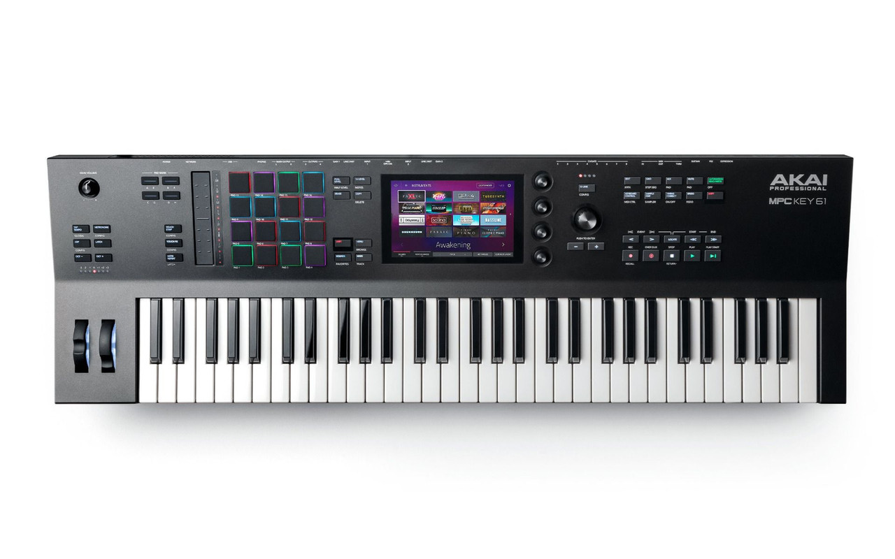
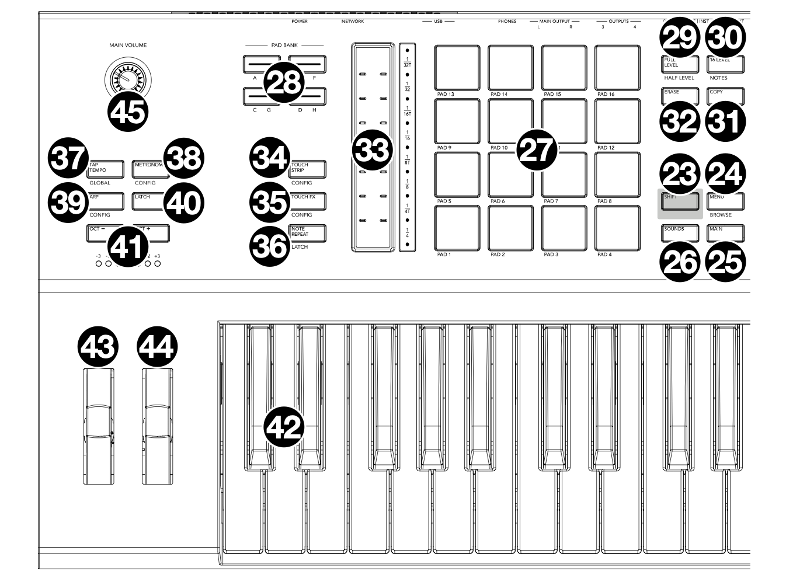
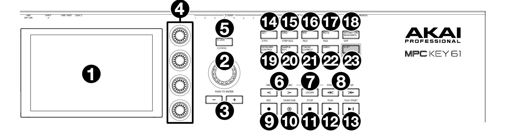
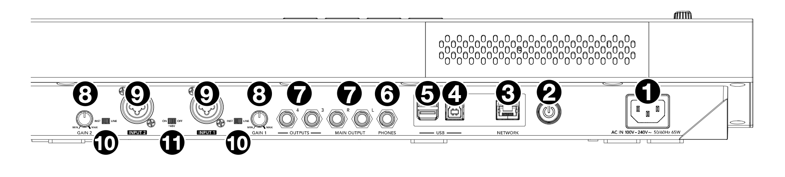
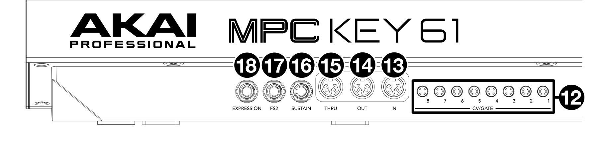
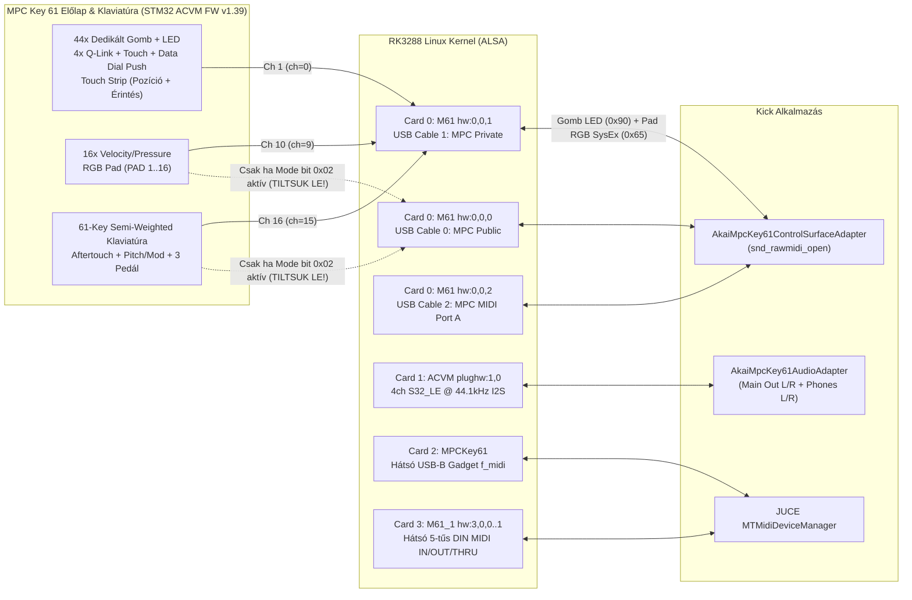
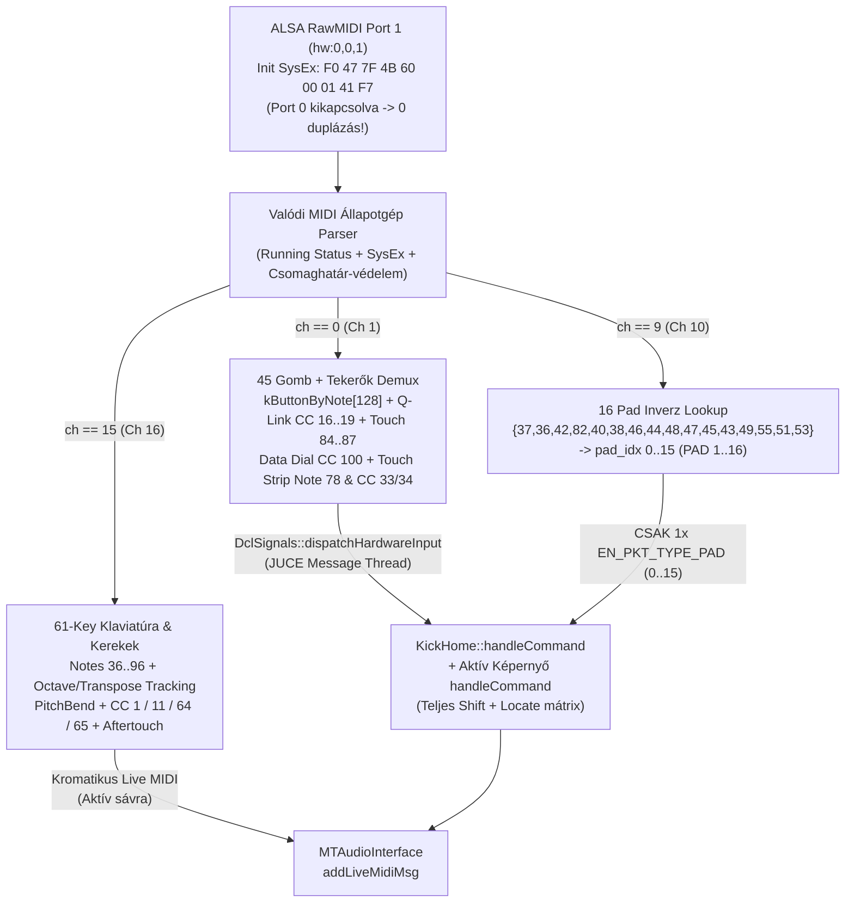

# Akai MPC Key 61 (`ACVM`) Hivatalos Hardver-Referencia, Jel-térkép és `Kick` Integrációs Code Review

> [!IMPORTANT]
> Ez a dokumentum **három egymástól független, 100%-ig hiteles forrás** összevetésén alapul — találgatás nélkül:
> 1. **Hivatalos Akai MPC Key 61 Quickstart Guide (`v1.2`) és gyári előlapi/hátlapi rajzok + fotók** (minden fizikai gomb pozíciója `1..45`, szitázott elsődleges felirata és fehér `SHIFT` / `LOCATE` másodlagos felirata).
> 2. **Az eszközön futó STM32 `ACVM` vezérlőpanel-firmware (`v1.39`, `/usr/share/Akai/SME0/Firmware/ACVM/update.dfu`) és a gyári `/usr/bin/MPC` (`AcvxHardware`, `Type = 15`, `Device ID = 0x4B`) gépi kódú táblázatai.**
> 3. **Élő telemetria (`/data/kick.log`) a fizikai Akai MPC Key 61-ről (`192.168.0.30`)** a valós gomb-, pad- és billentyűleütések közben.

---

## 1. Miért volt teljes káosz a készüléken? (Azonnali kórkép)

A jelenlegi [`akai_mpc_key61_adapter.h`](file:///Users/szabi/Documents/Projects/Safian/.worktrees/kick-pr13/Kick/apps/kick/hardware/adapters/akai_mpc_key61_adapter.h#L277-L517) kódban az előző próbálkozások során **nem a valódi MPC Key 61 dokumentációja és protokollja**, hanem más MPC modellekből / találgatásból származó Note-számok és egy hibás `note - 36` pad-képlet szerepelt. Ez négy súlyos, egymásra rakódó hibát okozott:

### 1.1. `Pad Mixer` (és minden 16 pados képernyő) káosz: `Pad 1 -> Pad 2`, `Pad 2 -> Pad 1`, `Pad 3 -> Pad 7`, 3 pad pedig teljesen halott!

1. **A `Kick` képernyőjén lévő 4×4-es padrács ([`KickPadButtonGroupComponent::resized`](file:///Users/szabi/Documents/Projects/Safian/.worktrees/kick-pr13/Kick/modules/kick_ui_components/source/kick_padButtonGroup.cpp#L514-L524)) elrendezése már eleve megegyezik a fizikai Akai előlappal:**
   - Alsó sor (`row = 3`): `pads[0..3]` = **`PAD A01 .. PAD A04`** (balról jobbra: Pad 1, Pad 2, Pad 3, Pad 4)
   - 2. sor (`row = 2`): `pads[4..7]` = **`PAD A05 .. PAD A08`** (Pad 5..8)
   - 3. sor (`row = 1`): `pads[8..11]` = **`PAD A09 .. PAD A12`** (Pad 9..12)
   - Felső sor (`row = 0`): `pads[12..15]` = **`PAD A13 .. PAD A16`** (Pad 13..16)
2. **Az MPC Key 61 STM32 firmware-e (`0x08009A68` -> `0x0801E4A5`) azonban NEM `36..51` sorrendben küldi a 16 padot a `ch == 9` (MIDI Ch 10) csatornán, hanem a klasszikus Akai GM Drum Bank A tábla szerint:**
   `{ 37, 36, 42, 82, 40, 38, 46, 44, 48, 47, 45, 43, 49, 55, 51, 53 }`
3. Mivel az [`akai_mpc_key61_adapter.h`](file:///Users/szabi/Documents/Projects/Safian/.worktrees/kick-pr13/Kick/apps/kick/hardware/adapters/akai_mpc_key61_adapter.h#L291-L296) vakon `pad_idx = note - 36` képletet számolt, **16-ból 15 fizikai pad rossz kijelző-padot villantott fel vagy teljesen elveszett**:

| Fizikai Akai Pad (előlapi szitázás) | Fizikai hely a 4×4 rácson | STM32 által küldött MIDI (`ch == 9`) | Jelenlegi hibás `note - 36` | Mi villan fel MOST a `Pad Mixer` kijelzőn? | Mit kell felvillantania (`pad_idx`)? |
|---|---|---|---:|---|---|
| **PAD 1** | 1. (alsó) sor, 1. oszlop | `0x99 0x25` (**Note `37`**) | `37 - 36 = 1` | ❌ **`PAD A02` (Pad 2!)** | ✅ **`PAD A01` (`idx 0`)** |
| **PAD 2** | 1. (alsó) sor, 2. oszlop | `0x99 0x24` (**Note `36`**) | `36 - 36 = 0` | ❌ **`PAD A01` (Pad 1!)** | ✅ **`PAD A02` (`idx 1`)** |
| **PAD 3** | 1. (alsó) sor, 3. oszlop | `0x99 0x2A` (**Note `42`**) | `42 - 36 = 6` | ❌ **`PAD A07` (Pad 7!)** | ✅ **`PAD A03` (`idx 2`)** |
| **PAD 4** | 1. (alsó) sor, 4. oszlop | `0x99 0x52` (**Note `82`**) | `82 - 36 = 46` (`>=16`) | ❌ **SEMMI (teljesen halott, az előző Pad 7 marad kijelölve!)** | ✅ **`PAD A04` (`idx 3`)** |
| **PAD 5** | 2. sor, 1. oszlop | `0x99 0x28` (**Note `40`**) | `40 - 36 = 4` | ⚠️ `PAD A05` *(véletlen egybeesés)* | ✅ **`PAD A05` (`idx 4`)** |
| **PAD 6** | 2. sor, 2. oszlop | `0x99 0x26` (**Note `38`**) | `38 - 36 = 2` | ❌ **`PAD A03` (Pad 3!)** | ✅ **`PAD A06` (`idx 5`)** |
| **PAD 7** | 2. sor, 3. oszlop | `0x99 0x2E` (**Note `46`**) | `46 - 36 = 10` | ❌ **`PAD A11` (Pad 11!)** | ✅ **`PAD A07` (`idx 6`)** |
| **PAD 8** | 2. sor, 4. oszlop | `0x99 0x2C` (**Note `44`**) | `44 - 36 = 8` | ❌ **`PAD A09` (Pad 9!)** | ✅ **`PAD A08` (`idx 7`)** |
| **PAD 9** | 3. sor, 1. oszlop | `0x99 0x30` (**Note `48`**) | `48 - 36 = 12` | ❌ **`PAD A13` (Pad 13!)** | ✅ **`PAD A09` (`idx 8`)** |
| **PAD 10** | 3. sor, 2. oszlop | `0x99 0x2F` (**Note `47`**) | `47 - 36 = 11` | ❌ **`PAD A12` (Pad 12!)** | ✅ **`PAD A10` (`idx 9`)** |
| **PAD 11** | 3. sor, 3. oszlop | `0x99 0x2D` (**Note `45`**) | `45 - 36 = 9` | ❌ **`PAD A10` (Pad 10!)** | ✅ **`PAD A11` (`idx 10`)** |
| **PAD 12** | 3. sor, 4. oszlop | `0x99 0x2B` (**Note `43`**) | `43 - 36 = 7` | ❌ **`PAD A08` (Pad 8!)** | ✅ **`PAD A12` (`idx 11`)** |
| **PAD 13** | 4. (felső) sor, 1. oszlop | `0x99 0x31` (**Note `49`**) | `49 - 36 = 13` | ❌ **`PAD A14` (Pad 14!)** | ✅ **`PAD A13` (`idx 12`)** |
| **PAD 14** | 4. (felső) sor, 2. oszlop | `0x99 0x37` (**Note `55`**) | `55 - 36 = 19` (`>=16`) | ❌ **SEMMI (teljesen halott!)** | ✅ **`PAD A14` (`idx 13`)** |
| **PAD 15** | 4. (felső) sor, 3. oszlop | `0x99 0x33` (**Note `51`**) | `51 - 36 = 15` | ❌ **`PAD A16` (Pad 16!)** | ✅ **`PAD A15` (`idx 14`)** |
| **PAD 16** | 4. (felső) sor, 4. oszlop | `0x99 0x35` (**Note `53`**) | `53 - 36 = 17` (`>=16`) | ❌ **SEMMI (teljesen halott!)** | ✅ **`PAD A16` (`idx 15`)** |

4. **Ráadásul minden egyes pad-leütés négyszeresen / duplán futott le:**
   - Az Init SysEx `0x43`-at küldött (`Port 0` Public + `Port 1` Private egyszerre aktív), így a `/data/kick.log` tanúsága szerint minden fizikai pad-ütés **kétszer** érkezett be a DCL-be (`Port 0`-ról és `Port 1`-ről is: `Data[0] From DCL:1`, `Data[0] From DCL:1`, `Data[0] From DCL:0`, `Data[0] From DCL:0`, `Data[0] From DCL:6`, `Data[0] From DCL:6`).
   - Ezen felül a [`KickHardwareBridge::on_pad_note_on`](file:///Users/szabi/Documents/Projects/Safian/.worktrees/kick-pr13/Kick/apps/kick/kick_hardware_bridge.h#L673-L686) a DCL csomag (`0..15`) mellett még egy fix `36 + pad_num` MIDI hangot is ráküldött a motorra!

---

### 1.2. Miért vált képernyőt a 61 billentyűs zongora (`C3 -> Sampler`, `D3 -> File Browser`, `D#3 -> Track View`), és miért néma több billentyű?

Az STM32 firmware Private módban (`Port 1` / `hw:0,0,1`) **mindhárom bemeneti csoportot ugyanazon a kábelen, de szigorúan külön MIDI-csatornán (`ch`) küldi**:
- **`ch == 0` (Ch 1):** 45 előlapi gomb + Q-Link + Data Dial + Touch Strip
- **`ch == 9` (Ch 10):** 16 RGB Pad
- **`ch == 15` (Ch 16):** 61 billentyűs zongora (`Note 36..96`, `C2..C7`) + Pitch/Mod kerék + pedálok

Mivel az [`akai_mpc_key61_adapter.h`](file:///Users/szabi/Documents/Projects/Safian/.worktrees/kick-pr13/Kick/apps/kick/hardware/adapters/akai_mpc_key61_adapter.h#L286-L415) a `port == 1` ágon **nem szűrt `ch == 0`-ra**, a `ch == 15`-ön beérkező zongorabillentyűket funkciógombnak nézte:
- **`C3` (`Note 48`, `ch=15`)** -> `HW_BTN_SAMPLER` -> **Sampler** képernyőre ugrik!
- **`C#3` (`Note 49`, `ch=15`)** -> `HW_BTN_SHIFT` -> lenyeli néma `SHIFT`-ként (**ezért „marad ki egy-egy billentyű”**)!
- **`D3` (`Note 50`, `ch=15`)** -> `HW_BTN_BROWSE` -> **File Browser** képernyőre ugrik!
- **`D#3` (`Note 51`, `ch=15`)** -> `HW_BTN_MAIN` -> **Main / Track View** képernyőre ugrik!
- **`E3` (`Note 52`, `ch=15`)** -> `HW_BTN_GRID` -> **Grid** képernyőre ugrik!
- **`F3..G3` (`53..55`, `ch=15`)** -> `TAP TEMPO` / `+` / `-` -> játék közben átállítja a projekt tempóját!
- **`C6..D#6` (`84..87`, `ch=15`)** -> Q-Link érintésnek nézi (mert az adapterben fordítva `ch == 15` volt írva `ch == 0` helyett)!
- **`B4..C5` (`71..72`), `D5..G5` (`74..79`), `E6..C7` (`88..96`)** -> ahogy az élő `/data/kick.log` is mutatta (`[AKAI-BTN] Port 1 Note 71..95 ch=15`), beleestek az `else` ágba, így teljesen némák maradtak!

### 1.3. Miért játszott le korábban minden gomb magas hangot (`G8`), és miért tűnt jónak az első demó?
- Korábban a `Port 1`-en fel nem ismert `ch == 0` gombok beleestek az `on_keybed_note_on(note, vel)` ágba. Mivel a valódi funkciógombok magas MIDI Note-okat küldenek — **`112` (`E8`/`G8` regiszter) = METRONOME**, **`116` (`G#8`) = MIX**, **`117` (`A8`) = GRID**, **`121` (`C#9`) = SOUNDS**, **`123` (`D#9`) = MENU** —, a gombnyomások a szintetizátort szólaltatták meg.
- Az első demó ([`Kick/apps/mpc_gui/main_gui.cpp`](file:///Users/szabi/Documents/Projects/Safian/.worktrees/kick-pr13/Kick/apps/mpc_gui/main_gui.cpp#L1426-L1531)) egyetlen statikus képernyőből állt (a `HW_BTN_MAIN/BROWSE/GRID/SAMPLER` ágak üresek voltak), csak ~13 gombot figyelt, és egy fix beépített 21-mintás F9 Grand Piano + 16 WAV lejátszót hajtott meg — ezért nem látszottak benne a képernyőugrálások és a DCL bank-eltolások.

---

## 2. Hivatalos Akai MPC Key 61 Fizikai Felépítés és Képi Referencia

### 2.1. Felülnézeti gyári fotó



### 2.2. Hivatalos számozott előlapi rajzok (`MPC Key 61 Quickstart Guide v1.2`, `1..45`)

#### Bal oldali előlap: Hangerő, Arp/Octave, Kerekek, Pad Bank, Touch Strip, 16 Pad és Bal Funkció-oszlop (`23..45`)


#### Jobb oldali előlap: 7" Érintőkijelző, 4 Q-Link, Data Dial, 2×5 Mód-mátrix, Locate és Transzport (`1..23`)


### 2.3. Hivatalos számozott hátlapi rajzok (`1..18`)





---

### 2.4. Hardver- és Linux ALSA Topológia



| Hátlapi / Belső egység (Kézikönyv `#`) | Linux / ALSA eszköz | Csatornák / Busz | Valódi szerep |
|---|---|---|---|
| **Előlap + 16 Pad + 61 Key + Pedálok** (`Top 2..44`, `Rear 16..18`) | **Card 0 (`M61`)**: `hw:0,0,1` (`MPC Private`) | USB `1-1` (`09e8:004b`), 3 virtuális USB-MIDI kábel (`0,0,0..2`) | Az STM32 `ACVM` mikrovezérlő fő kommunikációs csatornája (`ch=0` gombok/tekerők, `ch=9` padok, `ch=15` klaviatúra/kerekek/pedálok) |
| **Main Volume (`Top 45`)** | Analóg hardveres potméter | Hardveres végfok | Közvetlenül a `MAIN OUTPUT L/R` (`Rear 7`) és a `PHONES` (`Rear 6`) analóg jelszintjét szabályozza (**nem küld MIDI-t!**) |
| **Phones (`Rear 6`) + Main Out L/R (`Rear 7`) + Outputs 3/4 (`Rear 7`) + Inputs 1/2 (`Rear 8..11`)** | **Card 1 (`ACVM`)**: `plughw:1,0` | Rockchip I2S `S32_LE` @ `44.1 kHz` | `Out Ch 0–1` = `MAIN OUTPUT L/R`, `Out Ch 2–3` = `PHONES` sztereó fejhallgató; `In Ch 0–1` = `INPUT 1/2` (XLR/TRS kombó + `+48V` fantomtáp) |
| **USB-B Port (`Rear 4`)** | **Card 2 (`MPCKey61`)**: `hw:2,0,0..1` | Linux USB Gadget `f_midi` | Külső számítógép (Mac/PC DAW) felé nyújtott USB-MIDI kapcsolat |
| **USB-A Portok ×2 (`Rear 5`)** | Linux USB Host (`3-1.x`) | USB High-Speed Hub (`09e8:504b`) | Pendrive, külső USB-MIDI billentyűzet / kontroller csatlakoztatása |
| **5-tűs DIN MIDI IN / OUT / THRU (`Rear 13, 14, 15`)** | **Card 3 (`M61_1`)**: `hw:3,0,0..1` | USB `3-1.7` al-interfész | Fizikai 5-tűs DIN MIDI portok külső szintetizátorokhoz / dobgépekhez |
| **CV/Gate 1–8 (`Rear 12`)** | Belső DAC / GPIO | 8× 3.5 mm TS aljzat | Moduláris szintetizátor vezérlőfeszültség (`CV/Gate 1..8`) |

---

## 3. Hitelesített Akai MPC Key 61 (`0x4B`) MIDI Protokoll és Minden Fizikai Kezelőszerv Táblázata

### 3.1. Inicializáló SysEx (`msg_id = 0x60`) — A duplázódás megszüntetése
```text
F0  47  7F  4B  60  00  01  41  F7
```
- `0x47` = Akai Professional, `0x7F` = Broadcast, `0x4B` = **MPC Key 61 (`ACVM`)**, `0x60` = Mode Set.
- **`0x41` (`0x40 | 0x01`)**:
  - `0x01`: Bekapcsolja a **`Port 1` (`hw:0,0,1` / `MPC Private`)** csatornát.
  - **`0x02` NINCS beállítva** (a jelenlegi `0x43`-mal szemben!), így a `Port 0` (`MPC Public`) néma marad, és **megszűnik minden pad- és billentyű-duplázódás**!
  - `0x40`: Kikapcsolja a publikus MMC / `CC 116..119` transzport-átkódolást, így minden transzportgomb tiszta `0x90 <note> <0x7F/0x00>` üzenetet küld.

---

### 3.2. Mind a 45 fizikai gomb 100%-ig szitázás-hű táblázata (`Port 1`, `ch == 0`)

> [!NOTE]
> Az MPC Key 61 hivatalos specifikációja (Quickstart Guide 49. oldal): **`(44) dedicated function buttons` + `(1) 360° touch-sensitive push encoder` = összesen `45` gomb-Note kód** a `Port 1`, `ch == 0` csatornán (`0x90 <note> 0x7F` lenyomás, `0x90 <note> 0x00` vagy `0x80 <note> 0x00` felengedés). Az alábbi táblázatban **egyetlen gomb sem hiányzik, és egyetlen kitalált szám sincs**.

#### A) Bal szekció — Tempo / Metronome / Arp / Octave (`Kézikönyv #37–41`, a Pitch/Mod kerekek felett)
| Kézikönyv `#` | Fizikai gomb felirata | Fehér másodlagos felirat (`+SHIFT`) | MIDI Note (`ch == 0`) | Hex | Gyári `ButtonId` | `Kick` Elsődleges Funkció | `Kick` `+SHIFT` Funkció | Jelenlegi `Kick` hiba |
|---:|---|---|---:|---|---|---|---|---|
| **`37`** | **TAP TEMPO** | **GLOBAL** | **`53`** | `0x35` | `TAP_TEMPO` (`77`) | `EN_TAP_TEMPO` + BPM Tap számítás | `EN_MASTER` (Master / Global tempó) | ⚠️ `ch == 15` is be volt engedve -> az `F3` zongorabillentyű elállította a BPM-et! |
| **`38`** | **METRONOME** | **CONFIG** | **`112`** | `0x70` | `METRONOME` (`164`) | Metronóm Be/Ki (`setClickEnabled`) | `EN_PREF` / Metronóm beállítás | ❌ Hiányzott (korábban `G8/G#8` hangot ütött!) |
| **`39`** | **ARP** | **CONFIG** | **`118`** | `0x76` | `ARP` (`171`) | `EN_NOTE_REPEAT` / Arpeggiator | `EN_NOTES` (`MenuPadPerform`) | ❌ Hibásan `HW_BTN_PLAY`-re volt kötve! |
| **`40`** | **LATCH** | *(nincs)* | **`119`** | `0x77` | `ARP_LATCH` (`172`) | `EN_LATCH` | `EN_LATCH` | ❌ Hibásan `HW_BTN_REC`-re volt kötve! |
| **`41`** | **OCT –** | *(+Shift: Transpose -1; OCT- és OCT+ együtt: Reset 0)* | **`7`** | `0x07` | `OCT_DOWN` (`169`) | Klaviatúra `-1` oktáv (`-12` félhang) | Klaviatúra `-1` félhang | ⚠️ `ch == 0` szűrés hiányzott |
| **`41`** | **OCT +** | *(+Shift: Transpose +1; OCT- és OCT+ együtt: Reset 0)* | **`10`** | `0x0A` | `OCT_UP` (`170`) | Klaviatúra `+1` oktáv (`+12` félhang) | Klaviatúra `+1` félhang | ⚠️ `ch == 0` szűrés hiányzott |

#### B) Bal-középső szekció — Pad Bank `A–D` (`#28`) és Touch Strip gombok (`#34–36`)
| Kézikönyv `#` | Fizikai gomb felirata | Fehér másodlagos felirat (`+SHIFT`) | MIDI Note (`ch == 0`) | Hex | Gyári `ButtonId` | `Kick` Elsődleges Funkció | `Kick` `+SHIFT` Funkció | Jelenlegi `Kick` hiba |
|---:|---|---|---:|---|---|---|---|---|
| **`28`** | **PAD BANK A** | **E** *(dupla nyomásra is)* | **`35`** | `0x23` | `PAD_BANK_A` (`11`) | `EN_BANK_A` (`pads 0..15`) | `EN_BANK_E` (`pads 64..79`) | ❌ `35` Tap Tempo volt, Bank A pedig `106`! |
| **`28`** | **PAD BANK B** | **F** *(dupla nyomásra is)* | **`36`** | `0x24` | `PAD_BANK_B` (`12`) | `EN_BANK_B` (`pads 16..31`) | `EN_BANK_F` (`pads 80..95`) | ❌ `107`-re volt kötve (`36` üres volt)! |
| **`28`** | **PAD BANK C** | **G** *(dupla nyomásra is)* | **`37`** | `0x25` | `PAD_BANK_C` (`13`) | `EN_BANK_C` (`pads 32..47`) | `EN_BANK_G` (`pads 96..111`) | ❌ `37` `MENU` volt, Bank C pedig `108`! |
| **`28`** | **PAD BANK D** | **H** *(dupla nyomásra is)* | **`38`** | `0x26` | `PAD_BANK_D` (`14`) | `EN_BANK_D` (`pads 48..63`) | `EN_BANK_H` (`pads 112..127`) | ❌ `38` `NEXT_SEQ` volt, Bank D pedig `109`! |
| **`34`** | **TOUCH STRIP** | **CONFIG** | **`4`** | `0x04` | `STRIP` (`163`) | Touch Strip paramétermód váltás | Touch Strip Config | ❌ Hiányzott |
| **`35`** | **TOUCH FX** | **CONFIG** | **`42`** | `0x2A` | `TOUCHFX` (`165`) | `EN_FX` (`HomeXYView` XYFX) | `EN_FX` (`HomeXYView`) | ❌ `TRACK_MUTE`-ra volt kötve, és elkapta az `F#2` billentyűt! |
| **`36`** | **NOTE REPEAT** | **LATCH** | **`11`** | `0x0B` | `NOTE_REPEAT` (`80`) | `EN_NOTE_REPEAT` | `EN_LATCH` | ⚠️ `+Shift: EN_LATCH` és `ch == 0` szűrés hiányzott |

#### C) Középső 2×4-es oszlop a 16 Pad és a 7" Kijelző között (`Kézikönyv #23–26, #29–32`)
| Kézikönyv `#` | Pozíció (fentről le) | Fizikai gomb felirata | Fehér másodlagos felirat (`+SHIFT`) | MIDI Note (`ch == 0`) | Hex | Gyári `ButtonId` | `Kick` Elsődleges Funkció | `Kick` `+SHIFT` Funkció | Jelenlegi `Kick` hiba |
|---:|---|---|---|---:|---|---|---|---|---|
| **`29`** | 1. sor bal | **FULL LEVEL** | **HALF LEVEL** | **`39`** | `0x27` | `FULL_LEVEL` (`16`) | `EN_FULL_LEVEL` | `EN_HALF_LEVEL` | ⚠️ Elkapta a `D#2` billentyűt (`ch=15`), `+Shift` hiányzott! |
| **`30`** | 1. sor jobb | **16 LEVEL** | **NOTES** | **`40`** | `0x28` | `SIXTEEN_LEVEL` (`17`) | `EN_16LEVELS` | `EN_NOTES` (`MenuPadPerform`) | ⚠️ Elkapta az `E2` billentyűt (`ch=15`), `+Shift` hiányzott! |
| **`32`** | 2. sor bal | **ERASE** | *(nincs)* | **`9`** | `0x09` | `ERASE` (`79`) | `EN_ERASE` | `EN_ERASE` | ⚠️ Hibás `note == 21` is mellette volt |
| **`31`** | 2. sor jobb | **COPY** | **DELETE** | **`122`** | `0x7A` | `COPY` (`91`) | `EN_COPY` | `EN_ERASE` (Delete) | ❌ Teljesen hiányzott (élő logban: `Note 122 ch=0`)! |
| **`23`** | 3. sor bal | **SHIFT** *(bal)* | *(módosító)* | **`50`** | `0x32` | `SHIFT2` (`174`) | `EN_SHIFT` (módosító bit #2) | `EN_SHIFT` | ❌ Hibásan `HW_BTN_BROWSE` volt -> `D3` billentyű File Browsert nyitott, a bal Shift pedig Browsert! |
| **`24`** | 3. sor jobb | **MENU** | **BROWSE** | **`123`** | `0x7B` | `MENU` (`75`) | `EN_MENU` (`HomeOptions`) | **`EN_BROWSE` (`MenuFileBrowser`)** | ⚠️ `+Shift: Browse` hiányzott, és `37` (Bank C) is Menu volt |
| **`26`** | 4. sor bal | **SOUNDS** | **FAVORITES** | **`121`** | `0x79` | `SOUNDS` (`166`) | `EN_BROWSE` (`MenuFileBrowser` / Sounds) | `EN_NEXT_SEQ` / Favorites | ❌ Teljesen hiányzott (élő logban: `Note 121 ch=0`)! |
| **`25`** | 4. sor jobb | **MAIN** | **TRACK** | **`52`** | `0x34` | `MAIN` (`76`) | `EN_MAINMODE` (`HomeListView`) | Track View (`HomeGridView` / Track lista) | ❌ Hibásan `52` = `GRID` volt, `MAIN` pedig `51` (`D#3`)! |

#### D) Kijelzőtől jobbra: Q-Link gomb és Data Dial szekció (`Kézikönyv #2, #3, #5`)
| Kézikönyv `#` | Fizikai gomb felirata | Fehér másodlagos felirat (`+SHIFT`) | MIDI Note (`ch == 0`) | Hex | Gyári `ButtonId` | `Kick` Elsődleges Funkció | `Kick` `+SHIFT` Funkció | Jelenlegi `Kick` hiba |
|---:|---|---|---:|---|---|---|---|---|
| **`5`** | **Q-LINK** | **CONFIG** | **`0`** | `0x00` | `QLINK_BANK` (`90`) | `EN_LINK` (Q-Link oszlop 1..4 léptetés) | `EN_LINK_EDIT` (`MenuKnobEdit`) | ❌ Teljesen hiányzott (élő logban: `Note 0 ch=0`)! |
| **`2`** | **DATA DIAL PUSH** | *(PUSH TO ENTER)* | **`111`** | `0x6F` | `CURSOR_CENTRE` (`30`) | `EN_KNOB_ENTER` | `EN_KNOB_ENTER` | ⚠️ Mellette `note == 60` elkapta a középső `C4` zongorahangot! |
| **`3`** | **–** *(Data Dial alatt balra)* | *(nincs)* | **`55`** | `0x37` | `DATA_MINUS` (`27`) | `EN_MINUS` | `EN_MINUS` | ⚠️ `ch == 0` szűrés nélkül elkapta a `G3` billentyűt! |
| **`3`** | **+** *(Data Dial alatt jobbra)* | *(nincs)* | **`54`** | `0x36` | `DATA_PLUS` (`26`) | `EN_PLUS` | `EN_PLUS` | ⚠️ `ch == 0` szűrés nélkül elkapta az `F#3` billentyűt! |

#### E) Jobb oldali 2×5-ös Mód-mátrix (`Kézikönyv #14–23`)
| Kézikönyv `#` | Pozíció a 2×5 mátrixban | Fizikai gomb felirata | Fehér másodlagos felirat (`+SHIFT`) | MIDI Note (`ch == 0`) | Hex | Gyári `ButtonId` | `Kick` Elsődleges Funkció | `Kick` `+SHIFT` Funkció | Jelenlegi `Kick` hiba |
|---:|---|---|---|---:|---|---|---|---|---|
| **`14`** | 1. sor, 1. oszlop | **EDIT** | **XYFX** | **`2`** | `0x02` | `MODE_PROGRAM_EDIT` (`0`) | **`EN_PROG_EDIT` (`MenuProgramEdit`)** | **`EN_FX` (`HomeXYView`)** | ❌ Teljesen hiányzott (`45`-re volt tippelve)! |
| **`15`** | 1. sor, 2. oszlop | **GRID** | **STEP SEQ** | **`117`** | `0x75` | `GRID` (`167`) | **`EN_GRID` (`HomeGridView`)** | **`EN_STEP_SEQ` (`HomeSequencerView`)** | ❌ Hibásan `HW_BTN_STOP`-ra volt kötve! |
| **`16`** | 1. sor, 3. oszlop | **MIX** | **PAD** | **`116`** | `0x74` | `ACVM_MIX` (`176`) | **`EN_TRACK_MIX` (`MenuChannelMixer`)** | **`EN_PAD_MIX` (`MenuPadMixer`)** | ❌ Hibásan `HW_BTN_OVERDUB`-ra volt kötve! |
| **`17`** | 1. sor, 4. oszlop | **MUTE** | **PAD** | **`43`** | `0x2B` | `ACVM_MUTE` (`175`) | **`EN_TRACK_MUTE` (`MenuTrackMute`)** | **`EN_PAD_MUTE` (`MenuPadMute`)** | ❌ Hibásan `PAD_MIX`-re volt kötve, és elkapta a `G2` billentyűt! |
| **`18`** | 1. sor, 5. oszlop | **AUTOMATION READ/WRITE** | **OFF** | **`75`** | `0x4B` | `AUTOMATION` (`177`) | `EN_AUTOMATION` | `EN_ON_OFF` | ❌ Teljesen hiányzott (élő logban: `Note 75 ch=0`)! |
| **`19`** | 2. sor, 1. oszlop | **KEYBOARD CONTROL** | **MIDI CTRL** | **`120`** | `0x78` | `KEYBOARD_CONTROL` (`168`) | Keygroup / Keyboard Control nézet | **`EN_MIDI_CONTROL` (`MenuMidiControl`)** | ❌ Teljesen hiányzott (élő logban: `Note 120 ch=0`)! |
| **`20`** | 2. sor, 2. oszlop | **SAMPLE EDIT** | **SAMPLER** | **`6`** | `0x06` | `MODE_SAMPLE_EDIT` (`3`) | **`EN_SAMPLE_EDIT` (`MenuSampleEdit`)** | **`EN_SAMPLER` (`MenuSampler`)** | ❌ Teljesen hiányzott (`46`/`48`-ra volt tippelve)! |
| **`21`** | 2. sor, 3. oszlop | **TIMING CORRECT** | **ON/OFF** | **`12`** | `0x0C` | `TC` (`108`) | **`EN_TC`** (Timing Correct ablak) | **`EN_ON_OFF`** (TC Be/Ki) | ❌ Teljesen hiányzott (élő logban: `Note 12 ch=0`)! |
| **`22`** | 2. sor, 4. oszlop | **UNDO** | **REDO** | **`67`** | `0x43` | `UNDO` (`78`) | `undo()` | `redo()` | ⚠️ `ch == 0` szűrés nélkül elkapta a `G4` billentyűt, `redo()` hiányzott! |
| **`23`** | 2. sor, 5. oszlop | **SHIFT** *(jobb)* | *(módosító)* | **`49`** | `0x31` | `SHIFT` (`72`) | `EN_SHIFT` (módosító bit #1) | `EN_SHIFT` | ⚠️ `ch == 0` szűrés nélkül elnyelte a `C#3` billentyűt! |

#### F) Jobb alsó Locate sor (`#6–8`) és Transzport sor (`#9–13`)
| Kézikönyv `#` | Fizikai gomb felirata | Másodlagos felirat (`+LOCATE` vagy `+SHIFT`) | MIDI Note (`ch == 0`) | Hex | Gyári `ButtonId` | `Kick` Elsődleges Funkció | `Kick` Másodlagos Funkció | Jelenlegi `Kick` hiba |
|---:|---|---|---:|---|---|---|---|---|
| **`6`** | **`<`** | *(+Locate: **`\|<`** Event)* | **`68`** | `0x44` | `STEP_PREV` (`33`) | Step visszaléptetés | Előző eseményre ugrás | ⚠️ `ch == 0` szűrés nélkül elkapta a `G#4` billentyűt |
| **`6`** | **`>`** | *(+Locate: **`>\|`** Event)* | **`69`** | `0x45` | `STEP_NEXT` (`34`) | Step előreléptetés | Következő eseményre ugrás | ⚠️ `ch == 0` szűrés nélkül elkapta az `A4` billentyűt |
| **`7`** | **LOCATE** | *(módosító / Locate ablak)* | **`70`** | `0x46` | `LOCATE` (`35`) | Locate módosító / pozíció ablak | — | ❌ Hiányzott (élő logban: `Note 70 ch=0`)! |
| **`8`** | **`<<`** | *(+Locate: **START**)* | **`71`** | `0x47` | `BAR_PREV` (`36`) | 1 ütemmel vissza (`Bar -1`) | Szekvencia elejére (`Start`) | ❌ Hiányzott (élő logban: `Note 71 ch=0`)! |
| **`8`** | **`>>`** | *(+Locate: **END**)* | **`72`** | `0x48` | `BAR_NEXT` (`37`) | 1 ütemmel előre (`Bar +1`) | Szekvencia végére (`End`) | ❌ Hiányzott |
| **`9`** | **REC** *(●)* | **RECALL** *(+Shift)* | **`73`** | `0x49` | `RECORD` (`38`) | `EN_RECORD` | Retrospektív MIDI Recall | ⚠️ `ch == 0` szűrés nélkül elkapta a `C#5` billentyűt |
| **`10`** | **OVER DUB** *(⊕)* | *(nincs)* | **`80`** | `0x50` | `OVERDUB` (`39`) | `EN_OVERDUB` | `EN_OVERDUB` | ⚠️ `ch == 0` szűrés nélkül elkapta a `G#5` billentyűt |
| **`11`** | **STOP** *(■)* | **RETURN** *(+Shift; dupla nyomás: MIDI Panic)* | **`81`** | `0x51` | `STOP` (`40`) | `EN_STOP` | Return to Start (`01:01:00`) | ⚠️ `ch == 0` szűrés nélkül elkapta az `A5` billentyűt |
| **`12`** | **PLAY** *(▶)* | *(nincs)* | **`82`** | `0x52` | `PLAY` (`41`) | `EN_PLAY` | `EN_PLAY` | ⚠️ `ch == 0` szűrés nélkül elkapta az `A#5` billentyűt |
| **`13`** | **PLAY START** *(▶\|)* | *(nincs)* | **`83`** | `0x53` | `PLAY_START` (`42`) | `EN_PLAYSTART` | `EN_PLAYSTART` | ⚠️ `ch == 0` szűrés nélkül elkapta a `B5` billentyűt |

---

### 3.3. Tekerők, Érintésérzékelők és Touch Strip (`Port 1`, `ch == 0`)

| Kézikönyv `#` | Hardver elem | Csatorna | Üzenet típusa | Pontos bájtok / Értékek | Jelenlegi `Kick` adapter állapota |
|---:|---|---|---|---|---|
| **`4`** | **Q-Link 1..4 forgatás** (fentről lefelé `1..4`) | **`ch == 0`** | `0xB0` (CC) | **`CC 16, 17, 18, 19`** (`0x10..0x13`), relatív kettes komplemens: `1..63` = `+1..+63` CW, `127..65` = `-1..-63` CCW | ⚠️ `ch == 0` szűrés hiányzott |
| **`4`** | **Q-Link 1..4 kapacitív érintés** | **`ch == 0`** | `0x90` / `0x80` | **`Note 84, 85, 86, 87`** (`0x54..0x57`), érintés = `127`, elengedés = `0` *(élő logban igazolva: `Port 1 Note 84..87 ch=0 vel=127`!)* | ❌ **Hibás!** `ch == 15`-öt várt, így sosem működött, viszont elnyelte a `C6..D#6` billentyűket! |
| **`2`** | **Data Dial (Jog kerék) forgatás** | **`ch == 0`** | `0xB0` (CC) | **`CC 100`** (`0x64`), relatív kettes komplemens (`1..63` CW, `127..65` CCW) | ❌ **Hibás!** `CC 60`-ra volt kötve, így a nagy Data Dial tekerése egyáltalán nem működött! |
| **`33`** | **Touch Strip ujj-érintés** | **`ch == 0`** | `0x90` / `0x80` | **`Note 78`** (`0x4E`), érintés = `127`, elemelés = `0` | ❌ Hiányzott |
| **`33`** | **Touch Strip 14-bites pozíció** | **`ch == 0`** | `0xB0` (CC) | **`CC 33`** (`0x21` = MSB `0..127`) + **`CC 34`** (`0x22` = LSB `0..127`) | ⚠️ `ch == 0` szűrés hiányzott |

---

### 3.4. A 61 billentyűs klaviatúra, kerekek és hátsó pedálok (`Port 1`, `ch == 15`)

| Kézikönyv `#` | Hardver elem | Csatorna | MIDI Üzenet | Tartomány / Értelmezés |
|---:|---|---|---|---|
| **`42`** | **61 billentyűs klaviatúra** | **`ch == 15`** | `0x9F <note> <vel>` / `0x8F <note> 0x00` | **`Note 36..96`** (`C2..C7`). Az `OCT -` / `OCT +` eltolást (`±12` félhang) a szoftver adja hozzá! |
| **`42`** | **Keybed Channel Aftertouch** | **`ch == 15`** | `0xDF <pressure>` | `0..127` csatorna-utónyomás |
| **`43`** | **Pitch Bend kerék** | **`ch == 15`** | `0xEF <lsb> <msb>` | 14-bit (`0..16383`, közép = `8192`) |
| **`44`** | **Modulation kerék** | **`ch == 15`** | `0xBF 0x01 <val>` | **`CC 1`** (`0..127`) |
| **`Rear 18`** | **Expression pedál** (`1/4" TRS`) | **`ch == 15`** | `0xBF 0x0B <val>` | **`CC 11`** (`0..127`) |
| **`Rear 16`** | **Sustain pedál** (`1/4" TS/TRS`) | **`ch == 15`** | `0xBF 0x40 <val>` | **`CC 64`** (`0` / `127`) |
| **`Rear 17`** | **FS2 lábkapcsoló** (`1/4" TS`) | **`ch == 15`** | `0xBF 0x41 <val>` | **`CC 65`** (`0` / `127`) |

---

### 3.5. Kimenő LED-vezérlés az előlap felé (`Port 1` OUT / `m_out1`)

1. **44 gomb LED-jei (`0x90 <button_note> <level>` a `ch == 0` csatornán):**
   - Egyszínű gomb-LED: `0` = Ki, `1` = Halvány (`Dim`, háttérfény), `127` = Teljes fényerő (`Active`).
   - Kétszínű gomb-LED (`REC`, `OVERDUB`, `PLAY`, `MUTE`, `MIX`, `PAD BANK A..D`, `AUTOMATION`): `0` = Ki, `1` = Halvány A, `2` = Halvány B, `3` = Teljes A, `4` = Teljes B.
   - Oktáv visszajelző LED-sor (`-3 .. +3` az `OCT - / +` alatt): az `OCT -` (`Note 7`) és `OCT +` (`Note 10`) LED-szintjeivel vezérelhető.
2. **16 RGB Pad színvezérlése (`SysEx msg_id = 0x65` a `m_out1`-en):**
   ```text
   F0 47 7F 4B 65 <len_msb> <len_lsb> [ <pad_idx 0..15> <R 0..127> <G 0..127> <B 0..127> ] ... F7
   ```
   A `pad_idx` itt már lineárisan **`0..15` (`PAD 1..PAD 16`)**! Egyetlen `72` bájtos SysEx csomagban mind a 16 pad színe egyszerre, villódzásmentesen frissíthető.
3. **Touch Strip LED-létra (`#33`):** `0xB0 0x21 <0..127>` (`CC 33`).

---

## 4. Javítási Terv („Mit és hogyan kell átírni, hogy 100%-osan gyári minőségű legyen?”)



### 1. [`akai_mpc_key61_adapter.h`](file:///Users/szabi/Documents/Projects/Safian/.worktrees/kick-pr13/Kick/apps/kick/hardware/adapters/akai_mpc_key61_adapter.h) teljes tisztítása
- **Init SysEx `0x43` -> `0x41`:** Kizárólag a `Port 1` (`MPC Private`) legyen aktív, így megszűnik a `Port 0` + `Port 1` dupla pad- és billentyű-esemény. Az `m_in1 -> m_out2` vak bájtmásolást töröljük.
- **Valódi MIDI állapotgép parser:** Bájtonkénti `PortParserState` (Running Status, töredékes USB csomagok és SysEx helyes kezelése).
- **Szigorú csatorna-szétválasztás (`Port 1`):**
  1. **`ch == 0`:** Konstans 128-elemű tábla pontosan a fenti **3.2. fejezet 45 gombjával**, `Note 84..87` Q-Link érintés, `Note 78` Touch Strip érintés, `CC 16..19` Q-Link forgatás, **`CC 100` Data Dial forgatás**, `CC 33/34` Touch Strip pozíció.
  2. **`ch == 9`:** Pontos inverz lookup a `{37, 36, 42, 82, 40, 38, 46, 44, 48, 47, 45, 43, 49, 55, 51, 53}` táblából `pad_idx = 0..15`-re (`PAD 1 -> idx 0`, `PAD 2 -> idx 1`, `PAD 3 -> idx 2`, `PAD 4 -> idx 3`, ..., `PAD 16 -> idx 15`) + `0xA9` Poly Aftertouch.
  3. **`ch == 15`:** Kizárólag `on_keybed_note_on/off`, Pitch Bend (`0xEF`), Channel Aftertouch (`0xDF`), Mod Wheel (`CC 1`), Expression (`CC 11`), Sustain (`CC 64`), Footswitch (`CC 65`). **Soha egyetlen zongorabillentyű sem válthat képernyőt vagy nyomhat gombot!**

### 2. [`kick_hardware_bridge.h`](file:///Users/szabi/Documents/Projects/Safian/.worktrees/kick-pr13/Kick/apps/kick/kick_hardware_bridge.h) szálbiztos `DCL` és Shift-integrációja
- **Dupla pad-hang törlése:** Az `on_pad_note_on`-ból kivesszük a fix `addLiveMidiNote(..., 36 + pad_num, vel)` hívást, és csak az `EN_PKT_TYPE_PAD` (`0..15`) DCL csomagot küldjük be — így `Pad Mixer`, `Main`, `Grid`, `Pad Mute`, `Track Mute` és `Next Sequence` módban is pontosan az a pad villan és szólal meg (a kiválasztott `Bank A..H` szerint), amelyiket megütötték.
- **Szálbiztos `DCL` gombkezelés + mindkét `SHIFT` (`Note 49` és `Note 50`) + `LOCATE` (`Note 70`):** Minden gombot a `contracts::DclSignals::dispatchHardwareInput` (Message Thread) útvonalon küldünk be a hivatalos szitázott Shift-párokkal (`EDIT / +Shift: XYFX`, `GRID / +Shift: STEP SEQ`, `MIX / +Shift: PAD MIX`, `MUTE / +Shift: PAD MUTE`, `KEYBOARD CONTROL / +Shift: MIDI CTRL`, `SAMPLE EDIT / +Shift: SAMPLER`, `TIMING CORRECT / +Shift: ON/OFF`, `UNDO / +Shift: REDO`, `MENU / +Shift: BROWSE`, `MAIN / +Shift: TRACK`, `SOUNDS / +Shift: FAVORITES`, `COPY / +Shift: DELETE`, `FULL LEVEL / +Shift: HALF LEVEL`, `16 LEVEL / +Shift: NOTES`, `BANK A..D / +Shift: E..H`).
- **Klaviatúra oktáv/transzponálás követés (`OCT -` / `OCT +`):** Ragadásmentes `m_active_key_notes[128]` követés (`-3..+3` oktáv, `+Shift`-tel félhang-transzponálás, két gomb egyszerre = `0` reset).
- **LED szinkronizáció:** A valódi MPC Key 61 Note-számokon (`BANK A..D = 35..38`, aktív módgombok, transzport LED-ek) + 16 RGB pad színfrissítés egyetlen atomi `0x65` SysEx keretben.

### 3. [`Demo 01.kickPrj`](file:///Users/szabi/Documents/Projects/Safian/.worktrees/kick-pr13/Kick/demos/Demo%2001/Demo%2001.kickPrj) és Nyers MIDI Tesztkapu
- A `DnB Kit` 16 padját a `Kick` szabványos **Bank A (`keyNote="0..15"`)** tartományába igazítjuk (hogy a képernyőn lévő `PAD A01..A16` mind telített legyen és szóljon), a dallamsávra pedig valódi kromatikus **`Keygroup` (`type="1"`)** hangszerprogramot teszünk a 61 billentyűs klaviatúrához.
- A `/data/kick_cmd` kap egy `rawmidi <port> <hex...>` parancsot, amellyel közvetlenül a `handle_packet` bájtbemenetén teszteljük le mind a 16 padot (`Pad Mixer`-ben is!), mind a 61 billentyűt és mind a 45 fizikai gombot.
