# Behringer Kick Upstream Triázs és Ticket-Javaslatok

> **Dokumentum célja:** A `Safian/0700-AAM` fork (`fork/safian/main`) és az upstream `MusicTribeOpenSource/0700-AAM` (`origin/main`) közötti teljes commit-készlet és diff részletes triázsa, önálló, upstreamelhető ticketekre és PR-javaslatokra bontva az [AGENTS.md](file:///Users/szabi/Documents/Projects/Safian/BehringerKick/.claude/worktrees/agy-triage/AGENTS.md) szabályai szerint.

---

## 1. Összefoglaló és Metrikák

- **Upstream bázis (`origin/main`):** `27194180ce5fbab3776ebce53e2d4b016597364e` (Merge pull request #7 from MusicTribeOpenSource/remove-az01)
- **Fork csúcs (`fork/safian/main` / `HEAD`):** `8ea4af11808347824347d3103da34bfae5fc6c71` (Fix crash on every project switch)
- **Commitok száma:** **369 commit** a két ág között (`git log origin/main..HEAD`)
- **Teljes diff mérete:** **1340 fájl**, `+61408 / -1230` sor (`git diff --stat origin/main...HEAD`)
- **Fő komponens-megoszlás:**
  - **Proper Skin eszközök:** **877 fájl** a `Kick/assets/Proper/` alatt (önálló skin, **nem upstreamelhető**)
  - **Nem upstreamelhető commitok:** **55 commit** (Proper branding, mobil chassis, standalone teszt appok, helyi eszközök, mailbox)
  - **Upstreamelhető és dokumentációs munka:** **314 commit**, amelyek **36 logikai ticketbe** szerveződnek
- **Alapelv:** *Egy PR = egy önálló, tiszta main-ből indított változtatás*. A Linux és gyári hardver viselkedésének sértetlennek kell maradnia (`#if JUCE_IOS` / `#if JUCE_MAC` védelmek).

---

## 2. Upstream Ticket-Javaslatok Összesítő Táblázata

| Ticket ID | Megnevezés | Kategória | Commitok száma | Kulcs commitok (hash) | Érintett útvonalak | Becsült diff | Függőségek | Kockázat | Upstream Readiness |
| :--- | :--- | :--- | :---: | :--- | :--- | :---: | :--- | :--- | :--- |
| **UPSTREAM-FIX-01** | Audio input feedback, előhallgatás fade-in és minta hullámforma cache javítás (PR #15) | `fix` | 3 | `6802ab8c` `6b481dbf` `94674c5f` | `AudioObject.h` `audioPreview.cpp` *(+1 fájl)* | 3 fájl, +65 / -12 sor | Nincs | Alacsony. Megszünteti az audio bemenet gerjedését és a kattanást a minta előhallgatásakor; a Linux/hardver viselkedést nem veszélyezteti. | Azonnal beadható (tiszta main-ből nyitható; korábbi PR #15 tartalma). |
| **UPSTREAM-FIX-02** | DclContractsHelper::isShiftPressed() gombállapot-érzékelés javítása (PR #20) | `fix` | 2 | `81574a98` `efa9e955` | `kick_device_adapter.h` | 1 fájl, +4 / -2 sor | Nincs | Alacsony. Helyreállítja a Shift gomb valódi állapotának detektálását. | Azonnal beadható (tiszta main-ből nyitható; korábbi PR #20 tartalma). |
| **UPSTREAM-FIX-03** | Step Sequencer lépésszerkesztési hibajavítások (Wrap on Nudge, Slider on Empty, Step Off Pad Isolation - PR #18, PR #19a, PR #21) | `fix` | 5 | `2021c0d8` `24bc7318` `4e3765f6` *(+2 további)* | `kick_stepSequencer.cpp` | 1 fájl, +45 / -18 sor | Nincs | Alacsony. Tiszta UI szekvenszer logika; hardveres audiót és Linux buildet nem befolyásol. | Azonnal beadható (tiszta main-ből nyitható; PR #18, PR #19 és PR #21 része). |
| **UPSTREAM-FIX-04** | Note probability off-by-one számítási hiba a hangjegy véletlenszerű megszólalásánál (PR #24) | `fix` | 2 | `b91e580c` `403d9d39` | `mt_audio_track.cpp` | 1 fájl, +2 / -2 sor | Nincs | Alacsony. Matematikai egyenlőtlenség javítása. | Azonnal beadható (tiszta main-ből nyitható; korábbi PR #24 tartalma). |
| **UPSTREAM-FIX-05** | Analóg CV kimenet feszültség-invertálás és 0V határérték skálázás (Issue #11 / PR #30) | `fix` | 6 | `9ade01df` `cf430255` `417d596a` *(+3 további)* | `verify-green.sh` `CMakeLists.txt` *(+8 fájl)* | 2 fájl, +50 / -15 sor | Nincs | Közepes. Hardveres analóg I2C CV DAC feszültség-skálázást érint; korrigálja az invertált görbét a fizikai CV portokon. | Azonnal beadható (meglévő upstream ág: `fork/fix/cv-output-inversion`). |
| **UPSTREAM-FIX-06** | DrumVoice DSP csillapítás (-54 dBFS hiba), pitch slowdown (127x) és pad erősítés javítása | `fix` | 3 | `e288eaa4` `1bb75ab5` `73f4ffdf` | `mt_audio_iprogram_atomics.h` `DrumProgram.cpp` *(+4 fájl)* | 3 fájl, +85 / -20 sor | Nincs | Közepes. Dobhangszerek DSP hangképzését korrigálja; megszünteti a téves csillapítást és a hangmagasság drasztikus lelassulását. | Azonnal beadható (meglévő upstream ág: `fork/fix/drumvoice-dsp-sustain-pitch`). |
| **UPSTREAM-FIX-07** | Program azonosítás név szerinti tartalék feloldása (MTAudioProgramManager::getProgramById) | `fix` | 3 | `bd0778bb` `4821a3a8` `d66bfb86` | `Demo 01.kickPrj` `mt_audio_manager_program.cpp` | 2 fájl, +25 / -5 sor | Nincs | Alacsony. Név szerinti fallback lekérdezés, ha az egyedi azonosító (ID) nem egyezik projekt betöltésekor. | Azonnal beadható (meglévő upstream ág: `fork/fix/program-resolution-by-name`). |
| **UPSTREAM-FIX-08** | Virtuális MIDI kimeneti eszközök megőrzése eszköz-újrafelderítéskor (MTMidiDeviceManager) | `fix` | 2 | `4e517853` `4bdf6aaf` | `midi_device_manager.cpp` `midi_device_manager.h` | 2 fájl, +22 / -8 sor | Nincs | Alacsony. Megvédi a dinamikusan létrehozott virtuális MIDI portokat. | Azonnal beadható (meglévő upstream ág: `fork/fix/retain-virtual-midi-ports`). |
| **UPSTREAM-FIX-09** | Audio motor bus bypass feloldása setup-kor (MTIBus gain / mute / pan érvényesülés) | `fix` | 1 | `898a122a` | `mt_audio_bus_manager.cpp` | 1 fájl, +6 / -1 sor | Nincs | Alacsony. Törli az inicializáláskor beragadó bypass jelzőt az audio buszokon. | Azonnal beadható (1 soros javítás tiszta main-ből). |
| **UPSTREAM-FIX-10** | Audio motor állapothibák (lejátszási állapot szinkron, ValueTree adatverseny zár, pitch bend nullázás) | `fix` | 24 | `30fd6e32` `3e981bf3` `0aba7b5e` *(+21 további)* | `DawInserts.cpp` `DawInserts.h` *(+27 fájl)* | 8 fájl, +160 / -45 sor | Nincs | Közepes. Kritikus szálbiztonsági és állapotgép javítások az audio motorban. | Azonnal beadható (tiszta main-ből nyitható). |
| **UPSTREAM-FIX-11** | Projektváltáskori SIGSEGV összeomlás megszüntetése és diagnosztikai verem-kiíró | `fix` | 1 | `8ea4af11` | `AGENTS.md` `Main.cpp` *(+3 fájl)* | 2 fájl, +90 / -10 sor | Nincs | Alacsony. Megszünteti a rendszeres összeomlást új projekt betöltésekor. | Azonnal beadható (tiszta main-ből nyitható). |
| **UPSTREAM-FIX-12** | Nem-destruktív projektmentési pillanatfelvétel és relatív mintaútvonal-kezelés (Collect & Save) | `fix` | 20 | `4ec4f4d5` `98e0b506` `c6d7d094` *(+17 további)* | `clap-host.yml` `Recorder.cpp` *(+53 fájl)* | 6 fájl, +450 / -120 sor | Nincs | Közepes. Projektmentési stabilitás alapköve; relatív útvonalak a hordozhatóságért. | Azonnal beadható (alapja: `fork/fix/project-relative-samples`). |
| **UPSTREAM-FIX-13** | Kijelző nélküli (X-less / headless) indulás védelme és smoke-teszt többképernyős mentés | `fix` | 4 | `179c99c9` `390df798` `34314fd4` *(+1 további)* | `Main.cpp` `kick_fallback_display.h` *(+1 fájl)* | 2 fájl, +65 / -10 sor | Nincs | Alacsony. Megelőzi a null pointer dereferálást kijelző nélküli és CI környezetekben. | Azonnal beadható (tiszta main-ből nyitható). |
| **UPSTREAM-FIX-14** | UI érintés-érzékelési, legördülő lista (ChoiceBox) és modális ablak határolási hibák | `fix` | 3 | `64713dc9` `c8db754a` `753f8679` | `.gitignore` `kick_hardware_bridge.h` *(+9 fájl)* | 3 fájl, +75 / -20 sor | Nincs | Alacsony. Érintőképernyős ergonómia javítása; nem érinti az audio motort. | Azonnal beadható (tiszta main-ből nyitható). |
| **UPSTREAM-FEAT-01** | Step Sequencer: Drum Grid View, SHIFT többkijelölés (PR #19b) és ceruza gyorsbillentyűk (PR #22) | `feature` | 5 | `374e5497` `1b30adfe` `2020208d` *(+2 további)* | `kick_GridPencilTool.cpp` `kick_GridPencilTool.h` *(+6 fájl)* | 4 fájl, +310 / -30 sor | UPSTREAM-FIX-03 | Alacsony. Tiszta UI komponens; a meglévő szekvenszer funkciókat nem töri meg. | Azonnal beadható (meglévő PR #19 és PR #22 alapján). |
| **UPSTREAM-FEAT-02** | Asztali billentyűzet előlap (Keyboard Front Panel) és QWERTZ 4x4 pad kiosztás (PR #28) | `feature` | 8 | `b2864b2c` `be0611b6` `b5ece69e` *(+5 további)* | `CMakeLists.txt` `Main.cpp` *(+4 fájl)* | 5 fájl, +230 / -25 sor | Nincs | Alacsony. Opt-in asztali tesztelő modul, a hardveres futást és a beágyazott Linux buildet nem érinti. | Azonnal beadható (PR #28 és `fork/feat/keyboard-qwertz-layout` meglévő). |
| **UPSTREAM-FEAT-03** | Hallható ütemugrás (seekToBar / seekBars) és eseményalapú navigáció (LOCATE + < / >) | `feature` | 6 | `904aaf52` `723116f4` `daf8bd22` *(+3 további)* | `kick_hardware_bridge.h` `mt_audio_bar_seek.h` *(+11 fájl)* | 6 fájl, +240 / -35 sor | UPSTREAM-FIX-10 | Alacsony. Új navigációs metódusok az audio motorhoz. | Azonnal beadható (tiszta main-ből nyitható). |
| **UPSTREAM-FEAT-04** | Beépített valós Arpeggiator motor, hardveres gomb és tesztcsomag (T24) | `feature` | 2 | `03db3663` `07fd01b3` | `kick_hardware_bridge.h` `mt_arpeggiator.h` *(+6 fájl)* | 4 fájl, +360 / -10 sor | Nincs | Alacsony. Új zenei funkció a Kick magban; nem bont meglévő kódot. | Azonnal beadható (tiszta main-ből nyitható). |
| **UPSTREAM-FEAT-05** | RECALL: Visszamenőleges (retroactive) MIDI rögzítő puffer és mentés (T28) | `feature` | 4 | `9fd98db4` `813c5b17` `ec730948` *(+1 további)* | `kick_hardware_bridge.h` `mt_audio_interface.cpp` *(+6 fájl)* | 4 fájl, +270 / -15 sor | Nincs | Alacsony. Háttérben futó passzív körpuffer; CPU-terhelése elhanyagolható. | Azonnal beadható (tiszta main-ből nyitható). |
| **UPSTREAM-FEAT-06** | Timing Correct (Note Quantize) motor és modális beállító ablak (T30) | `feature` | 4 | `d1cd2421` `f2951d18` `7781c7b1` *(+1 további)* | `kick_hardware_bridge.h` `mt_audio_interface.cpp` *(+11 fájl)* | 4 fájl, +230 / -20 sor | UPSTREAM-FIX-14 | Alacsony. Felugró UI ablak és kvantálási algoritmus. | Azonnal beadható (tiszta main-ből nyitható). |
| **UPSTREAM-FEAT-07** | Sáv- és programszintű automatizációs sávok (Level és Pan Read/Write) | `feature` | 8 | `990fdf44` `d78423a3` `def27ac2` *(+5 további)* | `kick_hardware_bridge.h` `mt_audio_interface.cpp` *(+15 fájl)* | 6 fájl, +460 / -50 sor | Nincs | Közepes. Automatizációs vezérlőgörbék kezelése az audio szálon. | Azonnal beadható (tiszta main-ből nyitható). |
| **UPSTREAM-FEAT-08** | Élő szekvencia-felvétel motor (Live Recording REC+PLAY, Track Rec Arm) és Looper szinkron (AC1/AC2) | `feature` | 7 | `c81ae9f4` `257ca5d2` `b469bff0` *(+4 további)* | `led_map.h` `kick_hardware_bridge.h` *(+16 fájl)* | 7 fájl, +540 / -60 sor | UPSTREAM-FEAT-05 | Közepes. Élő szekvencia-rögzítés lejátszás közben; sáv élesítés. | Azonnal beadható (tiszta main-ből nyitható). |
| **UPSTREAM-FEAT-09** | Keygroup szintetizátor: minta nélküli szintézis, kromatikus C3 leképezés és multisample zónák | `feature` | 5 | `277f03c5` `e1448d49` `b101e5b8` *(+2 további)* | `mt_audio_drum_program.h` `mt_audio_iprogram.cpp` *(+12 fájl)* | 4 fájl, +390 / -40 sor | Nincs | Közepes. Bővíti a hangszer-processzort; meglévő programokat nem zavar. | Azonnal beadható (tiszta main-ből nyitható). |
| **UPSTREAM-FEAT-10** | Sustain pedál (CC 64) szálbiztos állapotgép és szekvenszer-hang izoláció | `feature` | 5 | `6011e952` `a7134f08` `a5c2d595` *(+2 további)* | `main_gui.cpp` `mt_audio_iprogram.cpp` *(+3 fájl)* | 4 fájl, +220 / -30 sor | Nincs | Közepes. Thread-safe állapotgép az audio szál és a MIDI szál között. | Azonnal beadható (tiszta main-ből nyitható). |
| **UPSTREAM-FEAT-11** | Fájlböngésző csatolási tábla (SD/USB) és 64-bites mappaméret-számítás, univerzális Data Dial fókusz | `feature` | 5 | `688245fb` `580620c3` `88e6670c` *(+2 további)* | `kick_hardware_bridge.h` `kick_AppHome.cpp` *(+7 fájl)* | 6 fájl, +260 / -35 sor | Nincs | Alacsony. Tiszta UI és segédfüggvény fejlesztés. | Azonnal beadható (tiszta main-ből nyitható). |
| **UPSTREAM-PLAT-01** | AudIO és ComProtocol hiányzó platform modulok és soros kommunikáció (PR #13 / Issue #9) | `feature` | 3 | `66ac8ed3` `09eba999` `9f8515f9` | `clap-host.yml` `AudioObject.h` *(+88 fájl)* | 10 fájl, +420 / -80 sor | Nincs | Magas. Alapvető platform-kötőréteg; az upstream PR #13-mal és Issue #9-cel összehangolandó. | Koordinációt igényel az upstream karbantartókkal (külön platform-glue ág javasolt). |
| **UPSTREAM-PLAT-02** | CLAP Plugin támogatás és különálló folyamatú szkenner architektúra (PR #27 & Host) | `feature` | 11 | `043ce722` `679cff96` `1c209f9e` *(+8 további)* | `clap-host.yml` `ClapInstrumentProcessor.cpp` *(+124 fájl)* | 105 fájl, +5000 / -200 sor | UPSTREAM-PLAT-01 | Magas. Jelentős új alrendszer; izolált folyamatban futó plugin szkenner összeomlás- és időtúllépés-védelemmel. | A ClapInstrumentProcessor (PR #27) önállóan beadható; a teljes host modul nagyobb architektúrális változtatás. |
| **UPSTREAM-PLAT-03** | macOS alkalmazáscsomag (.app) erőforrás-feloldás és asztali ablakméretezés | `feature` | 2 | `7d43f05b` `f8d97bd6` | `Main.cpp` `kick_hardware_chassis.h` *(+2 fájl)* | 2 fájl, +75 / -15 sor | Nincs | Alacsony. Tiszta `#if JUCE_MAC` védett útvonalkezelés; Linuxot nem érinti. | Azonnal beadható (tiszta main-ből nyitható). |
| **UPSTREAM-PLAT-04** | iOS platformtámogatás: CoreMIDI homokozó, mikrofon engedély és parancsfuttató útvonal | `mobile-iOS` | 4 | `db8f9bb5` `bf3fd341` `2ec647d7` *(+1 további)* | `AGENTS.md` `CMakeLists.txt` *(+7 fájl)* | 3 fájl, +140 / -20 sor | Nincs | Alacsony. Szigorúan `#if JUCE_IOS` mögé zárt kód, a hardveres működés változatlan. | Azonnal beadható (tiszta main-ből nyitható). |
| **UPSTREAM-HW-01** | Moduláris Hardver Absztrakciós Réteg (HAL) és Akai MPC Key 61 illesztő mag | `hardware-MPC` | 13 | `5bbda8ef` `9cf31dd9` `0fcd9ff8` *(+10 további)* | `lfo.h` `DeviceBlocks.h` *(+38 fájl)* | 6 fájl, +850 / -40 sor | Nincs | Alacsony. Dedikált adapter osztály, a gyári Behringer hardveres kommunikációt nem módosítja. | Közepes. Független HAL architektúraként javasolható az upstream felé. |
| **UPSTREAM-HW-02** | Akai MPC Key 61 Hardver híd gombleképezések, Shift párok és felengedési kódok | `hardware-MPC` | 20 | `336181dd` `804a6e8e` `39b8ddf2` *(+17 további)* | `akai_mpc_key61_adapter.h` `hw_targets.h` *(+15 fájl)* | 5 fájl, +650 / -60 sor | UPSTREAM-HW-01 | Alacsony. A fizikai vezérlőket kapcsolja össze a belső DCL szerződésekkel. | UPSTREAM-HW-01-re épül. |
| **UPSTREAM-HW-03** | Framebuffer érintési koordináta-transzformáció és közvetlen touch injektálás (X-mentes Linux) | `hardware-MPC` | 10 | `0891e92d` `f51dd7b7` `8eeed4a7` *(+7 további)* | `akai_mpc_key61_adapter.h` `touch_space.h` *(+6 fájl)* | 4 fájl, +290 / -25 sor | UPSTREAM-HW-01 | Alacsony. 1280x800 -> 1024x600 leképezés. | UPSTREAM-HW-01-re épül. |
| **UPSTREAM-HW-04** | Hardveres LED visszajelzés (CC/SysEx protokoll) és dinamikus RGB pad-világítás (T14) | `hardware-MPC` | 9 | `7d06f546` `47135cac` `bd96ecae` *(+6 további)* | `akai_mpc_key61_adapter.h` `hardware_adapter.h` *(+5 fájl)* | 5 fájl, +480 / -40 sor | UPSTREAM-HW-01 | Alacsony. Hardveres állapot-visszajelzés. | UPSTREAM-HW-01-re épül. |
| **UPSTREAM-HW-05** | Fizikai vezérlők illesztése (Oktáv transzponálás, kerekek, Full/Half Level, SysEx Volume, Data Dial, probe) | `hardware-MPC` | 13 | `a49e4f38` `6ea8d26a` `04832ab3` *(+10 további)* | `akai_mpc_key61_adapter.h` `hardware_adapter.h` *(+21 fájl)* | 8 fájl, +450 / -40 sor | UPSTREAM-HW-01 | Alacsony. Fizikai hardveres potméterek és kapcsolók lekezelése. | UPSTREAM-HW-01-re épül. |
| **UPSTREAM-HW-06** | Érintőcsík (Touch Strip) többmódusú motor (Pad/Track Level, Sustain, CC64 HeldTarget) | `hardware-MPC` | 14 | `490256b6` `b7670fcd` `8face8f5` *(+11 további)* | `akai_mpc_key61_adapter.h` `hardware_adapter.h` *(+13 fájl)* | 4 fájl, +490 / -45 sor | UPSTREAM-HW-01 | Alacsony. Elkülönített érintőcsík üzemmódok. | UPSTREAM-HW-01-re épül. |
| **UPSTREAM-DOCS-01** | Akai MPC Key 61 Hardver specifikáció, register-térkép és tesztelési dokumentáció | `docs` | 79 | `51d2ccab` `6fc9ffdd` `f68c313e` *(+76 további)* | `AGENTS.md` `AGENTS.md` *(+31 fájl)* | 35 fájl, +8000 / -50 sor | Nincs | Nincs. Kizárólag markdown és diagnosztikai dokumentáció. | Azonnal beadható vagy a forkban megőrizhető referenciaként. |

---

## 3. Részletes Ticket Leírások Kategóriánként

### 3.1. Hibajavítások (`fix`)

#### UPSTREAM-FIX-01: Audio input feedback, előhallgatás fade-in és minta hullámforma cache javítás (PR #15)

- **Kategória:** `fix`
- **Függőségek:** Nincs
- **Becsült méret:** 3 fájl, +65 / -12 sor
- **Kockázat (Linux/hardver):** Alacsony. Megszünteti az audio bemenet gerjedését és a kattanást a minta előhallgatásakor; a Linux/hardver viselkedést nem veszélyezteti.
- **Upstream-readiness:** Azonnal beadható (tiszta main-ből nyitható; korábbi PR #15 tartalma).
- **Leírás:** Megszünteti az audio visszacsatolási hurkot a bemenet és kimenet között, javítja a sampler hullámforma-gyorsítótár frissítését, valamint finom beúszást (fade-in ramp) alkalmaz a minta előhallgatásakor, megelőzve a tranziens kattanásokat.
- **Tartalmazott commitok:**
  - `6802ab8c` (2026-10-28): Fix input feedback, preview fade-in and flat sampler waveform
  - `6b481dbf` (2026-10-31): merge: integrate PR-15 (input feedback fix, preview fade-in ramp, sampler waveform cache fix)
  - `94674c5f` (2026-10-27): Merge pull request #1 from deastrobooking/coderabbit/review-and-fix-production-issues/3a527ae1
- **Érintett fájlok:**
  - [AudIO/AudIO/Includes/AudioObject.h](file:///Users/szabi/Documents/Projects/Safian/BehringerKick/.claude/worktrees/agy-triage/AudIO/AudIO/Includes/AudioObject.h)
  - [Kick/modules/engine/audio_program/synth/audioPreview.cpp](file:///Users/szabi/Documents/Projects/Safian/BehringerKick/.claude/worktrees/agy-triage/Kick/modules/engine/audio_program/synth/audioPreview.cpp)
  - [Kick/modules/kick_ui/audio_components/sampler/kick_SamplerRecorder.cpp](file:///Users/szabi/Documents/Projects/Safian/BehringerKick/.claude/worktrees/agy-triage/Kick/modules/kick_ui/audio_components/sampler/kick_SamplerRecorder.cpp)

#### UPSTREAM-FIX-02: DclContractsHelper::isShiftPressed() gombállapot-érzékelés javítása (PR #20)

- **Kategória:** `fix`
- **Függőségek:** Nincs
- **Becsült méret:** 1 fájl, +4 / -2 sor
- **Kockázat (Linux/hardver):** Alacsony. Helyreállítja a Shift gomb valódi állapotának detektálását.
- **Upstream-readiness:** Azonnal beadható (tiszta main-ből nyitható; korábbi PR #20 tartalma).
- **Leírás:** A `DclContractsHelper::isShiftPressed()` korábban mindig `false` értékkel tért vissza a hiányzó belső állapot-lekérdezés miatt. A javítás beköti a hardveres és szoftveres Shift állapotot a DCL szerződésekhez.
- **Tartalmazott commitok:**
  - `81574a98` (2026-10-28): Fix DclContractsHelper::isShiftPressed() always returning false
  - `efa9e955` (2026-10-31): merge: integrate PR-20 (Fix DclContractsHelper::isShiftPressed() sync)
- **Érintett fájlok:**
  - [Kick/apps/kick/kick_device_adapter.h](file:///Users/szabi/Documents/Projects/Safian/BehringerKick/.claude/worktrees/agy-triage/Kick/apps/kick/kick_device_adapter.h)

#### UPSTREAM-FIX-03: Step Sequencer lépésszerkesztési hibajavítások (Wrap on Nudge, Slider on Empty, Step Off Pad Isolation - PR #18, PR #19a, PR #21)

- **Kategória:** `fix`
- **Függőségek:** Nincs
- **Becsült méret:** 1 fájl, +45 / -18 sor
- **Kockázat (Linux/hardver):** Alacsony. Tiszta UI szekvenszer logika; hardveres audiót és Linux buildet nem befolyásol.
- **Upstream-readiness:** Azonnal beadható (tiszta main-ből nyitható; PR #18, PR #19 és PR #21 része).
- **Leírás:** Három szorosan összefüggő szekvenszer UX hibát old meg: (1) a lépés-eltolás (nudge) az ütem végén átfordul (wrap) a hangjegy törlése helyett; (2) egy üres lépés értékcsúszkájának megmozdítása automatikusan létrehozza a hangjegyet; (3) egy lépés kikapcsolásakor kizárólag a kiválasztott padhoz tartozó hangjegy törlődik, a többi megmarad.
- **Tartalmazott commitok:**
  - `2021c0d8` (2026-10-28): Step Sequencer: nudge wraps notes instead of erasing them
  - `24bc7318` (2026-10-28): Step Sequencer: moving a value slider on an empty step creates the note
  - `4e3765f6` (2026-10-31): merge: integrate PR-18 (slider creates note on empty step)
  - `c02909bc` (2026-10-28): Step Sequencer: turning a step off erases only the selected pad's note
  - `9f43a472` (2026-10-31): merge: integrate PR-21 (erasing note on step off affects only selected pad)
- **Érintett fájlok:**
  - [Kick/modules/kick_ui/audio_components/step_sequencer/kick_stepSequencer.cpp](file:///Users/szabi/Documents/Projects/Safian/BehringerKick/.claude/worktrees/agy-triage/Kick/modules/kick_ui/audio_components/step_sequencer/kick_stepSequencer.cpp)

#### UPSTREAM-FIX-04: Note probability off-by-one számítási hiba a hangjegy véletlenszerű megszólalásánál (PR #24)

- **Kategória:** `fix`
- **Függőségek:** Nincs
- **Becsült méret:** 1 fájl, +2 / -2 sor
- **Kockázat (Linux/hardver):** Alacsony. Matematikai egyenlőtlenség javítása.
- **Upstream-readiness:** Azonnal beadható (tiszta main-ből nyitható; korábbi PR #24 tartalma).
- **Leírás:** A hangjegyek véletlen megszólalási valószínűségénél (note probability roll) egy off-by-one egyenlőtlenségi hiba miatt a 100%-os valószínűség sem volt garantált, illetve a skála eltolódott. A javítás pontosítja a valószínűségi sorsolást.
- **Tartalmazott commitok:**
  - `b91e580c` (2026-10-28): Fix off-by-one in note probability roll
  - `403d9d39` (2026-10-31): merge: integrate PR-24 (fix off-by-one in note probability roll)
- **Érintett fájlok:**
  - [Kick/modules/engine/audio_engine/engine/mt_audio_track.cpp](file:///Users/szabi/Documents/Projects/Safian/BehringerKick/.claude/worktrees/agy-triage/Kick/modules/engine/audio_engine/engine/mt_audio_track.cpp)

#### UPSTREAM-FIX-05: Analóg CV kimenet feszültség-invertálás és 0V határérték skálázás (Issue #11 / PR #30)

- **Kategória:** `fix`
- **Függőségek:** Nincs
- **Becsült méret:** 2 fájl, +50 / -15 sor
- **Kockázat (Linux/hardver):** Közepes. Hardveres analóg I2C CV DAC feszültség-skálázást érint; korrigálja az invertált görbét a fizikai CV portokon.
- **Upstream-readiness:** Azonnal beadható (meglévő upstream ág: `fork/fix/cv-output-inversion`).
- **Leírás:** Az I2C analóg vezérlőfeszültség kimenetnél (CV velocity és mod-wheel) a feszültséggörbe fordítva volt skálázva (nagyobb bemenetre kisebb feszültség), valamint a 0V-os szint átvitele pontatlan volt. A javítás helyreállítja a lineáris feszültség-leképezést és egységtesztet biztosít hozzá.
- **Tartalmazott commitok:**
  - `9ade01df` (2026-11-01): fix(cv): upstream Issue #11 CV velocity es mod-wheel feszultseg inverzio javitasa
  - `cf430255` (2026-11-01): Fix inverted velocity and mod-wheel CV output scaling
  - `417d596a` (2026-11-01): fix(cv): PR #30 szerinti CV kimeneti nulla feszültseg kezelése
  - `ed1eb2c8` (2026-11-01): Riport: D csoport javitasok (F8, F11, F13, F14, F17, 7. dontes)
  - `ff980f5e` (2026-11-01): Merge fix-group-d: CV 0 V, listbox, verify-green, smoke PNG, TC dialog, no-display guard
  - `b81c8ce2` (2026-11-01): Merge remote-tracking branch 'origin/fix/cv-output-inversion' into r25-merge
- **Érintett fájlok:**
  - [.claude/hooks/verify-green.sh](file:///Users/szabi/Documents/Projects/Safian/BehringerKick/.claude/worktrees/agy-triage/.claude/hooks/verify-green.sh)
  - [Kick/CMakeLists.txt](file:///Users/szabi/Documents/Projects/Safian/BehringerKick/.claude/worktrees/agy-triage/Kick/CMakeLists.txt)
  - [Kick/apps/kick/Main.cpp](file:///Users/szabi/Documents/Projects/Safian/BehringerKick/.claude/worktrees/agy-triage/Kick/apps/kick/Main.cpp)
  - [Kick/modules/hardware/source/kick_I2c.cpp](file:///Users/szabi/Documents/Projects/Safian/BehringerKick/.claude/worktrees/agy-triage/Kick/modules/hardware/source/kick_I2c.cpp)
  - [Kick/modules/hardware/source/kick_cv_scale.h](file:///Users/szabi/Documents/Projects/Safian/BehringerKick/.claude/worktrees/agy-triage/Kick/modules/hardware/source/kick_cv_scale.h)
  - [Kick/modules/kick_ui/modes/kick_ListEdit.cpp](file:///Users/szabi/Documents/Projects/Safian/BehringerKick/.claude/worktrees/agy-triage/Kick/modules/kick_ui/modes/kick_ListEdit.cpp)
  - [Kick/modules/kick_ui/modes/kick_ListEdit.h](file:///Users/szabi/Documents/Projects/Safian/BehringerKick/.claude/worktrees/agy-triage/Kick/modules/kick_ui/modes/kick_ListEdit.h)
  - [Kick/modules/kick_ui_controls/source/kick_listbox.cpp](file:///Users/szabi/Documents/Projects/Safian/BehringerKick/.claude/worktrees/agy-triage/Kick/modules/kick_ui_controls/source/kick_listbox.cpp)
  - [Kick/tests/platform/CMakeLists.txt](file:///Users/szabi/Documents/Projects/Safian/BehringerKick/.claude/worktrees/agy-triage/Kick/tests/platform/CMakeLists.txt)
  - [Kick/tests/platform/CvScaleTests.cpp](file:///Users/szabi/Documents/Projects/Safian/BehringerKick/.claude/worktrees/agy-triage/Kick/tests/platform/CvScaleTests.cpp)

#### UPSTREAM-FIX-06: DrumVoice DSP csillapítás (-54 dBFS hiba), pitch slowdown (127x) és pad erősítés javítása

- **Kategória:** `fix`
- **Függőségek:** Nincs
- **Becsült méret:** 3 fájl, +85 / -20 sor
- **Kockázat (Linux/hardver):** Közepes. Dobhangszerek DSP hangképzését korrigálja; megszünteti a téves csillapítást és a hangmagasság drasztikus lelassulását.
- **Upstream-readiness:** Azonnal beadható (meglévő upstream ág: `fork/fix/drumvoice-dsp-sustain-pitch`).
- **Leírás:** A dobhangszerek lejátszásakor a DrumVoice véletlenszerűen -54 dBFS mértékű halkulást szenvedett el sustain állapotban, és bizonyos hangmagasság-beállításoknál 127-szeres sebesség-lassulás lépett fel. A javítás optimalizálja a DSP blokkot és a pad gain szorzókat.
- **Tartalmazott commitok:**
  - `e288eaa4` (2026-10-31): docs(kick): document DrumVoice -54 dBFS sustain and 127x pitch-rate DSP root cause
  - `1bb75ab5` (2026-11-01): Fix DrumVoice sustain attenuation, pitch slowdown, and pad gains
  - `73f4ffdf` (2026-11-01): Merge remote-tracking branch 'origin/fix/drumvoice-dsp-sustain-pitch' into r25-merge
- **Érintett fájlok:**
  - [Kick/modules/engine/audio_program/source/mt_audio_iprogram_atomics.h](file:///Users/szabi/Documents/Projects/Safian/BehringerKick/.claude/worktrees/agy-triage/Kick/modules/engine/audio_program/source/mt_audio_iprogram_atomics.h)
  - [Kick/modules/engine/audio_program/synth/DrumProgram.cpp](file:///Users/szabi/Documents/Projects/Safian/BehringerKick/.claude/worktrees/agy-triage/Kick/modules/engine/audio_program/synth/DrumProgram.cpp)
  - [Kick/modules/engine/audio_program/synth/drumProgram.h](file:///Users/szabi/Documents/Projects/Safian/BehringerKick/.claude/worktrees/agy-triage/Kick/modules/engine/audio_program/synth/drumProgram.h)
  - [Kick/modules/engine/audio_program/synth/drum_voice.cpp](file:///Users/szabi/Documents/Projects/Safian/BehringerKick/.claude/worktrees/agy-triage/Kick/modules/engine/audio_program/synth/drum_voice.cpp)
  - [Kick/modules/engine/audio_program/synth/drum_voice.h](file:///Users/szabi/Documents/Projects/Safian/BehringerKick/.claude/worktrees/agy-triage/Kick/modules/engine/audio_program/synth/drum_voice.h)
  - [docs/AKAI_MPC_KEY61_HARDWARE_REVIEW.md](file:///Users/szabi/Documents/Projects/Safian/BehringerKick/.claude/worktrees/agy-triage/docs/AKAI_MPC_KEY61_HARDWARE_REVIEW.md)

#### UPSTREAM-FIX-07: Program azonosítás név szerinti tartalék feloldása (MTAudioProgramManager::getProgramById)

- **Kategória:** `fix`
- **Függőségek:** Nincs
- **Becsült méret:** 2 fájl, +25 / -5 sor
- **Kockázat (Linux/hardver):** Alacsony. Név szerinti fallback lekérdezés, ha az egyedi azonosító (ID) nem egyezik projekt betöltésekor.
- **Upstream-readiness:** Azonnal beadható (meglévő upstream ág: `fork/fix/program-resolution-by-name`).
- **Leírás:** Ha egy projekt betöltésekor a sávokhoz rendelt program ID-k és a program könyvtár azonosítói eltérnek (pl. más környezetben mentett projekt vagy átrendezett hangkészlet), a sávok némák maradtak. A javítás név alapján is megpróbálja feloldani a hiányzó programot.
- **Tartalmazott commitok:**
  - `bd0778bb` (2026-10-31): fix(program): dobprogram feloldása sávokban név és ID alapján
  - `4821a3a8` (2026-11-01): Fallback to program name in MTAudioProgramManager::getProgramById
  - `d66bfb86` (2026-11-01): Merge remote-tracking branch 'origin/fix/program-resolution-by-name' into r25-merge
- **Érintett fájlok:**
  - [Kick/demos/Demo 01/Demo 01.kickPrj](file:///Users/szabi/Documents/Projects/Safian/BehringerKick/.claude/worktrees/agy-triage/Kick/demos/Demo 01/Demo 01.kickPrj)
  - [Kick/modules/engine/audio_engine/engine/mt_audio_manager_program.cpp](file:///Users/szabi/Documents/Projects/Safian/BehringerKick/.claude/worktrees/agy-triage/Kick/modules/engine/audio_engine/engine/mt_audio_manager_program.cpp)

#### UPSTREAM-FIX-08: Virtuális MIDI kimeneti eszközök megőrzése eszköz-újrafelderítéskor (MTMidiDeviceManager)

- **Kategória:** `fix`
- **Függőségek:** Nincs
- **Becsült méret:** 2 fájl, +22 / -8 sor
- **Kockázat (Linux/hardver):** Alacsony. Megvédi a dinamikusan létrehozott virtuális MIDI portokat.
- **Upstream-readiness:** Azonnal beadható (meglévő upstream ág: `fork/fix/retain-virtual-midi-ports`).
- **Leírás:** Az MTMidiDeviceManager hardveres vagy szoftveres port-újrafelderítéskor automatikusan kiürítette az összes kimeneti portot, ami megszakította a virtuális MIDI kapcsolatokat (pl. külső DAW vagy loopback felé). A javítás megtartja a regisztrált virtuális kimeneteket.
- **Tartalmazott commitok:**
  - `4e517853` (2026-11-01): Retain virtual MIDI output devices in MTMidiDeviceManager
  - `4bdf6aaf` (2026-11-01): Merge remote-tracking branch 'origin/fix/retain-virtual-midi-ports' into r25-merge
- **Érintett fájlok:**
  - [Kick/modules/engine/audio_midi/source/midi_device_manager.cpp](file:///Users/szabi/Documents/Projects/Safian/BehringerKick/.claude/worktrees/agy-triage/Kick/modules/engine/audio_midi/source/midi_device_manager.cpp)
  - [Kick/modules/engine/audio_midi/source/midi_device_manager.h](file:///Users/szabi/Documents/Projects/Safian/BehringerKick/.claude/worktrees/agy-triage/Kick/modules/engine/audio_midi/source/midi_device_manager.h)

#### UPSTREAM-FIX-09: Audio motor bus bypass feloldása setup-kor (MTIBus gain / mute / pan érvényesülés)

- **Kategória:** `fix`
- **Függőségek:** Nincs
- **Becsült méret:** 1 fájl, +6 / -1 sor
- **Kockázat (Linux/hardver):** Alacsony. Törli az inicializáláskor beragadó bypass jelzőt az audio buszokon.
- **Upstream-readiness:** Azonnal beadható (1 soros javítás tiszta main-ből).
- **Leírás:** Az `MTIBus::setup` inicializálásakor a busz bypass flag nem került törlésre, így a buszszintű hangerő-, panoráma- és némítás-beállítások hallhatóan nem fejtettek ki hatást. A setup most feloldja a bypass állapotot.
- **Tartalmazott commitok:**
  - `898a122a` (2026-11-02): fix(engine): MTIBus::setup lifts the engine bus bypass, so bus gain/mute/pan take effect
- **Érintett fájlok:**
  - [Kick/modules/engine/audio_engine/engine/mt_audio_bus_manager.cpp](file:///Users/szabi/Documents/Projects/Safian/BehringerKick/.claude/worktrees/agy-triage/Kick/modules/engine/audio_engine/engine/mt_audio_bus_manager.cpp)

#### UPSTREAM-FIX-10: Audio motor állapothibák (lejátszási állapot szinkron, ValueTree adatverseny zár, pitch bend nullázás)

- **Kategória:** `fix`
- **Függőségek:** Nincs
- **Becsült méret:** 8 fájl, +160 / -45 sor
- **Kockázat (Linux/hardver):** Közepes. Kritikus szálbiztonsági és állapotgép javítások az audio motorban.
- **Upstream-readiness:** Azonnal beadható (tiszta main-ből nyitható).
- **Leírás:** Átfogó audio motor stabilitási javításcsomag: (1) `pause()` hívás csak aktív lejátszás közben fut le; (2) `seek` művelet tiltása és hibakód visszadása dal (song) módban; (3) az MTNoteList lejátszási leképezése szinkronban követi a ValueTree undo/redo műveleteket; (4) olvasási zárolás az adatversenyek megelőzésére; (5) némított sávok és NoteOffAll esetén a hangmagasság-hajlítás (pitch bend) tiszta nullázása; (6) DAW insert effektek késleltetett `prepareToPlay` meghívása.
- **Tartalmazott commitok:**
  - `30fd6e32` (2026-11-01): Riport: F1 pause() csak lejatszas kozben, F4a sustain allapotgep (mt_sustain.h)
  - `3e981bf3` (2026-11-01): fix(engine): bar_seek namespace-hiba javitasa (mt::mt::bar_seek nem fordult)
  - `0aba7b5e` (2026-11-01): Riport: song modban a seek elutasitva (-1)
  - `cc914344` (2026-11-01): Riport: MTNoteList lejatszasi terkep kovesse a ValueTree-t (undo/redo)
  - `52e54e23` (2026-11-01): Riport: H2 mute-szuro velocity-0 note-on, H7 note-terkep olvaso-zar
  - `a02d02a2` (2026-11-01): Riport: F16 resetPitchBend kivetele az ISynthObject::noteOffAll-bol
  - `a6fb2e08` (2026-11-01): Riport: live-only sustain/pitch bend, bend reset for muted programs, pan lane restore (F7/F16)
  - `4caeaae6` (2026-11-01): Riport: fix(audio) G9 insert prepareToPlay kesobbi letrehozasnal + G17 printf az audio callbackbol
  - `69847215` (2026-11-01): Riport: A csoport (F2, F6, F7, F9, F15, F16) engine-track javitasok
  - `3be4f4cc` (2026-11-01): Riport: R2 B csoport: G5(B) live-only pedal, G6 mute-olt MIDI release, G8(B) meter csak note-on, G13 song-stop
  - `b7599e9d` (2026-11-01): Merge fix-group-a: F2 F6 F7 F9 F15 F16
  - `28ab06a1` (2026-11-01): Merge r2-live-flag
  - `195ffd30` (2026-11-01): Merge r2-notes-song
  - `4d4efcc8` (2026-11-01): Merge fix-group-b
  - `357a26a2` (2026-11-01): Merge r2fix-e
  - `09b712f0` (2026-11-01): Merge fix-group-c
  - `4b673dac` (2026-11-01): Merge r2fix-b
  - `0c605caa` (2026-11-01): Merge r2fix-d
  - `816e6b3b` (2026-11-01): Merge r2fix-a
  - `a2a305c7` (2026-11-01): Merge r2fix-c
  - `795d6ecb` (2026-11-01): Merge r2fix-followup: mentes kozbeni CC10, bridge alive jelzo, unused var
  - `24ad50bb` (2026-11-01): Merge branch 'r3-B' into safian/main
  - `723bcc81` (2026-11-01): Merge branch 'r3-A' into safian/main
  - `33bf2475` (2026-11-01): merge(safian/main): 195ffd30 r2-recall-time, r2-live-flag, r2-notes-song beolvasztása
- **Érintett fájlok:**
  - [AudIO/AudIO/Daw/DawInserts.cpp](file:///Users/szabi/Documents/Projects/Safian/BehringerKick/.claude/worktrees/agy-triage/AudIO/AudIO/Daw/DawInserts.cpp)
  - [AudIO/AudIO/Daw/DawInserts.h](file:///Users/szabi/Documents/Projects/Safian/BehringerKick/.claude/worktrees/agy-triage/AudIO/AudIO/Daw/DawInserts.h)
  - [AudIO/src/juce_adapter.cpp](file:///Users/szabi/Documents/Projects/Safian/BehringerKick/.claude/worktrees/agy-triage/AudIO/src/juce_adapter.cpp)
  - [Kick/modules/engine/audio_engine/engine/mt_audio_interface.cpp](file:///Users/szabi/Documents/Projects/Safian/BehringerKick/.claude/worktrees/agy-triage/Kick/modules/engine/audio_engine/engine/mt_audio_interface.cpp)
  - [Kick/modules/engine/audio_engine/engine/mt_audio_manager.cpp](file:///Users/szabi/Documents/Projects/Safian/BehringerKick/.claude/worktrees/agy-triage/Kick/modules/engine/audio_engine/engine/mt_audio_manager.cpp)
  - [Kick/modules/engine/audio_engine/engine/mt_audio_manager.h](file:///Users/szabi/Documents/Projects/Safian/BehringerKick/.claude/worktrees/agy-triage/Kick/modules/engine/audio_engine/engine/mt_audio_manager.h)
  - [Kick/modules/engine/audio_engine/engine/mt_audio_manager_transport.cpp](file:///Users/szabi/Documents/Projects/Safian/BehringerKick/.claude/worktrees/agy-triage/Kick/modules/engine/audio_engine/engine/mt_audio_manager_transport.cpp)
  - [Kick/modules/engine/audio_engine/engine/mt_audio_manager_transport.h](file:///Users/szabi/Documents/Projects/Safian/BehringerKick/.claude/worktrees/agy-triage/Kick/modules/engine/audio_engine/engine/mt_audio_manager_transport.h)
  - [Kick/modules/engine/audio_engine/engine/mt_audio_note.cpp](file:///Users/szabi/Documents/Projects/Safian/BehringerKick/.claude/worktrees/agy-triage/Kick/modules/engine/audio_engine/engine/mt_audio_note.cpp)
  - [Kick/modules/engine/audio_engine/engine/mt_audio_note.h](file:///Users/szabi/Documents/Projects/Safian/BehringerKick/.claude/worktrees/agy-triage/Kick/modules/engine/audio_engine/engine/mt_audio_note.h)
  - *... további 19 fájl*

#### UPSTREAM-FIX-11: Projektváltáskori SIGSEGV összeomlás megszüntetése és diagnosztikai verem-kiíró

- **Kategória:** `fix`
- **Függőségek:** Nincs
- **Becsült méret:** 2 fájl, +90 / -10 sor
- **Kockázat (Linux/hardver):** Alacsony. Megszünteti a rendszeres összeomlást új projekt betöltésekor.
- **Upstream-readiness:** Azonnal beadható (tiszta main-ből nyitható).
- **Leírás:** A Kick minden projektváltásnál megbízhatóan összeomlott (SIGSEGV) az audio interfész menedzser és a futó szálak aszinkron törlési sorrendje miatt. A javítás biztosítja az erőforrások szabályos leállítását a csere előtt, és egy diagnosztikai verem-kiírót (crash scan) vezet be végzetes hibák esetére.
- **Tartalmazott commitok:**
  - `8ea4af11` (2026-11-04): Fix crash on every project switch; crash file with pc and stack scan
- **Érintett fájlok:**
  - [AGENTS.md](file:///Users/szabi/Documents/Projects/Safian/BehringerKick/.claude/worktrees/agy-triage/AGENTS.md)
  - [Kick/apps/kick/Main.cpp](file:///Users/szabi/Documents/Projects/Safian/BehringerKick/.claude/worktrees/agy-triage/Kick/apps/kick/Main.cpp)
  - [Kick/modules/engine/interface/source/mt_audio_interface_types.h](file:///Users/szabi/Documents/Projects/Safian/BehringerKick/.claude/worktrees/agy-triage/Kick/modules/engine/interface/source/mt_audio_interface_types.h)
  - [Kick/modules/kick_ui/track_view/source/kick_AppTrackComponent.cpp](file:///Users/szabi/Documents/Projects/Safian/BehringerKick/.claude/worktrees/agy-triage/Kick/modules/kick_ui/track_view/source/kick_AppTrackComponent.cpp)
  - [Kick/tests/platform/AppSmoke.h](file:///Users/szabi/Documents/Projects/Safian/BehringerKick/.claude/worktrees/agy-triage/Kick/tests/platform/AppSmoke.h)

#### UPSTREAM-FIX-12: Nem-destruktív projektmentési pillanatfelvétel és relatív mintaútvonal-kezelés (Collect & Save)

- **Kategória:** `fix`
- **Függőségek:** Nincs
- **Becsült méret:** 6 fájl, +450 / -120 sor
- **Kockázat (Linux/hardver):** Közepes. Projektmentési stabilitás alapköve; relatív útvonalak a hordozhatóságért.
- **Upstream-readiness:** Azonnal beadható (alapja: `fork/fix/project-relative-samples`).
- **Leírás:** A Kick eredeti mentési logikája közvetlenül a futó élő adatfát írta át, ami adatvesztést és memóriasérülést okozott mentés közbeni lejátszáskor vagy íráshibakor. Az új megoldás izolált pillanatfelvételen (patchSnapshot) dolgozik, relatívvá alakítja a felhasznált hangminták útvonalait, kezeli az azonos nevű minták ütközését, és támogatja az automatikus mintacsomagolást (Collect & Save).
- **Tartalmazott commitok:**
  - `4ec4f4d5` (2026-10-27): Unified explicit save, autosave, and close snapshots. Added visible save errors, dirty status, and recovery protection. Fixed transport wake-up for sleeping plugins. Routed hardware macros through the shared contract with exclusive dialog ownership. Fixed stepped parameters in both directions. Completed allocation overloads, instrumented fixtures, and added Linux sanitizer CI.
  - `98e0b506` (2026-10-27): Validate hardware input and shift state, preserve saves on partial writes, retry failed autosaves, and retain virtual MIDI outputs
  - `c6d7d094` (2026-10-31): feat(project): automatikus relatív mintaútvonal mentés és Collect-All-and-Save
  - `f23d3b01` (2026-10-30): fix(project): bypass autosave on read-only demos and enhance mobile keyboard submission
  - `7d3cc96e` (2026-11-01): Riport: G10 pan write-back minden mentesi uton (prepareSave/afterSave)
  - `a866fd1f` (2026-11-01): Riport: H1 maradvány – sikertelen prepareSave visszaállítja a pant
  - `51ad2f9b` (2026-11-01): Riport: I1 read-only mentes dirty sorrend + I2 panBases uzenetszalra
  - `995a9216` (2026-11-01): Riport: J1 pan write-back az elo fa helyett a mentett masolaton (patchSnapshot)
  - `1916601d` (2026-11-01): Riport: K1 patchSnapshot teszt Close-szamlalo + K2 dontesnaplo J1 utan
  - `ee31fd1c` (2026-11-01): Riport: mentesi sample-utvonal utkozes az elo fa helyett a snapshoton
  - `eba2af20` (2026-11-01): Riport: azonos tartalmu meglevo mintafajl nem utkozes a relativizeSamplePaths-ban
  - `e2b39399` (2026-11-01): Riport: azonos bajtu, kulonbozo utvonalu mintak nem olvadnak egybe a mentesben (r9 M1)
  - `18f0278b` (2026-11-01): Riport: azonos nevu mintak mentese: ket kulon hiba javitva (r10 N1, N2)
  - `26767eca` (2026-11-01): Riport: relativ mintaforras nem orokodheto, sikertelen masolas nem sikeres mentes (r11 O1, O2)
  - `b8ee63a6` (2026-11-01): Riport: eltunt mintaforras mentett relativ celja megmarad (r12 P1)
  - `b26b1666` (2026-11-01): Riport: eltunt forras + eltunt sajat masolat nem vesz at idegen masolatot (r13 P2)
  - `10a87fb1` (2026-11-01): Riport: elo, de hianyzo fajlra mutato relativ hivatkozas celjat nem osztja ki uj forrasnak (r14 Q2)
  - `831c21e9` (2026-11-01): Riport: mentes nem modositja az elo fat (sample utak csak a snapshotban relativak)
  - `cb904fe2` (2026-11-01): Riport: round2 A csoport (G2, G5A, G8A, G10, G11, G12, G14)
  - `7c7630f4` (2026-11-01): Merge branch 'r14-fix' into safian/main
- **Érintett fájlok:**
  - [.github/workflows/clap-host.yml](file:///Users/szabi/Documents/Projects/Safian/BehringerKick/.claude/worktrees/agy-triage/.github/workflows/clap-host.yml)
  - [AudIO/juce_modules/AudIO_juce/Recorder.cpp](file:///Users/szabi/Documents/Projects/Safian/BehringerKick/.claude/worktrees/agy-triage/AudIO/juce_modules/AudIO_juce/Recorder.cpp)
  - [Kick/apps/kick/Main.cpp](file:///Users/szabi/Documents/Projects/Safian/BehringerKick/.claude/worktrees/agy-triage/Kick/apps/kick/Main.cpp)
  - [Kick/apps/kick/kick_device_adapter.h](file:///Users/szabi/Documents/Projects/Safian/BehringerKick/.claude/worktrees/agy-triage/Kick/apps/kick/kick_device_adapter.h)
  - [Kick/apps/kick_device_control/kick_device_message_handler.h](file:///Users/szabi/Documents/Projects/Safian/BehringerKick/.claude/worktrees/agy-triage/Kick/apps/kick_device_control/kick_device_message_handler.h)
  - [Kick/apps/kick_gui/kick_gui_main.cpp](file:///Users/szabi/Documents/Projects/Safian/BehringerKick/.claude/worktrees/agy-triage/Kick/apps/kick_gui/kick_gui_main.cpp)
  - [Kick/clap_host/CMakeLists.txt](file:///Users/szabi/Documents/Projects/Safian/BehringerKick/.claude/worktrees/agy-triage/Kick/clap_host/CMakeLists.txt)
  - [Kick/clap_host/README.md](file:///Users/szabi/Documents/Projects/Safian/BehringerKick/.claude/worktrees/agy-triage/Kick/clap_host/README.md)
  - [Kick/clap_host/juce/PluginSession.cpp](file:///Users/szabi/Documents/Projects/Safian/BehringerKick/.claude/worktrees/agy-triage/Kick/clap_host/juce/PluginSession.cpp)
  - [Kick/clap_host/juce/PluginSession.h](file:///Users/szabi/Documents/Projects/Safian/BehringerKick/.claude/worktrees/agy-triage/Kick/clap_host/juce/PluginSession.h)
  - *... további 45 fájl*

#### UPSTREAM-FIX-13: Kijelző nélküli (X-less / headless) indulás védelme és smoke-teszt többképernyős mentés

- **Kategória:** `fix`
- **Függőségek:** Nincs
- **Becsült méret:** 2 fájl, +65 / -10 sor
- **Kockázat (Linux/hardver):** Alacsony. Megelőzi a null pointer dereferálást kijelző nélküli és CI környezetekben.
- **Upstream-readiness:** Azonnal beadható (tiszta main-ből nyitható).
- **Leírás:** Ha az alkalmazást X11 szerver vagy aktív grafikus felület nélkül indították el (pl. szerveren, beágyazott Linux környezetben vagy CI füstteszt során), a null kijelzőpointer dereferálása azonnali összeomlást eredményezett. A javítás tartalék kijelzőt képez, és bővíti a `--smoke-test` parancssori kapcsolót több képernyő mentésének lehetőségével (`KICK_SMOKE_SCREENS`).
- **Tartalmazott commitok:**
  - `179c99c9` (2026-11-01): Riport: inditas kijelzo (X) nelkul - ne dereferalja az ures kijelzolistat
  - `390df798` (2026-11-01): Merge fix-startup-nodisplay
  - `34314fd4` (2026-11-01): Riport: tartalek kijelzo ures kijelzolista eseten (hardveres 8. hiba)
  - `9408844c` (2026-11-01): feat(smoke): tobb kepernyo mentese a smoke-teszttel (KICK_SMOKE_SCREENS)
- **Érintett fájlok:**
  - [Kick/apps/kick/Main.cpp](file:///Users/szabi/Documents/Projects/Safian/BehringerKick/.claude/worktrees/agy-triage/Kick/apps/kick/Main.cpp)
  - [Kick/apps/kick/kick_fallback_display.h](file:///Users/szabi/Documents/Projects/Safian/BehringerKick/.claude/worktrees/agy-triage/Kick/apps/kick/kick_fallback_display.h)
  - [docs/AKAI_MPC_KEY61_TODO.md](file:///Users/szabi/Documents/Projects/Safian/BehringerKick/.claude/worktrees/agy-triage/docs/AKAI_MPC_KEY61_TODO.md)

#### UPSTREAM-FIX-14: UI érintés-érzékelési, legördülő lista (ChoiceBox) és modális ablak határolási hibák

- **Kategória:** `fix`
- **Függőségek:** Nincs
- **Becsült méret:** 3 fájl, +75 / -20 sor
- **Kockázat (Linux/hardver):** Alacsony. Érintőképernyős ergonómia javítása; nem érinti az audio motort.
- **Upstream-readiness:** Azonnal beadható (tiszta main-ből nyitható).
- **Leírás:** Kiküszöböli a vissza (Back) gomb érintési mezőjének bizonytalanságát, biztosítja a legördülő menük (ChoiceBox listbox) közvetlen érintéssel történő megbízható görgetését és kiválasztását, valamint korrigálja a modális felugró ablakok framebuffer-határolását.
- **Tartalmazott commitok:**
  - `64713dc9` (2026-10-30): fix(ui): resolve back button touch intercept and eliminate loading white flash
  - `c8db754a` (2026-11-01): fix(ui): Dropdown listbox erintes es modalis ablakok framebuffer kompozitalasa
  - `753f8679` (2026-11-01): Riport: TC gomb nem nyit masodik Timing Correct ablakot (19. kor)
- **Érintett fájlok:**
  - [.gitignore](file:///Users/szabi/Documents/Projects/Safian/BehringerKick/.claude/worktrees/agy-triage/.gitignore)
  - [Kick/apps/kick/kick_hardware_bridge.h](file:///Users/szabi/Documents/Projects/Safian/BehringerKick/.claude/worktrees/agy-triage/Kick/apps/kick/kick_hardware_bridge.h)
  - [Kick/apps/kick/kick_mobile_t_layout.h](file:///Users/szabi/Documents/Projects/Safian/BehringerKick/.claude/worktrees/agy-triage/Kick/apps/kick/kick_mobile_t_layout.h)
  - [Kick/modules/kick_ui/dialogs/kick_AppHome.cpp](file:///Users/szabi/Documents/Projects/Safian/BehringerKick/.claude/worktrees/agy-triage/Kick/modules/kick_ui/dialogs/kick_AppHome.cpp)
  - [Kick/modules/kick_ui/modes/kick_ListEdit.cpp](file:///Users/szabi/Documents/Projects/Safian/BehringerKick/.claude/worktrees/agy-triage/Kick/modules/kick_ui/modes/kick_ListEdit.cpp)
  - [Kick/modules/kick_ui_controls/source/kick_listbox.cpp](file:///Users/szabi/Documents/Projects/Safian/BehringerKick/.claude/worktrees/agy-triage/Kick/modules/kick_ui_controls/source/kick_listbox.cpp)
  - [Kick/modules/kick_ui_controls/source/kick_utils_loadingAnimation.cpp](file:///Users/szabi/Documents/Projects/Safian/BehringerKick/.claude/worktrees/agy-triage/Kick/modules/kick_ui_controls/source/kick_utils_loadingAnimation.cpp)
  - [Kick/modules/kick_ui_controls/source/kick_utils_loadingAnimation.h](file:///Users/szabi/Documents/Projects/Safian/BehringerKick/.claude/worktrees/agy-triage/Kick/modules/kick_ui_controls/source/kick_utils_loadingAnimation.h)
  - [Kick/modules/kick_ui_controls/source/kick_utils_popup.cpp](file:///Users/szabi/Documents/Projects/Safian/BehringerKick/.claude/worktrees/agy-triage/Kick/modules/kick_ui_controls/source/kick_utils_popup.cpp)
  - [Kick/modules/kick_ui_header/header/kick_modeHeader.cpp](file:///Users/szabi/Documents/Projects/Safian/BehringerKick/.claude/worktrees/agy-triage/Kick/modules/kick_ui_header/header/kick_modeHeader.cpp)
  - *... további 1 fájl*

### 3.2. Új Funkciók és DAW Képességek (`feature`)

#### UPSTREAM-FEAT-01: Step Sequencer: Drum Grid View, SHIFT többkijelölés (PR #19b) és ceruza gyorsbillentyűk (PR #22)

- **Kategória:** `feature`
- **Függőségek:** UPSTREAM-FIX-03
- **Becsült méret:** 4 fájl, +310 / -30 sor
- **Kockázat (Linux/hardver):** Alacsony. Tiszta UI komponens; a meglévő szekvenszer funkciókat nem töri meg.
- **Upstream-readiness:** Azonnal beadható (meglévő PR #19 és PR #22 alapján).
- **Leírás:** Új dedikált dob-rács szerkesztő nézet (Drum Grid View) a léptető szekvenszerhez. Támogatja a Shift billentyűvel történő többes hangjegy-kijelölést, a forgótárcsás tömeges paraméterszerkesztést, valamint a ceruza eszköz (Pencil Tool) gyorsbillentyűit.
- **Tartalmazott commitok:**
  - `374e5497` (2026-10-28): Step Sequencer: add a drum grid view
  - `1b30adfe` (2026-10-28): Drum grid: SHIFT multi-select, dial edits all selected notes
  - `2020208d` (2026-10-28): Grid View: SHIFT shortcuts for the pencil tool
  - `8def2d9a` (2026-10-31): merge: integrate PR-19 (Drum grid, SHIFT multi-select, nudge wrap)
  - `333c2280` (2026-10-31): merge: integrate PR-22 (Grid View SHIFT shortcuts)
- **Érintett fájlok:**
  - [Kick/modules/kick_ui/audio_components/gridview/kick_GridPencilTool.cpp](file:///Users/szabi/Documents/Projects/Safian/BehringerKick/.claude/worktrees/agy-triage/Kick/modules/kick_ui/audio_components/gridview/kick_GridPencilTool.cpp)
  - [Kick/modules/kick_ui/audio_components/gridview/kick_GridPencilTool.h](file:///Users/szabi/Documents/Projects/Safian/BehringerKick/.claude/worktrees/agy-triage/Kick/modules/kick_ui/audio_components/gridview/kick_GridPencilTool.h)
  - [Kick/modules/kick_ui/audio_components/step_sequencer/kick_DrumGrid.cpp](file:///Users/szabi/Documents/Projects/Safian/BehringerKick/.claude/worktrees/agy-triage/Kick/modules/kick_ui/audio_components/step_sequencer/kick_DrumGrid.cpp)
  - [Kick/modules/kick_ui/audio_components/step_sequencer/kick_DrumGrid.h](file:///Users/szabi/Documents/Projects/Safian/BehringerKick/.claude/worktrees/agy-triage/Kick/modules/kick_ui/audio_components/step_sequencer/kick_DrumGrid.h)
  - [Kick/modules/kick_ui/audio_components/step_sequencer/kick_StepSequencer.h](file:///Users/szabi/Documents/Projects/Safian/BehringerKick/.claude/worktrees/agy-triage/Kick/modules/kick_ui/audio_components/step_sequencer/kick_StepSequencer.h)
  - [Kick/modules/kick_ui/audio_components/step_sequencer/kick_stepSequencer.cpp](file:///Users/szabi/Documents/Projects/Safian/BehringerKick/.claude/worktrees/agy-triage/Kick/modules/kick_ui/audio_components/step_sequencer/kick_stepSequencer.cpp)
  - [Kick/modules/kick_ui/kick_ui_grid.cpp](file:///Users/szabi/Documents/Projects/Safian/BehringerKick/.claude/worktrees/agy-triage/Kick/modules/kick_ui/kick_ui_grid.cpp)
  - [Kick/modules/kick_ui/kick_ui_grid.h](file:///Users/szabi/Documents/Projects/Safian/BehringerKick/.claude/worktrees/agy-triage/Kick/modules/kick_ui/kick_ui_grid.h)

#### UPSTREAM-FEAT-02: Asztali billentyűzet előlap (Keyboard Front Panel) és QWERTZ 4x4 pad kiosztás (PR #28)

- **Kategória:** `feature`
- **Függőségek:** Nincs
- **Becsült méret:** 5 fájl, +230 / -25 sor
- **Kockázat (Linux/hardver):** Alacsony. Opt-in asztali tesztelő modul, a hardveres futást és a beágyazott Linux buildet nem érinti.
- **Upstream-readiness:** Azonnal beadható (PR #28 és `fork/feat/keyboard-qwertz-layout` meglévő).
- **Leírás:** Lehetővé teszi a Kick teljes előlapi hardverének emulálását normál számítógépes billentyűzetről Linuxon és macOS-en (QWERTY és QWERTZ 4x4 dobpados leképezéssel, Shift polaritás kezeléssel és billentyűzet-érzékelő egységtesztekkel).
- **Tartalmazott commitok:**
  - `b2864b2c` (2026-10-29): Enable the keyboard front panel on Linux and macOS (opt-in)
  - `be0611b6` (2026-10-30): feat: apply PR #28 keyboard front panel on Linux and macOS
  - `b5ece69e` (2026-10-30): fix(keyboard): fix Shift polarity and add QWERTZ 4x4 pad grid mapping
  - `e1c1083c` (2026-10-30): fix(keyboard): fix Shift polarity and add QWERTZ 4x4 pad grid mapping
  - `7d851e26` (2026-10-30): test(keyboard): add unit tests for Shift polarity and QWERTZ pad mapping
  - `5e59a501` (2026-10-30): merge: integrate worker branch fix/keyboard-shift-qwertz into pr-13
  - `b9c87f4a` (2026-11-01): Support QWERTZ layout for 4x4 pad grid on desktop
  - `9975422e` (2026-11-01): Merge remote-tracking branch 'origin/feat/keyboard-qwertz-layout' into r25-merge
- **Érintett fájlok:**
  - [Kick/CMakeLists.txt](file:///Users/szabi/Documents/Projects/Safian/BehringerKick/.claude/worktrees/agy-triage/Kick/CMakeLists.txt)
  - [Kick/apps/kick/Main.cpp](file:///Users/szabi/Documents/Projects/Safian/BehringerKick/.claude/worktrees/agy-triage/Kick/apps/kick/Main.cpp)
  - [Kick/modules/contracts/utils/keyboard/keyboard_detector.cpp](file:///Users/szabi/Documents/Projects/Safian/BehringerKick/.claude/worktrees/agy-triage/Kick/modules/contracts/utils/keyboard/keyboard_detector.cpp)
  - [Kick/modules/contracts/utils/keyboard/keyboard_detector.h](file:///Users/szabi/Documents/Projects/Safian/BehringerKick/.claude/worktrees/agy-triage/Kick/modules/contracts/utils/keyboard/keyboard_detector.h)
  - [Kick/tests/platform/CMakeLists.txt](file:///Users/szabi/Documents/Projects/Safian/BehringerKick/.claude/worktrees/agy-triage/Kick/tests/platform/CMakeLists.txt)
  - [Kick/tests/platform/KeyboardDetectorTests.cpp](file:///Users/szabi/Documents/Projects/Safian/BehringerKick/.claude/worktrees/agy-triage/Kick/tests/platform/KeyboardDetectorTests.cpp)

#### UPSTREAM-FEAT-03: Hallható ütemugrás (seekToBar / seekBars) és eseményalapú navigáció (LOCATE + < / >)

- **Kategória:** `feature`
- **Függőségek:** UPSTREAM-FIX-10
- **Becsült méret:** 6 fájl, +240 / -35 sor
- **Kockázat (Linux/hardver):** Alacsony. Új navigációs metódusok az audio motorhoz.
- **Upstream-readiness:** Azonnal beadható (tiszta main-ből nyitható).
- **Leírás:** Megvalósítja az ütemre történő ugrást (`seekToBar`, `seekBars`) hallható pozicionálással, az álló helyzetű seek utáni azonnali kijelző- és lábléc-frissítést, valamint a LOCATE + < / > billentyűkombinációval az előző/következő zenei eseményre ugrást.
- **Tartalmazott commitok:**
  - `904aaf52` (2026-11-01): feat(engine): hallhato ütemugras (seekToBar/seekBars) es az Akai <</>> kotese
  - `723116f4` (2026-11-01): Merge engine-bar-seek: hallhato utemugras (seekToBar/seekBars) es Akai <</>> kotes
  - `daf8bd22` (2026-11-01): Riport: T7 LOCATE+< / > = ugras az elozo/kovetkezo esemenyre
  - `f2af667d` (2026-11-01): Merge t7-locate-events: LOCATE+< / > elozo/kovetkezo esemeny (T7)
  - `cfca6708` (2026-11-01): Riport: Shift+< / Shift+> = egy utem ugras (STEP_PREV/STEP_NEXT)
  - `78bb0a2c` (2026-11-01): Riport: Y2 megallitott allapotu seek: footer frissites + dupla PLAY nem dobja el a parkolt celt
- **Érintett fájlok:**
  - [Kick/apps/kick/kick_hardware_bridge.h](file:///Users/szabi/Documents/Projects/Safian/BehringerKick/.claude/worktrees/agy-triage/Kick/apps/kick/kick_hardware_bridge.h)
  - [Kick/modules/engine/audio_engine/engine/mt_audio_bar_seek.h](file:///Users/szabi/Documents/Projects/Safian/BehringerKick/.claude/worktrees/agy-triage/Kick/modules/engine/audio_engine/engine/mt_audio_bar_seek.h)
  - [Kick/modules/engine/audio_engine/engine/mt_audio_interface.cpp](file:///Users/szabi/Documents/Projects/Safian/BehringerKick/.claude/worktrees/agy-triage/Kick/modules/engine/audio_engine/engine/mt_audio_interface.cpp)
  - [Kick/modules/engine/audio_engine/engine/mt_audio_manager_transport.cpp](file:///Users/szabi/Documents/Projects/Safian/BehringerKick/.claude/worktrees/agy-triage/Kick/modules/engine/audio_engine/engine/mt_audio_manager_transport.cpp)
  - [Kick/modules/engine/audio_engine/engine/mt_audio_sequence.cpp](file:///Users/szabi/Documents/Projects/Safian/BehringerKick/.claude/worktrees/agy-triage/Kick/modules/engine/audio_engine/engine/mt_audio_sequence.cpp)
  - [Kick/modules/engine/audio_engine/engine/mt_audio_sequence.h](file:///Users/szabi/Documents/Projects/Safian/BehringerKick/.claude/worktrees/agy-triage/Kick/modules/engine/audio_engine/engine/mt_audio_sequence.h)
  - [Kick/modules/engine/audio_engine/engine/mt_audio_track.cpp](file:///Users/szabi/Documents/Projects/Safian/BehringerKick/.claude/worktrees/agy-triage/Kick/modules/engine/audio_engine/engine/mt_audio_track.cpp)
  - [Kick/modules/engine/audio_engine/engine/mt_audio_track.h](file:///Users/szabi/Documents/Projects/Safian/BehringerKick/.claude/worktrees/agy-triage/Kick/modules/engine/audio_engine/engine/mt_audio_track.h)
  - [Kick/modules/engine/audio_engine/engine/mt_event_seek.h](file:///Users/szabi/Documents/Projects/Safian/BehringerKick/.claude/worktrees/agy-triage/Kick/modules/engine/audio_engine/engine/mt_event_seek.h)
  - [Kick/modules/engine/interface/source/mt_audio_interface.h](file:///Users/szabi/Documents/Projects/Safian/BehringerKick/.claude/worktrees/agy-triage/Kick/modules/engine/interface/source/mt_audio_interface.h)
  - *... további 3 fájl*

#### UPSTREAM-FEAT-04: Beépített valós Arpeggiator motor, hardveres gomb és tesztcsomag (T24)

- **Kategória:** `feature`
- **Függőségek:** Nincs
- **Becsült méret:** 4 fájl, +360 / -10 sor
- **Kockázat (Linux/hardver):** Alacsony. Új zenei funkció a Kick magban; nem bont meglévő kódot.
- **Upstream-readiness:** Azonnal beadható (tiszta main-ből nyitható).
- **Leírás:** Teljes értékű, zeneileg szinkronizált arpeggiator motor az audio motorban: fel, le, fel-le, véletlen és akkord módokkal, hardveres ARP gomb bekötéssel a DCL szerződéseken át, és önálló egységtesztekkel.
- **Tartalmazott commitok:**
  - `03db3663` (2026-11-01): Valodi arpeggiator (T24): ARP gomb, motor, host teszt
  - `07fd01b3` (2026-11-01): Merge t24-arpeggiator
- **Érintett fájlok:**
  - [Kick/apps/kick/kick_hardware_bridge.h](file:///Users/szabi/Documents/Projects/Safian/BehringerKick/.claude/worktrees/agy-triage/Kick/apps/kick/kick_hardware_bridge.h)
  - [Kick/modules/engine/audio_engine/engine/mt_arpeggiator.h](file:///Users/szabi/Documents/Projects/Safian/BehringerKick/.claude/worktrees/agy-triage/Kick/modules/engine/audio_engine/engine/mt_arpeggiator.h)
  - [Kick/modules/engine/audio_engine/engine/mt_audio_interface.cpp](file:///Users/szabi/Documents/Projects/Safian/BehringerKick/.claude/worktrees/agy-triage/Kick/modules/engine/audio_engine/engine/mt_audio_interface.cpp)
  - [Kick/modules/engine/audio_engine/engine/mt_audio_track.cpp](file:///Users/szabi/Documents/Projects/Safian/BehringerKick/.claude/worktrees/agy-triage/Kick/modules/engine/audio_engine/engine/mt_audio_track.cpp)
  - [Kick/modules/engine/audio_engine/engine/mt_audio_track.h](file:///Users/szabi/Documents/Projects/Safian/BehringerKick/.claude/worktrees/agy-triage/Kick/modules/engine/audio_engine/engine/mt_audio_track.h)
  - [Kick/modules/engine/interface/source/mt_audio_interface.h](file:///Users/szabi/Documents/Projects/Safian/BehringerKick/.claude/worktrees/agy-triage/Kick/modules/engine/interface/source/mt_audio_interface.h)
  - [Kick/tests/platform/ArpeggiatorTests.cpp](file:///Users/szabi/Documents/Projects/Safian/BehringerKick/.claude/worktrees/agy-triage/Kick/tests/platform/ArpeggiatorTests.cpp)
  - [Kick/tests/platform/CMakeLists.txt](file:///Users/szabi/Documents/Projects/Safian/BehringerKick/.claude/worktrees/agy-triage/Kick/tests/platform/CMakeLists.txt)

#### UPSTREAM-FEAT-05: RECALL: Visszamenőleges (retroactive) MIDI rögzítő puffer és mentés (T28)

- **Kategória:** `feature`
- **Függőségek:** Nincs
- **Becsült méret:** 4 fájl, +270 / -15 sor
- **Kockázat (Linux/hardver):** Alacsony. Háttérben futó passzív körpuffer; CPU-terhelése elhanyagolható.
- **Upstream-readiness:** Azonnal beadható (tiszta main-ből nyitható).
- **Leírás:** Folyamatosan rögzíti a beérkező MIDI eseményeket egy memóriabeli körpufferbe még akkor is, ha nincs aktív felvétel. A REC+Shift gomb megnyomásakor a puffer tartalma pontos időzítéssel (tick vagy valós idő) azonnal bekerül az aktív sáv szekvenciájába.
- **Tartalmazott commitok:**
  - `9fd98db4` (2026-11-01): feat(engine): RECALL (retro MIDI capture), REC+Shift (T28)
  - `813c5b17` (2026-11-01): Merge t28-recall
  - `ec730948` (2026-11-01): Riport: RECALL idoillesztes eventenkent (tick vagy wall-clock)
  - `3a68c1ba` (2026-11-01): Merge r2-recall-time
- **Érintett fájlok:**
  - [Kick/apps/kick/kick_hardware_bridge.h](file:///Users/szabi/Documents/Projects/Safian/BehringerKick/.claude/worktrees/agy-triage/Kick/apps/kick/kick_hardware_bridge.h)
  - [Kick/modules/engine/audio_engine/engine/mt_audio_interface.cpp](file:///Users/szabi/Documents/Projects/Safian/BehringerKick/.claude/worktrees/agy-triage/Kick/modules/engine/audio_engine/engine/mt_audio_interface.cpp)
  - [Kick/modules/engine/audio_engine/engine/mt_audio_track.cpp](file:///Users/szabi/Documents/Projects/Safian/BehringerKick/.claude/worktrees/agy-triage/Kick/modules/engine/audio_engine/engine/mt_audio_track.cpp)
  - [Kick/modules/engine/audio_engine/engine/mt_audio_track.h](file:///Users/szabi/Documents/Projects/Safian/BehringerKick/.claude/worktrees/agy-triage/Kick/modules/engine/audio_engine/engine/mt_audio_track.h)
  - [Kick/modules/engine/audio_engine/engine/mt_live_capture.h](file:///Users/szabi/Documents/Projects/Safian/BehringerKick/.claude/worktrees/agy-triage/Kick/modules/engine/audio_engine/engine/mt_live_capture.h)
  - [Kick/modules/engine/interface/source/mt_audio_interface.h](file:///Users/szabi/Documents/Projects/Safian/BehringerKick/.claude/worktrees/agy-triage/Kick/modules/engine/interface/source/mt_audio_interface.h)
  - [Kick/tests/platform/CMakeLists.txt](file:///Users/szabi/Documents/Projects/Safian/BehringerKick/.claude/worktrees/agy-triage/Kick/tests/platform/CMakeLists.txt)
  - [Kick/tests/platform/LiveCaptureTests.cpp](file:///Users/szabi/Documents/Projects/Safian/BehringerKick/.claude/worktrees/agy-triage/Kick/tests/platform/LiveCaptureTests.cpp)

#### UPSTREAM-FEAT-06: Timing Correct (Note Quantize) motor és modális beállító ablak (T30)

- **Kategória:** `feature`
- **Függőségek:** UPSTREAM-FIX-14
- **Becsült méret:** 4 fájl, +230 / -20 sor
- **Kockázat (Linux/hardver):** Alacsony. Felugró UI ablak és kvantálási algoritmus.
- **Upstream-readiness:** Azonnal beadható (tiszta main-ből nyitható).
- **Leírás:** Megvalósítja a hangjegyek zenei rácsra igazítását (kvantálás), a globális és eseményenkénti Timing Correct flag kezelését, a modális beállító ablak megnyitását hardveres gombról, valamint kizárja a kettős ablaknyitási anomáliákat.
- **Tartalmazott commitok:**
  - `d1cd2421` (2026-11-01): T30: Timing Correct (note quantize) + globalis TC flag, TC+Shift kozvetlenul
  - `f2951d18` (2026-11-01): Merge t30b-timing-correct
  - `7781c7b1` (2026-11-01): Riport: T30 EN_TC megnyitja a Timing Correct ablakot; EN_ON_OFF/EN_AUTOMATION: nincs motor-funkcio
  - `71a7cc8d` (2026-11-01): Merge t27-t30-prefs-onoff
- **Érintett fájlok:**
  - [Kick/apps/kick/kick_hardware_bridge.h](file:///Users/szabi/Documents/Projects/Safian/BehringerKick/.claude/worktrees/agy-triage/Kick/apps/kick/kick_hardware_bridge.h)
  - [Kick/modules/engine/audio_engine/engine/mt_audio_interface.cpp](file:///Users/szabi/Documents/Projects/Safian/BehringerKick/.claude/worktrees/agy-triage/Kick/modules/engine/audio_engine/engine/mt_audio_interface.cpp)
  - [Kick/modules/engine/audio_engine/engine/mt_audio_note.cpp](file:///Users/szabi/Documents/Projects/Safian/BehringerKick/.claude/worktrees/agy-triage/Kick/modules/engine/audio_engine/engine/mt_audio_note.cpp)
  - [Kick/modules/engine/audio_engine/engine/mt_audio_note.h](file:///Users/szabi/Documents/Projects/Safian/BehringerKick/.claude/worktrees/agy-triage/Kick/modules/engine/audio_engine/engine/mt_audio_note.h)
  - [Kick/modules/engine/audio_engine/engine/mt_timing_correct.h](file:///Users/szabi/Documents/Projects/Safian/BehringerKick/.claude/worktrees/agy-triage/Kick/modules/engine/audio_engine/engine/mt_timing_correct.h)
  - [Kick/modules/engine/interface/source/mt_audio_interface.h](file:///Users/szabi/Documents/Projects/Safian/BehringerKick/.claude/worktrees/agy-triage/Kick/modules/engine/interface/source/mt_audio_interface.h)
  - [Kick/modules/engine/interface/source/mt_audio_interface_types.h](file:///Users/szabi/Documents/Projects/Safian/BehringerKick/.claude/worktrees/agy-triage/Kick/modules/engine/interface/source/mt_audio_interface_types.h)
  - [Kick/modules/kick_ui/dialogs/kick_AppHome.cpp](file:///Users/szabi/Documents/Projects/Safian/BehringerKick/.claude/worktrees/agy-triage/Kick/modules/kick_ui/dialogs/kick_AppHome.cpp)
  - [Kick/modules/kick_ui/modes/kick_ListEdit.cpp](file:///Users/szabi/Documents/Projects/Safian/BehringerKick/.claude/worktrees/agy-triage/Kick/modules/kick_ui/modes/kick_ListEdit.cpp)
  - [Kick/modules/kick_ui/modes/kick_ListEdit.h](file:///Users/szabi/Documents/Projects/Safian/BehringerKick/.claude/worktrees/agy-triage/Kick/modules/kick_ui/modes/kick_ListEdit.h)
  - *... további 3 fájl*

#### UPSTREAM-FEAT-07: Sáv- és programszintű automatizációs sávok (Level és Pan Read/Write)

- **Kategória:** `feature`
- **Függőségek:** Nincs
- **Becsült méret:** 6 fájl, +460 / -50 sor
- **Kockázat (Linux/hardver):** Közepes. Automatizációs vezérlőgörbék kezelése az audio szálon.
- **Upstream-readiness:** Azonnal beadható (tiszta main-ből nyitható).
- **Leírás:** Valós idejű sávszintű hangerő (Level) és programszintű panoráma (Pan) automatizáció: Off, Read és Write módok támogatása, automatizációs adatok mentése, valamint a MIDI programok panoráma gombjának összekötése a szabványos CC10 MIDI üzenettel.
- **Tartalmazott commitok:**
  - `990fdf44` (2026-11-01): feat(automation): track LEVEL automation (Off/Read/Write) + AUTOMATION gomb
  - `d78423a3` (2026-11-01): Merge automation-lanes: track level automation (Off/Read/Write), AUTOMATION gomb
  - `def27ac2` (2026-11-01): MIDI program: a mixer PAN gomb CC10-et kuld a program MIDI kimenetere
  - `a746352b` (2026-11-01): Merge midi-program-pan-cc10: MIDI program pan gomb CC10-et kuld
  - `93fccc7b` (2026-11-01): Riport: PAN automation lane (program pan), Read/Write/clear
  - `a0e4d025` (2026-11-01): Merge pan-lane-automation: program-szintu PAN automation (T35)
  - `fa104701` (2026-11-01): Riport: R2 follow-up (pan CC10 mentes alatt, isEffectivelyMute, bridge callAsync)
  - `59477a90` (2026-11-01): fix(engine): MIDI program mentes-jelzo az MTAudioInterface-en at (fordítasi hiba)
- **Érintett fájlok:**
  - [Kick/apps/kick/kick_hardware_bridge.h](file:///Users/szabi/Documents/Projects/Safian/BehringerKick/.claude/worktrees/agy-triage/Kick/apps/kick/kick_hardware_bridge.h)
  - [Kick/modules/engine/audio_engine/engine/mt_audio_interface.cpp](file:///Users/szabi/Documents/Projects/Safian/BehringerKick/.claude/worktrees/agy-triage/Kick/modules/engine/audio_engine/engine/mt_audio_interface.cpp)
  - [Kick/modules/engine/audio_engine/engine/mt_audio_manager.cpp](file:///Users/szabi/Documents/Projects/Safian/BehringerKick/.claude/worktrees/agy-triage/Kick/modules/engine/audio_engine/engine/mt_audio_manager.cpp)
  - [Kick/modules/engine/audio_engine/engine/mt_audio_manager.h](file:///Users/szabi/Documents/Projects/Safian/BehringerKick/.claude/worktrees/agy-triage/Kick/modules/engine/audio_engine/engine/mt_audio_manager.h)
  - [Kick/modules/engine/audio_engine/engine/mt_audio_track.cpp](file:///Users/szabi/Documents/Projects/Safian/BehringerKick/.claude/worktrees/agy-triage/Kick/modules/engine/audio_engine/engine/mt_audio_track.cpp)
  - [Kick/modules/engine/audio_engine/engine/mt_audio_track.h](file:///Users/szabi/Documents/Projects/Safian/BehringerKick/.claude/worktrees/agy-triage/Kick/modules/engine/audio_engine/engine/mt_audio_track.h)
  - [Kick/modules/engine/audio_engine/engine/mt_automation.h](file:///Users/szabi/Documents/Projects/Safian/BehringerKick/.claude/worktrees/agy-triage/Kick/modules/engine/audio_engine/engine/mt_automation.h)
  - [Kick/modules/engine/audio_program/source/mt_audio_midi_program.cpp](file:///Users/szabi/Documents/Projects/Safian/BehringerKick/.claude/worktrees/agy-triage/Kick/modules/engine/audio_program/source/mt_audio_midi_program.cpp)
  - [Kick/modules/engine/audio_program/source/mt_audio_midi_program.h](file:///Users/szabi/Documents/Projects/Safian/BehringerKick/.claude/worktrees/agy-triage/Kick/modules/engine/audio_program/source/mt_audio_midi_program.h)
  - [Kick/modules/engine/audio_program/source/mt_midi_pan.h](file:///Users/szabi/Documents/Projects/Safian/BehringerKick/.claude/worktrees/agy-triage/Kick/modules/engine/audio_program/source/mt_midi_pan.h)
  - *... további 7 fájl*

#### UPSTREAM-FEAT-08: Élő szekvencia-felvétel motor (Live Recording REC+PLAY, Track Rec Arm) és Looper szinkron (AC1/AC2)

- **Kategória:** `feature`
- **Függőségek:** UPSTREAM-FEAT-05
- **Becsült méret:** 7 fájl, +540 / -60 sor
- **Kockázat (Linux/hardver):** Közepes. Élő szekvencia-rögzítés lejátszás közben; sáv élesítés.
- **Upstream-readiness:** Azonnal beadható (tiszta main-ből nyitható).
- **Leírás:** Lehetővé teszi az élő MIDI játék rögzítését a szekvenciasávokba valós időben (REC + PLAY gombkombinációval), bevezeti a sávonkénti felvételi élesítést (Rec Arm), kezeli az overdub módot, és tisztán elkülöníti a looper felvételt a szekvencia-take-ektől.
- **Tartalmazott commitok:**
  - `c81ae9f4` (2026-11-01): Riport: r28 AC1 1/3 – szekvenciafelvetel tiszta logika (allapotgep, felvetel-puffer, LED-fuggveny) + hosztteszt + kutatas
  - `257ca5d2` (2026-11-01): Riport: r28 AC1 2/3 – motor: elo szekvenciafelvetel (sav Rec Arm, take kezeles, commit az elesitett savba)
  - `b469bff0` (2026-11-01): Riport: r28 AC1 3/3 – UI/bridge: sav Rec Arm gomb, hardveres REC/OVERDUB a szekvenciara, REC/OVERDUB LED
  - `62bdca21` (2026-11-01): Riport: postalada - szekvenciafelvetel fent (b469bff0)
  - `a2cf876a` (2026-11-01): Riport: AC2 - a Looper-felvetel ne inditson szekvencia-take-et (nem torli a MIDI jegyzeteket)
  - `cd9de309` (2026-11-01): Riport: Z2b looper SYNC PLAY/RECORD: jatszo szekvencia kifejezett ujrainditasa (Y2 vedelem utan)
  - `0193d9dd` (2026-11-01): Riport: looper RECORD/OVERDUB felvetel kozben nem inditja ujra a szekvenciat (22. kor)
- **Érintett fájlok:**
  - [Kick/apps/kick/hardware/led_map.h](file:///Users/szabi/Documents/Projects/Safian/BehringerKick/.claude/worktrees/agy-triage/Kick/apps/kick/hardware/led_map.h)
  - [Kick/apps/kick/kick_hardware_bridge.h](file:///Users/szabi/Documents/Projects/Safian/BehringerKick/.claude/worktrees/agy-triage/Kick/apps/kick/kick_hardware_bridge.h)
  - [Kick/modules/engine/audio_engine/engine/mt_audio_interface.cpp](file:///Users/szabi/Documents/Projects/Safian/BehringerKick/.claude/worktrees/agy-triage/Kick/modules/engine/audio_engine/engine/mt_audio_interface.cpp)
  - [Kick/modules/engine/audio_engine/engine/mt_audio_manager.cpp](file:///Users/szabi/Documents/Projects/Safian/BehringerKick/.claude/worktrees/agy-triage/Kick/modules/engine/audio_engine/engine/mt_audio_manager.cpp)
  - [Kick/modules/engine/audio_engine/engine/mt_audio_manager.h](file:///Users/szabi/Documents/Projects/Safian/BehringerKick/.claude/worktrees/agy-triage/Kick/modules/engine/audio_engine/engine/mt_audio_manager.h)
  - [Kick/modules/engine/audio_engine/engine/mt_audio_track.cpp](file:///Users/szabi/Documents/Projects/Safian/BehringerKick/.claude/worktrees/agy-triage/Kick/modules/engine/audio_engine/engine/mt_audio_track.cpp)
  - [Kick/modules/engine/audio_engine/engine/mt_audio_track.h](file:///Users/szabi/Documents/Projects/Safian/BehringerKick/.claude/worktrees/agy-triage/Kick/modules/engine/audio_engine/engine/mt_audio_track.h)
  - [Kick/modules/engine/audio_engine/engine/mt_seq_record.h](file:///Users/szabi/Documents/Projects/Safian/BehringerKick/.claude/worktrees/agy-triage/Kick/modules/engine/audio_engine/engine/mt_seq_record.h)
  - [Kick/modules/engine/interface/source/mt_audio_interface.h](file:///Users/szabi/Documents/Projects/Safian/BehringerKick/.claude/worktrees/agy-triage/Kick/modules/engine/interface/source/mt_audio_interface.h)
  - [Kick/modules/kick_ui/audio_components/looper/kick_LoopRecorder.cpp](file:///Users/szabi/Documents/Projects/Safian/BehringerKick/.claude/worktrees/agy-triage/Kick/modules/kick_ui/audio_components/looper/kick_LoopRecorder.cpp)
  - *... további 8 fájl*

#### UPSTREAM-FEAT-09: Keygroup szintetizátor: minta nélküli szintézis, kromatikus C3 leképezés és multisample zónák

- **Kategória:** `feature`
- **Függőségek:** Nincs
- **Becsült méret:** 4 fájl, +390 / -40 sor
- **Kockázat (Linux/hardver):** Közepes. Bővíti a hangszer-processzort; meglévő programokat nem zavar.
- **Upstream-readiness:** Azonnal beadható (tiszta main-ből nyitható).
- **Leírás:** A KeygroupProgram átfogó fejlesztése: (1) hangminta nélkül is képes megszólalni teszthangszínként; (2) egyetlen hangminta betöltésekor automatikusan kromatikus hangszert képez a C3 alaphangról; (3) támogatja a többmintás zónákat és leütési erősség (velocity) rétegeket; (4) élő pitch bend támogatást kap.
- **Tartalmazott commitok:**
  - `277f03c5` (2026-11-02): Keygroup: play from keys without an assigned sample
  - `e1448d49` (2026-11-02): Keygroup: a single-sample keygroup is a chromatic instrument rooted on C3
  - `b101e5b8` (2026-11-02): Keygroup: multisample zones and velocity layers; tool to build a piano project
  - `ecfeb260` (2026-11-01): T26: elo MIDI pitch bend (+-2 felhang) keygroup es dob programokra, sustain CC64
  - `089c8c13` (2026-11-01): Merge t26-pitch-bend
- **Érintett fájlok:**
  - [Kick/modules/engine/audio_program/source/mt_audio_drum_program.h](file:///Users/szabi/Documents/Projects/Safian/BehringerKick/.claude/worktrees/agy-triage/Kick/modules/engine/audio_program/source/mt_audio_drum_program.h)
  - [Kick/modules/engine/audio_program/source/mt_audio_iprogram.cpp](file:///Users/szabi/Documents/Projects/Safian/BehringerKick/.claude/worktrees/agy-triage/Kick/modules/engine/audio_program/source/mt_audio_iprogram.cpp)
  - [Kick/modules/engine/audio_program/source/mt_audio_iprogram.h](file:///Users/szabi/Documents/Projects/Safian/BehringerKick/.claude/worktrees/agy-triage/Kick/modules/engine/audio_program/source/mt_audio_iprogram.h)
  - [Kick/modules/engine/audio_program/source/mt_audio_iprogram_atomics.h](file:///Users/szabi/Documents/Projects/Safian/BehringerKick/.claude/worktrees/agy-triage/Kick/modules/engine/audio_program/source/mt_audio_iprogram_atomics.h)
  - [Kick/modules/engine/audio_program/source/mt_audio_keygroup_program.h](file:///Users/szabi/Documents/Projects/Safian/BehringerKick/.claude/worktrees/agy-triage/Kick/modules/engine/audio_program/source/mt_audio_keygroup_program.h)
  - [Kick/modules/engine/audio_program/source/mt_pitch_bend.h](file:///Users/szabi/Documents/Projects/Safian/BehringerKick/.claude/worktrees/agy-triage/Kick/modules/engine/audio_program/source/mt_pitch_bend.h)
  - [Kick/modules/engine/audio_program/synth/KeygroupProgram.cpp](file:///Users/szabi/Documents/Projects/Safian/BehringerKick/.claude/worktrees/agy-triage/Kick/modules/engine/audio_program/synth/KeygroupProgram.cpp)
  - [Kick/modules/engine/audio_program/synth/audio_voice.h](file:///Users/szabi/Documents/Projects/Safian/BehringerKick/.claude/worktrees/agy-triage/Kick/modules/engine/audio_program/synth/audio_voice.h)
  - [Kick/modules/engine/audio_program/synth/drum_voice.cpp](file:///Users/szabi/Documents/Projects/Safian/BehringerKick/.claude/worktrees/agy-triage/Kick/modules/engine/audio_program/synth/drum_voice.cpp)
  - [Kick/modules/engine/audio_program/synth/iSynthObject.cpp](file:///Users/szabi/Documents/Projects/Safian/BehringerKick/.claude/worktrees/agy-triage/Kick/modules/engine/audio_program/synth/iSynthObject.cpp)
  - *... további 4 fájl*

#### UPSTREAM-FEAT-10: Sustain pedál (CC 64) szálbiztos állapotgép és szekvenszer-hang izoláció

- **Kategória:** `feature`
- **Függőségek:** Nincs
- **Becsült méret:** 4 fájl, +220 / -30 sor
- **Kockázat (Linux/hardver):** Közepes. Thread-safe állapotgép az audio szál és a MIDI szál között.
- **Upstream-readiness:** Azonnal beadható (tiszta main-ből nyitható).
- **Leírás:** A kitartó pedál (sustain, MIDI CC 64) felengedése korábban levágta a szekvenszerben lejátszott hangokat is. A javítás elkülöníti a pedál hatását a szekvenszer hangjaitól, belső spinlockkal védi az állapotgépet adatversenyek ellen, és szigorú terhelési tesztekkel van igazolva.
- **Tartalmazott commitok:**
  - `6011e952` (2026-10-30): feat(mpc): hardware sustain pedal (MIDI CC 64) support and UI indicator
  - `a7134f08` (2026-11-01): Riport: AA1a - sustain pedal nem erinti a szekvenszer-hangot (23. kor review)
  - `a5c2d595` (2026-11-01): Riport: AB1 SustainState adatverseny javitas (belso spin lock)
  - `fd0143e7` (2026-11-01): Riport: SustainTests H8 – releaseNowOnNoteOff kinyerve, a teszt a valodi fuggvenyt hivja
  - `06e6e5c3` (2026-11-01): Merge branch 'r26-fix' into safian/main
- **Érintett fájlok:**
  - [Kick/apps/mpc_gui/main_gui.cpp](file:///Users/szabi/Documents/Projects/Safian/BehringerKick/.claude/worktrees/agy-triage/Kick/apps/mpc_gui/main_gui.cpp)
  - [Kick/modules/engine/audio_program/source/mt_audio_iprogram.cpp](file:///Users/szabi/Documents/Projects/Safian/BehringerKick/.claude/worktrees/agy-triage/Kick/modules/engine/audio_program/source/mt_audio_iprogram.cpp)
  - [Kick/modules/engine/audio_program/source/mt_audio_iprogram.h](file:///Users/szabi/Documents/Projects/Safian/BehringerKick/.claude/worktrees/agy-triage/Kick/modules/engine/audio_program/source/mt_audio_iprogram.h)
  - [Kick/modules/engine/audio_program/source/mt_sustain.h](file:///Users/szabi/Documents/Projects/Safian/BehringerKick/.claude/worktrees/agy-triage/Kick/modules/engine/audio_program/source/mt_sustain.h)
  - [Kick/tests/platform/SustainTests.cpp](file:///Users/szabi/Documents/Projects/Safian/BehringerKick/.claude/worktrees/agy-triage/Kick/tests/platform/SustainTests.cpp)

#### UPSTREAM-FEAT-11: Fájlböngésző csatolási tábla (SD/USB) és 64-bites mappaméret-számítás, univerzális Data Dial fókusz

- **Kategória:** `feature`
- **Függőségek:** Nincs
- **Becsült méret:** 6 fájl, +260 / -35 sor
- **Kockázat (Linux/hardver):** Alacsony. Tiszta UI és segédfüggvény fejlesztés.
- **Upstream-readiness:** Azonnal beadható (tiszta main-ből nyitható).
- **Leírás:** A fájlböngésző automatikusan követi az operációs rendszer csatolási tábláját (külső SD kártyák és USB meghajtók közvetlen elérése), lineáris 64-bites algoritmusra cseréli a rekurzív méretszámítást (kiküszöbölve a felület lefagyását nagyméretű könyvtáraknál), és az enkóder tárcsát univerzálisan az aktív képernyő vezérlőjéhez köti.
- **Tartalmazott commitok:**
  - `688245fb` (2026-11-02): File browser: follow the mount table for the SD card and USB locations
  - `580620c3` (2026-11-02): File browser: linear 64-bit folder size
  - `88e6670c` (2026-11-02): Pad Mixer: follow external pad level changes while visible
  - `0a42bfdb` (2026-11-02): feat(ui): the data dial / +/- act on the last touched control on every screen; Level sliders drag by finger
  - `42cfdc3c` (2026-11-02): Hardware bridge: double tap for injected and real touches
- **Érintett fájlok:**
  - [Kick/apps/kick/kick_hardware_bridge.h](file:///Users/szabi/Documents/Projects/Safian/BehringerKick/.claude/worktrees/agy-triage/Kick/apps/kick/kick_hardware_bridge.h)
  - [Kick/modules/kick_ui/dialogs/kick_AppHome.cpp](file:///Users/szabi/Documents/Projects/Safian/BehringerKick/.claude/worktrees/agy-triage/Kick/modules/kick_ui/dialogs/kick_AppHome.cpp)
  - [Kick/modules/kick_ui/dialogs/kick_AppHome.h](file:///Users/szabi/Documents/Projects/Safian/BehringerKick/.claude/worktrees/agy-triage/Kick/modules/kick_ui/dialogs/kick_AppHome.h)
  - [Kick/modules/kick_ui/modes/filebrowser/kick_fileBrowser.cpp](file:///Users/szabi/Documents/Projects/Safian/BehringerKick/.claude/worktrees/agy-triage/Kick/modules/kick_ui/modes/filebrowser/kick_fileBrowser.cpp)
  - [Kick/modules/kick_ui/modes/filebrowser/kick_fileUtils.cpp](file:///Users/szabi/Documents/Projects/Safian/BehringerKick/.claude/worktrees/agy-triage/Kick/modules/kick_ui/modes/filebrowser/kick_fileUtils.cpp)
  - [Kick/modules/kick_ui/modes/filebrowser/kick_fileUtils.h](file:///Users/szabi/Documents/Projects/Safian/BehringerKick/.claude/worktrees/agy-triage/Kick/modules/kick_ui/modes/filebrowser/kick_fileUtils.h)
  - [Kick/modules/kick_ui/modes/mixers/kick_PadMixer.cpp](file:///Users/szabi/Documents/Projects/Safian/BehringerKick/.claude/worktrees/agy-triage/Kick/modules/kick_ui/modes/mixers/kick_PadMixer.cpp)
  - [Kick/modules/kick_ui/modes/mixers/kick_PadMixer.h](file:///Users/szabi/Documents/Projects/Safian/BehringerKick/.claude/worktrees/agy-triage/Kick/modules/kick_ui/modes/mixers/kick_PadMixer.h)
  - [Kick/modules/kick_ui_controls/source/kick_ControlBase.h](file:///Users/szabi/Documents/Projects/Safian/BehringerKick/.claude/worktrees/agy-triage/Kick/modules/kick_ui_controls/source/kick_ControlBase.h)

### 3.3. Platform és Mobil Integráció (`mobile-iOS` / `feature`)

#### UPSTREAM-PLAT-01: AudIO és ComProtocol hiányzó platform modulok és soros kommunikáció (PR #13 / Issue #9)

- **Kategória:** `feature`
- **Függőségek:** Nincs
- **Becsült méret:** 10 fájl, +420 / -80 sor
- **Kockázat (Linux/hardver):** Magas. Alapvető platform-kötőréteg; az upstream PR #13-mal és Issue #9-cel összehangolandó.
- **Upstream-readiness:** Koordinációt igényel az upstream karbantartókkal (külön platform-glue ág javasolt).
- **Leírás:** Pótolja a nyílt forrású kiadásból hiányzó ragasztókódot a Kick UI, az AudIO motor és a ComProtocol réteg között. Biztosítja az `AudioObject`, `ControlObject` és a natív soros port illesztését Linuxon és asztali rendszereken.
- **Tartalmazott commitok:**
  - `66ac8ed3` (2026-10-27): Integrated the missing platform modules: AudIO/ComProtocol glue, native serial transport, audio-device support, recorder/looper, and DSP adapters. Also fixed ownership and shutdown defects.
  - `09eba999` (2026-10-30): Platform glue from upstream PR #13 (66ac8ed3), minus CLAP host
  - `9f8515f9` (2026-10-30): merge: integrate develop branch into pr-13
- **Érintett fájlok:**
  - [.github/workflows/clap-host.yml](file:///Users/szabi/Documents/Projects/Safian/BehringerKick/.claude/worktrees/agy-triage/.github/workflows/clap-host.yml)
  - [AudIO/AudIO/Includes/AudioObject.h](file:///Users/szabi/Documents/Projects/Safian/BehringerKick/.claude/worktrees/agy-triage/AudIO/AudIO/Includes/AudioObject.h)
  - [AudIO/AudIO/Includes/Constants.h](file:///Users/szabi/Documents/Projects/Safian/BehringerKick/.claude/worktrees/agy-triage/AudIO/AudIO/Includes/Constants.h)
  - [AudIO/README.md](file:///Users/szabi/Documents/Projects/Safian/BehringerKick/.claude/worktrees/agy-triage/AudIO/README.md)
  - [AudIO/juce_modules.cmake](file:///Users/szabi/Documents/Projects/Safian/BehringerKick/.claude/worktrees/agy-triage/AudIO/juce_modules.cmake)
  - [AudIO/juce_modules/AudIO_constants/AudIO_constants.h](file:///Users/szabi/Documents/Projects/Safian/BehringerKick/.claude/worktrees/agy-triage/AudIO/juce_modules/AudIO_constants/AudIO_constants.h)
  - [AudIO/juce_modules/AudIO_juce/AudIO_juce.h](file:///Users/szabi/Documents/Projects/Safian/BehringerKick/.claude/worktrees/agy-triage/AudIO/juce_modules/AudIO_juce/AudIO_juce.h)
  - [AudIO/juce_modules/AudIO_juce/DeviceBlocks.h](file:///Users/szabi/Documents/Projects/Safian/BehringerKick/.claude/worktrees/agy-triage/AudIO/juce_modules/AudIO_juce/DeviceBlocks.h)
  - [AudIO/juce_modules/AudIO_juce/DspAdapters.h](file:///Users/szabi/Documents/Projects/Safian/BehringerKick/.claude/worktrees/agy-triage/AudIO/juce_modules/AudIO_juce/DspAdapters.h)
  - [AudIO/juce_modules/AudIO_juce/Recorder.cpp](file:///Users/szabi/Documents/Projects/Safian/BehringerKick/.claude/worktrees/agy-triage/AudIO/juce_modules/AudIO_juce/Recorder.cpp)
  - *... további 80 fájl*

#### UPSTREAM-PLAT-02: CLAP Plugin támogatás és különálló folyamatú szkenner architektúra (PR #27 & Host)

- **Kategória:** `feature`
- **Függőségek:** UPSTREAM-PLAT-01
- **Becsült méret:** 105 fájl, +5000 / -200 sor
- **Kockázat (Linux/hardver):** Magas. Jelentős új alrendszer; izolált folyamatban futó plugin szkenner összeomlás- és időtúllépés-védelemmel.
- **Upstream-readiness:** A ClapInstrumentProcessor (PR #27) önállóan beadható; a teljes host modul nagyobb architektúrális változtatás.
- **Leírás:** Lehetővé teszi CLAP formátumú szoftverszintetizátorok és effektek betöltését. Tartalmazza a biztonságos, külön folyamatban futó plugin felderítőt és a DAW-ba integrált `ClapInstrumentProcessor` modult.
- **Tartalmazott commitok:**
  - `043ce722` (2026-10-27): Added Clap Support. Separate-process scanning with crash and timeout handling. MIDI/audio processing, parameter controls, and tempo/transport delivery. Searchable touchscreen controls with four assignable knobs. Project-state saving, duplication, and missing-plugin relinking.
  - `679cff96` (2026-10-28): Create ClapInstrumentProcessor.hpp
  - `1c209f9e` (2026-10-28): Create ClapInstrumentProcessor.cpp
  - `513366cf` (2026-10-30): feat(clap): integrate and verify ClapInstrumentProcessor (PR #27) with unit test suite
  - `0528e133` (2026-10-30): fix(cmake): guard clap cli tools and scanner bundle on iOS
  - `3210a6d5` (2026-10-30): merge: integrate pr-27 (ClapInstrumentProcessor) into pr-13
  - `9660e5fb` (2026-11-01): fix(ci): GitHub Actions CLAP host és platform teszt fordítási hibák javítása
  - `c6172110` (2026-11-01): Riport: CLAP host CI javitas (application + juce jobok)
  - `25254eb4` (2026-11-01): Riport: CLAP host CI javitasok egyesitese (9660e5fb + fix-clap-ci)
  - `5ef418a5` (2026-11-01): Merge branch 'clap-ci-integrate' into safian/main
  - `79d32be5` (2026-10-27): Added tools for the next round of hardware testing: - Offline and headless audio-device benchmarks with JSON reports. - Multiple-instance, parameter, transport, and state-save stress tests. - Separate counters for DSP deadline misses and control-related silences. - Matrix runs that retain crashes/timeouts. - An AArch64 cross-build/QEMU CI job. Validation passed: JUCE 7/8 8/8 each, headless 5/5, UBSan 4/4, and installation checks. GLIESE’s offline smoke test passed; initialization took about 25 seconds.
- **Érintett fájlok:**
  - [.github/workflows/clap-host.yml](file:///Users/szabi/Documents/Projects/Safian/BehringerKick/.claude/worktrees/agy-triage/.github/workflows/clap-host.yml)
  - [AudIO/processors/ClapInstrumentProcessor.cpp](file:///Users/szabi/Documents/Projects/Safian/BehringerKick/.claude/worktrees/agy-triage/AudIO/processors/ClapInstrumentProcessor.cpp)
  - [AudIO/processors/ClapInstrumentProcessor.hpp](file:///Users/szabi/Documents/Projects/Safian/BehringerKick/.claude/worktrees/agy-triage/AudIO/processors/ClapInstrumentProcessor.hpp)
  - [Kick/CMakeLists.txt](file:///Users/szabi/Documents/Projects/Safian/BehringerKick/.claude/worktrees/agy-triage/Kick/CMakeLists.txt)
  - [Kick/apps/kick/CMakeLists.txt](file:///Users/szabi/Documents/Projects/Safian/BehringerKick/.claude/worktrees/agy-triage/Kick/apps/kick/CMakeLists.txt)
  - [Kick/apps/kick_audio_model/CMakeLists.txt](file:///Users/szabi/Documents/Projects/Safian/BehringerKick/.claude/worktrees/agy-triage/Kick/apps/kick_audio_model/CMakeLists.txt)
  - [Kick/apps/kick_gui/CMakeLists.txt](file:///Users/szabi/Documents/Projects/Safian/BehringerKick/.claude/worktrees/agy-triage/Kick/apps/kick_gui/CMakeLists.txt)
  - [Kick/apps/kickem/CMakeLists.txt](file:///Users/szabi/Documents/Projects/Safian/BehringerKick/.claude/worktrees/agy-triage/Kick/apps/kickem/CMakeLists.txt)
  - [Kick/clap_host/.gitignore](file:///Users/szabi/Documents/Projects/Safian/BehringerKick/.claude/worktrees/agy-triage/Kick/clap_host/.gitignore)
  - [Kick/clap_host/CMakeLists.txt](file:///Users/szabi/Documents/Projects/Safian/BehringerKick/.claude/worktrees/agy-triage/Kick/clap_host/CMakeLists.txt)
  - *... további 116 fájl*

#### UPSTREAM-PLAT-03: macOS alkalmazáscsomag (.app) erőforrás-feloldás és asztali ablakméretezés

- **Kategória:** `feature`
- **Függőségek:** Nincs
- **Becsült méret:** 2 fájl, +75 / -15 sor
- **Kockázat (Linux/hardver):** Alacsony. Tiszta `#if JUCE_MAC` védett útvonalkezelés; Linuxot nem érinti.
- **Upstream-readiness:** Azonnal beadható (tiszta main-ből nyitható).
- **Leírás:** macOS környezetben az alkalmazáscsomag (app bundle) Resources könyvtárából oldja fel a témákat és alapértelmezett eszközöket, valamint támogatja az asztali ablak arányos skálázását és a menüsort.
- **Tartalmazott commitok:**
  - `7d43f05b` (2026-10-30): fix(mac): add robust path resolution fallback for macOS app bundle and local execution
  - `f8d97bd6` (2026-10-30): feat(mac): add Behringer Kick hardware chassis view, menu bar and keyboard view switching
- **Érintett fájlok:**
  - [Kick/apps/kick/Main.cpp](file:///Users/szabi/Documents/Projects/Safian/BehringerKick/.claude/worktrees/agy-triage/Kick/apps/kick/Main.cpp)
  - [Kick/apps/kick/kick_hardware_chassis.h](file:///Users/szabi/Documents/Projects/Safian/BehringerKick/.claude/worktrees/agy-triage/Kick/apps/kick/kick_hardware_chassis.h)
  - [Kick/assets/hardware_front.png](file:///Users/szabi/Documents/Projects/Safian/BehringerKick/.claude/worktrees/agy-triage/Kick/assets/hardware_front.png)
  - [Kick/modules/common/source/kick_paths.cpp](file:///Users/szabi/Documents/Projects/Safian/BehringerKick/.claude/worktrees/agy-triage/Kick/modules/common/source/kick_paths.cpp)

#### UPSTREAM-PLAT-04: iOS platformtámogatás: CoreMIDI homokozó, mikrofon engedély és parancsfuttató útvonal

- **Kategória:** `mobile-iOS`
- **Függőségek:** Nincs
- **Becsült méret:** 3 fájl, +140 / -20 sor
- **Kockázat (Linux/hardver):** Alacsony. Szigorúan `#if JUCE_IOS` mögé zárt kód, a hardveres működés változatlan.
- **Upstream-readiness:** Azonnal beadható (tiszta main-ből nyitható).
- **Leírás:** Megvalósítja az iOS specifikus platform-feltételeket: mikrofon használati engedély kérése minta-rögzítéshez, CoreMIDI homokozó és csatlakozási stabilitás, valamint a `system()` hívások átirányítása a `runBoardCommand()` interfészre.
- **Tartalmazott commitok:**
  - `db8f9bb5` (2026-10-30): iOS: route system() calls through runBoardCommand()
  - `bf3fd341` (2026-10-30): feat(mobile): add microphone permission, file sharing and bundle id override for iOS
  - `2ec647d7` (2026-10-30): fix(mobile): fix iOS UIScene initialization order, CoreMIDI sandbox and kiosk mode
  - `294971f2` (2026-10-30): AGENTS.md: record iOS launch blocker (UIScene lifecycle)
- **Érintett fájlok:**
  - [AGENTS.md](file:///Users/szabi/Documents/Projects/Safian/BehringerKick/.claude/worktrees/agy-triage/AGENTS.md)
  - [Kick/apps/kick/CMakeLists.txt](file:///Users/szabi/Documents/Projects/Safian/BehringerKick/.claude/worktrees/agy-triage/Kick/apps/kick/CMakeLists.txt)
  - [Kick/apps/kick/Main.cpp](file:///Users/szabi/Documents/Projects/Safian/BehringerKick/.claude/worktrees/agy-triage/Kick/apps/kick/Main.cpp)
  - [Kick/modules/engine/audio_midi/source/midi_device_manager.cpp](file:///Users/szabi/Documents/Projects/Safian/BehringerKick/.claude/worktrees/agy-triage/Kick/modules/engine/audio_midi/source/midi_device_manager.cpp)
  - [Kick/modules/hardware/source/kick_FirmwareUpdate.cpp](file:///Users/szabi/Documents/Projects/Safian/BehringerKick/.claude/worktrees/agy-triage/Kick/modules/hardware/source/kick_FirmwareUpdate.cpp)
  - [Kick/modules/hardware/source/kick_HardwareMode.h](file:///Users/szabi/Documents/Projects/Safian/BehringerKick/.claude/worktrees/agy-triage/Kick/modules/hardware/source/kick_HardwareMode.h)
  - [Kick/modules/hardware/source/kick_Hwpref.cpp](file:///Users/szabi/Documents/Projects/Safian/BehringerKick/.claude/worktrees/agy-triage/Kick/modules/hardware/source/kick_Hwpref.cpp)
  - [Kick/modules/kick_ui/swupdate/kick_SWUpdateScreen.cpp](file:///Users/szabi/Documents/Projects/Safian/BehringerKick/.claude/worktrees/agy-triage/Kick/modules/kick_ui/swupdate/kick_SWUpdateScreen.cpp)
  - [Kick/patches/juce_ios_uiscene_7.0.12.patch](file:///Users/szabi/Documents/Projects/Safian/BehringerKick/.claude/worktrees/agy-triage/Kick/patches/juce_ios_uiscene_7.0.12.patch)

### 3.4. Hardver és Kontroller Illesztés (`hardware-MPC`)

#### UPSTREAM-HW-01: Moduláris Hardver Absztrakciós Réteg (HAL) és Akai MPC Key 61 illesztő mag

- **Kategória:** `hardware-MPC`
- **Függőségek:** Nincs
- **Becsült méret:** 6 fájl, +850 / -40 sor
- **Kockázat (Linux/hardver):** Alacsony. Dedikált adapter osztály, a gyári Behringer hardveres kommunikációt nem módosítja.
- **Upstream-readiness:** Közepes. Független HAL architektúraként javasolható az upstream felé.
- **Leírás:** Bevezeti a pluggable hardware adapter architektúrát (`HardwareAdapter` alaposztály), és megvalósítja az Akai MPC Key 61 natív illesztőjét (ALSA RawMIDI kommunikáció, privát üzemmód inicializálás, eseménykezelő ciklus).
- **Tartalmazott commitok:**
  - `5bbda8ef` (2026-10-30): feat(mpc_gui): Modular Hardware Abstraction Layer (HAL) bevezetése
  - `9cf31dd9` (2026-10-31): feat(akai): Teljes autentikus Kick DAW UI es hardver csatolo integralasa Akai MPC Key 61-re
  - `0fcd9ff8` (2026-10-31): fix(hal): javitsuk a headless Linux touch esemenykezeleset es az ILI2117 allapotgepet
  - `3f133df1` (2026-10-31): MPC audio és hardver javítás: relatív minták feloldása, touch strip és Akai vezérlő
  - `f96298c2` (2026-10-31): fix(mpc): touchscreen interaction, multi-channel audio routing and hardware test suite
  - `0b24bf60` (2026-10-31): Akai MPC Key 61: gombvezerles, erintokepernyo es tobbcsatornas hang javitasa
  - `d9a48e38` (2026-10-31): fix(akai): MPC Key 61 hardver-illesztes, DSP hangero es Pad Mixer review javitasok
  - `f34cfb9b` (2026-11-01): fix(akai): MIDI parser kiemelese es javitasa, RawMIDI nyitas hibakezeles
  - `31b7d850` (2026-11-01): Akai adapter: poll(), irasi zarolas, eszkozfelderites, note tablak, rawmidi parancs (T16/T17/T21/T22)
  - `cfa6d292` (2026-11-01): Merge adapter-hygiene: poll/zarolas, eszkozfelderites, tablak tesztje, rawmidi parancs (T16, T17, T21, T22)
  - `2b16e00f` (2026-11-02): fix(akai): the adapter sends the stock MPC start-up sequence, so a Kick-first boot lands in Private mode
  - `71363d8c` (2026-11-01): docs & feat(akai): Dokumentáció és kód teljes szinkronizációja, hardver-vezérlők bővítése
  - `095f49a5` (2026-11-01): merge: fork/safian/main (MIDI parser kiemeles, unit tesztek, TODO audit)
- **Érintett fájlok:**
  - [AudIO/AudIO/Dsp/lfo.h](file:///Users/szabi/Documents/Projects/Safian/BehringerKick/.claude/worktrees/agy-triage/AudIO/AudIO/Dsp/lfo.h)
  - [AudIO/juce_modules/AudIO_juce/DeviceBlocks.h](file:///Users/szabi/Documents/Projects/Safian/BehringerKick/.claude/worktrees/agy-triage/AudIO/juce_modules/AudIO_juce/DeviceBlocks.h)
  - [AudIO/juce_modules/AudIO_juce/DspAdapters.h](file:///Users/szabi/Documents/Projects/Safian/BehringerKick/.claude/worktrees/agy-triage/AudIO/juce_modules/AudIO_juce/DspAdapters.h)
  - [AudIO/src/juce_adapter.cpp](file:///Users/szabi/Documents/Projects/Safian/BehringerKick/.claude/worktrees/agy-triage/AudIO/src/juce_adapter.cpp)
  - [Kick/apps/kick/Main.cpp](file:///Users/szabi/Documents/Projects/Safian/BehringerKick/.claude/worktrees/agy-triage/Kick/apps/kick/Main.cpp)
  - [Kick/apps/kick/hardware/adapters/akai_mpc_key61_adapter.h](file:///Users/szabi/Documents/Projects/Safian/BehringerKick/.claude/worktrees/agy-triage/Kick/apps/kick/hardware/adapters/akai_mpc_key61_adapter.h)
  - [Kick/apps/kick/hardware/adapters/ni_kontrol_adapter.h](file:///Users/szabi/Documents/Projects/Safian/BehringerKick/.claude/worktrees/agy-triage/Kick/apps/kick/hardware/adapters/ni_kontrol_adapter.h)
  - [Kick/apps/kick/hardware/akai_map.h](file:///Users/szabi/Documents/Projects/Safian/BehringerKick/.claude/worktrees/agy-triage/Kick/apps/kick/hardware/akai_map.h)
  - [Kick/apps/kick/hardware/device_factory.h](file:///Users/szabi/Documents/Projects/Safian/BehringerKick/.claude/worktrees/agy-triage/Kick/apps/kick/hardware/device_factory.h)
  - [Kick/apps/kick/hardware/device_probe.h](file:///Users/szabi/Documents/Projects/Safian/BehringerKick/.claude/worktrees/agy-triage/Kick/apps/kick/hardware/device_probe.h)
  - *... további 30 fájl*

#### UPSTREAM-HW-02: Akai MPC Key 61 Hardver híd gombleképezések, Shift párok és felengedési kódok

- **Kategória:** `hardware-MPC`
- **Függőségek:** UPSTREAM-HW-01
- **Becsült méret:** 5 fájl, +650 / -60 sor
- **Kockázat (Linux/hardver):** Alacsony. A fizikai vezérlőket kapcsolja össze a belső DCL szerződésekkel.
- **Upstream-readiness:** UPSTREAM-HW-01-re épül.
- **Leírás:** Teljes körű gombleképezés az Akai fizikai kezelőszerveihez: Shift kombinációk (SOUNDS, TC, AUTOMATION), felengedési kódok konzisztenciája, modális ablakok hardveres zárása (Enter / Stop gombokkal), és dupla leütés szűrés.
- **Tartalmazott commitok:**
  - `336181dd` (2026-11-01): feat(akai): T6 Shift-parok a hardver hidban (SOUNDS, TC, AUTOMATION)
  - `804a6e8e` (2026-11-01): Merge t6-shift-pairs: Shift-parok a hardver hidban (SOUNDS, TC, AUTOMATION)
  - `39b8ddf2` (2026-11-01): merge(akai): safian/main T6 Shift-párok és STOP tisztítás beolvasztása
  - `3ac2e6d1` (2026-11-01): fix(bridge): Shift-fuggo gombok release kodja egyezzen a press kodjaval
  - `3e76d364` (2026-11-01): Merge t6b-release-codes: Shift-fuggo gombok release kodja egyezzen a press kodjaval
  - `5cfd562d` (2026-11-01): fix(akai): Shift+STOP (RETURN) allitsa vissza a kijelzett playheadet is (T31)
  - `735276a0` (2026-11-01): Riport: T27 METRONOME+Shift (CONFIG) -> DCL EN_PREF
  - `57050685` (2026-11-01): feat(ui): T25/T29 kulso UI-belepesi pontok (SOUNDS+Shift, MAIN+Shift)
  - `53d80738` (2026-11-01): Riport: bridge tempo-szerkeszto mod eltavolitasa, +/- es kurzor gombok nyomas/felengedes parositasa (T6b, T20)
  - `c3081047` (2026-11-01): Merge bridge-tempo-release: T20 tempo-szerkeszto mod, T6b felengedesek
  - `b0f532f8` (2026-11-01): Riport: bridge F3/F4b/F5/F10/F12 + pad aftertouch kikapcsolas (C csoport)
  - `40965275` (2026-11-01): Riport: G3, G7, G15, G16 a bridge-ben
  - `f68efd3c` (2026-11-01): Riport: hardver-bridge H4/H5/H6 javitasok
  - `df2f0d29` (2026-11-01): Riport: B) mindkét Shift LED (note 50 bal + 49 jobb) szinkronban
  - `88a30cd1` (2026-11-01): Riport: C) leképezett gombesemények naplózása ([AKAI-BTN] note=.. vel=..)
  - `c44e9659` (2026-11-01): Riport: A) Timing Correct ablak hardveres zárása (ENTER/STOP = Apply, Shift+STOP/MAIN = Cancel)
  - `ab69a65f` (2026-11-01): Riport: TC hardveres zárás csak legfelső modális ablaknál (UAF javítás)
  - `309af59b` (2026-11-01): fix(akai): pad dupla trigger megszuntetese, >> ne legyen Enter
  - `26a37795` (2026-11-01): Merge t25-t29-ui-entrypoints
  - `c3778088` (2026-11-01): Riport: G1 hidegomb-kezeles a message threadre
- **Érintett fájlok:**
  - [Kick/apps/kick/hardware/adapters/akai_mpc_key61_adapter.h](file:///Users/szabi/Documents/Projects/Safian/BehringerKick/.claude/worktrees/agy-triage/Kick/apps/kick/hardware/adapters/akai_mpc_key61_adapter.h)
  - [Kick/apps/kick/hardware/hw_targets.h](file:///Users/szabi/Documents/Projects/Safian/BehringerKick/.claude/worktrees/agy-triage/Kick/apps/kick/hardware/hw_targets.h)
  - [Kick/apps/kick/hardware/led_map.h](file:///Users/szabi/Documents/Projects/Safian/BehringerKick/.claude/worktrees/agy-triage/Kick/apps/kick/hardware/led_map.h)
  - [Kick/apps/kick/hardware/modal_dialog_keys.h](file:///Users/szabi/Documents/Projects/Safian/BehringerKick/.claude/worktrees/agy-triage/Kick/apps/kick/hardware/modal_dialog_keys.h)
  - [Kick/apps/kick/kick_hardware_bridge.h](file:///Users/szabi/Documents/Projects/Safian/BehringerKick/.claude/worktrees/agy-triage/Kick/apps/kick/kick_hardware_bridge.h)
  - [Kick/modules/kick_ui/dialogs/kick_AppHome.cpp](file:///Users/szabi/Documents/Projects/Safian/BehringerKick/.claude/worktrees/agy-triage/Kick/modules/kick_ui/dialogs/kick_AppHome.cpp)
  - [Kick/modules/kick_ui/dialogs/kick_AppMainMode.cpp](file:///Users/szabi/Documents/Projects/Safian/BehringerKick/.claude/worktrees/agy-triage/Kick/modules/kick_ui/dialogs/kick_AppMainMode.cpp)
  - [Kick/modules/kick_ui/dialogs/kick_AppMainMode.h](file:///Users/szabi/Documents/Projects/Safian/BehringerKick/.claude/worktrees/agy-triage/Kick/modules/kick_ui/dialogs/kick_AppMainMode.h)
  - [Kick/modules/kick_ui/modes/filebrowser/kick_fileBrowser.cpp](file:///Users/szabi/Documents/Projects/Safian/BehringerKick/.claude/worktrees/agy-triage/Kick/modules/kick_ui/modes/filebrowser/kick_fileBrowser.cpp)
  - [Kick/modules/kick_ui/modes/filebrowser/kick_fileBrowser.h](file:///Users/szabi/Documents/Projects/Safian/BehringerKick/.claude/worktrees/agy-triage/Kick/modules/kick_ui/modes/filebrowser/kick_fileBrowser.h)
  - *... további 7 fájl*

#### UPSTREAM-HW-03: Framebuffer érintési koordináta-transzformáció és közvetlen touch injektálás (X-mentes Linux)

- **Kategória:** `hardware-MPC`
- **Függőségek:** UPSTREAM-HW-01
- **Becsült méret:** 4 fájl, +290 / -25 sor
- **Kockázat (Linux/hardver):** Alacsony. 1280x800 -> 1024x600 leképezés.
- **Upstream-readiness:** UPSTREAM-HW-01-re épül.
- **Leírás:** Megoldja a beágyazott Linux közvetlen framebuffer és érintőképernyő kezelését X11 szerver nélkül: az MPC 1280x800 fizikai felbontású érintési koordinátáit leképezi a Kick 1024x600 logikai felületére közvetlen JUCE touch injektálással.
- **Tartalmazott commitok:**
  - `0891e92d` (2026-11-01): Riport: erintes koordinata-skalazas javitas (fb 1280x800 -> UI 1024x600) + touch diagnosztika
  - `f51dd7b7` (2026-11-01): Riport: Y1 erintes kezbesites X nelkul (peer-ut mouse forrasra esik vissza)
  - `8eeed4a7` (2026-11-01): Riport: Z1a - ujj-erintes JUCE touch forras X nelkul is (remego koppintas kattint)
  - `1b211927` (2026-11-01): Riport: Z2a erintes X nelkul: kezi mouseDown/Up ut ha az ablak rejtett (peer van, de nem latszik)
  - `3d6da25d` (2026-11-01): Riport: Z1a - ujj-erintes JUCE touch forras X nelkul is (remego koppintas kattint)
  - `b65dc8c6` (2026-11-01): Riport: 13. kör – érintés hardveren igazolva (c4ec7f35), koordináta-pontosítás
  - `c4ec7f35` (2026-11-01): Merge branch 'r24-fix' into safian/main
  - `1ac22fc0` (2026-11-01): Riport: Y1 erintes kezbesites X nelkul (peer-ut mouse forrasra esik vissza)
  - `731a4884` (2026-11-01): Merge branch 'r22-fix' into safian/main
  - `61f5b16a` (2026-11-01): Merge branch 'r23-fix' into safian/main
- **Érintett fájlok:**
  - [Kick/apps/kick/hardware/adapters/akai_mpc_key61_adapter.h](file:///Users/szabi/Documents/Projects/Safian/BehringerKick/.claude/worktrees/agy-triage/Kick/apps/kick/hardware/adapters/akai_mpc_key61_adapter.h)
  - [Kick/apps/kick/hardware/touch_space.h](file:///Users/szabi/Documents/Projects/Safian/BehringerKick/.claude/worktrees/agy-triage/Kick/apps/kick/hardware/touch_space.h)
  - [Kick/apps/kick/kick_hardware_bridge.h](file:///Users/szabi/Documents/Projects/Safian/BehringerKick/.claude/worktrees/agy-triage/Kick/apps/kick/kick_hardware_bridge.h)
  - [Kick/patches/juce_multitouch_7.0.12.patch](file:///Users/szabi/Documents/Projects/Safian/BehringerKick/.claude/worktrees/agy-triage/Kick/patches/juce_multitouch_7.0.12.patch)
  - [Kick/tests/platform/CMakeLists.txt](file:///Users/szabi/Documents/Projects/Safian/BehringerKick/.claude/worktrees/agy-triage/Kick/tests/platform/CMakeLists.txt)
  - [Kick/tests/platform/TouchSpaceTests.cpp](file:///Users/szabi/Documents/Projects/Safian/BehringerKick/.claude/worktrees/agy-triage/Kick/tests/platform/TouchSpaceTests.cpp)
  - [docs/AKAI_MPC_KEY61_HW_TEST_REPORT.md](file:///Users/szabi/Documents/Projects/Safian/BehringerKick/.claude/worktrees/agy-triage/docs/AKAI_MPC_KEY61_HW_TEST_REPORT.md)
  - [docs/hw-mailbox/TO_CLOUD.md](file:///Users/szabi/Documents/Projects/Safian/BehringerKick/.claude/worktrees/agy-triage/docs/hw-mailbox/TO_CLOUD.md)

#### UPSTREAM-HW-04: Hardveres LED visszajelzés (CC/SysEx protokoll) és dinamikus RGB pad-világítás (T14)

- **Kategória:** `hardware-MPC`
- **Függőségek:** UPSTREAM-HW-01
- **Becsült méret:** 5 fájl, +480 / -40 sor
- **Kockázat (Linux/hardver):** Alacsony. Hardveres állapot-visszajelzés.
- **Upstream-readiness:** UPSTREAM-HW-01-re épül.
- **Leírás:** Megvalósítja a gombok háttérvilágításának vezérlését a DAW állapota szerint (REC, OVERDUB, lejátszás), és a 16 RGB dobpad dinamikus szín-szinkronizációját az aktuális projekt témája és bankja szerint (SysEx üzenetekkel).
- **Tartalmazott commitok:**
  - `7d06f546` (2026-11-01): feat(akai): Pad RGB SysEx vilagitas es Bank szinkronizacio
  - `47135cac` (2026-11-01): Riport: T13 Akai MPC Key 61 gomb-LED bovites (szintes LED API, mod/SHIFT/ARP/LATCH/TC LED, BANK E-H)
  - `bd96ecae` (2026-11-01): Merge t13-akai-leds: gomb-LED visszajelzes (T13)
  - `2acf8924` (2026-11-01): Riport: Akai LED futasidejű kapcsolo (KICK_AKAI_LED_MODE), G4
  - `c59bc19c` (2026-11-01): Riport: Akai gomb-LED protokoll egyszerusitese CC-re (KICK_AKAI_LED_MODE torolve)
  - `2dee240f` (2026-11-01): Riport: Y3a REC/OVERDUB LED a looper allapotabol
  - `4aae78e4` (2026-11-01): Riport: Y3a REC/OVERDUB LED a looper allapotabol
  - `10e710a4` (2026-11-01): Riport: Z1b - OVERDUB LED csak felvetel kozben vilagit
  - `d6737558` (2026-11-01): Riport: Z1b - OVERDUB LED csak felvetel kozben vilagit
- **Érintett fájlok:**
  - [Kick/apps/kick/hardware/adapters/akai_mpc_key61_adapter.h](file:///Users/szabi/Documents/Projects/Safian/BehringerKick/.claude/worktrees/agy-triage/Kick/apps/kick/hardware/adapters/akai_mpc_key61_adapter.h)
  - [Kick/apps/kick/hardware/hardware_adapter.h](file:///Users/szabi/Documents/Projects/Safian/BehringerKick/.claude/worktrees/agy-triage/Kick/apps/kick/hardware/hardware_adapter.h)
  - [Kick/apps/kick/hardware/led_map.h](file:///Users/szabi/Documents/Projects/Safian/BehringerKick/.claude/worktrees/agy-triage/Kick/apps/kick/hardware/led_map.h)
  - [Kick/apps/kick/kick_hardware_bridge.h](file:///Users/szabi/Documents/Projects/Safian/BehringerKick/.claude/worktrees/agy-triage/Kick/apps/kick/kick_hardware_bridge.h)
  - [Kick/tests/platform/CMakeLists.txt](file:///Users/szabi/Documents/Projects/Safian/BehringerKick/.claude/worktrees/agy-triage/Kick/tests/platform/CMakeLists.txt)
  - [Kick/tests/platform/LedMapTests.cpp](file:///Users/szabi/Documents/Projects/Safian/BehringerKick/.claude/worktrees/agy-triage/Kick/tests/platform/LedMapTests.cpp)
  - [docs/AKAI_MPC_KEY61_MORNING_DECISIONS.md](file:///Users/szabi/Documents/Projects/Safian/BehringerKick/.claude/worktrees/agy-triage/docs/AKAI_MPC_KEY61_MORNING_DECISIONS.md)

#### UPSTREAM-HW-05: Fizikai vezérlők illesztése (Oktáv transzponálás, kerekek, Full/Half Level, SysEx Volume, Data Dial, probe)

- **Kategória:** `hardware-MPC`
- **Függőségek:** UPSTREAM-HW-01
- **Becsült méret:** 8 fájl, +450 / -40 sor
- **Kockázat (Linux/hardver):** Alacsony. Fizikai hardveres potméterek és kapcsolók lekezelése.
- **Upstream-readiness:** UPSTREAM-HW-01-re épül.
- **Leírás:** Iparági szintű beviteli funkciók az Akai billentyűzethez: hardveres oktáv-váltás (OCT-/OCT+), modulációs és aftertouch kerekek továbbítása, Port 1 SysEx Master Volume és relatív Data Dial CC100 lekezelés, Full Level és Half Level pad dinamika, valamint rendszer-probe.
- **Tartalmazott commitok:**
  - `a49e4f38` (2026-11-01): T8: OCT billentyu-transzpozicio (Shift+OCT felhang, OCT-+OCT+ reset)
  - `6ea8d26a` (2026-11-01): T9+T10: channel aftertouch, mod wheel, expression, FS2, pad poly aftertouch
  - `04832ab3` (2026-11-01): Merge p1-akai-inputs: oktav-transzponalas, aftertouch, kerekek, pad aftertouch (T8, T9, T10)
  - `b73305ba` (2026-11-01): Riport: AA1b - CC1/CC11 mindig az aktualisan kivalasztott savra megy (23. kor review)
  - `3f4c8321` (2026-11-02): Riport: AD1a - Main Volume gomb (Port 1 SysEx) a Kick master szintjere kotve
  - `73189036` (2026-11-02): Riport: AD1b - Data Dial: Kick-oldali ut vegigkovetve, relativ CC fuggveny + 0 lepes szuro, UI-oldali ok nem megallapithato
  - `c5858763` (2026-11-02): Riport: AF1b - m_dial_cc_count atomic (adatverseny a kick_cmd rawmidi es a MIDI reader kozott)
  - `0947f1f5` (2026-11-02): feat(akai): Full Level / Half Level fix the pad velocity (127 / 64)
  - `6fbb5862` (2026-11-01): Riport: Y3c probe: ALSA kartya-fa olvasasa (csak olvasas)
  - `0e6ea4b1` (2026-11-01): Riport: Y3c probe: ALSA kartya-fa olvasasa (csak olvasas)
  - `753d60f1` (2026-11-01): feat(akai): T14 projekt pad-szinek az MPC Key 61 padjein
  - `2ed0f425` (2026-11-01): Merge t14-pad-colours: projekt pad-szinek az MPC Key 61 padjein
  - `5a4fef3b` (2026-11-01): merge(akai): fork/safian/main (T14 projekt pad-színek, pad_colour_map és unit tesztek)
- **Érintett fájlok:**
  - [Kick/apps/kick/hardware/adapters/akai_mpc_key61_adapter.h](file:///Users/szabi/Documents/Projects/Safian/BehringerKick/.claude/worktrees/agy-triage/Kick/apps/kick/hardware/adapters/akai_mpc_key61_adapter.h)
  - [Kick/apps/kick/hardware/hardware_adapter.h](file:///Users/szabi/Documents/Projects/Safian/BehringerKick/.claude/worktrees/agy-triage/Kick/apps/kick/hardware/hardware_adapter.h)
  - [Kick/apps/kick/hardware/hw_targets.h](file:///Users/szabi/Documents/Projects/Safian/BehringerKick/.claude/worktrees/agy-triage/Kick/apps/kick/hardware/hw_targets.h)
  - [Kick/apps/kick/hardware/key_transpose.h](file:///Users/szabi/Documents/Projects/Safian/BehringerKick/.claude/worktrees/agy-triage/Kick/apps/kick/hardware/key_transpose.h)
  - [Kick/apps/kick/hardware/main_volume.h](file:///Users/szabi/Documents/Projects/Safian/BehringerKick/.claude/worktrees/agy-triage/Kick/apps/kick/hardware/main_volume.h)
  - [Kick/apps/kick/hardware/midi_parser.h](file:///Users/szabi/Documents/Projects/Safian/BehringerKick/.claude/worktrees/agy-triage/Kick/apps/kick/hardware/midi_parser.h)
  - [Kick/apps/kick/hardware/pad_colour_map.h](file:///Users/szabi/Documents/Projects/Safian/BehringerKick/.claude/worktrees/agy-triage/Kick/apps/kick/hardware/pad_colour_map.h)
  - [Kick/apps/kick/hardware/pad_level.h](file:///Users/szabi/Documents/Projects/Safian/BehringerKick/.claude/worktrees/agy-triage/Kick/apps/kick/hardware/pad_level.h)
  - [Kick/apps/kick/hardware/relative_cc.h](file:///Users/szabi/Documents/Projects/Safian/BehringerKick/.claude/worktrees/agy-triage/Kick/apps/kick/hardware/relative_cc.h)
  - [Kick/apps/kick/hardware/system_probe.h](file:///Users/szabi/Documents/Projects/Safian/BehringerKick/.claude/worktrees/agy-triage/Kick/apps/kick/hardware/system_probe.h)
  - *... további 13 fájl*

#### UPSTREAM-HW-06: Érintőcsík (Touch Strip) többmódusú motor (Pad/Track Level, Sustain, CC64 HeldTarget)

- **Kategória:** `hardware-MPC`
- **Függőségek:** UPSTREAM-HW-01
- **Becsült méret:** 4 fájl, +490 / -45 sor
- **Kockázat (Linux/hardver):** Alacsony. Elkülönített érintőcsík üzemmódok.
- **Upstream-readiness:** UPSTREAM-HW-01-re épül.
- **Leírás:** Önálló, JUCE-független logikájú érintőcsík motor: 8/12 választható üzemmód az MPC v3.10 specifikáció szerint (Pad Level, Track Level, virtuális Sustain sáv-azonos HeldTargettel és beragadás-védelemmel, LED sáv inicializálás).
- **Tartalmazott commitok:**
  - `490256b6` (2026-11-01): feat(akai): T12 touch strip modok, T5 Port 0 kapcsolo, T32/T19 probe parancs, T11 vizsgalat
  - `b7670fcd` (2026-11-01): Merge akai-leftovers: touch strip modok, KICK_AKAI_PORT0 kapcsolo, probe parancs (T12, T5, T32)
  - `8face8f5` (2026-11-01): Riport: Y3b touch strip LED-sor irasanak torlese
  - `56da24c4` (2026-11-01): Riport: Y3b touch strip LED-sor irasanak torlese
  - `1a5e4543` (2026-11-02): Dokumentáció: touch strip 12 mód az MPC v3.10 útmutatóból (KEY61_TOUCH_STRIP_MODES.md)
  - `c2037bbe` (2026-11-02): Riport: Y4/1 - strip modok JUCE-mentes logikaja (8 mod, doksi szerinti sorrend), host-teszt
  - `3180df00` (2026-11-02): Riport: Y4/2 + AE1 - strip modok a hidban (Pad/Track Level, Sustain, Expression, Off), Data Dial diagnosztikai naplo
  - `604f84db` (2026-11-02): Riport: AF1a - strip Pad Level a motor bankjabol szamolja a hangot (nem a hidas m_current_bank-bol)
  - `b33403ad` (2026-11-02): Riport: AF1c - strip Sustain nem ragad be modvaltaskor (kick_cmd TOUCH_STRIP / rawmidi verseny)
  - `afa52224` (2026-11-02): Riport: AF1e - strip LED indulaskor a mod szintjere all (Kick slider = tompa) + CMake megjegyzes
  - `e387cded` (2026-11-02): Riport: AF1d - a strip Sustain es a fizikai pedal sajat HeldTarget-et hasznal (kozos CC64 sav, szamlalo-szeru felengedes)
  - `cf7c54fc` (2026-11-02): Riport: AG1a - a strip/pedal Sustain sav-azonossag csak (sequence, track) alapjan, a program mezot figyelmen kivul hagyja
  - `3e99e201` (2026-11-02): Riport: AG1b - strip Sustain: a flag-valtas es a press/release dontes egyetlen m_target_mutex szakaszban (kick_cmd verseny lezarva)
  - `e7724c87` (2026-11-02): Riport: AH1 - CC64 idő előtti felengedés: a hatáshely (program / MIDI port+csatorna) is azonosítja a "azonos" forrást
- **Érintett fájlok:**
  - [Kick/apps/kick/hardware/adapters/akai_mpc_key61_adapter.h](file:///Users/szabi/Documents/Projects/Safian/BehringerKick/.claude/worktrees/agy-triage/Kick/apps/kick/hardware/adapters/akai_mpc_key61_adapter.h)
  - [Kick/apps/kick/hardware/hardware_adapter.h](file:///Users/szabi/Documents/Projects/Safian/BehringerKick/.claude/worktrees/agy-triage/Kick/apps/kick/hardware/hardware_adapter.h)
  - [Kick/apps/kick/hardware/hw_targets.h](file:///Users/szabi/Documents/Projects/Safian/BehringerKick/.claude/worktrees/agy-triage/Kick/apps/kick/hardware/hw_targets.h)
  - [Kick/apps/kick/hardware/strip_modes.h](file:///Users/szabi/Documents/Projects/Safian/BehringerKick/.claude/worktrees/agy-triage/Kick/apps/kick/hardware/strip_modes.h)
  - [Kick/apps/kick/hardware/system_probe.h](file:///Users/szabi/Documents/Projects/Safian/BehringerKick/.claude/worktrees/agy-triage/Kick/apps/kick/hardware/system_probe.h)
  - [Kick/apps/kick/kick_hardware_bridge.h](file:///Users/szabi/Documents/Projects/Safian/BehringerKick/.claude/worktrees/agy-triage/Kick/apps/kick/kick_hardware_bridge.h)
  - [Kick/tests/platform/CMakeLists.txt](file:///Users/szabi/Documents/Projects/Safian/BehringerKick/.claude/worktrees/agy-triage/Kick/tests/platform/CMakeLists.txt)
  - [Kick/tests/platform/HwTargetsTests.cpp](file:///Users/szabi/Documents/Projects/Safian/BehringerKick/.claude/worktrees/agy-triage/Kick/tests/platform/HwTargetsTests.cpp)
  - [Kick/tests/platform/StripModesTests.cpp](file:///Users/szabi/Documents/Projects/Safian/BehringerKick/.claude/worktrees/agy-triage/Kick/tests/platform/StripModesTests.cpp)
  - [Kick/tests/platform/SustainStressTests.cpp](file:///Users/szabi/Documents/Projects/Safian/BehringerKick/.claude/worktrees/agy-triage/Kick/tests/platform/SustainStressTests.cpp)
  - *... további 5 fájl*

### 3.5. Műszaki és Hardver Dokumentáció (`docs`)

#### UPSTREAM-DOCS-01: Akai MPC Key 61 Hardver specifikáció, register-térkép és tesztelési dokumentáció

- **Kategória:** `docs`
- **Függőségek:** Nincs
- **Becsült méret:** 35 fájl, +8000 / -50 sor
- **Kockázat (Linux/hardver):** Nincs. Kizárólag markdown és diagnosztikai dokumentáció.
- **Upstream-readiness:** Azonnal beadható vagy a forkban megőrizhető referenciaként.
- **Leírás:** Részletes műszaki tudástár az Akai MPC Key 61 beágyazott Linux rendszeréről, ALSA hangkártya felépítéséről, RawMIDI protokolljáról, hardveres kapcsolási rajzairól és 14 mérési ciklus jegyzőkönyveiről.
- **Tartalmazott commitok:**
  - `51d2ccab` (2026-10-31): docs(kick): add Akai MPC Key 61 hardware MIDI spec and integration review
  - `6fc9ffdd` (2026-10-31): docs(kick): add official Akai MPC Key 61 diagrams, photos, and Pad Mixer chaos audit
  - `f68c313e` (2026-11-01): docs(akai): MPC Key 61 hardverfunkcio-audit es TODO
  - `bb8c0905` (2026-11-01): docs(akai): TODO frissitese a 7d06f546, c8db754a, 9ade01df commitok alapjan
  - `f3172eb5` (2026-11-01): docs(akai): TODO frissitese a P0 munka utan
  - `8961cc60` (2026-11-01): docs(akai): T14 pad-szin feltérkepezes rogzitese a TODO-ban
  - `79b79889` (2026-11-01): docs(akai): TODO frissitese a T14 beolvasztasa utan
  - `759a5b99` (2026-11-01): docs(akai): T7b ütemugras elemzes rogzitese (motor seek nem hallhato)
  - `819b5d59` (2026-11-01): merge(docs): safian/main legfrissebb T7b ütemugrás elemzés beolvasztása
  - `fae6356a` (2026-11-01): docs(akai): Shift+STOP return-to-start ellenorzese a kodban
  - `e1d8a8b8` (2026-11-01): docs(akai): TODO frissitese a T6 beolvasztasa utan
  - `848af140` (2026-11-01): fix(akai): Shift+STOP felesleges hivasainak eltavolitasa
  - `44a0ae01` (2026-11-01): docs(akai): TODO frissitese a T6b es a motor-seek beolvasztasa utan
  - `2daf9107` (2026-11-01): docs(akai): nyitott kerdesek eldontese, uj tetelek (T24-T32)
  - `5bcc2ef5` (2026-11-01): docs(akai): TODO frissitese az elso worker-hullam beolvasztasa utan
  - `da040ee6` (2026-11-01): docs(akai): audio bemenet / CV felderites eredmenye (T15, T19, T32)
  - `17193465` (2026-11-01): docs(akai): TODO frissitese a masodik worker-hullam beolvasztasa utan (T8-T12, T24)
  - `f5464fce` (2026-11-01): docs(akai): T13 LED-ek kesznek jelolve
  - `834513fd` (2026-11-01): docs(akai): hardveres probalista (T23)
  - `0e2ebf7b` (2026-11-01): docs(akai): TODO frissitese a T16/T17/T20/T21/T22/T6b beolvasztasa utan
  - `3ce2590f` (2026-11-01): docs(akai): T18 pontositasa (az audio-adapter csak az mpc_gui-ban fut)
  - `7fb34c15` (2026-11-01): docs(akai): T7 (LOCATE+< >) kesz, probalista frissitve
  - `0df2f46d` (2026-11-01): docs(akai): TODO es probalista frissitese (T5, T11, T12, T32, Automation)
  - `77eccd33` (2026-11-01): docs(akai): track PAN automation: miert nem megvalosithato (T33)
  - `8e7bdfd2` (2026-11-01): docs(akai): MIDI program pan -> CC10 (T34) a TODO-ban es a probalistaban
  - `b5e7ef4a` (2026-11-01): docs(akai): PAN automation nem "kimarado" tetel (T35 folyamatban)
  - `733a82e5` (2026-11-01): Riport: Akai MPC Key 61 hardveres próba (injektált tesztek, hibalista)
  - `c64865c8` (2026-11-01): Merge origin/safian/main (hardveres jelentes)
  - `80d0870a` (2026-11-01): docs(akai): review 1. kor (17 talalat), csoportok es dontesek
  - `11ebdc7b` (2026-11-01): Riport: Akai MPC Key 61 hardveres próba 2. kör és build-recept
  - `254a5e62` (2026-11-01): Merge origin/safian/main (hardveres 2. kor, build-recept)
  - `9b97f1a5` (2026-11-01): docs(akai): reggeli dontesek es dummy elemek gyujtodokumentuma
  - `66027aa6` (2026-11-01): docs(akai): review 2. kor (17 talalat G1-G17), csoportok es dontesek
  - `fdbe1401` (2026-11-01): Riport: R25 M1 - upstream PR-agak beolvasztasa a safian/main-be (doksi sorok)
  - `911e95b3` (2026-11-01): Riport: Akai MPC Key 61 hardveres próba 3. kör (b8ee63a6, tmp patch nélkül)
  - `01bdd901` (2026-11-01): Riport: LED-megfigyelés javítása a hardveres próba riportban
  - `6fa771b2` (2026-11-01): Riport: felhasznaloi donteseket es autonom donteseket rogzito jegyzet
  - `13624259` (2026-11-01): Riport: Akai LED-protokoll (cc működik) és az Akai MPC hardver tudástár könyvtár
  - `6e7daae4` (2026-11-01): Riport: 5. kör – SOUNDS javítva, érintés még nem hat (ea7f2d68, -g build)
  - `7b9c12ba` (2026-11-01): Riport: review-ciklus osszegzes a dontesnaploban
  - `94abd4cd` (2026-11-01): Riport: 6. kör – jobb oldali gombcsoport (injektált út), Main Volume
  - `44e16100` (2026-11-01): Riport: EDIT helyesbítés – fizikailag a Program Edit nyílik
  - `4292d45d` (2026-11-01): Riport: 7. kör – fizikai gombpárok, TC modális ablak és Shift LED hiba
  - `096d7c75` (2026-11-01): Riport: dontesnaplo - hardveres 6-7. kor autonom dontesei
  - `d1b2d6f8` (2026-11-01): Riport: 8. kör – érintés-javítás hardveren: koordináta jó, kézbesítés nem
  - `c5ac6988` (2026-11-01): Riport: Main Volume gomb nem MIDI (nyers MIDI-mérés, Q-Link kontrollal)
  - `108aff5d` (2026-11-01): Riport: Main Volume gomb a dokumentációban (tudástár)
  - `06d1fce9` (2026-11-01): Riport: Shift LED pontosítás, Shift-lock nincs a dokumentációban, UNDO/REDO OK
  - `cf37c58b` (2026-11-01): Riport: 9. kör – megállított állapotú seek nem hat (11. hiba)
  - `16470238` (2026-11-01): Riport: 10. kör – LED-vezérlés hiányai (REC, OVERDUB, nav gombok), Shift dupla nyomás
  - `60a78858` (2026-11-01): Riport: 11. kör – bal oldali LED-ek kamerával, touch strip nyers MIDI, LED-szín tábla kiegészítve
  - `38a7fe4f` (2026-11-01): Riport: 12. hiba – a touch strip LED-sora nem világít (kamerával)
  - `b10255d5` (2026-11-01): Riport: touch strip a dokumentáció szerint – LED-sor nem vezérelhető (12. hiba helyesbítve), 12 mód (13. hiba)
  - `6af3b553` (2026-11-01): Riport: dokumentáció vs Kick összevetés (MPC Key 61 v3.10), hipotézisek visszavonva
  - `e3d64f04` (2026-11-01): Riport: terv az MPC v3.10 útmutató soronkénti végigvételéhez, párhuzamos fejlesztéssel
  - `5243dbae` (2026-11-01): Riport: helyi modell kísérlet (MLX, Qwen3.6-35B-A3B) a WP-A dokumentum-kinyerésre
  - `b89d8bcb` (2026-11-01): Riport: postaláda – a TC hardveres zárás visszavont hipotézis volt, dokumentáció-előbb szabály
  - `359e08b1` (2026-11-01): Riport: dontesnaplo - TC zaras es Shift LED tukor marad
  - `cdef3c10` (2026-11-01): Riport: érintés – az eredeti bináris működik ugyanazon az MPC-n, az újabb buildek nem
  - `fb734514` (2026-11-01): Riport: postaláda – mérések a régi binárisról (nincs X, a régi UI gyökere 1280x800)
  - `aeb8b805` (2026-11-01): Riport: 14. kör – szekvenciafelvétel (REC + PLAY) hiányzó funkció, doksi szerinti leírással
  - `88df79b2` (2026-11-01): Riport: felhasználói döntések rögzítése (REC/OVERDUB LED, TC hardveres zárás marad, terv döntései, upstream PR később)
  - `7e18cf79` (2026-11-01): Riport: VÉGLEGES hardveres összefoglaló (MPC Key 61, b65dc8c6), TODO T5/T7b/T14/T19/T32/T33 frissítve
  - `cd75e237` (2026-11-01): Riport: TC ablak hardveres zárása (ENTER = Apply) hardveren igazolva
  - `d0ab8e46` (2026-11-02): Riport: scope-dontes rogzitese (Kick-funkciok eloszor, Akai-specifikus a vegere)
  - `fb25455d` (2026-11-02): Riport: nyers MIDI mérés (Data Dial CC100 igazolva, Main Volume SysEx, billentyűk Port 1 ch16)
  - `13531c23` (2026-11-02): Riport: Data Dial javítás – az injektált jog hat a Track képernyőn, a fizikai ok nyitott
  - `275f0895` (2026-11-02): Riport: szekvenciafelvétel hardveren mérve (1a5e4543), Grid csak az A bankot mutatja
  - `f7e8846d` (2026-11-02): Riport: Data Dial és fizikai pad-felvétel hardveren igazolva
  - `0bec31d0` (2026-11-02): Riport: Main Volume nem szabályozza a hallható hangerőt, strip módok mérése, Full/Half Level kérés
  - `8c563c06` (2026-11-02): Riport: felhasználói döntés – a fejlesztés helyben folytatódik, a cloud session lezárandó
  - `034b6025` (2026-11-02): Riport: a leállítási kérés visszavonva, minden munka a safian/main-ben
  - `d8e10cda` (2026-11-02): Dokumentáció: a Key 61 gombjainak fizikai működése (tudás-napló) és a Kick-first indulás mért oka (gombok Port 0-n)
  - `fcdfda15` (2026-11-02): Dokumentáció: a középső gombblokk és a Full/Half Level hideg indítás után igazolva
  - `323973a5` (2026-11-02): docs: MPC v3.10 walkthrough claims registers WP-D (mixer, mute, track view) and WP-G (menu, browser, preferences, save)
  - `b642c3b1` (2026-11-02): docs: ellenőrzési állapot a WP-D és WP-G állítás-lapokhoz (piszkozat-szintű OK, D-031 túlállított)
  - `88af3f16` (2026-11-02): Docs: move MPC hardware rules to Kick/apps/kick/AGENTS.md, add docs index
  - `2ecb6315` (2026-11-03): Docs: Key 61 USB, Controller Mode and phone/tablet use (manual and web research)
  - `cd48b987` (2026-11-01): merge(safian/main): 254a5e62 hardware trial 2 és CI fixek beolvasztása
- **Érintett fájlok:**
  - [AGENTS.md](file:///Users/szabi/Documents/Projects/Safian/BehringerKick/.claude/worktrees/agy-triage/AGENTS.md)
  - [Kick/apps/kick/AGENTS.md](file:///Users/szabi/Documents/Projects/Safian/BehringerKick/.claude/worktrees/agy-triage/Kick/apps/kick/AGENTS.md)
  - [Kick/apps/kick/CLAUDE.md](file:///Users/szabi/Documents/Projects/Safian/BehringerKick/.claude/worktrees/agy-triage/Kick/apps/kick/CLAUDE.md)
  - [Kick/apps/kick/kick_hardware_bridge.h](file:///Users/szabi/Documents/Projects/Safian/BehringerKick/.claude/worktrees/agy-triage/Kick/apps/kick/kick_hardware_bridge.h)
  - [docs/AKAI_MPC_KEY61_BUILD_RECIPE.md](file:///Users/szabi/Documents/Projects/Safian/BehringerKick/.claude/worktrees/agy-triage/docs/AKAI_MPC_KEY61_BUILD_RECIPE.md)
  - [docs/AKAI_MPC_KEY61_HARDWARE_REVIEW.md](file:///Users/szabi/Documents/Projects/Safian/BehringerKick/.claude/worktrees/agy-triage/docs/AKAI_MPC_KEY61_HARDWARE_REVIEW.md)
  - [docs/AKAI_MPC_KEY61_HW_TEST_CHECKLIST.md](file:///Users/szabi/Documents/Projects/Safian/BehringerKick/.claude/worktrees/agy-triage/docs/AKAI_MPC_KEY61_HW_TEST_CHECKLIST.md)
  - [docs/AKAI_MPC_KEY61_HW_TEST_REPORT.md](file:///Users/szabi/Documents/Projects/Safian/BehringerKick/.claude/worktrees/agy-triage/docs/AKAI_MPC_KEY61_HW_TEST_REPORT.md)
  - [docs/AKAI_MPC_KEY61_MORNING_DECISIONS.md](file:///Users/szabi/Documents/Projects/Safian/BehringerKick/.claude/worktrees/agy-triage/docs/AKAI_MPC_KEY61_MORNING_DECISIONS.md)
  - [docs/AKAI_MPC_KEY61_PROBE_RESULT.txt](file:///Users/szabi/Documents/Projects/Safian/BehringerKick/.claude/worktrees/agy-triage/docs/AKAI_MPC_KEY61_PROBE_RESULT.txt)
  - *... további 23 fájl*

---

## 4. Ami NEM Upstreamelhető (Fork-Specifikus Komponensek)

Az [AGENTS.md](file:///Users/szabi/Documents/Projects/Safian/BehringerKick/.claude/worktrees/agy-triage/AGENTS.md) szabályai egyértelműen meghatározzák, hogy milyen elemek maradhatnak kizárólag a helyi forkban, és mit tilos az upstream felé beküldeni:

1. **Védjegyek és márkázás:** A 'Behringer' és 'KICK' nevek/logók nem képezik licenc tárgyát; a 'Proper' brand saját név és logó alatt fut.
2. **Saját skinek:** A Proper skinnek saját `Kick/assets/Proper/` könyvtárban kell élnie (az `assets/Default/` módosítása tilos).
3. **Mobil UX szabály:** A hivatalos mobilverziónak (iOS) teljes képernyősnek kell lennie, hardver-utánzatú készülékház (chassis), fiókok (drawers) vagy képernyőn lévő hardveres forgógombok/padok nélkül.

### 4.1. Proper Skin és Védjegyzett Arculati Elemek (Skin & Assets)

- **Leírás:** A Proper skin teljes grafikai készlete (gombok, hátterek, ikonok, színsémák, SVG és XML leírók).
- **Érintett fájlok:** **877 fájl** a `Kick/assets/Proper/` könyvtár alatt, valamint 4 mobil chassis grafika a `Kick/assets/` gyökérben (`hardware_front.png`, `mobile_hw_*.png`).
- **Indoklás:** A Proper skin kizárólag a helyi kereskedelmi kiadás arculata. Az AGENTS.md szerint az upstream repóban csak a Kick alapértelmezett témája élhet; a Proper skint egy külön fordítási opcióval (`-DENABLE_PROPER_THEME=ON`) kell kiválaszthatóvá tenni, nem upstreamelendő.
- **Tartalmazott commitok száma:** 1 commit
- **Commit hash lista:**
  - `c0b5bba7` (2026-10-30): feat(mobile): add slide-out hardware drawer and Proper Studio theme for iOS

### 4.2. Mobil Készülékház-Nézet és Fiókos Vezérlők (Mobile Chassis & Drawer UI)

- **Leírás:** Virtuális hardverkeret, 2D síkvászon (planar canvas), 3-ujjas kameramozgatás, kihúzható fiókok és hardverutánzat.
- **Érintett fájlok:** `Kick/apps/kick/kick_hardware_chassis.h`, `Kick/apps/kick/kick_mobile_t_layout.h`, `Kick/apps/kick/kick_hw_ui_components.h`, `Kick/modules/kick_ui_controls/source/kick_VirtualKeyboard.cpp`.
- **Indoklás:** Kifejezett AGENTS.md tiltás: *'Mobile app (iOS/iPad): the Kick UI looks the same as on the Akai: full screen only, no hardware-lookalike chassis, drawers or on-screen hardware controls.'* Emiatt ez a teljes kódág kizárólag kísérleti jelleggel futhat, upstream PR-be nem kerülhet.
- **Tartalmazott commitok száma:** 17 commit
- **Commit hash lista:**
  - `f8d97bd6` (2026-10-30): feat(mac): add Behringer Kick hardware chassis view, menu bar and keyboard view switching
  - `1727f981` (2026-10-30): fix(chassis): calibrate MPC pad, knob and button hit zones to pixel-perfect hardware alignment
  - `fa113201` (2026-10-30): feat(mobile): T-elrendezes implementalasa es atfedo fiok eltavolitasa mobilrol
  - `e1a5f989` (2026-10-30): feat(mobile): nativ hardver dizajn es 3-ujjas gesztusvezerles implementalasa
  - `cca6d3fb` (2026-10-30): feat(ui): unified reusable hardware control components (kick_hw_ui) across Mac & iOS
  - `8d72b583` (2026-10-30): feat(mobile): sticky peeking side panels, auto-reveal on touch & carousel bounce
  - `9ec7c784` (2026-10-30): feat(mobile): 2D unified planar rectangular canvas with magnetic snap & zero bounce
  - `2127b261` (2026-10-30): feat(mobile): add 1-finger swipe on non-interactive areas and damped bounce prevention
  - `c90343ae` (2026-10-30): fix(mobile): initialize camera centered on launch and keep progress animation in daw
  - `5ba357b1` (2026-10-30): feat(mobile): integrate native on-screen keyboard and compact dialog layout
  - `df3e145b` (2026-10-31): fix(chassis): align bank button bounds with hardware cap and thin active border
  - `407cb667` (2026-10-31): feat(mobile): egyesitett teljes hardver saszi kivagassal, 16-szegmenses LED Touch Strip es oldalsuhintos vezerlessel
  - `e703cdfe` (2026-10-31): fix(mobile): restore outer control edge alignment and remove centered chassis regression
  - `9a544b80` (2026-10-30): merge: integrate develop branch into feat/mobile-slideout-ui
  - `f923051b` (2026-10-31): merge: integrate feat/mobile-slideout-ui (df3e145b chassis alignment)
  - `96e816a1` (2026-10-30): feat(mobile): restrict camera panning to 2-3 fingers to prevent accidental 1-finger sliding
  - `fb1e5815` (2026-10-30): feat(daw): hide on-screen drawer in chassis view, add Demo 01 Drum & Bass song and iOS physical device support

### 4.3. Akai MPC Önálló Prototípus-Alkalmazások (mpc_piano, mpc_gui)

- **Leírás:** Különálló binárisok az Akai MPC Key 61 hardverének közvetlen próbájához (ARMv7l piano és nyers GUI motor).
- **Érintett fájlok:** `Kick/apps/mpc_piano/` (alsa_probe, main.cpp, stb.) és `Kick/apps/mpc_gui/` (main_gui.cpp, f9_piano, stb.).
- **Indoklás:** Ezek a segédalkalmazások kizárólag hardveres kísérleti eszközökként és a hangkártya felderítésére szolgáltak a valódi DAW integráció előtt. Az upstream kódbázist feleslegesen terhelnék; helyettük a `Kick/apps/kick/hardware/adapters/` alatti tiszta HAL adapter az upstreamelhető út.
- **Tartalmazott commitok száma:** 13 commit
- **Commit hash lista:**
  - `f37f6d7b` (2026-10-30): feat(mpc): standalone ARMv7l piano and MIDI thru engine for Akai MPC Key 61
  - `a6fcdd3c` (2026-10-30): feat(mpc): rawmidi controller probe and standalone direct MIDI engine for MPC Key 61
  - `ebb37ab6` (2026-10-30): feat(mpc): standalone Kick DAW GUI and touchscreen engine for Akai MPC Key 61
  - `b7ee550c` (2026-10-30): feat(mpc): fix touchscreen rotation matrix and pixel-accurate hit-testing for MPC Key 61
  - `652d5fb4` (2026-10-30): feat(mpc): multi-touch slot protocol and independent pad/keyboard UI feedback
  - `980f1a19` (2026-10-30): feat(mpc): studio WAV drum sampler, zero-click piano engine and audio underrun fix
  - `ee8fe58e` (2026-10-30): feat(mpc): real multi-sampled F9 acoustic concert grand piano engine
  - `4b68a1af` (2026-10-30): feat(mpc): expand touch hitboxes, add touch-raw logging and Akai hardware control surface mapping
  - `fa5d99d7` (2026-10-30): fix(mpc): remap CC 117 from sustain to hardware STOP and isolate Q-Link touch to ch 15
  - `f904e80d` (2026-10-30): feat(mpc): automatikus hardverfelismeres es nativ Akai MPC Key 61 vezerles
  - `78fadf01` (2026-10-30): feat(mpc): azonnali audio STOP sampler hangokhoz, aktiv parameter kivalasztas es Data Wheel vezerles
  - `76bc6bcb` (2026-10-30): feat(mpc): route hardware Q-Link rotary encoders and capacitive touch sensors
  - `b749a2f2` (2026-10-30): feat(mpc): restore physical keys & pads routing, footswitch CC117 and master volume control

### 4.4. Helyi Telepítő Eszközök és Hardveres Postaláda (Deploy & Mailbox)

- **Leírás:** ARMv7 keresztfordító és SSH/SCP telepítő szkriptek, távoli folyamatfelügyelők, felhő és eszköz közötti üzenetváltó naplók.
- **Érintett fájlok:** `docs/akai_mpc_hardware/tools/` (`build_arm.sh`, `deploy_mpc.sh`, `mpcsnoop.c`, `pilot_wpa.py`, `walk.py`), `docs/hw-mailbox/` (`FROM_CLOUD.md`, `TO_CLOUD.md`).
- **Indoklás:** Ezek a szkriptek szigorúan a helyi fejlesztői környezethez és a teszteléshez használt Akai gép IP-címéhez/hálózatához kötöttek. Nem tartoznak a Kick hivatalos Buildroot / CMake láncához.
- **Tartalmazott commitok száma:** 15 commit
- **Commit hash lista:**
  - `fe8dfc36` (2026-11-01): Riport: eszközök a repóba (build-armv7.sh, PDF- és helyi-modell szkriptek, WP-B nyers kimenet), postaláda válasz
  - `5b53da58` (2026-11-02): tools: build_arm.sh and deploy_mpc.sh for the Kick ARMv7 build and the MPC install
  - `13c29b0a` (2026-11-01): Riport: postaláda a hardveres és a cloud session között (docs/hw-mailbox)
  - `0b8c616d` (2026-11-01): Riport: postalada - nyugta es allas
  - `ea7f2d68` (2026-11-01): Riport: postalada - kijelzo-javitas fent, LED cc alap uton
  - `273571bd` (2026-11-01): Riport: postalada - LED cc fent, erintes vizsgalat uton
  - `beb1a6f1` (2026-11-01): Riport: postalada - erintes javitva, epitsd es teszteld
  - `18103828` (2026-11-01): Riport: postalada - donteseink es allas 731a4884
  - `e71a0619` (2026-11-01): Riport: postalada - valasz az erintes leletre
  - `8e79e5d6` (2026-11-01): Riport: postalada - erintes ok megvan (rejtett ablak + G15 return)
  - `0a69fdb1` (2026-11-01): Riport: postalada - erintes-javitas fent (c4ec7f35)
  - `4d6dcbb5` (2026-11-01): Riport: postalada - touch strip modok leirasanak kerese
  - `62bdca21` (2026-11-01): Riport: postalada - szekvenciafelvetel fent (b469bff0)
  - `94159126` (2026-11-02): Riport: postalada - Main Volume, Data Dial naplo, strip modok fent (3180df00)
  - `51807ee5` (2026-11-02): Riport: postalada - lezaras, atadas a helyi sessionnek

### 4.5. Claude és Antigravity Fejlesztői Környezet Automatizációk (Agent Hooks & Settings)

- **Leírás:** PreToolUse bash horog a hosszú előtéri parancsok blokkolására, Linux build konténer felkészítő szkript, push-guard.
- **Érintett fájlok:** `.claude/hooks/block-foreground-long-cmds.py`, `.claude/hooks/setup-linux-build.sh`, `.claude/hooks/push-guard.sh`, `.claude/hooks/verify-green.sh`, `.claude/settings.json`, `.claude/agents/`.
- **Indoklás:** A fork autonóm AI fejlesztési folyamatát (Claude / Antigravity ügynökök munkafolyamatát) biztosító konfigurációk. Az upstream repó nem használja őket.
- **Tartalmazott commitok száma:** 9 commit
- **Commit hash lista:**
  - `3dac5644` (2026-10-30): Add AGENTS.md with layout, rules and build steps
  - `466d7642` (2026-11-01): chore(agents): hosszu elotéri parancsok blokkolasa hook-kal es szabaly az AGENTS.md-ben
  - `900e4f37` (2026-11-01): chore(agents): Linux build szekcio, kick-worker agent definicio, setup szkript
  - `5d72e131` (2026-11-01): chore(agents): push-kapu (csak safian/main) es verify-green szkript
  - `4bc12acd` (2026-11-01): chore(agents): push-kapu bekotese es permissions.allow a settings.json-ban
  - `4605b75e` (2026-11-01): chore(agents): SessionStart hook a Linux build kornyezet beallitasahoz
  - `9b2ce4d6` (2026-11-01): Riport: AGENTS.md – szintaxis-ellenőrzés minden érintett TU-ra
  - `e957ce2b` (2026-11-01): WIP: tmp
  - `bc37efae` (2026-11-02): docs(agents): autonomous hardware debugging rule for all agents; CLAUDE.md imports AGENTS.md

---

## 5. Upstream PR Ütemezési Terv és Függőségi Gráf

Az upstream felé történő beadás célszerű lépcsői (Roadmap), prioritás és kockázat alapján:

```mermaid
flowchart TD
    subgraph Phase1 [1. Fázis: Kockázatmentes Mag-Hibajavítások]
        FIX1["UPSTREAM-FIX-01: Audio Feedback / Preview"]
        FIX2["UPSTREAM-FIX-02: Shift Gomb Érzékelés"]
        FIX3["UPSTREAM-FIX-03: Sequencer Nudge / Slider / StepOff"]
        FIX4["UPSTREAM-FIX-04: Note Probability Roll"]
        FIX5["UPSTREAM-FIX-05: CV Feszültség Skálázás"]
        FIX6["UPSTREAM-FIX-06: DrumVoice DSP Halkulás / Pitch"]
        FIX7["UPSTREAM-FIX-07: Program Név Fallback"]
        FIX8["UPSTREAM-FIX-08: Virtuális MIDI Portok Megtartása"]
        FIX9["UPSTREAM-FIX-09: Bus Bypass Feloldás"]
        FIX10["UPSTREAM-FIX-10: Audio Motor Állapotok / Zár"]
        FIX11["UPSTREAM-FIX-11: Projektváltás Crash Fix"]
        FIX13["UPSTREAM-FIX-13: Headless X-less Védelem"]
        FIX14["UPSTREAM-FIX-14: UI Érintés és ChoiceBox"]
    end

    subgraph Phase2 [2. Fázis: Projekt Stabilitás és Új DAW Funkciók]
        FIX12["UPSTREAM-FIX-12: Nem-destruktív Mentés Snapshot"]
        FEAT1["UPSTREAM-FEAT-01: Drum Grid View & Pencil"]
        FEAT2["UPSTREAM-FEAT-02: Asztali Billentyűzet & QWERTZ"]
        FEAT3["UPSTREAM-FEAT-03: Hallható Ütemugrás & LOCATE"]
        FEAT4["UPSTREAM-FEAT-04: Beépített Arpeggiator"]
        FEAT5["UPSTREAM-FEAT-05: RECALL MIDI Körpuffer"]
        FEAT6["UPSTREAM-FEAT-06: Timing Correct Kvantálás"]
        FEAT7["UPSTREAM-FEAT-07: Sáv / Program Automatizáció"]
        FEAT8["UPSTREAM-FEAT-08: Élő Szekvencia-Felvétel"]
        FEAT9["UPSTREAM-FEAT-09: Keygroup Kromatikus / Multisample"]
        FEAT10["UPSTREAM-FEAT-10: Sustain Pedál Állapotgép"]
        FEAT11["UPSTREAM-FEAT-11: Fájlböngésző SD/USB & Dial"]
    end

    subgraph Phase3 [3. Fázis: Platform és Mobil Támogatás]
        PLAT1["UPSTREAM-PLAT-01: AudIO/ComProtocol Platform Glue"]
        PLAT2["UPSTREAM-PLAT-02: CLAP Plugin Host Architektúra"]
        PLAT3["UPSTREAM-PLAT-03: macOS Bundle Útvonal-feloldás"]
        PLAT4["UPSTREAM-PLAT-04: iOS CoreMIDI & Jogosultságok"]
    end

    subgraph Phase4 [4. Fázis: Moduláris HAL és Hardver Adapterek]
        HW1["UPSTREAM-HW-01: Moduláris HAL & Akai Adapter Mag"]
        HW2["UPSTREAM-HW-02: Hardver Híd Gombleképezések"]
        HW3["UPSTREAM-HW-03: Framebuffer Érintés-Transzformáció"]
        HW4["UPSTREAM-HW-04: LED Visszajelzés & Pad RGB Világítás"]
        HW5["UPSTREAM-HW-05: Fizikai Vezérlők & Kerekek"]
        HW6["UPSTREAM-HW-06: Érintőcsík Többmódusú Motor"]
        DOC1["UPSTREAM-DOCS-01: Hardver Specifikációk és Mérési Naplók"]
    end

    FIX3 --> FEAT1
    FIX10 --> FEAT3
    FIX14 --> FEAT6
    FEAT5 --> FEAT8
    PLAT1 --> PLAT2
    HW1 --> HW2
    HW1 --> HW3
    HW1 --> HW4
    HW1 --> HW5
    HW1 --> HW6
    HW1 --> DOC1
```

---

## 6. Összegzés és Következő Lépések

1. **Elsőként beadandó PR-ek (Quick Wins):**
   - `UPSTREAM-FIX-01` (PR #15 audio feedback/preview)
   - `UPSTREAM-FIX-02` (PR #20 isShiftPressed)
   - `UPSTREAM-FIX-04` (PR #24 note probability)
   - `UPSTREAM-FIX-05` (PR #30 / Issue #11 CV feszültséggörbe)
   - `UPSTREAM-FIX-08` (virtuális MIDI portok megőrzése)
   - `UPSTREAM-FIX-09` (busz bypass setup feloldás)
   - `UPSTREAM-FIX-11` (projektváltáskori SIGSEGV javítás)
2. **Nagyobb motorfejlesztések (Önálló PR-ként, unit tesztekkel kiegészítve):**
   - `UPSTREAM-FEAT-04` (Arpeggiator)
   - `UPSTREAM-FEAT-05` (RECALL)
   - `UPSTREAM-FEAT-07` (Automatizáció)
   - `UPSTREAM-FEAT-09` (Keygroup motor)
   - `UPSTREAM-FEAT-10` (Sustain pedál szálbiztonság)
3. **Hardver/HAL felterjesztés:**
   - Az `UPSTREAM-HW-01` HAL architektúra megvitatása az upstream karbantartókkal (külön PR-ben bemutatva, hogy a Behringer működéshez semmilyen regressziót nem hoz).
