# Behringer Kick Upstream Triázs és Ticket-Javaslatok

> **Dokumentum célja:** A `Safian/0700-AAM` fork (`fork/safian/main`) és az upstream `MusicTribeOpenSource/0700-AAM` (`origin/main`) közötti teljes commit-készlet triázsa önálló, upstreamelhető ticketekre bontva az `AGENTS.md` szabályai szerint (egy PR = egy változás, tiszta `origin/main`-ből). **Ez csak terv: az origin (MusicTribe) felé nem pusholunk és PR-t nem nyitunk.**
> **Ellenőrzés:** `python3 docs/tools/check_upstream_triage.py` (hash-ek létezése, tartomány, útvonalak a commit diffjében, lefedettség, számok). A dokumentum minden szám- és commit-adata a git előzményből gépileg előállított; a szkript újrafuttatandó minden frissítés után.

---

## 1. Összefoglaló és metrikák

- **Upstream bázis (`origin/main`):** `27194180ce5fbab3776ebce53e2d4b016597364e` (Merge pull request #7 from MusicTribeOpenSource/remove-az01)
- **Fork csúcs (`fork/safian/main` / `HEAD`):** `6fe002432b746521da8b9311dac3595d8dc91d87` (Merge sonnet/r7-menus-header)
- **Commitok száma:** **565 commit** (`git rev-list --count origin/main..HEAD`): 467 nem-merge és 98 merge. A ticketek a nem-merge commitokat tartalmazzák (467 + 3 mobil-ági commit), a merge commitok nem külön tételek.
- **Teljes diff mérete:** **1740 fájl**, `+117694 / -9267` sor (`git diff --stat origin/main...HEAD`); ebből a Proper skin nélkül 862 fájl, `+100592 / -9267` sor.
- **Proper skin eszközök:** **878 fájl** a `Kick/assets/Proper/` alatt (önálló skin, **nem upstreamelhető**).
- **Ticketek:** 71 upstreamelhető jelöltű ticket (`UPSTREAM-FIX/FEAT/PLAT/MOB/HW/TEST`), 2 dokumentációs ticket (`UPSTREAM-DOCS-*`, nem PR) és 5 fork-only ticket (`FORK-*`, nem upstreamelhető).
- **Mobil ág:** `fork/feat/mobile-slideout-ui` (3 commit nincs a `HEAD`-ben, lásd 6. szakasz); a hardver-kinézet eltávolítása (`61425121`) csak ott van meg.
- **Alapelv:** *Egy PR = egy önálló, tiszta main-ből indított változtatás*. A Linux és gyári hardver viselkedésének sértetlennek kell maradnia (`#if JUCE_IOS` / `#if JUCE_MAC` védelmek). A `Behringer` és `KICK` nevek/logók, valamint a Proper skin nem upstreamelhetők.
- **Módszer:** minden ticket pontosan a benne felsorolt nem-merge commitokból áll (minden nem-merge commit pontosan egy ticketben szerepel; a szkript ellenőrzi). A méret a ticket commitjainak diffjeinek összege (Σ), nem nettó diff. A *Cherry-pick* oszlop a ticket commitjait sorban `origin/main`-re szimulálja (`git merge-tree --write-tree --merge-base=<commit>^`); fordítás/teszt tiszta main-en NEM futott. Az upstream PR-/issue-számok (#13, #15, #18, ... #30) a korábbi triázsból öröklődnek, offline nem ellenőrizhetők.

### 1.1 Mi volt hibás a korábbi (8ea4af11-es) triázsban

A korábbi dokumentumot (`8ea4af11`, 369 commit, 36 ticket) soronként ellenőriztük. **Hash-hiba nem volt** (mind a 371 hivatkozott hash létezik és az akkori tartományban van); a hibák a besorolásban, a számokban és a függőségekben voltak:

1. **Elavult alap:** a fork azóta `8ea4af11`-ről `6fe00243`-re nőtt: **565 commit** (369 helyett), `1740 fájl +117694 / -9267` (1340 fájl +61408 / -1230 helyett), 878 Proper fájl (877 helyett).
2. **Kétszer besorolt commitok:** `62bdca21` (postaláda, a FEAT-08-ban és a postaláda szakaszban) és `f8d97bd6` (chassis, a PLAT-03-ban és a chassis szakaszban). Emiatt a szakaszok 55 + 316 = 371 tételt listáztak a 369 commitra, miközben az összefoglaló 314 upstreamelhető commitot állított (a listák 316-ot tartalmaztak).
3. **Rossz besorolás, 41 nem-merge commit került át** a 301-ből: 27 postaláda-riport (`TO_CLOUD.md`) volt a DOCS-01 ticketben `Azonnal beadható` jelzéssel (fork-belső levelezés, nem upstreamelhető); az `e957ce2b` (`WIP: tmp`, valódi kód, patch-id szerint azonos az `f68efd3c`-vel) az ügynök-környezet szakaszban volt; a `f8d97bd6` (hardver-chassis) a PLAT-03 (macOS) ticketben; a `6011e952` (mpc_gui prototípus) a FEAT-10-ben; a `3e981bf3` (bar_seek namespace javítás) a FIX-10-ben, pedig a bar_seek-et a FEAT-03 hozza létre; az `ecfeb260` (pitch bend) a FEAT-09-ben a FEAT-10 helyett; az `294971f2` (AGENTS.md) a PLAT-04-ben; az `e288eaa4`, `b65dc8c6`, `1a5e4543` dokumentációs commitok kód-ticketekben; a `9408844c` (smoke teszt + TODO dokumentum) a FIX-13-ban; az `88e6670c` (Pad Mixer) a fájlböngésző FEAT-11-ben; az `5ba357b1` (natív képernyő-billentyűzet, chassis-mentes) a chassis szakaszban.
4. **Téves méretbecslések:** a 36 ticketből **29-nél** a "Becsült méret" fájlszáma nem egyezik a commitok tényleges (Σ) fájlszámával, **18-nál** a beszúrt sorok száma több mint 50%-kal eltér (pl. FIX-12: "6 fájl, +450 / -120" helyett 55 fájl, +1931 / -473; FIX-10: "8 fájl +160 / -45" helyett 29 fájl, +640 / -109; PLAT-04: "+140" helyett +6554; DOCS-01: "+8000" helyett +2786).
5. **Hibás függőségek:** 15 ticketnél állt `Nincs`, miközben a ticket olyan fájlt módosít, amelyet másik ticket hozott létre (pl. FEAT-04/05/07 a `kick_hardware_bridge.h`-t, amely `origin/main`-ben nincs, a HW-01 hozza létre; szinte minden a PLAT-01 platform-glue-ra épít). Önállóan `origin/main`-re szimulált cherry-pick: a régi `Azonnal beadható` jelzésű tickettekből csak 8 ticket tiszta (lásd 3. szakasz), a többi ütközik.
6. **A táblázat kulcs-commitjai:** a 99 kulcs-hash-ből 20 merge commit (pl. FIX-01: `6b481dbf`, `94674c5f`), vagyis nem a tényleges változtatás.
7. **Törött hivatkozások:** a 259 fájl-hivatkozás abszolút `file:///...worktrees/agy-triage/...` útvonalú (egy másik, ideiglenes worktree-re mutat, nem a repóra); itt egyszerű, repó-relatív útvonalak szerepelnek.
8. **Vegyes commitok jelöletlenül:** pl. `c0b5bba7` (Proper skin + hardver-fiók + útvonal-feloldás + CMake egyben), `fb1e5815` (Demo dal + chassis + DawRouting), `ed1eb2c8` (CV skála + List Edit + listbox + `.claude` hook). Ezek most megjegyzéssel jelöltek.
9. **Ismétlődő commitok:** 7 ismétlődő commit-tárgy; 5 pár patch-id szerint azonos (`2dee240f`/`4aae78e4`, `8face8f5`/`56da24c4`, `f51dd7b7`/`1ac22fc0`, `6fbb5862`/`0e6ea4b1`, `f68efd3c`/`e957ce2b`); a régi triázs ezeket külön commitként számolta.
10. **Mobil besorolás:** a "nem upstreamelhető: mobil chassis" teljes besorolás a `feat/mobile-slideout-ui` hardver-kinézet eltávolítása (`61425121`) után részben érvénytelen: a mobil rész külön szakaszt kapott (6. szakasz).

---

## 2. Mit érdemes elsőnek felküldeni upstreamre

Az `AGENTS.md` szabálya szerint egy PR = egy változás, tiszta `origin/main`-ből. A sorrend szempontjai: (1) kicsi diff, (2) a commit önállóan, ütközés nélkül ráhelyezhető `origin/main`-re (a szimuláció eredménye a 3. szakasz *Cherry-pick* oszlopa és a lenti számok; a 470 nem-merge commitból önállóan csak **80** tiszta), (3) kockázatmentes: hibát javít, a Linux/hardver viselkedést csak a hibás állapotból a helyesbe viszi, (4) nincs függősége más ticketre (a számított függőségek alapján), (5) nincs fork-only fájl a diffben. Az építő bizonyíték hiányzik: **tiszta main-en fordítás/teszt nem futott**, ezért minden PR előtt kötelező az `origin/main`-en való build és a hozzá tartozó teszt.

**A. hullám: egyfájlos / néhány soros, önállóan tiszta javítások (egyenként külön PR, ebben a sorrendben):**

| # | Ticket | Commit | Méret | Miért elöl |
| :-: | :--- | :--- | :--- | :--- |
| 1 | UPSTREAM-FIX-04 | `b91e580c` | 1 fájl, +3 / -1 | Egy fájl (`mt_audio_track.cpp`), egy sor off-by-one a hangjegy-valószínűség számításban: nem tud mást elrontani, a legkönnyebben átnézhető. |
| 2 | UPSTREAM-FIX-09 | `898a122a` | 1 fájl, +3 / -0 | `MTIBus::setup` feloldja a beragadt bus bypass jelzőt (3 sor): a bus gain/mute/pan így érvényesül; nincs API-változás. |
| 3 | UPSTREAM-FIX-02 | `81574a98` | 1 fájl, +3 / -0 | `DclContractsHelper::isShiftPressed()` mindig `false`-t adott (3 sor); egyetlen fájl, nincs hardver-hatás a hibás állapoton túl. |
| 4 | UPSTREAM-FIX-08 | `4e517853` | 2 fájl, +5 / -1 | Virtuális MIDI kimenetek megőrzése az eszköz-újrafelderítéskor (2 fájl, 5 sor); a fork-on már van tiszta ága (`fork/fix/retain-virtual-midi-ports`). |
| 5 | UPSTREAM-FIX-01 | `6802ab8c` | 3 fájl, +10 / -2 | Audio bemenet gerjedése és előhallgatási kattanás (3 fájl, ~10 sor); a hallható hiba megszűnik, a Linux viselkedés érintetlen. |
| 6 | UPSTREAM-FIX-06 | `1bb75ab5` | 5 fájl, +33 / -7 | DrumVoice csillapítás és pitch-sebesség hiba (5 fájl, ~30 sor); tiszta, a fork-on van ágként (`fork/fix/drumvoice-dsp-sustain-pitch`); DSP-t érint, ezért hallgatásos ellenőrzés is kell. |
| 7 | UPSTREAM-FIX-03 | `2021c0d8`, `24bc7318`, `c02909bc` | 1 fájl, +50 / -4 | Három külön PR (nudge wrap, érték-csúszka üres lépésen, step-off csak a kijelölt padot törli): egy fájl, tiszta UI-logika; az AGENTS.md "egy PR = egy változás" szabálya miatt NEM egy csomagban. |
| 8 | UPSTREAM-FIX-07 | `4821a3a8` | 2 fájl, +17 / -3 | `getProgramById` név szerinti fallback (7 sor); a `bd0778bb`-ből csak a motor-rész adható, a `Demo 01.kickPrj` módosítás nélkül. |
| 9 | UPSTREAM-PLAT-03 | `7d43f05b` | 1 fájl, +22 / -7 | macOS app bundle útvonal-fallback, `#if JUCE_MAC` mögött, egy fájl: Linuxot nem érinti. |

**B. hullám: kicsi javítások, amelyekhez a commitból nettó kinyerés kell (a fork-only fájlt és a duplikált részt le kell választani):**

| # | Ticket | Tartalom | Méret | Megjegyzés |
| :-: | :--- | :--- | :--- | :--- |
| 10 | UPSTREAM-FIX-15 | Looper nullával osztás (SIGFPE, `kick_LoopRecorder.cpp`, `project.cpp`) és Next Sequence `std::abort()` útvonalak (`dec5d617` önállóan tiszta) | 5 fájl, +43 / -23 | A két nullával osztás-commit (`168417a1`, `15c7adcf`) egymásra épül és a `Main.cpp`/`TODO_MASTER.md` részét le kell választani; nettó diff két fájlon. Valódi, hardveren reprodukált összeomlás (signal=8 az MPC-n). |
| 11 | UPSTREAM-FIX-17 | Hangminta-gyorsítótár zárolása (`d5c7ad9c`, önállóan tiszta) és Layer Play javítások (`8bfe39a4`) | 8 fájl, +153 / -52 | Két külön PR. |
| 12 | UPSTREAM-FIX-05 | CV kimenet inverzió + 0 V határérték (`fork/fix/cv-output-inversion`) | 10 fájl, +133 / -56 | Három hash ugyanazt javítja; nettó diff + `kick_cv_scale.h` és teszt; hardveres (I2C CV DAC) ellenőrzés kell, ezért a hullám végén. |
| 13 | UPSTREAM-FIX-13 | Üres kijelzőlista védelem (`179c99c9`, `34314fd4`) | 2 fájl, +71 / -4 | `Main.cpp` ütközés miatt kinyerés kell; megelőzi a null dereferálást kijelző nélküli/CI környezetben. |
| 14 | UPSTREAM-FIX-11 | Projektváltáskori SIGSEGV (`8ea4af11`) | 5 fájl, +89 / -3 | AGENTS.md és AppSmoke leválasztandó. |

**C. hullám: platform-alap és koordináció (az upstream karbantartókkal előre egyeztetve):** UPSTREAM-PLAT-01 (platform glue, PR #13) szinte az összes többi ticket előfeltétele (a számított függőségek közül ez a leggyakoribb), ezért ennek elfogadása nélkül a funkció-ticketek nem adhatók be tiszta main-ből; ezután: UPSTREAM-FIX-12 (mentés, szétbontva), UPSTREAM-FIX-10 (szétbontva), majd a funkciók a függőségi sorrendben (FEAT-01, FEAT-09, FEAT-11, ...).

**Nem javasolt elsőnek:** UPSTREAM-PLAT-02/05/06 (CLAP host, 105+ fájl, biztonsági jellegű aláírás-ellenőrzés), UPSTREAM-FEAT-31 (RT-biztos insert-csere), minden `UPSTREAM-HW-*` (az Akai HAL az upstreamnek csak a HW-01 megvitatása után releváns), és a fork-only szakaszok.

**Megjegyzés a konkrét példákra:** a tartományban nincs "virtuális destruktor" nevű javítás (a commit-tárgyak átvizsgálva); a nullával osztás javítások a FIX-15 alatt vannak; a "track-duplikáció" (`e089c0ff`) a fork saját két összefésülésének (W1-C és W2-B) regressziója, upstream main-en nem létezik, ezért nem önálló upstream PR, hanem a FEAT-32/FEAT-20 része.

---

## 3. Ticket összesítő táblázat

Függőségek: kézi + a számított (egy ticket olyan fájlt módosít, amelyet másik ticket hozott létre `origin/main`-hez képest; ez alsó korlát, fordítási függőség ennél több lehet). `PLAT-01` (AudIO/ComProtocol platform glue) szinte mindennek az alapja, ezért az ábrán nincs külön nyíl hozzá.

| Ticket ID | Megnevezés | Kategória | Commitok | Kulcs commitok (hash) | Érintett útvonalak | Diff (Σ) | Függőségek | Kockázat (Linux/hardver) | Upstream readiness | Cherry-pick origin/main-re |
| :--- | :--- | :--- | :---: | :--- | :--- | :---: | :--- | :--- | :--- | :--- |
| **UPSTREAM-FIX-01** | Audio input feedback, előhallgatás fade-in és minta hullámforma cache javítás (PR #15) | `fix` | 1 | `6802ab8c` | `AudioObject.h` `audioPreview.cpp` *(+1 fájl)* | 3 fájl, +10 / -2 | Nincs | Alacsony. Megszünteti az audio bemenet gerjedését és a kattanást a minta előhallgatásakor; a Linux/hardver viselkedést nem veszélyezteti. | Azonnal beadható (tiszta main-ből nyitható; korábbi PR #15 tartalma). | tiszta (1/1 commit) |
| **UPSTREAM-FIX-02** | DclContractsHelper::isShiftPressed() gombállapot-érzékelés javítása (PR #20) | `fix` | 1 | `81574a98` | `kick_device_adapter.h` | 1 fájl, +3 / -0 | Nincs | Alacsony. Helyreállítja a Shift gomb valódi állapotának detektálását. | Azonnal beadható (tiszta main-ből nyitható; korábbi PR #20 tartalma). | tiszta (1/1 commit) |
| **UPSTREAM-FIX-03** | Step Sequencer lépésszerkesztési hibajavítások (Wrap on Nudge, Slider on Empty, Step Off Pad Isolation - PR #18, PR #19a, PR #21) | `fix` | 3 | `2021c0d8` `24bc7318` `c02909bc` | `kick_stepSequencer.cpp` | 1 fájl, +50 / -4 | Nincs | Alacsony. Tiszta UI szekvenszer logika; hardveres audiót és Linux buildet nem befolyásol. | Azonnal beadható (tiszta main-ből nyitható; PR #18, PR #19 és PR #21 része). | tiszta (3/3 commit) |
| **UPSTREAM-FIX-04** | Note probability off-by-one számítási hiba a hangjegy véletlenszerű megszólalásánál (PR #24) | `fix` | 1 | `b91e580c` | `mt_audio_track.cpp` | 1 fájl, +3 / -1 | Nincs | Alacsony. Matematikai egyenlőtlenség javítása. | Azonnal beadható (tiszta main-ből nyitható; korábbi PR #24 tartalma). | tiszta (1/1 commit) |
| **UPSTREAM-FIX-05** | Analóg CV kimenet feszültség-invertálás és 0V határérték skálázás (Issue #11 / PR #30) | `fix` | 5 | `9ade01df` `cf430255` `d390bb14` *(+2 további)* | `kick_I2c.cpp` `CvScaleTests.cpp` *(+8 fájl)* | 10 fájl, +133 / -56 | PLAT-01 | Közepes. Hardveres analóg I2C CV DAC feszültség-skálázást érint; korrigálja az invertált görbét a fizikai CV portokon. | Átdolgozás kell: nettó diff kell (három commit ugyanazt a CV-inverziót javítja a kick_I2c.cpp-ben), az ed1eb2c8 vegyes (kick_cv_scale.h + CvScaleTests a PR #30 tartalma; kick_ListEdit/kick_listbox/Main.cpp és .claude/hooks/verify-green.sh leválasztandó). | ütközik a(z) 2. commitnál (`cf430255`): `kick_I2c.cpp` |
| **UPSTREAM-FIX-06** | DrumVoice DSP csillapítás (-54 dBFS hiba), pitch slowdown (127x) és pad erősítés javítása | `fix` | 1 | `1bb75ab5` | `drum_voice.cpp` `DrumProgram.cpp` *(+3 fájl)* | 5 fájl, +33 / -7 | Nincs | Közepes. Dobhangszerek DSP hangképzését korrigálja; megszünteti a téves csillapítást és a hangmagasság drasztikus lelassulását. | Azonnal beadható (meglévő upstream ág: `fork/fix/drumvoice-dsp-sustain-pitch`). | tiszta (1/1 commit) |
| **UPSTREAM-FIX-07** | Program azonosítás név szerinti tartalék feloldása (MTAudioProgramManager::getProgramById) | `fix` | 2 | `bd0778bb` `4821a3a8` | `mt_audio_manager_program.cpp` `Demo 01.kickPrj` | 2 fájl, +17 / -3 | Nincs | Alacsony. Név szerinti fallback lekérdezés, ha az egyedi azonosító (ID) nem egyezik projekt betöltésekor. | Átdolgozás kell: a bd0778bb a Demo 01.kickPrj projektfájlt is módosítja (ütközik), azt le kell választani; a 4821a3a8 (fork/fix/program-resolution-by-name) tiszta. | ütközik a(z) 1. commitnál (`bd0778bb`): `Demo 01.kickPrj` |
| **UPSTREAM-FIX-08** | Virtuális MIDI kimeneti eszközök megőrzése eszköz-újrafelderítéskor (MTMidiDeviceManager) | `fix` | 1 | `4e517853` | `midi_device_manager.cpp` `midi_device_manager.h` | 2 fájl, +5 / -1 | Nincs | Alacsony. Megvédi a dinamikusan létrehozott virtuális MIDI portokat. | Azonnal beadható (meglévő upstream ág: `fork/fix/retain-virtual-midi-ports`). | tiszta (1/1 commit) |
| **UPSTREAM-FIX-09** | Audio motor bus bypass feloldása setup-kor (MTIBus gain / mute / pan érvényesülés) | `fix` | 1 | `898a122a` | `mt_audio_bus_manager.cpp` | 1 fájl, +3 / -0 | Nincs | Alacsony. Törli az inicializáláskor beragadó bypass jelzőt az audio buszokon. | Azonnal beadható (1 soros javítás tiszta main-ből). | tiszta (1/1 commit) |
| **UPSTREAM-FIX-10** | Audio motor állapothibák (lejátszási állapot szinkron, ValueTree adatverseny zár, pitch bend nullázás) | `fix` | 9 | `69847215` `30fd6e32` `a02d02a2` *(+6 további)* | `mt_audio_note.cpp` `SustainTests.cpp` *(+26 fájl)* | 28 fájl, +631 / -100 | FIX-12, FEAT-03, FEAT-06, PLAT-01, PLAT-02 | Közepes. Kritikus szálbiztonsági és állapotgép javítások az audio motorban. | Szétbontás kell: 9 'Riport' commit, 29 fájl, többféle téma (pause/seek, note-lista térkép és olvasó-zár, pitch bend reset, insert prepareToPlay); az önálló cherry-pick már az első commitnál ütközik. | ütközik a(z) 1. commitnál (`69847215`): `mt_audio_interface.cpp`, `mt_audio_note.cpp`, `mt_audio_note.h`, `mt_audio_track.cpp` |
| **UPSTREAM-FIX-11** | Projektváltáskori SIGSEGV összeomlás megszüntetése és diagnosztikai verem-kiíró | `fix` | 1 | `8ea4af11` | `Main.cpp` `AppSmoke.h` *(+3 fájl)* | 5 fájl, +89 / -3 | PLAT-01 | Alacsony. Megszünteti a rendszeres összeomlást új projekt betöltésekor. | Átdolgozás kell: AGENTS.md és a tesztkeret (AppSmoke.h) leválasztandó, a Main.cpp-ben ütközik. | ütközik a(z) 1. commitnál (`8ea4af11`): `AGENTS.md`, `Main.cpp`, `AppSmoke.h` |
| **UPSTREAM-FIX-12** | Nem-destruktív projektmentési pillanatfelvétel és relatív mintaútvonal-kezelés (Collect & Save) | `fix` | 19 | `4ec4f4d5` `98e0b506` `f23d3b01` *(+16 további)* | `kick_xml_manager.cpp` `PersistenceTests.cpp` *(+53 fájl)* | 55 fájl, +1931 / -473 | PLAT-01, PLAT-02 | Közepes. Projektmentési stabilitás alapköve; relatív útvonalak a hordozhatóságért. | Szétbontás kell: 19 commit, 55 fájl (mentés-pillanatkép, relatív minta-útvonal, pan write-back, mintaútvonal-ütközések külön PR). | ütközik a(z) 1. commitnál (`4ec4f4d5`): `CMakeLists.txt`, `README.md`, `PluginSession.cpp`, `PluginSession.h` |
| **UPSTREAM-FIX-13** | Kijelző nélküli (X-less / headless) indulás védelme és smoke-teszt többképernyős mentés | `fix` | 2 | `179c99c9` `34314fd4` | `kick_fallback_display.h` `Main.cpp` | 2 fájl, +71 / -4 | Nincs | Alacsony. Megelőzi a null pointer dereferálást kijelző nélküli és CI környezetekben. | Átdolgozás kell: a Main.cpp-ben ütközik a többi indítási változtatással; az üres kijelzőlista védelem (179c99c9) önállóan kinyerhető. | ütközik a(z) 1. commitnál (`179c99c9`): `Main.cpp` |
| **UPSTREAM-FIX-14** | UI érintés-érzékelési, legördülő lista (ChoiceBox) és modális ablak határolási hibák | `fix` | 3 | `64713dc9` `c8db754a` `753f8679` | `kick_utils_loadingAnimation.cpp` `kick_hardware_bridge.h` *(+9 fájl)* | 11 fájl, +110 / -24 | HW-01 | Alacsony. Érintőképernyős ergonómia javítása; nem érinti az audio motort. | Átdolgozás kell: a 64713dc9 a mobil chassis fájlt (kick_mobile_t_layout.h) is módosítja, azt le kell választani; a 753f8679 tiszta. | ütközik a(z) 1. commitnál (`64713dc9`): `kick_mobile_t_layout.h`, `kick_utils_loadingAnimation.cpp` |
| **UPSTREAM-FIX-15** | Looper képernyő nullával osztás (SIGFPE) és a Next Sequence std::abort() útvonalak eltávolítása | `fix` | 3 | `168417a1` `15c7adcf` `dec5d617` | `kick_nextSequence.cpp` `Main.cpp` *(+3 fájl)* | 5 fájl, +43 / -23 | Nincs | Alacsony. Védőfeltételek (jmax / pozitív érték fallback); a gyári Behringer hardveren is érvényes a 960 / 0 hiba, viselkedést nem változtat érvényes projekten. | Függőség után / nettó diff kell: az önálló cherry-pick ütközik origin/main-re (a régi 'azonnal beadható' besorolás téves); a számított függőségek betartásával adható be. | ütközik a(z) 1. commitnál (`168417a1`): `Main.cpp`, `TODO_MASTER.md` |
| **UPSTREAM-FIX-16** | PLAY STOP után ütem közepén indul (Looper SYNC fázis ~1,3 s) | `fix` | 1 | `4949d88f` | `PlayStartTests.cpp` `mt_audio_sequence.cpp` *(+2 fájl)* | 4 fájl, +73 / -1 | FEAT-03, PLAT-01 | Közepes. A szállítás (transport) indítási pontját érinti az audio motorban; Linuxon/hardveren mérhető hatású, ezért hardveres ellenőrzés kell. | Függőség után / hardveres igazolás kell (az MPC-n -1,34 s -> -0,14 s mérve, upstream hardveren nem ellenőrzött). | ütközik a(z) 1. commitnál (`4949d88f`): `mt_audio_bar_seek.h`, `CMakeLists.txt` |
| **UPSTREAM-FIX-17** | Engine kisjavítások: hangminta-gyorsítótár zárolás, Layer Play (Cycle/Random/Velocity-tartomány) | `fix` | 2 | `8bfe39a4` `d5c7ad9c` | `LayerPlayTests.cpp` `layer_play_select.h` *(+6 fájl)* | 8 fájl, +153 / -52 | Nincs | Alacsony-közepes. Háttérszálas hullámforma-betöltés közbeni lista-zárolás és a réteg-lejátszási módok korrekciója; audio szálat csak a lista-zár érinti. | Szétbontható két PR-re (d5c7ad9c zár; 8bfe39a4 Layer Play); mindkettő tiszta main-ből nyitható. | ütközik a(z) 1. commitnál (`8bfe39a4`): `KeygroupProgram.cpp` |
| **UPSTREAM-FIX-18** | Grid nézet hibák: dupla bank-eltolás, gombismétlés, nagyítás érintésre, zoom delta | `fix` | 1 | `99d64582` | `kick_grid_logic.h` `GridLogicTests.cpp` *(+10 fájl)* | 12 fájl, +528 / -189 | FEAT-01, PLAT-01, HW-01 | Alacsony. UI-logika, hardver/audio nem érintett. | Függőség után (a Grid nézet FEAT-01-gyel kerül be). | ütközik a(z) 1. commitnál (`99d64582`): `kick_hardware_bridge.h`, `CMakeLists.txt` |
| **UPSTREAM-FEAT-01** | Step Sequencer: Drum Grid View, SHIFT többkijelölés (PR #19b) és ceruza gyorsbillentyűk (PR #22) | `feature` | 3 | `374e5497` `1b30adfe` `2020208d` | `kick_DrumGrid.cpp` `kick_DrumGrid.h` *(+6 fájl)* | 8 fájl, +935 / -32 | FIX-03 | Alacsony. Tiszta UI komponens; a meglévő szekvenszer funkciókat nem töri meg. | Függőség után / nettó diff kell: az önálló cherry-pick ütközik origin/main-re (a régi 'azonnal beadható' besorolás téves); a számított függőségek betartásával adható be. | ütközik a(z) 1. commitnál (`374e5497`): `kick_stepSequencer.cpp` |
| **UPSTREAM-FEAT-02** | Asztali billentyűzet előlap (Keyboard Front Panel) és QWERTZ 4x4 pad kiosztás (PR #28) | `feature` | 6 | `b2864b2c` `be0611b6` `b5ece69e` *(+3 további)* | `keyboard_detector.cpp` `KeyboardDetectorTests.cpp` *(+4 fájl)* | 6 fájl, +667 / -257 | PLAT-01 | Alacsony. Opt-in asztali tesztelő modul, a hardveres futást és a beágyazott Linux buildet nem érinti. | Függőség után / nettó diff kell: az önálló cherry-pick ütközik origin/main-re (a régi 'azonnal beadható' besorolás téves); a számított függőségek betartásával adható be. | ütközik a(z) 2. commitnál (`be0611b6`): `Main.cpp` |
| **UPSTREAM-FEAT-03** | Hallható ütemugrás (seekToBar / seekBars) és eseményalapú navigáció (LOCATE + < / >) | `feature` | 5 | `904aaf52` `3e981bf3` `daf8bd22` *(+2 további)* | `mt_audio_sequence.cpp` `BarSeekTests.cpp` *(+11 fájl)* | 13 fájl, +666 / -40 | FIX-10, PLAT-01, HW-01 | Alacsony. Új navigációs metódusok az audio motorhoz. | Függőség után / nettó diff kell: az önálló cherry-pick ütközik origin/main-re (a régi 'azonnal beadható' besorolás téves); a számított függőségek betartásával adható be. | ütközik a(z) 1. commitnál (`904aaf52`): `kick_hardware_bridge.h`, `CMakeLists.txt` |
| **UPSTREAM-FEAT-04** | Beépített valós Arpeggiator motor, hardveres gomb és tesztcsomag (T24) | `feature` | 1 | `03db3663` | `mt_arpeggiator.h` `ArpeggiatorTests.cpp` *(+6 fájl)* | 8 fájl, +646 / -4 | PLAT-01, HW-01 | Alacsony. Új zenei funkció a Kick magban; nem bont meglévő kódot. | Függőség után / nettó diff kell: az önálló cherry-pick ütközik origin/main-re (a régi 'azonnal beadható' besorolás téves); a számított függőségek betartásával adható be. | ütközik a(z) 1. commitnál (`03db3663`): `kick_hardware_bridge.h`, `mt_audio_interface.cpp`, `mt_audio_track.cpp`, `mt_audio_track.h` |
| **UPSTREAM-FEAT-05** | RECALL: Visszamenőleges (retroactive) MIDI rögzítő puffer és mentés (T28) | `feature` | 2 | `9fd98db4` `ec730948` | `mt_live_capture.h` `LiveCaptureTests.cpp` *(+6 fájl)* | 8 fájl, +315 / -29 | PLAT-01, HW-01 | Alacsony. Háttérben futó passzív körpuffer; CPU-terhelése elhanyagolható. | Függőség után / nettó diff kell: az önálló cherry-pick ütközik origin/main-re (a régi 'azonnal beadható' besorolás téves); a számított függőségek betartásával adható be. | ütközik a(z) 1. commitnál (`9fd98db4`): `kick_hardware_bridge.h`, `mt_audio_track.h`, `CMakeLists.txt` |
| **UPSTREAM-FEAT-06** | Timing Correct (Note Quantize) motor és modális beállító ablak (T30) | `feature` | 2 | `7781c7b1` `d1cd2421` | `mt_timing_correct.h` `TimingCorrectTests.cpp` *(+11 fájl)* | 13 fájl, +447 / -9 | FIX-14, PLAT-01, HW-01 | Alacsony. Felugró UI ablak és kvantálási algoritmus. | Függőség után / nettó diff kell: az önálló cherry-pick ütközik origin/main-re (a régi 'azonnal beadható' besorolás téves); a számított függőségek betartásával adható be. | ütközik a(z) 1. commitnál (`7781c7b1`): `kick_hardware_bridge.h` |
| **UPSTREAM-FEAT-07** | Sáv- és programszintű automatizációs sávok (Level és Pan Read/Write) | `feature` | 5 | `990fdf44` `def27ac2` `93fccc7b` *(+2 további)* | `mt_audio_track.cpp` `mt_automation.h` *(+15 fájl)* | 17 fájl, +1039 / -55 | PLAT-01, HW-01 | Közepes. Automatizációs vezérlőgörbék kezelése az audio szálon. | Függőség után / nettó diff kell: az önálló cherry-pick ütközik origin/main-re (a régi 'azonnal beadható' besorolás téves); a számított függőségek betartásával adható be. | ütközik a(z) 1. commitnál (`990fdf44`): `kick_hardware_bridge.h`, `mt_audio_interface.cpp`, `mt_audio_track.h`, `mt_audio_interface.h` |
| **UPSTREAM-FEAT-08** | Élő szekvencia-felvétel motor (Live Recording REC+PLAY, Track Rec Arm) és Looper szinkron (AC1/AC2) | `feature` | 6 | `cd9de309` `0193d9dd` `c81ae9f4` *(+3 további)* | `mt_seq_record.h` `mt_audio_manager.cpp` *(+15 fájl)* | 17 fájl, +823 / -17 | FEAT-05, PLAT-01, HW-01, HW-04 | Közepes. Élő szekvencia-rögzítés lejátszás közben; sáv élesítés. | Függőség után / nettó diff kell: az önálló cherry-pick ütközik origin/main-re (a régi 'azonnal beadható' besorolás téves); a számított függőségek betartásával adható be. | ütközik a(z) 3. commitnál (`c81ae9f4`): `led_map.h`, `CMakeLists.txt`, `LedMapTests.cpp`, `AKAI_MPC_KEY61_MORNING_DECISIONS.md` |
| **UPSTREAM-FEAT-09** | Keygroup szintetizátor: minta nélküli szintézis, kromatikus C3 leképezés és multisample zónák | `feature` | 3 | `277f03c5` `e1448d49` `b101e5b8` | `KeygroupProgram.cpp` `make_piano_project.py` | 2 fájl, +139 / -59 | Nincs | Közepes. Bővíti a hangszer-processzort; meglévő programokat nem zavar. | Függőség után / nettó diff kell: az önálló cherry-pick ütközik origin/main-re (a régi 'azonnal beadható' besorolás téves); a számított függőségek betartásával adható be. | ütközik a(z) 1. commitnál (`277f03c5`): `KeygroupProgram.cpp` |
| **UPSTREAM-FEAT-10** | Sustain pedál (CC 64) szálbiztos állapotgép, élő pitch bend és szekvenszer-hang izoláció | `feature` | 4 | `ecfeb260` `fd0143e7` `a7134f08` *(+1 további)* | `mt_sustain.h` `SustainTests.cpp` *(+12 fájl)* | 14 fájl, +246 / -36 | FIX-10, PLAT-01 | Közepes. Thread-safe állapotgép az audio szál és a MIDI szál között. | Függőség után: önálló cherry-pick ütközik; az ecfeb260 (T26 pitch bend) ide került a FEAT-09-ből, a 6011e952 (mpc_gui prototípus) a FORK-03-ba. | ütközik a(z) 1. commitnál (`ecfeb260`): `audio_voice.h`, `CMakeLists.txt` |
| **UPSTREAM-FEAT-11** | Fájlböngésző csatolási tábla (SD/USB), 64 bites mappaméret, univerzális Data Dial fókusz és dupla érintés | `feature` | 4 | `0a42bfdb` `42cfdc3c` `688245fb` *(+1 további)* | `kick_ControlBase.h` `kick_hardware_bridge.h` *(+5 fájl)* | 7 fájl, +193 / -31 | HW-01 | Alacsony. Tiszta UI és segédfüggvény fejlesztés. | Függőség után / nettó diff kell: az önálló cherry-pick ütközik origin/main-re (a régi 'azonnal beadható' besorolás téves); a számított függőségek betartásával adható be. | ütközik a(z) 1. commitnál (`0a42bfdb`): `kick_hardware_bridge.h` |
| **UPSTREAM-FEAT-12** | Strukturált naplózás: rotáció, crash-napló, kategória-szűrés | `feature` | 3 | `6428de95` `3429876f` `10da888f` | `kick_logger.h` `LoggingTests.cpp` *(+8 fájl)* | 10 fájl, +841 / -96 | PLAT-01, HW-01, HW-05 | Alacsony. Új naplózó modul; a hardveres működést nem módosítja, a fájlírás rotált és korlátozott méretű. | Átdolgozás kell (10da888f Akai-specifikus main-volume naplósor leválasztandó) utána beadható. | ütközik a(z) 1. commitnál (`6428de95`): `Main.cpp`, `akai_mpc_key61_adapter.h`, `kick_hardware_bridge.h`, `mt_audio_manager.cpp` |
| **UPSTREAM-FEAT-13** | Fájlböngésző: aszinkron mappaméret-számítás (gyorsítótár, megszakítás) és tiszta bejárás tesztekkel | `feature` | 2 | `4bcd01de` `04126d9d` | `kick_fileBrowser.cpp` `FolderSizeTests.cpp` *(+5 fájl)* | 7 fájl, +858 / -85 | FEAT-11 | Alacsony. Háttérszálas mappaméret; UI nem blokkol, nagy SD/USB köteten is biztonságos. | Függőség után (FEAT-11). | ütközik a(z) 1. commitnál (`4bcd01de`): `kick_fileUtils.cpp`, `kick_fileUtils.h` |
| **UPSTREAM-FEAT-14** | Fájlböngésző források: FileBrowserSource, közös cache, letöltési sor, WebDAV és helyi mappa források | `feature` | 4 | `58accef7` `3bc28531` `3e5dbf42` *(+1 további)* | `kick_webdavHelper.h` `kick_fileBrowser.cpp` *(+17 fájl)* | 19 fájl, +3471 / -38 | FEAT-11, PLAT-01 | Közepes. Új hálózati kód (JUCE URL PROPFIND/GET/Range) és letöltési sor; opt-in helyek a Location listában. | Függőség után; hálózati funkció, upstream egyeztetés ajánlott. | ütközik a(z) 1. commitnál (`58accef7`): `CMakeLists.txt` |
| **UPSTREAM-FEAT-15** | Fájl- és projektműveletek: háttérben futó másolás/mozgatás/törlés folyamatjelzővel, védett útvonalak, felülírás-védelem | `feature` | 3 | `a0429fe2` `98eb882e` `7b083151` | `kick_fileBrowser.cpp` `kick_fileOps.h` *(+23 fájl)* | 25 fájl, +4482 / -1704 | FEAT-11, FEAT-14, PLAT-01 | Közepes. Fájlrendszer-módosító műveletek (törlés, áthelyezés); a védelmek csökkentik a kockázatot, hardveres SD/USB eltávolítás (eject) a Linux oldalt érinti. | Függőség után; külön PR a tiszta logikának (98eb882e) és az UI-nak. | ütközik a(z) 1. commitnál (`a0429fe2`): `kick_fileBrowser.cpp`, `kick_fileBrowser.h`, `CMakeLists.txt` |
| **UPSTREAM-FEAT-16** | Projektkezelés: Save As / Save a Copy / Save as Template, átnevezés, duplikálás, törlés, nem mentett változás kérdés, legutóbbi projektek | `feature` | 4 | `293633cf` `225f1c3f` `7533e33c` *(+1 további)* | `kick_RecentProject.cpp` `kick_ProjectActions.cpp` *(+32 fájl)* | 34 fájl, +2080 / -367 | FIX-12, FEAT-15, FEAT-20, FEAT-25, FEAT-27, PLAT-01, TEST-02 | Közepes. Projektmappa-másolás és mentési állapot; adatvesztési utak védettek (név-ellenőrzés, ütközés-vizsgálat, hibás másolat takarítása). | Függőség után (FIX-12 mentés-pillanatkép). | ütközik a(z) 1. commitnál (`293633cf`): `kick_RecentProject.cpp`, `kick_RecentProject.h`, `CMakeLists.txt` |
| **UPSTREAM-FEAT-17** | Preferences csomag platform-absztrakcióval | `feature` | 1 | `dfbd3a93` | `kick_PlatformServices.cpp` `kick_PlatformCommands.h` *(+28 fájl)* | 30 fájl, +2392 / -861 | PLAT-01, HW-01 | Közepes. Beállítások tárolása/olvasása, az MPC-s ág hardver-beállításai külön ágban (platform-absztrakció) vannak. | Átdolgozás kell (MPC-specifikus ág leválasztandó), utána beadható. | ütközik a(z) 1. commitnál (`dfbd3a93`): `kick_hardware_bridge.h`, `kick_xml_manager.cpp`, `kick_Hwpref.cpp`, `kick_I2c.cpp` |
| **UPSTREAM-FEAT-18** | Indítási folyamat: indítóképernyő, egyetlen betöltési sor, hibaüzenetek, állapot-csík, safe-mode őr | `feature` | 4 | `0bdf2e74` `bb8994c3` `d327ee87` *(+1 további)* | `kick_startup_state.h` `StartupTests.cpp` *(+19 fájl)* | 21 fájl, +1728 / -73 | PLAT-01, HW-01 | Közepes. Az indítás sorrendjét és az init-hibák jelentését módosítja a híd (bridge) rétegben; hardveres indulás (Linux) ellenőrzés kell. | Átdolgozás kell (a híd-rész az UPSTREAM-HW-01-re épít), a tiszta helperek (0bdf2e74) önállóan beadhatók. | ütközik a(z) 1. commitnál (`0bdf2e74`): `common.h`, `CMakeLists.txt` |
| **UPSTREAM-FEAT-19** | Menü, fejléc, státuszsor és dialógusok: MENU váltó, csempék, mód-regiszter, Undo előzmények, egységes időmérték-dialógus, billentyűk dialógusokhoz | `feature` | 14 | `942652b5` `17df00f9` `aa0f0f91` *(+11 további)* | `kick_menu_logic.h` `kick_AppMenuOptions.cpp` *(+52 fájl)* | 54 fájl, +2616 / -515 | FEAT-15, FEAT-18, FEAT-34, PLAT-01, HW-01, HW-02 | Közepes. Sok UI fájl, a hardveres gombok (ENTER/STOP/Shift+STOP) dialógus-kezelését is érinti; Linux/hardver viselkedést módosítja. | Szétbontás kell (menü / fejléc / státuszsor / dialógus-popup külön PR), függőség: FEAT-18. | ütközik a(z) 1. commitnál (`942652b5`): `kick_AppHome.cpp`, `kick_AppMenuOptions.cpp`, `CMakeLists.txt` |
| **UPSTREAM-FEAT-20** | Sequence/Track/Main képernyő: időmérték az engine-ben, undo az engine objektumokra, Track Monitor, törlés-megerősítés | `feature` | 5 | `9b07cf0b` `5062375e` `19f0ad18` *(+2 további)* | `mt_audio_sequence.cpp` `MainTabsSmoke.h` *(+29 fájl)* | 31 fájl, +1075 / -55 | FIX-10, PLAT-01 | Közepes. Az engine időmérték-táblázatát (seek, loop-pontok, track-hossz) érinti; nem 4/4 projekteknél viselkedést változtat. | Függőség után; engine és UI külön PR. | ütközik a(z) 1. commitnál (`9b07cf0b`): `mt_audio_manager_program.cpp`, `mt_audio_sequence.h`, `mt_audio_track.cpp`, `mt_audio_track.h` |
| **UPSTREAM-FEAT-21** | Step Sequencer szerkesztők: engine-alapú lépésszerkesztés, oldal-relatív bevitel, undo-csoportosítás, beállítások ablak | `feature` | 3 | `d7076177` `900896a3` `5203fa25` | `kick_stepSequencer.cpp` `kick_StepModel.h` *(+16 fájl)* | 18 fájl, +1392 / -449 | FIX-03, FEAT-01, FEAT-20, PLAT-01 | Közepes. A lépés-szerkesztés az engine objektumokon keresztül megy; undo-viselkedés változik. | Függőség után; a legnagyobb UI-ticket, szétbontás ajánlott. | ütközik a(z) 1. commitnál (`d7076177`): `kick_DrumGrid.cpp`, `kick_DrumGrid.h`, `kick_StepSequencer.h`, `kick_stepSequencer.cpp` |
| **UPSTREAM-FEAT-22** | List Edit: virtuális sorok (3000 esemény), többes kijelölés, csoportműveletek, automatizációs töréspontok, Humanize | `feature` | 4 | `da20b90c` `8a5a18d6` `b512777d` *(+1 további)* | `kick_ListEdit.cpp` `kick_ListEdit.h` *(+25 fájl)* | 27 fájl, +2457 / -369 | FEAT-06, FEAT-07, FEAT-21, PLAT-01, HW-01 | Alacsony-közepes. UI és szerkesztési logika; undo lépések egységesítve. | Függőség után. | ütközik a(z) 1. commitnál (`da20b90c`): `mt_audio_interface.cpp`, `CMakeLists.txt` |
| **UPSTREAM-FEAT-23** | Next Sequence és Song: állapotmodell, PLAY vs PLAY START, Hold, Copy to Song, undo, átnevezés/törlés | `feature` | 3 | `d2d51ce2` `10217009` `27885b36` | `kick_song.cpp` `kick_nextSequence.cpp` *(+14 fájl)* | 16 fájl, +1417 / -267 | FEAT-20 | Közepes. A szállítás vezérlést és a Song állapotot érinti. | Függőség után. | ütközik a(z) 1. commitnál (`d2d51ce2`): `kick_nextSequence.cpp` |
| **UPSTREAM-FEAT-24** | Color Edit: valódi Make Default/Reset, pad-színezés, Data Dial paletta, Shift-műveletek | `feature` | 3 | `3f265a07` `9e7ccbd7` `d9e0c7d3` | `kick_PadColor.cpp` `mt_pad_colour_defaults.h` *(+14 fájl)* | 16 fájl, +641 / -168 | PLAT-01, HW-04, TEST-02 | Alacsony. Szín-adatok és UI; a pad-LED rész hardver-adapteren át megy. | Átdolgozás kell (pad-LED rész leválasztandó), a szín-logika önálló. | ütközik a(z) 1. commitnál (`3f265a07`): `mt_audio_iprogram.cpp` |
| **UPSTREAM-FEAT-25** | Mixerek: Q-Link logika, Pad Mixer, Channel Mixer, Pad Mute / Track Mute, valódi mute/solo, mérők | `feature` | 7 | `88e6670c` `e70e8283` `842a1f6b` *(+4 további)* | `kick_PadMixer.cpp` `kick_mixer_logic.h` *(+39 fájl)* | 41 fájl, +880 / -1052 | FEAT-20, PLAT-01 | Közepes. Mixer és mute logika, Clear Solos és mérő-jelzők az engine-ben. | Függőség után; a tiszta Q-Link helperek (e70e8283) önállóan beadhatók. | ütközik a(z) 2. commitnál (`e70e8283`): `CMakeLists.txt` |
| **UPSTREAM-FEAT-26** | Sampler, Sample Assign és Sample Edit: bemenet-állapot, RAM keret, szeletek, undo, valódi Fade/Extract/Bit Reduce | `feature` | 6 | `5aa2b263` `3ddaaa84` `efee7e00` *(+3 további)* | `kick_Sampler.cpp` `kick_AppAssignSample.cpp` *(+37 fájl)* | 39 fájl, +1935 / -635 | FEAT-09, PLAT-01 | Közepes. Fájl-szerkesztés (WAV helyben), mentés a projekt samples mappájába; adatvesztés ellen védett (mentés-ellenőrzés). | Függőség után; három külön PR (Sampler / Assign / Edit). | ütközik a(z) 1. commitnál (`5aa2b263`): `Main.cpp` |
| **UPSTREAM-FEAT-27** | Program Edit, Keygroup szerkesztő és Pad Perform: JUCE-mentes PadMapper, 16 LEVELS, érintőpadok, nem használt oldalak elrejtése | `feature` | 4 | `3494bd2c` `0693f18a` `acec72b2` *(+1 további)* | `kick_PadPerform.cpp` `kick_pad_mapper.h` *(+42 fájl)* | 44 fájl, +1725 / -810 | FEAT-09, PLAT-01, PLAT-02 | Közepes. Program Edit nem birtokolja többé az engine programját; Pad Perform új logika. | Függőség után; három külön PR. | ütközik a(z) 2. commitnál (`0693f18a`): `kick_AppHome.cpp`, `kick_padButtonGroup.h`, `CMakeLists.txt` |
| **UPSTREAM-FEAT-28** | Q-Link Edit és MIDI Control: egységes paramétertábla, bank-tudatos írás, tárolt hozzárendelés | `feature` | 2 | `fdad8454` `2436d8d5` | `kick_MidiControlTabs.cpp` `kick_KnobGrid.cpp` *(+16 fájl)* | 18 fájl, +1543 / -860 | FEAT-25, PLAT-01 | Alacsony-közepes. Hozzárendelések mentése; fantom MIDI küldések megszüntetve. | Függőség után. | ütközik a(z) 1. commitnál (`fdad8454`): `mt_audio_midi_program.cpp`, `kick_AppHome.cpp`, `CMakeLists.txt` |
| **UPSTREAM-FEAT-29** | Looper felület és felvevő: overdub állapot, dupla indítás elleni védelem, zárolásmentes hullámforma pillanatkép, marker FIFO, ütem-pontos export | `feature` | 2 | `6651bbb6` `c1084e26` | `Recorder.cpp` `RecorderPositionLogic.h` *(+18 fájl)* | 20 fájl, +1274 / -122 | FEAT-08, PLAT-01 | Közepes. A felvevő audio-szálát érinti (dupla gain/pan, overdub lejátszás), hardveres ellenőrzés kell. | Függőség után; felvevő (c1084e26) és UI külön PR. | ütközik a(z) 1. commitnál (`6651bbb6`): `mt_audio_manager.cpp`, `kick_LoopRecorder.cpp`, `CMakeLists.txt` |
| **UPSTREAM-FEAT-30** | XY FX: valódi Touch FX (szűrő, tempó-szinkron szűrő, beat repeat, phaser) | `feature` | 1 | `9044b560` | `TouchFx.h` `kick_XyFxView.cpp` *(+13 fájl)* | 15 fájl, +1385 / -85 | FEAT-31, PLAT-01 | Közepes. Új DSP a kijelölt sávon vagy bus-on, audio szálon fut. | Függőség után. | ütközik a(z) 1. commitnál (`9044b560`): `DawInserts.cpp`, `DawInserts.h`, `mt_audio_inserts_types.cpp`, `mt_audio_inserts_types.h` |
| **UPSTREAM-FEAT-31** | DawInserts: slot-átrendezés/csere, RT-biztos slot-cserélés, bus insertek hallhatók, per-slot szerializálás | `feature` | 3 | `70ef72a2` `4492bee8` `b15b100c` | `DawInserts.cpp` `mt_audio_inserts_types.cpp` *(+8 fájl)* | 10 fájl, +663 / -150 | PLAT-01 | Magas. Az audio szál RT-biztonságát érintő csere (élő pointer + audio epoch várakozás). | Függőség után; alapos RT-felülvizsgálat kell. | ütközik a(z) 1. commitnál (`70ef72a2`): `DawInserts.h` |
| **UPSTREAM-FEAT-32** | MIDI program audit: stabilitás, tartományok, UI, undo-kompatibilis fa-figyelők | `feature` | 2 | `fe263cd7` `e089c0ff` | `MidiProgramTests.cpp` `mt_audio_midi_program.cpp` *(+25 fájl)* | 27 fájl, +1176 / -107 | FIX-07, PLAT-01 | Közepes. Engine program/track létrehozás menete változik; az e089c0ff a W1-C és W2-B összefésülés dupla-track regresszióját javítja. | Átdolgozás kell: az e089c0ff csak együtt értelmezhető az UPSTREAM-FEAT-20 undo-javításával. | ütközik a(z) 1. commitnál (`fe263cd7`): `mt_audio_manager_program.cpp`, `mt_audio_midi_program.cpp`, `mt_audio_midi_program.h`, `CMakeLists.txt` |
| **UPSTREAM-FEAT-33** | Érintő zongora (Keyboard képernyő): ujjankénti slotok, glissando, velocity módok, pitch bend, sustain, skála-jelölés | `feature` | 6 | `265640fd` `8242d84a` `35a67a1f` *(+3 további)* | `kick_PianoView.cpp` `kick_piano_logic.h` *(+31 fájl)* | 33 fájl, +2120 / -146 | FEAT-10, PLAT-01, HW-01, HW-02, HW-05 | Közepes. A híd többujjas érintést kezel; MPC-n mérve (3 ujj, ~42 ms), rejtett ablak hit-teszt hiba javítva. | Átdolgozás kell (hídoldali rész UPSTREAM-HW-03-ra épít), UI-rész önálló. | ütközik a(z) 1. commitnál (`265640fd`): `hw_targets.h`, `key_transpose.h`, `kick_hardware_bridge.h`, `HwTargetsTests.cpp` |
| **UPSTREAM-FEAT-34** | System Resources: valódi CPU/memória, /proc/mounts kötetek, audio-callback terhelés és dropout számláló, figyelmeztetések | `feature` | 2 | `a46365ab` `c74a7dda` | `kick_ui_systemResources.cpp` `kick_sysinfo.h` *(+20 fájl)* | 22 fájl, +894 / -304 | FEAT-19, PLAT-01 | Közepes. Linux /proc és statvfs olvasás (csak olvasás), háttérszálas mintavétel; macOS-on más ág kell. | Átdolgozás kell (platformfüggő ágak #if mögé), utána beadható. | ütközik a(z) 1. commitnál (`a46365ab`): `Main.cpp`, `kick_menu_logic.h`, `CMakeLists.txt`, `MenuLogicTests.cpp` |
| **UPSTREAM-PLAT-01** | AudIO és ComProtocol hiányzó platform modulok és soros kommunikáció (PR #13 / Issue #9) | `feature` | 2 | `66ac8ed3` `09eba999` | `input_events.cpp` `3rdParty.cmake` *(+88 fájl)* | 90 fájl, +3144 / -1470 | FIX-12, PLAT-02 | Magas. Alapvető platform-kötőréteg; az upstream PR #13-mal és Issue #9-cel összehangolandó. | Koordinációt igényel az upstream karbantartókkal (külön platform-glue ág javasolt). | ütközik a(z) 1. commitnál (`66ac8ed3`): `clap-host.yml`, `CMakeLists.txt`, `Main.cpp`, `kick_gui_main.cpp` |
| **UPSTREAM-PLAT-02** | CLAP Plugin támogatás és különálló folyamatú szkenner architektúra (PR #27 & Host) | `feature` | 8 | `043ce722` `79d32be5` `679cff96` *(+5 további)* | `Host.cpp` `ClapInstrumentProcessor.cpp` *(+124 fájl)* | 126 fájl, +10234 / -45 | FIX-12, PLAT-01 | Magas. Jelentős új alrendszer; izolált folyamatban futó plugin szkenner összeomlás- és időtúllépés-védelemmel. | A ClapInstrumentProcessor (PR #27) önállóan beadható; a teljes host modul nagyobb architektúrális változtatás. | ütközik a(z) 2. commitnál (`79d32be5`): `clap-host.yml`, `README.md`, `Host.cpp` |
| **UPSTREAM-PLAT-03** | macOS alkalmazáscsomag (.app) erőforrás-feloldás (útvonal-fallback) | `feature` | 1 | `7d43f05b` | `kick_paths.cpp` | 1 fájl, +22 / -7 | Nincs | Alacsony. Tiszta `#if JUCE_MAC` védett útvonalkezelés; Linuxot nem érinti. | Azonnal beadható (tiszta main-ből nyitható). | tiszta (1/1 commit) |
| **UPSTREAM-PLAT-04** | iOS platformtámogatás: CoreMIDI homokozó, mikrofon engedély és parancsfuttató útvonal | `mobile-iOS` | 3 | `db8f9bb5` `bf3fd341` `2ec647d7` | `juce_ios_uiscene_7.0.12.patch` `kick_Hwpref.cpp` *(+6 fájl)* | 8 fájl, +6550 / -296 | PLAT-01 | Alacsony. Szigorúan `#if JUCE_IOS` mögé zárt kód, a hardveres működés változatlan. | Függőség után / nettó diff kell: az önálló cherry-pick ütközik origin/main-re (a régi 'azonnal beadható' besorolás téves); a számított függőségek betartásával adható be. | ütközik a(z) 1. commitnál (`db8f9bb5`): `kick_HardwareMode.h` |
| **UPSTREAM-PLAT-05** | CLAP effekt támogatás: clap.gui/clap.tail, Airwindopedia adatbázis, insert-böngésző | `feature` | 4 | `203eabae` `ffcd3c81` `9b980297` *(+1 további)* | `ClapEffectHostTests.cpp` `mt_airwindopedia.cpp` *(+16 fájl)* | 18 fájl, +2436 / -55 | FEAT-31, PLAT-01, PLAT-02 | Magas. Külső plugin kód futtatása az insert láncban; hosztolt tesztekkel (MockClapEffect). | Függőség után; a CLAP host (PLAT-02) után. | ütközik a(z) 1. commitnál (`203eabae`): `Host.h`, `Host.cpp`, `Fixture.cpp`, `HostTests.cpp` |
| **UPSTREAM-PLAT-06** | .kickplug csomag: manifest, Ed25519 megbízhatósági tár, telepítő és UI | `feature` | 2 | `fc4ac950` `150023a2` | `tweetnacl.c` `PluginManagerTests.cpp` *(+27 fájl)* | 29 fájl, +4442 / -7 | PLAT-01, PLAT-02, PLAT-05 | Magas. Biztonsági jellegű (aláírás-ellenőrzés); a beépített nyilvános kulcs jelenleg csak helyőrző (fail-closed). | Koordináció kell az upstreammel (kulcskezelés, aláírási politika). | ütközik a(z) 1. commitnál (`fc4ac950`): `CMakeLists.txt`, `PluginPanel.cpp`, `Discovery.cpp`, `mt_clap_effect.cpp` |
| **UPSTREAM-MOB-01** | iOS: teljes képernyős, arányőrző mobil nézet (KickMobileView), hardver-chassis és fiók nélkül | `mobile-iOS` | 1 | `61425121` | `kick_mobile_t_layout.h` `kick_hardware_chassis.h` *(+14 fájl)* | 16 fájl, +83 / -3690 | PLAT-04 | Alacsony. Szigorúan `#if JUCE_IOS` mögött, a macOS nézet natív címsoros 1024x600; Linux/hardver nem érintett. | Függőség után: a safian/main-be előbb be kell olvasztani a mobil ágat (8 fájl ütközik, lásd 6. | ütközik a(z) 1. commitnál (`61425121`): `AGENTS.md`, `Main.cpp`, `kick_AppHome.cpp`, `kick_AppHome.h` |
| **UPSTREAM-MOB-02** | Natív képernyő-billentyűzet és kompakt dialógus-elrendezés mobilon | `mobile-iOS` | 1 | `5ba357b1` | `kick_VirtualKeyboard.cpp` `kick_modeHeader.cpp` *(+2 fájl)* | 4 fájl, +51 / -5 | PLAT-04 | Alacsony. VirtualKeyboard, popup és fejléc kismértékű módosítása, `#if JUCE_IOS` védett. | Függőség után / nettó diff kell: az önálló cherry-pick ütközik origin/main-re (a régi 'azonnal beadható' besorolás téves); a számított függőségek betartásával adható be. | ütközik a(z) 1. commitnál (`5ba357b1`): `kick_modeHeader.cpp` |
| **UPSTREAM-HW-01** | Moduláris Hardver Absztrakciós Réteg (HAL) és Akai MPC Key 61 illesztő mag | `hardware-MPC` | 11 | `5bbda8ef` `9cf31dd9` `0fcd9ff8` *(+8 további)* | `akai_mpc_key61_adapter.h` `kick_hardware_bridge.h` *(+38 fájl)* | 40 fájl, +5940 / -2102 | PLAT-01 | Alacsony. Dedikált adapter osztály, a gyári Behringer hardveres kommunikációt nem módosítja. | Közepes. Független HAL architektúraként javasolható az upstream felé. | ütközik a(z) 1. commitnál (`5bbda8ef`): `main_gui.cpp` |
| **UPSTREAM-HW-02** | Akai MPC Key 61 Hardver híd gombleképezések, Shift párok és felengedési kódok | `hardware-MPC` | 16 | `309af59b` `336181dd` `3ac2e6d1` *(+13 további)* | `kick_hardware_bridge.h` `hw_targets.h` *(+15 fájl)* | 17 fájl, +744 / -194 | PLAT-01, HW-01, HW-04 | Alacsony. A fizikai vezérlőket kapcsolja össze a belső DCL szerződésekkel. | UPSTREAM-HW-01-re épül. | ütközik a(z) 1. commitnál (`309af59b`): `kick_hardware_bridge.h` |
| **UPSTREAM-HW-03** | Framebuffer érintési koordináta-transzformáció és közvetlen touch injektálás (X-mentes Linux) | `hardware-MPC` | 6 | `0891e92d` `f51dd7b7` `1ac22fc0` *(+3 további)* | `kick_hardware_bridge.h` `touch_space.h` *(+4 fájl)* | 6 fájl, +378 / -44 | PLAT-01, HW-01 | Alacsony. 1280x800 -> 1024x600 leképezés. | UPSTREAM-HW-01-re épül. | ütközik a(z) 1. commitnál (`0891e92d`): `akai_mpc_key61_adapter.h`, `kick_hardware_bridge.h`, `CMakeLists.txt` |
| **UPSTREAM-HW-04** | Hardveres LED visszajelzés (CC/SysEx protokoll) és dinamikus RGB pad-világítás (T14) | `hardware-MPC` | 8 | `7d06f546` `47135cac` `2acf8924` *(+5 további)* | `led_map.h` `kick_hardware_bridge.h` *(+5 fájl)* | 7 fájl, +589 / -103 | PLAT-01, HW-01 | Alacsony. Hardveres állapot-visszajelzés. | UPSTREAM-HW-01-re épül. | ütközik a(z) 1. commitnál (`7d06f546`): `akai_mpc_key61_adapter.h`, `hardware_adapter.h`, `kick_hardware_bridge.h` |
| **UPSTREAM-HW-05** | Fizikai vezérlők illesztése (Oktáv transzponálás, kerekek, Full/Half Level, SysEx Volume, Data Dial, probe) | `hardware-MPC` | 10 | `753d60f1` `a49e4f38` `6ea8d26a` *(+7 további)* | `kick_hardware_bridge.h` `system_probe.h` *(+21 fájl)* | 23 fájl, +1116 / -67 | PLAT-01, HW-01, HW-02, HW-06 | Alacsony. Fizikai hardveres potméterek és kapcsolók lekezelése. | UPSTREAM-HW-01-re épül. | ütközik a(z) 1. commitnál (`753d60f1`): `kick_hardware_bridge.h`, `CMakeLists.txt` |
| **UPSTREAM-HW-06** | Érintőcsík (Touch Strip) többmódusú motor (Pad/Track Level, Sustain, CC64 HeldTarget) | `hardware-MPC` | 12 | `490256b6` `8face8f5` `56da24c4` *(+9 további)* | `kick_hardware_bridge.h` `system_probe.h` *(+11 fájl)* | 13 fájl, +961 / -115 | PLAT-01, HW-01, HW-02 | Alacsony. Elkülönített érintőcsík üzemmódok. | UPSTREAM-HW-01-re épül. | ütközik a(z) 1. commitnál (`490256b6`): `akai_mpc_key61_adapter.h`, `hardware_adapter.h`, `kick_hardware_bridge.h`, `CMakeLists.txt` |
| **UPSTREAM-HW-07** | Akai MPC Key 61: oktáv akkord-transzponálás, OCT jelző LED-ek (-3..+3) | `hardware-MPC` | 2 | `a330b0c2` `7764079a` | `KeyTransposeTests.cpp` `key_transpose.h` *(+6 fájl)* | 8 fájl, +319 / -5 | HW-01, HW-04, HW-05 | Alacsony. Adapter-szintű; gyári Behringer hardvert nem érint. | UPSTREAM-HW-01/04/05-re épül. | ütközik a(z) 1. commitnál (`a330b0c2`): `key_transpose.h`, `kick_hardware_bridge.h`, `KeyTransposeTests.cpp` |
| **UPSTREAM-HW-08** | Akai MPC Key 61: Q-Link bank, transport router, pad-LED DCL leképezés, Touch Strip / Touch FX / Sampler parancsok | `hardware-MPC` | 3 | `3dc47ce7` `2464f3de` `9d372b13` | `kick_hardware_bridge.h` `pad_colour_map.h` *(+18 fájl)* | 20 fájl, +766 / -73 | FEAT-28, PLAT-01, HW-01, HW-05, HW-06 | Közepes. A híd rétegben közvetlen poly aftertouch és transport routing. | UPSTREAM-HW-01-re épül. | ütközik a(z) 1. commitnál (`3dc47ce7`): `device_factory.h`, `pad_colour_map.h`, `strip_modes.h`, `CMakeLists.txt` |
| **UPSTREAM-HW-09** | Pendrive telepítő és Kick Update képernyő (Linux/MPC): auto-telepítés verzióeltérésre, Kick.prev, visszaállítás, changelog | `hardware-MPC` | 6 | `bdd6e744` `6e222d80` `9df4c1d4` *(+3 további)* | `test_tkgl_bootstrap.sh` `tkgl_bootstrap` *(+23 fájl)* | 25 fájl, +2582 / -47 | FEAT-17, FEAT-19, FEAT-34, PLAT-01, HW-01 | Közepes. Telepítő és rollback szkriptek a célgépen (Linux); más hardveren (Behringer) csak a Kick Update képernyő szólhat bele. | Koordináció kell (MPC-specifikus szkriptek; a UI rész külön PR). | ütközik a(z) 2. commitnál (`6e222d80`): `README.md`, `README.md`, `README.md` |
| **UPSTREAM-TEST-01** | Smoke-teszt keret: több képernyő mentése (KICK_SMOKE_SCREENS) | `feature` | 1 | `9408844c` | `Main.cpp` `AKAI_MPC_KEY61_TODO.md` | 2 fájl, +73 / -0 | FIX-13 | Alacsony. Csak teszt/diagnosztikai kód. | Függőség után (FIX-13). | ütközik a(z) 1. commitnál (`9408844c`): `Main.cpp`, `AKAI_MPC_KEY61_TODO.md` |
| **UPSTREAM-TEST-02** | Smoke tesztek a szekvenszer képernyőkre (engine ellenőrzések, képernyőképek, nem 4/4, 3000 eseményes List Edit) | `feature` | 2 | `39846b60` `ac81ca99` | `SequencerSmoke.h` `Main.cpp` *(+4 fájl)* | 6 fájl, +274 / -17 | FEAT-21, FEAT-22, FEAT-23, FEAT-24, PLAT-01, TEST-01 | Alacsony. Csak teszt kód. | Függőség után. | ütközik a(z) 1. commitnál (`39846b60`): `Main.cpp`, `kick_stepSequencer.cpp`, `AppSmoke.h`, `CMakeLists.txt` |
| **UPSTREAM-DOCS-01** | Akai MPC Key 61 Hardver specifikáció, register-térkép és tesztelési dokumentáció | `docs` | 58 | `51d2ccab` `6fc9ffdd` `e288eaa4` *(+55 további)* | `AKAI_MPC_KEY61_TODO.md` `WP-G.md` *(+34 fájl)* | 36 fájl, +2801 / -428 | HW-01 | Nincs. Kizárólag markdown és diagnosztikai dokumentáció. | Függőség után / nettó diff kell: az önálló cherry-pick ütközik origin/main-re (a régi 'azonnal beadható' besorolás téves); a számított függőségek betartásával adható be. | ütközik a(z) 12. commitnál (`848af140`): `kick_hardware_bridge.h` |
| **UPSTREAM-DOCS-02** | Fork-belső tervek, képernyő-review jegyzetek, TODO/MORNING összefoglalók, ez a triázs | `docs` | 45 | `35fce454` `70acf658` `d039c8c0` *(+42 további)* | `UPSTREAM_TRIAGE.md` `build.py` *(+65 fájl)* | 67 fájl, +8247 / -1072 | HW-04, HW-05 | Nincs. Csak markdown. | Nem PR (fork-belső munkanapló; legfeljebb kézzel szerkesztett kivonat). | ütközik a(z) 4. commitnál (`4428d182`): `led_map.h`, `main_volume.h`, `relative_cc.h`, `AKAI_MPC_KEY61_HW_TEST_REPORT.md` |
| **FORK-01** | Proper skin és védjegyzett arculat | `skin` | 1 | `c0b5bba7` | `kick_HardwareDrawer.cpp` `theme.xml` *(+889 fájl)* | 891 fájl, +18349 / -25 | Nincs | Nincs (nem kerül upstreamre). | NEM upstreamelhető. | ütközik a(z) 1. commitnál (`c0b5bba7`): `3rdParty.cmake`, `kick_AppHome.h` |
| **FORK-02** | Mobil hardver-chassis, fiókok és T-elrendezés (a feat/mobile-slideout-ui ágon már eltávolítva) | `mobile-iOS` | 14 | `f8d97bd6` `fb1e5815` `1727f981` *(+11 további)* | `kick_mobile_t_layout.h` `kick_hardware_chassis.h` *(+49 fájl)* | 51 fájl, +6573 / -3256 | Nincs | Nincs (nem kerül upstreamre). | NEM upstreamelhető (az AGENTS.md tiltja: nincs hardver-utánzó chassis). | ütközik a(z) 1. commitnál (`f8d97bd6`): `Main.cpp` |
| **FORK-03** | Önálló Akai MPC prototípus alkalmazások (mpc_piano, mpc_gui) | `hardware-MPC` | 14 | `f37f6d7b` `a6fcdd3c` `ebb37ab6` *(+11 további)* | `main_gui.cpp` `main.cpp` *(+10 fájl)* | 12 fájl, +3805 / -527 | Nincs | Nincs (nem kerül upstreamre). | NEM upstreamelhető (felderítő eszközök; a HAL adapter az upstreamelhető út). | tiszta (14/14 commit) |
| **FORK-04** | Helyi telepítő eszközök, MPC deploy szkriptek és hardveres postaláda (docs/hw-mailbox) | `hardware-MPC` | 43 | `13c29b0a` `0b8c616d` `13624259` *(+40 további)* | `WP-B.raw.json` `AKAI_MPC_KEY61_HW_TEST_REPORT.md` *(+16 fájl)* | 18 fájl, +1312 / -15 | Nincs | Nincs (nem kerül upstreamre). | NEM upstreamelhető (helyi hálózathoz kötött; a postaláda fájlai törölve). | ütközik a(z) 3. commitnál (`13624259`): `AKAI_MPC_KEY61_HW_TEST_REPORT.md` |
| **FORK-05** | Claude/Antigravity ügynök-környezet: AGENTS.md, hookok, beállítások | `docs` | 10 | `3dac5644` `294971f2` `466d7642` *(+7 további)* | `AGENTS.md` `push-gate.py` *(+6 fájl)* | 8 fájl, +362 / -3 | Nincs | Nincs (nem kerül upstreamre). | NEM upstreamelhető. | ütközik a(z) 10. commitnál (`e1254f35`): `AGENTS.md` |

---

## 4. Részletes ticket leírások

### 4.1. Hibajavítások (`fix`)

#### UPSTREAM-FIX-01: Audio input feedback, előhallgatás fade-in és minta hullámforma cache javítás (PR #15)

- **Kategória:** `fix`
- **Függőségek:** Nincs
- **Becsült méret:** 3 fájl, +10 / -2 sor (Σ commit-diff)
- **Kockázat (Linux/hardver):** Alacsony. Megszünteti az audio bemenet gerjedését és a kattanást a minta előhallgatásakor; a Linux/hardver viselkedést nem veszélyezteti.
- **Upstream-readiness:** Azonnal beadható (tiszta main-ből nyitható; korábbi PR #15 tartalma).
- **Cherry-pick origin/main-re (önállóan):** tiszta (1/1 commit)
- **Leírás:** Megszünteti az audio visszacsatolási hurkot a bemenet és kimenet között, javítja a sampler hullámforma-gyorsítótár frissítését, valamint finom beúszást (fade-in ramp) alkalmaz a minta előhallgatásakor, megelőzve a tranziens kattanásokat.
- **Tartalmazott commitok:**
  - `6802ab8c` (2026-10-28): Fix input feedback, preview fade-in and flat sampler waveform
- **Érintett fájlok:**
  - `AudIO/AudIO/Includes/AudioObject.h`
  - `Kick/modules/engine/audio_program/synth/audioPreview.cpp`
  - `Kick/modules/kick_ui/audio_components/sampler/kick_SamplerRecorder.cpp`

#### UPSTREAM-FIX-02: DclContractsHelper::isShiftPressed() gombállapot-érzékelés javítása (PR #20)

- **Kategória:** `fix`
- **Függőségek:** Nincs
- **Becsült méret:** 1 fájl, +3 / -0 sor (Σ commit-diff)
- **Kockázat (Linux/hardver):** Alacsony. Helyreállítja a Shift gomb valódi állapotának detektálását.
- **Upstream-readiness:** Azonnal beadható (tiszta main-ből nyitható; korábbi PR #20 tartalma).
- **Cherry-pick origin/main-re (önállóan):** tiszta (1/1 commit)
- **Leírás:** A `DclContractsHelper::isShiftPressed()` korábban mindig `false` értékkel tért vissza a hiányzó belső állapot-lekérdezés miatt. A javítás beköti a hardveres és szoftveres Shift állapotot a DCL szerződésekhez.
- **Tartalmazott commitok:**
  - `81574a98` (2026-10-28): Fix DclContractsHelper::isShiftPressed() always returning false
- **Érintett fájlok:**
  - `Kick/apps/kick/kick_device_adapter.h`

#### UPSTREAM-FIX-03: Step Sequencer lépésszerkesztési hibajavítások (Wrap on Nudge, Slider on Empty, Step Off Pad Isolation - PR #18, PR #19a, PR #21)

- **Kategória:** `fix`
- **Függőségek:** Nincs
- **Becsült méret:** 1 fájl, +50 / -4 sor (Σ commit-diff)
- **Kockázat (Linux/hardver):** Alacsony. Tiszta UI szekvenszer logika; hardveres audiót és Linux buildet nem befolyásol.
- **Upstream-readiness:** Azonnal beadható (tiszta main-ből nyitható; PR #18, PR #19 és PR #21 része).
- **Cherry-pick origin/main-re (önállóan):** tiszta (3/3 commit)
- **Leírás:** Három szorosan összefüggő szekvenszer UX hibát old meg: (1) a lépés-eltolás (nudge) az ütem végén átfordul (wrap) a hangjegy törlése helyett; (2) egy üres lépés értékcsúszkájának megmozdítása automatikusan létrehozza a hangjegyet; (3) egy lépés kikapcsolásakor kizárólag a kiválasztott padhoz tartozó hangjegy törlődik, a többi megmarad.
- **Tartalmazott commitok:**
  - `2021c0d8` (2026-10-28): Step Sequencer: nudge wraps notes instead of erasing them
  - `24bc7318` (2026-10-28): Step Sequencer: moving a value slider on an empty step creates the note
  - `c02909bc` (2026-10-28): Step Sequencer: turning a step off erases only the selected pad's note
- **Érintett fájlok:**
  - `Kick/modules/kick_ui/audio_components/step_sequencer/kick_stepSequencer.cpp`

#### UPSTREAM-FIX-04: Note probability off-by-one számítási hiba a hangjegy véletlenszerű megszólalásánál (PR #24)

- **Kategória:** `fix`
- **Függőségek:** Nincs
- **Becsült méret:** 1 fájl, +3 / -1 sor (Σ commit-diff)
- **Kockázat (Linux/hardver):** Alacsony. Matematikai egyenlőtlenség javítása.
- **Upstream-readiness:** Azonnal beadható (tiszta main-ből nyitható; korábbi PR #24 tartalma).
- **Cherry-pick origin/main-re (önállóan):** tiszta (1/1 commit)
- **Leírás:** A hangjegyek véletlen megszólalási valószínűségénél (note probability roll) egy off-by-one egyenlőtlenségi hiba miatt a 100%-os valószínűség sem volt garantált, illetve a skála eltolódott. A javítás pontosítja a valószínűségi sorsolást.
- **Tartalmazott commitok:**
  - `b91e580c` (2026-10-28): Fix off-by-one in note probability roll
- **Érintett fájlok:**
  - `Kick/modules/engine/audio_engine/engine/mt_audio_track.cpp`

#### UPSTREAM-FIX-05: Analóg CV kimenet feszültség-invertálás és 0V határérték skálázás (Issue #11 / PR #30)

- **Kategória:** `fix`
- **Függőségek:** Nincs; számított (fájl-létrehozás alapján): PLAT-01 (1 fájl)
- **Becsült méret:** 10 fájl, +133 / -56 sor (Σ commit-diff)
- **Kockázat (Linux/hardver):** Közepes. Hardveres analóg I2C CV DAC feszültség-skálázást érint; korrigálja az invertált görbét a fizikai CV portokon.
- **Upstream-readiness:** Átdolgozás kell: nettó diff kell (három commit ugyanazt a CV-inverziót javítja a kick_I2c.cpp-ben), az ed1eb2c8 vegyes (kick_cv_scale.h + CvScaleTests a PR #30 tartalma; kick_ListEdit/kick_listbox/Main.cpp és .claude/hooks/verify-green.sh leválasztandó). Meglévő ág: fork/fix/cv-output-inversion (cf430255).
- **Cherry-pick origin/main-re (önállóan):** ütközik a(z) 2. commitnál (`cf430255`): `kick_I2c.cpp`
- **Leírás:** Az I2C analóg vezérlőfeszültség kimenetnél (CV velocity és mod-wheel) a feszültséggörbe fordítva volt skálázva (nagyobb bemenetre kisebb feszültség), valamint a 0V-os szint átvitele pontatlan volt. A javítás helyreállítja a lineáris feszültség-leképezést és egységtesztet biztosít hozzá.
- **Megjegyzés:** Az 9ade01df, cf430255 és az ág-hash d390bb14 (fork/feat/mobile-slideout-ui) azonos CV-inverzió javítás három hashen.
- **Megjegyzés:** Fork-only fájlokat is érint (PR előtt leválasztandó): `.claude/hooks/verify-green.sh`
- **Megjegyzés:** Fork-only ticketek által létrehozott fájlokat módosít: FORK-05 (1 fájl)
- **Tartalmazott commitok:**
  - `9ade01df` (2026-11-01): fix(cv): upstream Issue #11 CV velocity es mod-wheel feszultseg inverzio javitasa
  - `cf430255` (2026-11-01): Fix inverted velocity and mod-wheel CV output scaling
  - `d390bb14` (2026-11-01): Fix inverted velocity and mod-wheel CV output scaling
  - `417d596a` (2026-11-01): fix(cv): PR #30 szerinti CV kimeneti nulla feszültseg kezelése
  - `ed1eb2c8` (2026-11-01): Riport: D csoport javitasok (F8, F11, F13, F14, F17, 7. dontes)
- **Érintett fájlok:**
  - `Kick/modules/hardware/source/kick_I2c.cpp`
  - `Kick/tests/platform/CvScaleTests.cpp`
  - `Kick/modules/kick_ui/modes/kick_ListEdit.cpp`
  - `Kick/modules/hardware/source/kick_cv_scale.h`
  - `Kick/modules/kick_ui_controls/source/kick_listbox.cpp`
  - `Kick/CMakeLists.txt`
  - `Kick/apps/kick/Main.cpp`
  - `Kick/tests/platform/CMakeLists.txt`
  - `.claude/hooks/verify-green.sh`
  - `Kick/modules/kick_ui/modes/kick_ListEdit.h`

#### UPSTREAM-FIX-06: DrumVoice DSP csillapítás (-54 dBFS hiba), pitch slowdown (127x) és pad erősítés javítása

- **Kategória:** `fix`
- **Függőségek:** Nincs
- **Becsült méret:** 5 fájl, +33 / -7 sor (Σ commit-diff)
- **Kockázat (Linux/hardver):** Közepes. Dobhangszerek DSP hangképzését korrigálja; megszünteti a téves csillapítást és a hangmagasság drasztikus lelassulását.
- **Upstream-readiness:** Azonnal beadható (meglévő upstream ág: `fork/fix/drumvoice-dsp-sustain-pitch`).
- **Cherry-pick origin/main-re (önállóan):** tiszta (1/1 commit)
- **Leírás:** A dobhangszerek lejátszásakor a DrumVoice véletlenszerűen -54 dBFS mértékű halkulást szenvedett el sustain állapotban, és bizonyos hangmagasság-beállításoknál 127-szeres sebesség-lassulás lépett fel. A javítás optimalizálja a DSP blokkot és a pad gain szorzókat.
- **Megjegyzés:** A régi triázs itt egy dokumentációs commitot (e288eaa4) is listázott; ez a DOCS-01-be került.
- **Tartalmazott commitok:**
  - `1bb75ab5` (2026-11-01): Fix DrumVoice sustain attenuation, pitch slowdown, and pad gains
- **Érintett fájlok:**
  - `Kick/modules/engine/audio_program/synth/drum_voice.cpp`
  - `Kick/modules/engine/audio_program/synth/DrumProgram.cpp`
  - `Kick/modules/engine/audio_program/synth/drum_voice.h`
  - `Kick/modules/engine/audio_program/source/mt_audio_iprogram_atomics.h`
  - `Kick/modules/engine/audio_program/synth/drumProgram.h`

#### UPSTREAM-FIX-07: Program azonosítás név szerinti tartalék feloldása (MTAudioProgramManager::getProgramById)

- **Kategória:** `fix`
- **Függőségek:** Nincs
- **Becsült méret:** 2 fájl, +17 / -3 sor (Σ commit-diff)
- **Kockázat (Linux/hardver):** Alacsony. Név szerinti fallback lekérdezés, ha az egyedi azonosító (ID) nem egyezik projekt betöltésekor.
- **Upstream-readiness:** Átdolgozás kell: a bd0778bb a Demo 01.kickPrj projektfájlt is módosítja (ütközik), azt le kell választani; a 4821a3a8 (fork/fix/program-resolution-by-name) tiszta.
- **Cherry-pick origin/main-re (önállóan):** ütközik a(z) 1. commitnál (`bd0778bb`): `Demo 01.kickPrj`
- **Leírás:** Ha egy projekt betöltésekor a sávokhoz rendelt program ID-k és a program könyvtár azonosítói eltérnek (pl. más környezetben mentett projekt vagy átrendezett hangkészlet), a sávok némák maradtak. A javítás név alapján is megpróbálja feloldani a hiányzó programot.
- **Tartalmazott commitok:**
  - `bd0778bb` (2026-10-31): fix(program): dobprogram feloldása sávokban név és ID alapján
  - `4821a3a8` (2026-11-01): Fallback to program name in MTAudioProgramManager::getProgramById
- **Érintett fájlok:**
  - `Kick/modules/engine/audio_engine/engine/mt_audio_manager_program.cpp`
  - `Kick/demos/Demo 01/Demo 01.kickPrj`

#### UPSTREAM-FIX-08: Virtuális MIDI kimeneti eszközök megőrzése eszköz-újrafelderítéskor (MTMidiDeviceManager)

- **Kategória:** `fix`
- **Függőségek:** Nincs
- **Becsült méret:** 2 fájl, +5 / -1 sor (Σ commit-diff)
- **Kockázat (Linux/hardver):** Alacsony. Megvédi a dinamikusan létrehozott virtuális MIDI portokat.
- **Upstream-readiness:** Azonnal beadható (meglévő upstream ág: `fork/fix/retain-virtual-midi-ports`).
- **Cherry-pick origin/main-re (önállóan):** tiszta (1/1 commit)
- **Leírás:** Az MTMidiDeviceManager hardveres vagy szoftveres port-újrafelderítéskor automatikusan kiürítette az összes kimeneti portot, ami megszakította a virtuális MIDI kapcsolatokat (pl. külső DAW vagy loopback felé). A javítás megtartja a regisztrált virtuális kimeneteket.
- **Tartalmazott commitok:**
  - `4e517853` (2026-11-01): Retain virtual MIDI output devices in MTMidiDeviceManager
- **Érintett fájlok:**
  - `Kick/modules/engine/audio_midi/source/midi_device_manager.cpp`
  - `Kick/modules/engine/audio_midi/source/midi_device_manager.h`

#### UPSTREAM-FIX-09: Audio motor bus bypass feloldása setup-kor (MTIBus gain / mute / pan érvényesülés)

- **Kategória:** `fix`
- **Függőségek:** Nincs
- **Becsült méret:** 1 fájl, +3 / -0 sor (Σ commit-diff)
- **Kockázat (Linux/hardver):** Alacsony. Törli az inicializáláskor beragadó bypass jelzőt az audio buszokon.
- **Upstream-readiness:** Azonnal beadható (1 soros javítás tiszta main-ből).
- **Cherry-pick origin/main-re (önállóan):** tiszta (1/1 commit)
- **Leírás:** Az `MTIBus::setup` inicializálásakor a busz bypass flag nem került törlésre, így a buszszintű hangerő-, panoráma- és némítás-beállítások hallhatóan nem fejtettek ki hatást. A setup most feloldja a bypass állapotot.
- **Tartalmazott commitok:**
  - `898a122a` (2026-11-02): fix(engine): MTIBus::setup lifts the engine bus bypass, so bus gain/mute/pan take effect
- **Érintett fájlok:**
  - `Kick/modules/engine/audio_engine/engine/mt_audio_bus_manager.cpp`

#### UPSTREAM-FIX-10: Audio motor állapothibák (lejátszási állapot szinkron, ValueTree adatverseny zár, pitch bend nullázás)

- **Kategória:** `fix`
- **Függőségek:** Nincs; számított (fájl-létrehozás alapján): FIX-12 (2 fájl), FEAT-03 (2 fájl), FEAT-06 (1 fájl), PLAT-01 (2 fájl), PLAT-02 (2 fájl)
- **Becsült méret:** 28 fájl, +631 / -100 sor (Σ commit-diff)
- **Kockázat (Linux/hardver):** Közepes. Kritikus szálbiztonsági és állapotgép javítások az audio motorban.
- **Upstream-readiness:** Szétbontás kell: 9 'Riport' commit, 29 fájl, többféle téma (pause/seek, note-lista térkép és olvasó-zár, pitch bend reset, insert prepareToPlay); az önálló cherry-pick már az első commitnál ütközik.
- **Cherry-pick origin/main-re (önállóan):** ütközik a(z) 1. commitnál (`69847215`): `mt_audio_interface.cpp`, `mt_audio_note.cpp`, `mt_audio_note.h`, `mt_audio_track.cpp`
- **Leírás:** Átfogó audio motor stabilitási javításcsomag: (1) `pause()` hívás csak aktív lejátszás közben fut le; (2) `seek` művelet tiltása és hibakód visszadása dal (song) módban; (3) az MTNoteList lejátszási leképezése szinkronban követi a ValueTree undo/redo műveleteket; (4) olvasási zárolás az adatversenyek megelőzésére; (5) némított sávok és NoteOffAll esetén a hangmagasság-hajlítás (pitch bend) tiszta nullázása; (6) DAW insert effektek késleltetett `prepareToPlay` meghívása.
- **Tartalmazott commitok:**
  - `69847215` (2026-11-01): Riport: A csoport (F2, F6, F7, F9, F15, F16) engine-track javitasok
  - `30fd6e32` (2026-11-01): Riport: F1 pause() csak lejatszas kozben, F4a sustain allapotgep (mt_sustain.h)
  - `a02d02a2` (2026-11-01): Riport: F16 resetPitchBend kivetele az ISynthObject::noteOffAll-bol
  - `a6fb2e08` (2026-11-01): Riport: live-only sustain/pitch bend, bend reset for muted programs, pan lane restore (F7/F16)
  - `cc914344` (2026-11-01): Riport: MTNoteList lejatszasi terkep kovesse a ValueTree-t (undo/redo)
  - `0aba7b5e` (2026-11-01): Riport: song modban a seek elutasitva (-1)
  - `3be4f4cc` (2026-11-01): Riport: R2 B csoport: G5(B) live-only pedal, G6 mute-olt MIDI release, G8(B) meter csak note-on, G13 song-stop
  - `4caeaae6` (2026-11-01): Riport: fix(audio) G9 insert prepareToPlay kesobbi letrehozasnal + G17 printf az audio callbackbol
  - `52e54e23` (2026-11-01): Riport: H2 mute-szuro velocity-0 note-on, H7 note-terkep olvaso-zar
- **Érintett fájlok:**
  - `Kick/modules/engine/audio_engine/engine/mt_audio_note.cpp`
  - `Kick/tests/platform/SustainTests.cpp`
  - `Kick/modules/engine/audio_engine/engine/mt_audio_track.cpp`
  - `Kick/modules/engine/audio_program/source/mt_audio_iprogram.cpp`
  - `Kick/modules/engine/audio_program/source/mt_sustain.h`
  - `Kick/modules/engine/audio_engine/engine/mt_audio_note.h`
  - `Kick/modules/engine/audio_engine/engine/mt_event_seek.h`
  - `Kick/modules/engine/audio_engine/engine/mt_audio_manager.cpp`
  - `Kick/modules/engine/audio_program/source/mt_audio_midi_program.cpp`
  - `Kick/tests/platform/MuteFilterTests.cpp`
  - `Kick/modules/engine/audio_engine/engine/mt_audio_interface.cpp`
  - `Kick/modules/engine/audio_engine/engine/mt_audio_track.h`
  - `Kick/tests/platform/EventSeekTests.cpp`
  - `AudIO/AudIO/Daw/DawInserts.cpp`
  - *... további 14 fájl*

#### UPSTREAM-FIX-11: Projektváltáskori SIGSEGV összeomlás megszüntetése és diagnosztikai verem-kiíró

- **Kategória:** `fix`
- **Függőségek:** Nincs; számított (fájl-létrehozás alapján): PLAT-01 (1 fájl)
- **Becsült méret:** 5 fájl, +89 / -3 sor (Σ commit-diff)
- **Kockázat (Linux/hardver):** Alacsony. Megszünteti a rendszeres összeomlást új projekt betöltésekor.
- **Upstream-readiness:** Átdolgozás kell: AGENTS.md és a tesztkeret (AppSmoke.h) leválasztandó, a Main.cpp-ben ütközik.
- **Cherry-pick origin/main-re (önállóan):** ütközik a(z) 1. commitnál (`8ea4af11`): `AGENTS.md`, `Main.cpp`, `AppSmoke.h`
- **Leírás:** A Kick minden projektváltásnál megbízhatóan összeomlott (SIGSEGV) az audio interfész menedzser és a futó szálak aszinkron törlési sorrendje miatt. A javítás biztosítja az erőforrások szabályos leállítását a csere előtt, és egy diagnosztikai verem-kiírót (crash scan) vezet be végzetes hibák esetére.
- **Megjegyzés:** Fork-only fájlokat is érint (PR előtt leválasztandó): `AGENTS.md`
- **Megjegyzés:** Fork-only ticketek által létrehozott fájlokat módosít: FORK-05 (1 fájl)
- **Tartalmazott commitok:**
  - `8ea4af11` (2026-11-04): Fix crash on every project switch; crash file with pc and stack scan
- **Érintett fájlok:**
  - `Kick/apps/kick/Main.cpp`
  - `Kick/tests/platform/AppSmoke.h`
  - `Kick/modules/kick_ui/track_view/source/kick_AppTrackComponent.cpp`
  - `Kick/modules/engine/interface/source/mt_audio_interface_types.h`
  - `AGENTS.md`

#### UPSTREAM-FIX-12: Nem-destruktív projektmentési pillanatfelvétel és relatív mintaútvonal-kezelés (Collect & Save)

- **Kategória:** `fix`
- **Függőségek:** Nincs; számított (fájl-létrehozás alapján): PLAT-01 (3 fájl), PLAT-02 (11 fájl)
- **Becsült méret:** 55 fájl, +1931 / -473 sor (Σ commit-diff)
- **Kockázat (Linux/hardver):** Közepes. Projektmentési stabilitás alapköve; relatív útvonalak a hordozhatóságért.
- **Upstream-readiness:** Szétbontás kell: 19 commit, 55 fájl (mentés-pillanatkép, relatív minta-útvonal, pan write-back, mintaútvonal-ütközések külön PR). A fork/fix/project-relative-samples ág (cf4647c8) más megvalósítás, a safian/main-ben NINCS benne.
- **Cherry-pick origin/main-re (önállóan):** ütközik a(z) 1. commitnál (`4ec4f4d5`): `CMakeLists.txt`, `README.md`, `PluginSession.cpp`, `PluginSession.h`
- **Leírás:** A Kick eredeti mentési logikája közvetlenül a futó élő adatfát írta át, ami adatvesztést és memóriasérülést okozott mentés közbeni lejátszáskor vagy íráshibakor. Az új megoldás izolált pillanatfelvételen (patchSnapshot) dolgozik, relatívvá alakítja a felhasznált hangminták útvonalait, kezeli az azonos nevű minták ütközését, és támogatja az automatikus mintacsomagolást (Collect & Save).
- **Megjegyzés:** A 98e0b506 a virtuális MIDI kimenetek megőrzését (FIX-08) és a Shift-állapot validálást (FIX-02) is tartalmazza: átfedés, a duplikált részt le kell választani.
- **Megjegyzés:** Fork-only fájlokat is érint (PR előtt leválasztandó): `docs/AKAI_MPC_KEY61_MORNING_DECISIONS.md`
- **Tartalmazott commitok:**
  - `4ec4f4d5` (2026-10-27): Unified explicit save, autosave, and close snapshots. Added visible save errors, dirty status, and recovery protection. Fixed transport wake-up for sleeping plugins. Routed hardware macros through the shared contract with exclusive dialog ownership. Fixed stepped parameters in both directions. Completed allocation overloads, instrumented fixtures, and added Linux sanitizer CI.
  - `98e0b506` (2026-10-27): Validate hardware input and shift state, preserve saves on partial writes, retry failed autosaves, and retain virtual MIDI outputs
  - `f23d3b01` (2026-10-30): fix(project): bypass autosave on read-only demos and enhance mobile keyboard submission
  - `c6d7d094` (2026-10-31): feat(project): automatikus relatív mintaútvonal mentés és Collect-All-and-Save
  - `cb904fe2` (2026-11-01): Riport: round2 A csoport (G2, G5A, G8A, G10, G11, G12, G14)
  - `7d3cc96e` (2026-11-01): Riport: G10 pan write-back minden mentesi uton (prepareSave/afterSave)
  - `a866fd1f` (2026-11-01): Riport: H1 maradvány – sikertelen prepareSave visszaállítja a pant
  - `51ad2f9b` (2026-11-01): Riport: I1 read-only mentes dirty sorrend + I2 panBases uzenetszalra
  - `995a9216` (2026-11-01): Riport: J1 pan write-back az elo fa helyett a mentett masolaton (patchSnapshot)
  - `1916601d` (2026-11-01): Riport: K1 patchSnapshot teszt Close-szamlalo + K2 dontesnaplo J1 utan
  - `ee31fd1c` (2026-11-01): Riport: mentesi sample-utvonal utkozes az elo fa helyett a snapshoton
  - `eba2af20` (2026-11-01): Riport: azonos tartalmu meglevo mintafajl nem utkozes a relativizeSamplePaths-ban
  - `e2b39399` (2026-11-01): Riport: azonos bajtu, kulonbozo utvonalu mintak nem olvadnak egybe a mentesben (r9 M1)
  - `18f0278b` (2026-11-01): Riport: azonos nevu mintak mentese: ket kulon hiba javitva (r10 N1, N2)
  - `26767eca` (2026-11-01): Riport: relativ mintaforras nem orokodheto, sikertelen masolas nem sikeres mentes (r11 O1, O2)
  - `b8ee63a6` (2026-11-01): Riport: eltunt mintaforras mentett relativ celja megmarad (r12 P1)
  - `b26b1666` (2026-11-01): Riport: eltunt forras + eltunt sajat masolat nem vesz at idegen masolatot (r13 P2)
  - `10a87fb1` (2026-11-01): Riport: elo, de hianyzo fajlra mutato relativ hivatkozas celjat nem osztja ki uj forrasnak (r14 Q2)
  - `831c21e9` (2026-11-01): Riport: mentes nem modositja az elo fat (sample utak csak a snapshotban relativak)
- **Érintett fájlok:**
  - `Kick/modules/engine/project/kick_xml_manager.cpp`
  - `Kick/clap_host/tests/PersistenceTests.cpp`
  - `Kick/modules/engine/audio_engine/engine/mt_audio_manager.cpp`
  - `Kick/clap_host/tests/HardwareInputTests.cpp`
  - `Kick/modules/contracts/dcl/dcl_contracts_helper.cpp`
  - `.github/workflows/clap-host.yml`
  - `Kick/modules/kick_ui_controls/source/kick_VirtualKeyboard.cpp`
  - `Kick/clap_host/tests/AllocationGuard.h`
  - `AudIO/juce_modules/AudIO_juce/Recorder.cpp`
  - `Kick/clap_host/README.md`
  - `Kick/clap_host/juce/PluginSession.cpp`
  - `Kick/modules/engine/audio_engine/engine/mt_audio_track.cpp`
  - `Kick/clap_host/tests/SessionTests.cpp`
  - `Kick/modules/engine/project/kick_xml_manager.h`
  - *... további 41 fájl*

#### UPSTREAM-FIX-13: Kijelző nélküli (X-less / headless) indulás védelme és smoke-teszt többképernyős mentés

- **Kategória:** `fix`
- **Függőségek:** Nincs
- **Becsült méret:** 2 fájl, +71 / -4 sor (Σ commit-diff)
- **Kockázat (Linux/hardver):** Alacsony. Megelőzi a null pointer dereferálást kijelző nélküli és CI környezetekben.
- **Upstream-readiness:** Átdolgozás kell: a Main.cpp-ben ütközik a többi indítási változtatással; az üres kijelzőlista védelem (179c99c9) önállóan kinyerhető.
- **Cherry-pick origin/main-re (önállóan):** ütközik a(z) 1. commitnál (`179c99c9`): `Main.cpp`
- **Leírás:** Ha az alkalmazást X11 szerver vagy aktív grafikus felület nélkül indították el (pl. szerveren, beágyazott Linux környezetben vagy CI füstteszt során), a null kijelzőpointer dereferálása azonnali összeomlást eredményezett. A javítás tartalék kijelzőt képez, és bővíti a `--smoke-test` parancssori kapcsolót több képernyő mentésének lehetőségével (`KICK_SMOKE_SCREENS`).
- **Megjegyzés:** A 9408844c (smoke több képernyő + TODO dokumentum) a régi triázsban itt volt; a TEST-01-be került.
- **Tartalmazott commitok:**
  - `179c99c9` (2026-11-01): Riport: inditas kijelzo (X) nelkul - ne dereferalja az ures kijelzolistat
  - `34314fd4` (2026-11-01): Riport: tartalek kijelzo ures kijelzolista eseten (hardveres 8. hiba)
- **Érintett fájlok:**
  - `Kick/apps/kick/kick_fallback_display.h`
  - `Kick/apps/kick/Main.cpp`

#### UPSTREAM-FIX-14: UI érintés-érzékelési, legördülő lista (ChoiceBox) és modális ablak határolási hibák

- **Kategória:** `fix`
- **Függőségek:** Nincs; számított (fájl-létrehozás alapján): HW-01 (1 fájl)
- **Becsült méret:** 11 fájl, +110 / -24 sor (Σ commit-diff)
- **Kockázat (Linux/hardver):** Alacsony. Érintőképernyős ergonómia javítása; nem érinti az audio motort.
- **Upstream-readiness:** Átdolgozás kell: a 64713dc9 a mobil chassis fájlt (kick_mobile_t_layout.h) is módosítja, azt le kell választani; a 753f8679 tiszta.
- **Cherry-pick origin/main-re (önállóan):** ütközik a(z) 1. commitnál (`64713dc9`): `kick_mobile_t_layout.h`, `kick_utils_loadingAnimation.cpp`
- **Leírás:** Kiküszöböli a vissza (Back) gomb érintési mezőjének bizonytalanságát, biztosítja a legördülő menük (ChoiceBox listbox) közvetlen érintéssel történő megbízható görgetését és kiválasztását, valamint korrigálja a modális felugró ablakok framebuffer-határolását.
- **Megjegyzés:** Fork-only fájlokat is érint (PR előtt leválasztandó): `Kick/apps/kick/kick_mobile_t_layout.h`
- **Megjegyzés:** Fork-only ticketek által létrehozott fájlokat módosít: FORK-02 (1 fájl)
- **Tartalmazott commitok:**
  - `64713dc9` (2026-10-30): fix(ui): resolve back button touch intercept and eliminate loading white flash
  - `c8db754a` (2026-11-01): fix(ui): Dropdown listbox erintes es modalis ablakok framebuffer kompozitalasa
  - `753f8679` (2026-11-01): Riport: TC gomb nem nyit masodik Timing Correct ablakot (19. kor)
- **Érintett fájlok:**
  - `Kick/modules/kick_ui_controls/source/kick_utils_loadingAnimation.cpp`
  - `Kick/apps/kick/kick_hardware_bridge.h`
  - `Kick/modules/kick_ui/dialogs/kick_AppHome.cpp`
  - `.gitignore`
  - `Kick/apps/kick/kick_mobile_t_layout.h`
  - `Kick/modules/kick_ui_controls/source/kick_listbox.cpp`
  - `Kick/modules/kick_ui_header/header/kick_modeHeader.cpp`
  - `Kick/modules/kick_ui/modes/kick_ListEdit.cpp`
  - `Kick/modules/kick_ui_controls/source/kick_utils_loadingAnimation.h`
  - `Kick/modules/kick_ui_controls/source/kick_utils_popup.cpp`
  - `Kick/modules/kick_ui_settings/kick_ui_settings.cpp`

#### UPSTREAM-FIX-15: Looper képernyő nullával osztás (SIGFPE) és a Next Sequence std::abort() útvonalak eltávolítása

- **Kategória:** `fix`
- **Függőségek:** Nincs
- **Becsült méret:** 5 fájl, +43 / -23 sor (Σ commit-diff)
- **Kockázat (Linux/hardver):** Alacsony. Védőfeltételek (jmax / pozitív érték fallback); a gyári Behringer hardveren is érvényes a 960 / 0 hiba, viselkedést nem változtat érvényes projekten.
- **Upstream-readiness:** Függőség után / nettó diff kell: az önálló cherry-pick ütközik origin/main-re (a régi 'azonnal beadható' besorolás téves); a számított függőségek betartásával adható be.
- **Cherry-pick origin/main-re (önállóan):** ütközik a(z) 1. commitnál (`168417a1`): `Main.cpp`, `TODO_MASTER.md`
- **Leírás:** Üres /data-n (nincs tárolt projekt-alapérték) a Looper képernyő `960 / (denominator/2)` és `i / barInc` osztása nullával SIGFPE-t okozott (ARM). A javítás alapértéket (4) ad nem pozitív számlálóra/nevezőre és a project.cpp-ben is. A Next Sequence két `std::abort()` hívását eltávolítja, a hiányzó sorozatra hivatkozó táblázatcellát védi.
- **Megjegyzés:** Fork-only fájlokat is érint (PR előtt leválasztandó): `docs/TODO_MASTER.md`
- **Tartalmazott commitok:**
  - `168417a1` (2026-11-04): Fix Looper screen crash on a fresh /data (division by zero); crash report stack scan
  - `15c7adcf` (2026-11-04): Fix Looper screen SIGFPE: unset numerator made barInc 0; guard project defaults
  - `dec5d617` (2026-11-04): Next Sequence: remove the two std::abort() crash paths and guard the table cell against a missing sequence (NS-01, NS-02)
- **Érintett fájlok:**
  - `Kick/modules/kick_ui/modes/kick_nextSequence.cpp`
  - `Kick/apps/kick/Main.cpp`
  - `Kick/modules/kick_ui/audio_components/looper/kick_LoopRecorder.cpp`
  - `Kick/modules/engine/project/project.cpp`
  - `docs/TODO_MASTER.md`

#### UPSTREAM-FIX-16: PLAY STOP után ütem közepén indul (Looper SYNC fázis ~1,3 s)

- **Kategória:** `fix`
- **Függőségek:** Nincs; számított (fájl-létrehozás alapján): FEAT-03 (1 fájl), PLAT-01 (1 fájl)
- **Becsült méret:** 4 fájl, +73 / -1 sor (Σ commit-diff)
- **Kockázat (Linux/hardver):** Közepes. A szállítás (transport) indítási pontját érinti az audio motorban; Linuxon/hardveren mérhető hatású, ezért hardveres ellenőrzés kell.
- **Upstream-readiness:** Függőség után / hardveres igazolás kell (az MPC-n -1,34 s -> -0,14 s mérve, upstream hardveren nem ellenőrzött).
- **Cherry-pick origin/main-re (önállóan):** ütközik a(z) 1. commitnál (`4949d88f`): `mt_audio_bar_seek.h`, `CMakeLists.txt`
- **Leírás:** A PLAY gomb STOP után nem az ütem elejéről indította a lejátszást, így a Looper felvétel és a visszajátszás ~1,3 s-ot csúszott. Az engine seek/indítás logikája javítva.
- **Tartalmazott commitok:**
  - `4949d88f` (2026-11-04): Fix PLAY after STOP starting mid-bar (Looper SYNC phase ~1.3 s)
- **Érintett fájlok:**
  - `Kick/tests/platform/PlayStartTests.cpp`
  - `Kick/modules/engine/audio_engine/engine/mt_audio_sequence.cpp`
  - `Kick/modules/engine/audio_engine/engine/mt_audio_bar_seek.h`
  - `Kick/tests/platform/CMakeLists.txt`

#### UPSTREAM-FIX-17: Engine kisjavítások: hangminta-gyorsítótár zárolás, Layer Play (Cycle/Random/Velocity-tartomány)

- **Kategória:** `fix`
- **Függőségek:** Nincs
- **Becsült méret:** 8 fájl, +153 / -52 sor (Σ commit-diff)
- **Kockázat (Linux/hardver):** Alacsony-közepes. Háttérszálas hullámforma-betöltés közbeni lista-zárolás és a réteg-lejátszási módok korrekciója; audio szálat csak a lista-zár érinti.
- **Upstream-readiness:** Szétbontható két PR-re (d5c7ad9c zár; 8bfe39a4 Layer Play); mindkettő tiszta main-ből nyitható.
- **Cherry-pick origin/main-re (önállóan):** ütközik a(z) 1. commitnál (`8bfe39a4`): `KeygroupProgram.cpp`
- **Leírás:** A hangminta-lista zárolva (háttér hullámforma-betöltés), `getLayerTailLength` a `tailStart`-ot olvassa; Layer Play Cycle körbefordul, a Random/Cycle valódi réteg-számokat használ, a Velocity-tartomány zárt (127 találat), a Keygroup tiszteletben tartja a Cycle/Random módot.
- **Tartalmazott commitok:**
  - `8bfe39a4` (2026-11-04): Layer Play: Cycle wraps, Random / Cycle use real layer numbers, Velocity range is closed (127 hit), Keygroup honours Cycle / Random
  - `d5c7ad9c` (2026-11-04): Sound cache: lock the list (background waveform loads), getLayerTailLength read tailStart
- **Érintett fájlok:**
  - `Kick/tests/platform/LayerPlayTests.cpp`
  - `Kick/modules/engine/audio_program/synth/layer_play_select.h`
  - `Kick/modules/engine/audio_program/synth/DrumProgram.cpp`
  - `Kick/modules/engine/audio_program/synth/KeygroupProgram.cpp`
  - `Kick/modules/engine/audio_file_manager/source/audiofile_manager.cpp`
  - `Kick/modules/engine/audio_file_manager/source/audiofile_manager.h`
  - `Kick/modules/engine/audio_program/source/mt_audio_iprogram.cpp`
  - `Kick/modules/engine/audio_program/synth/keygroupProgram.h`

#### UPSTREAM-FIX-18: Grid nézet hibák: dupla bank-eltolás, gombismétlés, nagyítás érintésre, zoom delta

- **Kategória:** `fix`
- **Függőségek:** UPSTREAM-FEAT-01; számított (fájl-létrehozás alapján): PLAT-01 (1 fájl), HW-01 (1 fájl)
- **Becsült méret:** 12 fájl, +528 / -189 sor (Σ commit-diff)
- **Kockázat (Linux/hardver):** Alacsony. UI-logika, hardver/audio nem érintett.
- **Upstream-readiness:** Függőség után (a Grid nézet FEAT-01-gyel kerül be).
- **Cherry-pick origin/main-re (önállóan):** ütközik a(z) 1. commitnál (`99d64582`): `kick_hardware_bridge.h`, `CMakeLists.txt`
- **Leírás:** A Grid nézet dupla bank-eltolását, a gombismétlést, a nagyító érintéskezelést és a zoom delta hibát javítja, néhány üres (stub) vezérlőt eltávolít.
- **Tartalmazott commitok:**
  - `99d64582` (2026-11-04): fix(grid): resolve double bank offset, button repeat, magnify touch, zoom delta and stubs
- **Érintett fájlok:**
  - `Kick/modules/kick_ui/audio_components/gridview/kick_grid_logic.h`
  - `Kick/tests/platform/GridLogicTests.cpp`
  - `Kick/modules/kick_ui/audio_components/gridview/kick_AppGrid.cpp`
  - `Kick/modules/kick_ui/audio_components/gridview/kick_GridMagnifyTool.cpp`
  - `Kick/modules/kick_ui/audio_components/gridview/kick_AppGridHeader.cpp`
  - `Kick/modules/kick_ui/audio_components/gridview/kick_GridEditOptions.cpp`
  - `Kick/modules/kick_ui/audio_components/gridview/kick_AppGrid.h`
  - `Kick/apps/kick/kick_hardware_bridge.h`
  - `Kick/tests/platform/CMakeLists.txt`
  - `Kick/modules/kick_ui/audio_components/gridview/kick_GridEditOptions.h`
  - `Kick/modules/kick_ui/track_view/source/kick_AppTrackOptions.cpp`
  - `Kick/modules/kick_ui/audio_components/gridview/kick_AppGridHeader.h`

### 4.2. Új funkciók és DAW képességek (`feature`)

#### UPSTREAM-FEAT-01: Step Sequencer: Drum Grid View, SHIFT többkijelölés (PR #19b) és ceruza gyorsbillentyűk (PR #22)

- **Kategória:** `feature`
- **Függőségek:** UPSTREAM-FIX-03
- **Becsült méret:** 8 fájl, +935 / -32 sor (Σ commit-diff)
- **Kockázat (Linux/hardver):** Alacsony. Tiszta UI komponens; a meglévő szekvenszer funkciókat nem töri meg.
- **Upstream-readiness:** Függőség után / nettó diff kell: az önálló cherry-pick ütközik origin/main-re (a régi 'azonnal beadható' besorolás téves); a számított függőségek betartásával adható be.
- **Cherry-pick origin/main-re (önállóan):** ütközik a(z) 1. commitnál (`374e5497`): `kick_stepSequencer.cpp`
- **Leírás:** Új dedikált dob-rács szerkesztő nézet (Drum Grid View) a léptető szekvenszerhez. Támogatja a Shift billentyűvel történő többes hangjegy-kijelölést, a forgótárcsás tömeges paraméterszerkesztést, valamint a ceruza eszköz (Pencil Tool) gyorsbillentyűit.
- **Tartalmazott commitok:**
  - `374e5497` (2026-10-28): Step Sequencer: add a drum grid view
  - `1b30adfe` (2026-10-28): Drum grid: SHIFT multi-select, dial edits all selected notes
  - `2020208d` (2026-10-28): Grid View: SHIFT shortcuts for the pencil tool
- **Érintett fájlok:**
  - `Kick/modules/kick_ui/audio_components/step_sequencer/kick_DrumGrid.cpp`
  - `Kick/modules/kick_ui/audio_components/step_sequencer/kick_DrumGrid.h`
  - `Kick/modules/kick_ui/audio_components/step_sequencer/kick_stepSequencer.cpp`
  - `Kick/modules/kick_ui/audio_components/gridview/kick_GridPencilTool.cpp`
  - `Kick/modules/kick_ui/audio_components/gridview/kick_GridPencilTool.h`
  - `Kick/modules/kick_ui/audio_components/step_sequencer/kick_StepSequencer.h`
  - `Kick/modules/kick_ui/kick_ui_grid.cpp`
  - `Kick/modules/kick_ui/kick_ui_grid.h`

#### UPSTREAM-FEAT-02: Asztali billentyűzet előlap (Keyboard Front Panel) és QWERTZ 4x4 pad kiosztás (PR #28)

- **Kategória:** `feature`
- **Függőségek:** Nincs; számított (fájl-létrehozás alapján): PLAT-01 (1 fájl)
- **Becsült méret:** 6 fájl, +667 / -257 sor (Σ commit-diff)
- **Kockázat (Linux/hardver):** Alacsony. Opt-in asztali tesztelő modul, a hardveres futást és a beágyazott Linux buildet nem érinti.
- **Upstream-readiness:** Függőség után / nettó diff kell: az önálló cherry-pick ütközik origin/main-re (a régi 'azonnal beadható' besorolás téves); a számított függőségek betartásával adható be.
- **Cherry-pick origin/main-re (önállóan):** ütközik a(z) 2. commitnál (`be0611b6`): `Main.cpp`
- **Leírás:** Lehetővé teszi a Kick teljes előlapi hardverének emulálását normál számítógépes billentyűzetről Linuxon és macOS-en (QWERTY és QWERTZ 4x4 dobpados leképezéssel, Shift polaritás kezeléssel és billentyűzet-érzékelő egységtesztekkel).
- **Megjegyzés:** b5ece69e és e1c1083c azonos tárgyú (cherry-pick duplikátum). A fork-on már létezik fork/feat/keyboard-qwertz-layout (2 commit) és fork/fix/keyboard-shift-qwertz (2 commit).
- **Tartalmazott commitok:**
  - `b2864b2c` (2026-10-29): Enable the keyboard front panel on Linux and macOS (opt-in)
  - `be0611b6` (2026-10-30): feat: apply PR #28 keyboard front panel on Linux and macOS
  - `b5ece69e` (2026-10-30): fix(keyboard): fix Shift polarity and add QWERTZ 4x4 pad grid mapping
  - `e1c1083c` (2026-10-30): fix(keyboard): fix Shift polarity and add QWERTZ 4x4 pad grid mapping
  - `7d851e26` (2026-10-30): test(keyboard): add unit tests for Shift polarity and QWERTZ pad mapping
  - `b9c87f4a` (2026-11-01): Support QWERTZ layout for 4x4 pad grid on desktop
- **Érintett fájlok:**
  - `Kick/modules/contracts/utils/keyboard/keyboard_detector.cpp`
  - `Kick/tests/platform/KeyboardDetectorTests.cpp`
  - `Kick/tests/platform/CMakeLists.txt`
  - `Kick/CMakeLists.txt`
  - `Kick/modules/contracts/utils/keyboard/keyboard_detector.h`
  - `Kick/apps/kick/Main.cpp`

#### UPSTREAM-FEAT-03: Hallható ütemugrás (seekToBar / seekBars) és eseményalapú navigáció (LOCATE + < / >)

- **Kategória:** `feature`
- **Függőségek:** UPSTREAM-FIX-10; számított (fájl-létrehozás alapján): PLAT-01 (1 fájl), HW-01 (1 fájl)
- **Becsült méret:** 13 fájl, +666 / -40 sor (Σ commit-diff)
- **Kockázat (Linux/hardver):** Alacsony. Új navigációs metódusok az audio motorhoz.
- **Upstream-readiness:** Függőség után / nettó diff kell: az önálló cherry-pick ütközik origin/main-re (a régi 'azonnal beadható' besorolás téves); a számított függőségek betartásával adható be.
- **Cherry-pick origin/main-re (önállóan):** ütközik a(z) 1. commitnál (`904aaf52`): `kick_hardware_bridge.h`, `CMakeLists.txt`
- **Leírás:** Megvalósítja az ütemre történő ugrást (`seekToBar`, `seekBars`) hallható pozicionálással, az álló helyzetű seek utáni azonnali kijelző- és lábléc-frissítést, valamint a LOCATE + < / > billentyűkombinációval az előző/következő zenei eseményre ugrást.
- **Megjegyzés:** A 3e981bf3 (bar_seek namespace javítás) a régi triázsban a FIX-10-ben volt; a bar_seek fájlt ez a ticket hozza létre, ezért ide tartozik.
- **Tartalmazott commitok:**
  - `904aaf52` (2026-11-01): feat(engine): hallhato ütemugras (seekToBar/seekBars) es az Akai <</>> kotese
  - `3e981bf3` (2026-11-01): fix(engine): bar_seek namespace-hiba javitasa (mt::mt::bar_seek nem fordult)
  - `daf8bd22` (2026-11-01): Riport: T7 LOCATE+< / > = ugras az elozo/kovetkezo esemenyre
  - `cfca6708` (2026-11-01): Riport: Shift+< / Shift+> = egy utem ugras (STEP_PREV/STEP_NEXT)
  - `78bb0a2c` (2026-11-01): Riport: Y2 megallitott allapotu seek: footer frissites + dupla PLAY nem dobja el a parkolt celt
- **Érintett fájlok:**
  - `Kick/modules/engine/audio_engine/engine/mt_audio_sequence.cpp`
  - `Kick/tests/platform/BarSeekTests.cpp`
  - `Kick/modules/engine/audio_engine/engine/mt_audio_bar_seek.h`
  - `Kick/modules/engine/audio_engine/engine/mt_event_seek.h`
  - `Kick/tests/platform/EventSeekTests.cpp`
  - `Kick/modules/engine/audio_engine/engine/mt_audio_interface.cpp`
  - `Kick/apps/kick/kick_hardware_bridge.h`
  - `Kick/modules/engine/audio_engine/engine/mt_audio_sequence.h`
  - `Kick/modules/engine/audio_engine/engine/mt_audio_manager_transport.cpp`
  - `Kick/modules/engine/audio_engine/engine/mt_audio_track.cpp`
  - `Kick/modules/engine/interface/source/mt_audio_interface.h`
  - `Kick/tests/platform/CMakeLists.txt`
  - `Kick/modules/engine/audio_engine/engine/mt_audio_track.h`

#### UPSTREAM-FEAT-04: Beépített valós Arpeggiator motor, hardveres gomb és tesztcsomag (T24)

- **Kategória:** `feature`
- **Függőségek:** Nincs; számított (fájl-létrehozás alapján): PLAT-01 (1 fájl), HW-01 (1 fájl)
- **Becsült méret:** 8 fájl, +646 / -4 sor (Σ commit-diff)
- **Kockázat (Linux/hardver):** Alacsony. Új zenei funkció a Kick magban; nem bont meglévő kódot.
- **Upstream-readiness:** Függőség után / nettó diff kell: az önálló cherry-pick ütközik origin/main-re (a régi 'azonnal beadható' besorolás téves); a számított függőségek betartásával adható be.
- **Cherry-pick origin/main-re (önállóan):** ütközik a(z) 1. commitnál (`03db3663`): `kick_hardware_bridge.h`, `mt_audio_interface.cpp`, `mt_audio_track.cpp`, `mt_audio_track.h`
- **Leírás:** Teljes értékű, zeneileg szinkronizált arpeggiator motor az audio motorban: fel, le, fel-le, véletlen és akkord módokkal, hardveres ARP gomb bekötéssel a DCL szerződéseken át, és önálló egységtesztekkel.
- **Tartalmazott commitok:**
  - `03db3663` (2026-11-01): Valodi arpeggiator (T24): ARP gomb, motor, host teszt
- **Érintett fájlok:**
  - `Kick/modules/engine/audio_engine/engine/mt_arpeggiator.h`
  - `Kick/tests/platform/ArpeggiatorTests.cpp`
  - `Kick/modules/engine/audio_engine/engine/mt_audio_track.cpp`
  - `Kick/modules/engine/audio_engine/engine/mt_audio_interface.cpp`
  - `Kick/modules/engine/audio_engine/engine/mt_audio_track.h`
  - `Kick/apps/kick/kick_hardware_bridge.h`
  - `Kick/modules/engine/interface/source/mt_audio_interface.h`
  - `Kick/tests/platform/CMakeLists.txt`

#### UPSTREAM-FEAT-05: RECALL: Visszamenőleges (retroactive) MIDI rögzítő puffer és mentés (T28)

- **Kategória:** `feature`
- **Függőségek:** Nincs; számított (fájl-létrehozás alapján): PLAT-01 (1 fájl), HW-01 (1 fájl)
- **Becsült méret:** 8 fájl, +315 / -29 sor (Σ commit-diff)
- **Kockázat (Linux/hardver):** Alacsony. Háttérben futó passzív körpuffer; CPU-terhelése elhanyagolható.
- **Upstream-readiness:** Függőség után / nettó diff kell: az önálló cherry-pick ütközik origin/main-re (a régi 'azonnal beadható' besorolás téves); a számított függőségek betartásával adható be.
- **Cherry-pick origin/main-re (önállóan):** ütközik a(z) 1. commitnál (`9fd98db4`): `kick_hardware_bridge.h`, `mt_audio_track.h`, `CMakeLists.txt`
- **Leírás:** Folyamatosan rögzíti a beérkező MIDI eseményeket egy memóriabeli körpufferbe még akkor is, ha nincs aktív felvétel. A REC+Shift gomb megnyomásakor a puffer tartalma pontos időzítéssel (tick vagy valós idő) azonnal bekerül az aktív sáv szekvenciájába.
- **Tartalmazott commitok:**
  - `9fd98db4` (2026-11-01): feat(engine): RECALL (retro MIDI capture), REC+Shift (T28)
  - `ec730948` (2026-11-01): Riport: RECALL idoillesztes eventenkent (tick vagy wall-clock)
- **Érintett fájlok:**
  - `Kick/modules/engine/audio_engine/engine/mt_live_capture.h`
  - `Kick/tests/platform/LiveCaptureTests.cpp`
  - `Kick/modules/engine/audio_engine/engine/mt_audio_track.cpp`
  - `Kick/apps/kick/kick_hardware_bridge.h`
  - `Kick/modules/engine/audio_engine/engine/mt_audio_interface.cpp`
  - `Kick/modules/engine/audio_engine/engine/mt_audio_track.h`
  - `Kick/modules/engine/interface/source/mt_audio_interface.h`
  - `Kick/tests/platform/CMakeLists.txt`

#### UPSTREAM-FEAT-06: Timing Correct (Note Quantize) motor és modális beállító ablak (T30)

- **Kategória:** `feature`
- **Függőségek:** UPSTREAM-FIX-14; számított (fájl-létrehozás alapján): PLAT-01 (1 fájl), HW-01 (1 fájl)
- **Becsült méret:** 13 fájl, +447 / -9 sor (Σ commit-diff)
- **Kockázat (Linux/hardver):** Alacsony. Felugró UI ablak és kvantálási algoritmus.
- **Upstream-readiness:** Függőség után / nettó diff kell: az önálló cherry-pick ütközik origin/main-re (a régi 'azonnal beadható' besorolás téves); a számított függőségek betartásával adható be.
- **Cherry-pick origin/main-re (önállóan):** ütközik a(z) 1. commitnál (`7781c7b1`): `kick_hardware_bridge.h`
- **Leírás:** Megvalósítja a hangjegyek zenei rácsra igazítását (kvantálás), a globális és eseményenkénti Timing Correct flag kezelését, a modális beállító ablak megnyitását hardveres gombról, valamint kizárja a kettős ablaknyitási anomáliákat.
- **Megjegyzés:** Fork-only fájlokat is érint (PR előtt leválasztandó): `docs/AKAI_MPC_KEY61_TODO.md`
- **Tartalmazott commitok:**
  - `7781c7b1` (2026-11-01): Riport: T30 EN_TC megnyitja a Timing Correct ablakot; EN_ON_OFF/EN_AUTOMATION: nincs motor-funkcio
  - `d1cd2421` (2026-11-01): T30: Timing Correct (note quantize) + globalis TC flag, TC+Shift kozvetlenul
- **Érintett fájlok:**
  - `Kick/modules/engine/audio_engine/engine/mt_timing_correct.h`
  - `Kick/tests/platform/TimingCorrectTests.cpp`
  - `Kick/modules/engine/audio_engine/engine/mt_audio_note.cpp`
  - `Kick/modules/kick_ui/modes/kick_ListEdit.cpp`
  - `Kick/modules/engine/audio_engine/engine/mt_audio_interface.cpp`
  - `Kick/apps/kick/kick_hardware_bridge.h`
  - `Kick/modules/engine/interface/source/mt_audio_interface_types.h`
  - `Kick/modules/engine/interface/source/mt_audio_interface.h`
  - `Kick/modules/engine/audio_engine/engine/mt_audio_note.h`
  - `Kick/modules/kick_ui/dialogs/kick_AppHome.cpp`
  - `Kick/modules/kick_ui/modes/kick_ListEdit.h`
  - `Kick/tests/platform/CMakeLists.txt`
  - `docs/AKAI_MPC_KEY61_TODO.md`

#### UPSTREAM-FEAT-07: Sáv- és programszintű automatizációs sávok (Level és Pan Read/Write)

- **Kategória:** `feature`
- **Függőségek:** Nincs; számított (fájl-létrehozás alapján): PLAT-01 (1 fájl), HW-01 (1 fájl)
- **Becsült méret:** 17 fájl, +1039 / -55 sor (Σ commit-diff)
- **Kockázat (Linux/hardver):** Közepes. Automatizációs vezérlőgörbék kezelése az audio szálon.
- **Upstream-readiness:** Függőség után / nettó diff kell: az önálló cherry-pick ütközik origin/main-re (a régi 'azonnal beadható' besorolás téves); a számított függőségek betartásával adható be.
- **Cherry-pick origin/main-re (önállóan):** ütközik a(z) 1. commitnál (`990fdf44`): `kick_hardware_bridge.h`, `mt_audio_interface.cpp`, `mt_audio_track.h`, `mt_audio_interface.h`
- **Leírás:** Valós idejű sávszintű hangerő (Level) és programszintű panoráma (Pan) automatizáció: Off, Read és Write módok támogatása, automatizációs adatok mentése, valamint a MIDI programok panoráma gombjának összekötése a szabványos CC10 MIDI üzenettel.
- **Megjegyzés:** Fork-only fájlokat is érint (PR előtt leválasztandó): `docs/AKAI_MPC_KEY61_MORNING_DECISIONS.md`, `docs/AKAI_MPC_KEY61_TODO.md`
- **Tartalmazott commitok:**
  - `990fdf44` (2026-11-01): feat(automation): track LEVEL automation (Off/Read/Write) + AUTOMATION gomb
  - `def27ac2` (2026-11-01): MIDI program: a mixer PAN gomb CC10-et kuld a program MIDI kimenetere
  - `93fccc7b` (2026-11-01): Riport: PAN automation lane (program pan), Read/Write/clear
  - `fa104701` (2026-11-01): Riport: R2 follow-up (pan CC10 mentes alatt, isEffectivelyMute, bridge callAsync)
  - `59477a90` (2026-11-01): fix(engine): MIDI program mentes-jelzo az MTAudioInterface-en at (fordítasi hiba)
- **Érintett fájlok:**
  - `Kick/modules/engine/audio_engine/engine/mt_audio_track.cpp`
  - `Kick/modules/engine/audio_engine/engine/mt_automation.h`
  - `Kick/tests/platform/AutomationTests.cpp`
  - `Kick/modules/engine/audio_engine/engine/mt_audio_manager.cpp`
  - `Kick/modules/engine/audio_engine/engine/mt_audio_track.h`
  - `Kick/tests/platform/MidiPanTests.cpp`
  - `Kick/apps/kick/kick_hardware_bridge.h`
  - `Kick/modules/engine/audio_program/source/mt_audio_midi_program.cpp`
  - `Kick/modules/engine/audio_program/source/mt_midi_pan.h`
  - `Kick/modules/engine/audio_engine/engine/mt_audio_interface.cpp`
  - `Kick/modules/engine/audio_engine/engine/mt_audio_manager.h`
  - `Kick/modules/engine/interface/source/mt_audio_interface.h`
  - `Kick/tests/platform/CMakeLists.txt`
  - `Kick/modules/engine/interface/source/mt_audio_ids.h`
  - *... további 3 fájl*

#### UPSTREAM-FEAT-08: Élő szekvencia-felvétel motor (Live Recording REC+PLAY, Track Rec Arm) és Looper szinkron (AC1/AC2)

- **Kategória:** `feature`
- **Függőségek:** UPSTREAM-FEAT-05; számított (fájl-létrehozás alapján): PLAT-01 (1 fájl), HW-01 (1 fájl), HW-04 (2 fájl)
- **Becsült méret:** 17 fájl, +823 / -17 sor (Σ commit-diff)
- **Kockázat (Linux/hardver):** Közepes. Élő szekvencia-rögzítés lejátszás közben; sáv élesítés.
- **Upstream-readiness:** Függőség után / nettó diff kell: az önálló cherry-pick ütközik origin/main-re (a régi 'azonnal beadható' besorolás téves); a számított függőségek betartásával adható be.
- **Cherry-pick origin/main-re (önállóan):** ütközik a(z) 3. commitnál (`c81ae9f4`): `led_map.h`, `CMakeLists.txt`, `LedMapTests.cpp`, `AKAI_MPC_KEY61_MORNING_DECISIONS.md`
- **Leírás:** Lehetővé teszi az élő MIDI játék rögzítését a szekvenciasávokba valós időben (REC + PLAY gombkombinációval), bevezeti a sávonkénti felvételi élesítést (Rec Arm), kezeli az overdub módot, és tisztán elkülöníti a looper felvételt a szekvencia-take-ektől.
- **Megjegyzés:** Fork-only fájlokat is érint (PR előtt leválasztandó): `docs/AKAI_MPC_KEY61_MORNING_DECISIONS.md`
- **Tartalmazott commitok:**
  - `cd9de309` (2026-11-01): Riport: Z2b looper SYNC PLAY/RECORD: jatszo szekvencia kifejezett ujrainditasa (Y2 vedelem utan)
  - `0193d9dd` (2026-11-01): Riport: looper RECORD/OVERDUB felvetel kozben nem inditja ujra a szekvenciat (22. kor)
  - `c81ae9f4` (2026-11-01): Riport: r28 AC1 1/3 – szekvenciafelvetel tiszta logika (allapotgep, felvetel-puffer, LED-fuggveny) + hosztteszt + kutatas
  - `257ca5d2` (2026-11-01): Riport: r28 AC1 2/3 – motor: elo szekvenciafelvetel (sav Rec Arm, take kezeles, commit az elesitett savba)
  - `b469bff0` (2026-11-01): Riport: r28 AC1 3/3 – UI/bridge: sav Rec Arm gomb, hardveres REC/OVERDUB a szekvenciara, REC/OVERDUB LED
  - `a2cf876a` (2026-11-01): Riport: AC2 - a Looper-felvetel ne inditson szekvencia-take-et (nem torli a MIDI jegyzeteket)
- **Érintett fájlok:**
  - `Kick/modules/engine/audio_engine/engine/mt_seq_record.h`
  - `Kick/modules/engine/audio_engine/engine/mt_audio_manager.cpp`
  - `Kick/tests/platform/SeqRecordTests.cpp`
  - `Kick/modules/engine/audio_engine/engine/mt_audio_track.cpp`
  - `Kick/apps/kick/kick_hardware_bridge.h`
  - `Kick/modules/engine/audio_engine/engine/mt_audio_interface.cpp`
  - `Kick/modules/engine/audio_engine/engine/mt_audio_manager.h`
  - `docs/AKAI_MPC_KEY61_MORNING_DECISIONS.md`
  - `Kick/modules/engine/audio_engine/engine/mt_audio_track.h`
  - `Kick/tests/platform/LedMapTests.cpp`
  - `Kick/apps/kick/hardware/led_map.h`
  - `Kick/modules/kick_ui/audio_components/looper/kick_LoopRecorder.cpp`
  - `Kick/modules/kick_ui_controls/source/kick_buttons.cpp`
  - `Kick/modules/engine/interface/source/mt_audio_interface.h`
  - *... további 3 fájl*

#### UPSTREAM-FEAT-09: Keygroup szintetizátor: minta nélküli szintézis, kromatikus C3 leképezés és multisample zónák

- **Kategória:** `feature`
- **Függőségek:** Nincs
- **Becsült méret:** 2 fájl, +139 / -59 sor (Σ commit-diff)
- **Kockázat (Linux/hardver):** Közepes. Bővíti a hangszer-processzort; meglévő programokat nem zavar.
- **Upstream-readiness:** Függőség után / nettó diff kell: az önálló cherry-pick ütközik origin/main-re (a régi 'azonnal beadható' besorolás téves); a számított függőségek betartásával adható be.
- **Cherry-pick origin/main-re (önállóan):** ütközik a(z) 1. commitnál (`277f03c5`): `KeygroupProgram.cpp`
- **Leírás:** A KeygroupProgram átfogó fejlesztése: (1) hangminta nélkül is képes megszólalni teszthangszínként; (2) egyetlen hangminta betöltésekor automatikusan kromatikus hangszert képez a C3 alaphangról; (3) támogatja a többmintás zónákat és leütési erősség (velocity) rétegeket; (4) élő pitch bend támogatást kap.
- **Megjegyzés:** Fork-only fájlokat is érint (PR előtt leválasztandó): `docs/akai_mpc_hardware/tools/make_piano_project.py`
- **Tartalmazott commitok:**
  - `277f03c5` (2026-11-02): Keygroup: play from keys without an assigned sample
  - `e1448d49` (2026-11-02): Keygroup: a single-sample keygroup is a chromatic instrument rooted on C3
  - `b101e5b8` (2026-11-02): Keygroup: multisample zones and velocity layers; tool to build a piano project
- **Érintett fájlok:**
  - `Kick/modules/engine/audio_program/synth/KeygroupProgram.cpp`
  - `docs/akai_mpc_hardware/tools/make_piano_project.py`

#### UPSTREAM-FEAT-10: Sustain pedál (CC 64) szálbiztos állapotgép, élő pitch bend és szekvenszer-hang izoláció

- **Kategória:** `feature`
- **Függőségek:** Nincs; számított (fájl-létrehozás alapján): FIX-10 (2 fájl), PLAT-01 (1 fájl)
- **Becsült méret:** 14 fájl, +246 / -36 sor (Σ commit-diff)
- **Kockázat (Linux/hardver):** Közepes. Thread-safe állapotgép az audio szál és a MIDI szál között.
- **Upstream-readiness:** Függőség után: önálló cherry-pick ütközik; az ecfeb260 (T26 pitch bend) ide került a FEAT-09-ből, a 6011e952 (mpc_gui prototípus) a FORK-03-ba.
- **Cherry-pick origin/main-re (önállóan):** ütközik a(z) 1. commitnál (`ecfeb260`): `audio_voice.h`, `CMakeLists.txt`
- **Leírás:** A kitartó pedál (sustain, MIDI CC 64) felengedése korábban levágta a szekvenszerben lejátszott hangokat is. A javítás elkülöníti a pedál hatását a szekvenszer hangjaitól, belső spinlockkal védi az állapotgépet adatversenyek ellen, és szigorú terhelési tesztekkel van igazolva.
- **Tartalmazott commitok:**
  - `ecfeb260` (2026-11-01): T26: elo MIDI pitch bend (+-2 felhang) keygroup es dob programokra, sustain CC64
  - `fd0143e7` (2026-11-01): Riport: SustainTests H8 – releaseNowOnNoteOff kinyerve, a teszt a valodi fuggvenyt hivja
  - `a7134f08` (2026-11-01): Riport: AA1a - sustain pedal nem erinti a szekvenszer-hangot (23. kor review)
  - `a5c2d595` (2026-11-01): Riport: AB1 SustainState adatverseny javitas (belso spin lock)
- **Érintett fájlok:**
  - `Kick/modules/engine/audio_program/source/mt_sustain.h`
  - `Kick/tests/platform/SustainTests.cpp`
  - `Kick/modules/engine/audio_program/source/mt_audio_iprogram.cpp`
  - `Kick/tests/platform/PitchBendTests.cpp`
  - `Kick/modules/engine/audio_program/source/mt_pitch_bend.h`
  - `Kick/modules/engine/audio_program/source/mt_audio_iprogram.h`
  - `Kick/modules/engine/audio_program/source/mt_audio_iprogram_atomics.h`
  - `Kick/tests/platform/CMakeLists.txt`
  - `Kick/modules/engine/audio_program/synth/audio_voice.h`
  - `Kick/modules/engine/audio_program/synth/drum_voice.cpp`
  - `Kick/modules/engine/audio_program/source/mt_audio_drum_program.h`
  - `Kick/modules/engine/audio_program/source/mt_audio_keygroup_program.h`
  - `Kick/modules/engine/audio_program/synth/iSynthObject.cpp`
  - `Kick/modules/engine/audio_program/synth/iSynthObject.h`

#### UPSTREAM-FEAT-11: Fájlböngésző csatolási tábla (SD/USB), 64 bites mappaméret, univerzális Data Dial fókusz és dupla érintés

- **Kategória:** `feature`
- **Függőségek:** Nincs; számított (fájl-létrehozás alapján): HW-01 (1 fájl)
- **Becsült méret:** 7 fájl, +193 / -31 sor (Σ commit-diff)
- **Kockázat (Linux/hardver):** Alacsony. Tiszta UI és segédfüggvény fejlesztés.
- **Upstream-readiness:** Függőség után / nettó diff kell: az önálló cherry-pick ütközik origin/main-re (a régi 'azonnal beadható' besorolás téves); a számított függőségek betartásával adható be.
- **Cherry-pick origin/main-re (önállóan):** ütközik a(z) 1. commitnál (`0a42bfdb`): `kick_hardware_bridge.h`
- **Leírás:** A fájlböngésző automatikusan követi az operációs rendszer csatolási tábláját (külső SD kártyák és USB meghajtók közvetlen elérése), lineáris 64-bites algoritmusra cseréli a rekurzív méretszámítást (kiküszöbölve a felület lefagyását nagyméretű könyvtáraknál), és az enkóder tárcsát univerzálisan az aktív képernyő vezérlőjéhez köti.
- **Tartalmazott commitok:**
  - `0a42bfdb` (2026-11-02): feat(ui): the data dial / +/- act on the last touched control on every screen; Level sliders drag by finger
  - `42cfdc3c` (2026-11-02): Hardware bridge: double tap for injected and real touches
  - `688245fb` (2026-11-02): File browser: follow the mount table for the SD card and USB locations
  - `580620c3` (2026-11-02): File browser: linear 64-bit folder size
- **Érintett fájlok:**
  - `Kick/modules/kick_ui_controls/source/kick_ControlBase.h`
  - `Kick/apps/kick/kick_hardware_bridge.h`
  - `Kick/modules/kick_ui/modes/filebrowser/kick_fileUtils.cpp`
  - `Kick/modules/kick_ui/dialogs/kick_AppHome.cpp`
  - `Kick/modules/kick_ui/modes/filebrowser/kick_fileBrowser.cpp`
  - `Kick/modules/kick_ui/modes/filebrowser/kick_fileUtils.h`
  - `Kick/modules/kick_ui/dialogs/kick_AppHome.h`

#### UPSTREAM-FEAT-12: Strukturált naplózás: rotáció, crash-napló, kategória-szűrés

- **Kategória:** `feature`
- **Függőségek:** Nincs (a Main Volume naplósor a 10da888f miatt UPSTREAM-HW-05-re épít); számított (fájl-létrehozás alapján): PLAT-01 (1 fájl), HW-01 (2 fájl)
- **Becsült méret:** 10 fájl, +841 / -96 sor (Σ commit-diff)
- **Kockázat (Linux/hardver):** Alacsony. Új naplózó modul; a hardveres működést nem módosítja, a fájlírás rotált és korlátozott méretű.
- **Upstream-readiness:** Átdolgozás kell (10da888f Akai-specifikus main-volume naplósor leválasztandó) utána beadható.
- **Cherry-pick origin/main-re (önállóan):** ütközik a(z) 1. commitnál (`6428de95`): `Main.cpp`, `akai_mpc_key61_adapter.h`, `kick_hardware_bridge.h`, `mt_audio_manager.cpp`
- **Leírás:** Naplózási keretrendszer kategóriákkal, rotációval és crash-fájllal; alapértelmezetten bekapcsolt cmd és bridge kategória.
- **Megjegyzés:** Az mpc/hardver adapter (akai_mpc_key61_adapter.h) naplózási hívásai miatt a ticket ütközik a HW-01-gyel: a naplózó mag önálló, a hívási helyek külön.
- **Tartalmazott commitok:**
  - `6428de95` (2026-11-04): feat(logging): structured logging, rotation, crash log and category filtering
  - `3429876f` (2026-11-04): Logging: cmd and bridge on by default, main-volume change logged
  - `10da888f` (2026-11-04): Fix main-volume log line: gain is a CachedValue
- **Érintett fájlok:**
  - `Kick/modules/common/source/kick_logger.h`
  - `Kick/tests/platform/LoggingTests.cpp`
  - `Kick/apps/kick/kick_hardware_bridge.h`
  - `Kick/modules/engine/audio_engine/engine/mt_audio_manager.cpp`
  - `Kick/apps/kick/hardware/adapters/akai_mpc_key61_adapter.h`
  - `Kick/modules/engine/audio_file_manager/source/mt_audio_asset_manager.cpp`
  - `Kick/apps/kick/Main.cpp`
  - `Kick/modules/engine/audio_engine/engine/mt_audio_manager_program.cpp`
  - `Kick/tests/platform/CMakeLists.txt`
  - `Kick/modules/common/common.h`

#### UPSTREAM-FEAT-13: Fájlböngésző: aszinkron mappaméret-számítás (gyorsítótár, megszakítás) és tiszta bejárás tesztekkel

- **Kategória:** `feature`
- **Függőségek:** UPSTREAM-FEAT-11
- **Becsült méret:** 7 fájl, +858 / -85 sor (Σ commit-diff)
- **Kockázat (Linux/hardver):** Alacsony. Háttérszálas mappaméret; UI nem blokkol, nagy SD/USB köteten is biztonságos.
- **Upstream-readiness:** Függőség után (FEAT-11).
- **Cherry-pick origin/main-re (önállóan):** ütközik a(z) 1. commitnál (`4bcd01de`): `kick_fileUtils.cpp`, `kick_fileUtils.h`
- **Leírás:** A mappaméretet háttérben, gyorsítótárral és megszakítással számolja; a tiszta bejárás valódi mappákkal tesztelt, új projekt sablonból teszt.
- **Tartalmazott commitok:**
  - `4bcd01de` (2026-11-04): feat(filebrowser): asynchronous folder size calculation with caching and cancellation
  - `04126d9d` (2026-11-04): Folder size scan as a pure walk with real-folder tests; new project from a template against a real temp folder (FB-33, PRJ-23)
- **Érintett fájlok:**
  - `Kick/modules/kick_ui/modes/filebrowser/kick_fileBrowser.cpp`
  - `Kick/tests/platform/FolderSizeTests.cpp`
  - `Kick/modules/kick_ui/modes/filebrowser/kick_folderSizeHelper.h`
  - `Kick/tests/platform/ProjectTemplateFsTests.cpp`
  - `Kick/modules/kick_ui/modes/filebrowser/kick_fileUtils.cpp`
  - `Kick/modules/kick_ui/modes/filebrowser/kick_fileBrowser.h`
  - `Kick/modules/kick_ui/modes/filebrowser/kick_fileUtils.h`

#### UPSTREAM-FEAT-14: Fájlböngésző források: FileBrowserSource, közös cache, letöltési sor, WebDAV és helyi mappa források

- **Kategória:** `feature`
- **Függőségek:** UPSTREAM-FEAT-11; számított (fájl-létrehozás alapján): PLAT-01 (1 fájl)
- **Becsült méret:** 19 fájl, +3471 / -38 sor (Σ commit-diff)
- **Kockázat (Linux/hardver):** Közepes. Új hálózati kód (JUCE URL PROPFIND/GET/Range) és letöltési sor; opt-in helyek a Location listában.
- **Upstream-readiness:** Függőség után; hálózati funkció, upstream egyeztetés ajánlott.
- **Cherry-pick origin/main-re (önállóan):** ütközik a(z) 1. commitnál (`58accef7`): `CMakeLists.txt`
- **Leírás:** Forrás-absztrakció (LRU gyorsítótár, letöltési sor), WebDavSource integrációs teszttel egy helyi WebDAV szerver ellen, további helyek a böngészőben.
- **Tartalmazott commitok:**
  - `58accef7` (2026-11-04): File browser sources M0: FileBrowserSource interface, shared cache (LRU/limit), download queue, local source; WebDAV pure helpers + host tests
  - `3bc28531` (2026-11-04): Source cache: keep original file name/extension per key directory (loaders pick format by extension)
  - `3e5dbf42` (2026-11-04): File browser sources M1: WebDavSource (PROPFIND/GET/Range on JUCE URL), SourceHub, integration test against a local WebDAV server
  - `b7e24f14` (2026-11-04): File browser: extra locations (WebDAV / local-folder sources) in the Location list, + WebDAV button, download-then-load
- **Érintett fájlok:**
  - `Kick/modules/kick_ui/modes/filebrowser/kick_webdavHelper.h`
  - `Kick/modules/kick_ui/modes/filebrowser/kick_fileBrowser.cpp`
  - `Kick/tests/platform/SourceCacheTests.cpp`
  - `Kick/modules/kick_ui/modes/filebrowser/kick_sourceCache.h`
  - `Kick/modules/kick_ui/modes/filebrowser/kick_webdavSource.h`
  - `Kick/tests/platform/WebDavHelperTests.cpp`
  - `Kick/modules/kick_ui/modes/filebrowser/kick_downloadQueue.h`
  - `Kick/tests/platform/WebDavSourceTests.cpp`
  - `Kick/modules/kick_ui/modes/filebrowser/kick_sourceHub.h`
  - `Kick/modules/kick_ui/modes/filebrowser/kick_localSource.h`
  - `Kick/modules/kick_ui/modes/filebrowser/kick_fileSource.h`
  - `Kick/modules/kick_ui/modes/filebrowser/kick_sourceConfig.h`
  - `Kick/tests/platform/data/webdav_test_server.py`
  - `Kick/modules/kick_ui/modes/filebrowser/kick_secretStore.h`
  - *... további 5 fájl*

#### UPSTREAM-FEAT-15: Fájl- és projektműveletek: háttérben futó másolás/mozgatás/törlés folyamatjelzővel, védett útvonalak, felülírás-védelem

- **Kategória:** `feature`
- **Függőségek:** UPSTREAM-FEAT-11; számított (fájl-létrehozás alapján): FEAT-14 (1 fájl), PLAT-01 (1 fájl)
- **Becsült méret:** 25 fájl, +4482 / -1704 sor (Σ commit-diff)
- **Kockázat (Linux/hardver):** Közepes. Fájlrendszer-módosító műveletek (törlés, áthelyezés); a védelmek csökkentik a kockázatot, hardveres SD/USB eltávolítás (eject) a Linux oldalt érinti.
- **Upstream-readiness:** Függőség után; külön PR a tiszta logikának (98eb882e) és az UI-nak.
- **Cherry-pick origin/main-re (önállóan):** ütközik a(z) 1. commitnál (`a0429fe2`): `kick_fileBrowser.cpp`, `kick_fileBrowser.h`, `CMakeLists.txt`
- **Leírás:** Tiszta, háttérképes fájlműveleti logika folyamatjelzéssel és megszakítással, mount-tábla/eject/formázás segédek; a böngésző saját listázást, védett útvonalakat és felülírás-védelmet kap.
- **Megjegyzés:** Fork-only fájlokat is érint (PR előtt leválasztandó): `docs/plans/screens/file-browser.md`, `docs/plans/screens/projects.md`
- **Tartalmazott commitok:**
  - `a0429fe2` (2026-11-04): File browser: no dangling Delete confirm, protected paths, no overwrite on paste / rename, name rules, dead code removed
  - `98eb882e` (2026-11-04): Pure logic for project / file operations: background-capable file ops with progress and cancel, mount table / eject / format helpers, folder listing, project duplicate / rename / delete / info, unsaved-changes gate (host-tested)
  - `7b083151` (2026-11-04): File browser: background copy / move / delete with progress and cancel, own listing (sorted, hidden files, async, virtual rows), real eject, format, drive model, load semantics, select mode cursor, favourites by path, options, MIDI filter, local folder sources
- **Érintett fájlok:**
  - `Kick/modules/kick_ui/modes/filebrowser/kick_fileBrowser.cpp`
  - `Kick/modules/kick_ui/modes/filebrowser/kick_fileOps.h`
  - `Kick/modules/kick_ui/modes/filebrowser/kick_fileUtils.cpp`
  - `Kick/modules/kick_ui/modes/filebrowser/kick_fileList.h`
  - `Kick/modules/kick_ui/recent_project/kick_project_ops.h`
  - `Kick/modules/kick_ui/modes/filebrowser/kick_fileBrowser.h`
  - `Kick/modules/kick_ui/modes/filebrowser/kick_mounts.h`
  - `Kick/tests/platform/FileOpsTests.cpp`
  - `Kick/modules/kick_ui/modes/filebrowser/kick_fbLogic.h`
  - `Kick/modules/kick_ui/modes/filebrowser/kick_fsGuard.h`
  - `Kick/modules/kick_ui_controls/source/kick_table.cpp`
  - `Kick/tests/platform/FileListTests.cpp`
  - `docs/plans/screens/file-browser.md`
  - `Kick/tests/platform/ProjectOpsTests.cpp`
  - *... további 11 fájl*

#### UPSTREAM-FEAT-16: Projektkezelés: Save As / Save a Copy / Save as Template, átnevezés, duplikálás, törlés, nem mentett változás kérdés, legutóbbi projektek

- **Kategória:** `feature`
- **Függőségek:** UPSTREAM-FIX-12; számított (fájl-létrehozás alapján): FEAT-15 (2 fájl), FEAT-20 (1 fájl), FEAT-25 (1 fájl), FEAT-27 (1 fájl), PLAT-01 (4 fájl), TEST-02 (1 fájl)
- **Becsült méret:** 34 fájl, +2080 / -367 sor (Σ commit-diff)
- **Kockázat (Linux/hardver):** Közepes. Projektmappa-másolás és mentési állapot; adatvesztési utak védettek (név-ellenőrzés, ütközés-vizsgálat, hibás másolat takarítása).
- **Upstream-readiness:** Függőség után (FIX-12 mentés-pillanatkép).
- **Cherry-pick origin/main-re (önállóan):** ütközik a(z) 1. commitnál (`293633cf`): `kick_RecentProject.cpp`, `kick_RecentProject.h`, `CMakeLists.txt`
- **Leírás:** Engine: Save As / Save a Copy, mentetlen jelző, csak-olvasható projekt API; UI: csempe-menü (Rename/Duplicate/Delete/Info), validált nevek, sablonból új projekt, legutóbbi projektek tiszta listalogikája.
- **Tartalmazott commitok:**
  - `293633cf` (2026-11-04): Projects: validated names for New project and template copies, on-disk collision check, failed copies are cleaned up, tile path for dial/long-press load, safe tile timer
  - `225f1c3f` (2026-11-04): Engine: Save As / Save a Copy (project folder copy + live state), unsaved flag and read-only project API, Don't save on close, missing project is an error (not created), audio thread settle instead of fixed sleeps, browser option storage
  - `7533e33c` (2026-11-04): Projects: Save As / Save a Copy / Save as Template, Rename / Duplicate / Delete / Info on the tile menu, unsaved-changes question before switching / new project / load / quit, load source instead of a global flag, load errors shown, single-tap tiles, thumbnails, launch options, hardware row switching and tile menu
  - `1f4a2476` (2026-11-04): Recent projects: pure list logic (host-tested), re-open moves the entry to the end, the list never exceeds its maximum, remove / rename fixed (PRJ-22)
- **Érintett fájlok:**
  - `Kick/modules/kick_ui/recent_project/kick_RecentProject.cpp`
  - `Kick/modules/kick_ui/recent_project/kick_ProjectActions.cpp`
  - `Kick/tests/platform/ProjectsSmoke.h`
  - `Kick/modules/engine/project/kick_xml_manager.cpp`
  - `Kick/modules/kick_ui/recent_project/kick_project_names.h`
  - `Kick/tests/platform/ProjectNamesTests.cpp`
  - `Kick/modules/kick_ui/recent_project/kick_RecentProject_Utils.cpp`
  - `Kick/modules/kick_ui/recent_project/kick_ProjectActions.h`
  - `Kick/modules/engine/project/kick_recent_list.h`
  - `Kick/tests/platform/RecentListTests.cpp`
  - `Kick/modules/engine/project/kick_settings.cpp`
  - `Kick/modules/kick_ui/recent_project/kick_RecentProject.h`
  - `Kick/modules/engine/audio_engine/engine/mt_audio_manager.cpp`
  - `Kick/apps/kick/Main.cpp`
  - *... további 20 fájl*

#### UPSTREAM-FEAT-17: Preferences csomag platform-absztrakcióval

- **Kategória:** `feature`
- **Függőségek:** Nincs; számított (fájl-létrehozás alapján): PLAT-01 (1 fájl), HW-01 (1 fájl)
- **Becsült méret:** 30 fájl, +2392 / -861 sor (Σ commit-diff)
- **Kockázat (Linux/hardver):** Közepes. Beállítások tárolása/olvasása, az MPC-s ág hardver-beállításai külön ágban (platform-absztrakció) vannak.
- **Upstream-readiness:** Átdolgozás kell (MPC-specifikus ág leválasztandó), utána beadható.
- **Cherry-pick origin/main-re (önállóan):** ütközik a(z) 1. commitnál (`dfbd3a93`): `kick_hardware_bridge.h`, `kick_xml_manager.cpp`, `kick_Hwpref.cpp`, `kick_I2c.cpp`
- **Leírás:** Új Preferences csomag (kick_ui_settings) platformfüggetlen háttérrel; az MPC hardver-specifikus oldalak külön kapcsolhatók.
- **Tartalmazott commitok:**
  - `dfbd3a93` (2026-11-04): feat(prefs): implement W1-A preferences package with platform abstraction and MPC support
- **Érintett fájlok:**
  - `Kick/modules/hardware/source/kick_PlatformServices.cpp`
  - `Kick/modules/hardware/source/kick_PlatformCommands.h`
  - `Kick/modules/hardware/source/kick_Hwpref.cpp`
  - `Kick/modules/hardware/source/kick_I2c.cpp`
  - `Kick/modules/kick_ui_settings/source/kick_ui_settings_etnernet.cpp`
  - `Kick/modules/kick_ui_settings/source/kick_ui_settings_wifi.cpp`
  - `Kick/tests/platform/PlatformCommandTests.cpp`
  - `Kick/modules/hardware/source/kick_WifiFirmware.cpp`
  - `Kick/modules/hardware/source/kick_PlatformServices.h`
  - `Kick/modules/kick_ui_settings/source/kick_ui_settings_midi_sync.cpp`
  - `Kick/modules/kick_ui_settings/source/kick_ui_settings_hardware.cpp`
  - `Kick/modules/kick_ui_settings/source/kick_ui_settings_defaults.cpp`
  - `Kick/modules/kick_ui_settings/source/kick_ui_settings_info.cpp`
  - `Kick/modules/engine/project/kick_settings.cpp`
  - *... további 16 fájl*

#### UPSTREAM-FEAT-18: Indítási folyamat: indítóképernyő, egyetlen betöltési sor, hibaüzenetek, állapot-csík, safe-mode őr

- **Kategória:** `feature`
- **Függőségek:** Nincs; számított (fájl-létrehozás alapján): PLAT-01 (1 fájl), HW-01 (1 fájl)
- **Becsült méret:** 21 fájl, +1728 / -73 sor (Σ commit-diff)
- **Kockázat (Linux/hardver):** Közepes. Az indítás sorrendjét és az init-hibák jelentését módosítja a híd (bridge) rétegben; hardveres indulás (Linux) ellenőrzés kell.
- **Upstream-readiness:** Átdolgozás kell (a híd-rész az UPSTREAM-HW-01-re épít), a tiszta helperek (0bdf2e74) önállóan beadhatók.
- **Cherry-pick origin/main-re (önállóan):** ütközik a(z) 1. commitnál (`0bdf2e74`): `common.h`, `CMakeLists.txt`
- **Leírás:** Host-tesztelt helperek (állapotgép, safe-mode őr, állapot-csík, betöltési sor), init-lépések jelentése az állapot-forrásba, indítóképernyő, gyors újraindulás; a híd nem kényszerít képernyőváltást.
- **Megjegyzés:** Fork-only fájlokat is érint (PR előtt leválasztandó): `docs/plans/04-screen-audit.md`
- **Tartalmazott commitok:**
  - `0bdf2e74` (2026-11-04): Indítás: tiszta, host-tesztelt helperek (állapotgép, safe-mode őr, állapot-csík, betöltési sor)
  - `bb8994c3` (2026-11-04): Indítás: init-lépések jelentése az állapot-forrásba (audio, safe mode, build-azonosító)
  - `d327ee87` (2026-11-04): Indítás: indítóképernyő, egyetlen sorba állított betöltés, hibaüzenetek, állapot-csík, gyors újraindulás
  - `4ba18e1a` (2026-11-04): Híd: nincs külön betöltés/kényszerített képernyőváltás, init-hibák jelentése
- **Érintett fájlok:**
  - `Kick/modules/common/source/kick_startup_state.h`
  - `Kick/tests/platform/StartupTests.cpp`
  - `Kick/modules/common/source/kick_status_strip.h`
  - `Kick/modules/kick_ui/dialogs/kick_StartupScreen.cpp`
  - `Kick/modules/common/source/kick_boot_guard.h`
  - `Kick/modules/kick_ui/recent_project/kick_RecentProject_Utils.cpp`
  - `Kick/modules/kick_ui/dialogs/kick_StartupScreen.h`
  - `Kick/modules/kick_ui/recent_project/kick_RecentProject.cpp`
  - `Kick/apps/kick/kick_hardware_bridge.h`
  - `Kick/modules/kick_ui/dialogs/kick_AppHome.cpp`
  - `Kick/apps/kick/Main.cpp`
  - `Kick/modules/kick_ui/recent_project/kick_RecentProject_Utils.h`
  - `Kick/modules/engine/audio_engine/engine/mt_audio_manager.cpp`
  - `Kick/apps/kick/CMakeLists.txt`
  - *... további 7 fájl*

#### UPSTREAM-FEAT-19: Menü, fejléc, státuszsor és dialógusok: MENU váltó, csempék, mód-regiszter, Undo előzmények, egységes időmérték-dialógus, billentyűk dialógusokhoz

- **Kategória:** `feature`
- **Függőségek:** UPSTREAM-FEAT-18; számított (fájl-létrehozás alapján): FEAT-15 (1 fájl), FEAT-34 (2 fájl), PLAT-01 (1 fájl), HW-01 (1 fájl), HW-02 (2 fájl)
- **Becsült méret:** 54 fájl, +2616 / -515 sor (Σ commit-diff)
- **Kockázat (Linux/hardver):** Közepes. Sok UI fájl, a hardveres gombok (ENTER/STOP/Shift+STOP) dialógus-kezelését is érinti; Linux/hardver viselkedést módosítja.
- **Upstream-readiness:** Szétbontás kell (menü / fejléc / státuszsor / dialógus-popup külön PR), függőség: FEAT-18.
- **Cherry-pick origin/main-re (önállóan):** ütközik a(z) 1. commitnál (`942652b5`): `kick_AppHome.cpp`, `kick_AppMenuOptions.cpp`, `CMakeLists.txt`
- **Leírás:** MENU váltó és vissza gomb, projekt-kapu, pad->csempe leképezés, kedvencek csempe, Undo előzmények ablak, státuszsor UNDO gomb, tap tempo, képernyő-regiszter, egyetlen Time Signature dialógus, BBT popup valódi locate-tal, STP popup mentés, dialógusok hardveres billentyűi, popup tartalom-tulajdonlás.
- **Megjegyzés:** Fork-only fájlokat is érint (PR előtt leválasztandó): `docs/AKAI_MPC_KEY61_HW_TEST_CHECKLIST.md`, `docs/plans/screens/file-browser.md`, `docs/plans/screens/header-statusbar-popups.md`, `docs/plans/screens/menu.md`, `docs/plans/screens/projects.md`, `docs/plans/screens/sw-update.md`, `docs/plans/screens/system-resources.md`
- **Tartalmazott commitok:**
  - `942652b5` (2026-11-04): Menu: MENU toggle and Back to the Menu, project gate for screens/tiles, pad->tile mapping for the MPC pad layout, dial wrap + Shift row step, highlight on the current mode
  - `17df00f9` (2026-11-04): Hardware keys for every dialog: ENTER/STOP apply, Shift+STOP/MAIN cancel, screen-switching buttons swallowed while a dialog is open
  - `aa0f0f91` (2026-11-04): BBT popup does a real locate (seekToBar/seekToTick, 1-based, ranges); screen registry lookups no longer insert null entries
  - `a6908f76` (2026-11-04): Header: Automation button cycles Off/Read/Write on the engine mode, Metronome popup syncs on open and hides controls the engine ignores
  - `be6aa66c` (2026-11-04): STP popup: every exit but Apply restores the selection, track / program lists follow the sequence, own-modal close
  - `fe49eaac` (2026-11-04): Status bar: UNDO button next to a message (AppStatusbar::offerUndo), expires after 8 s or on the next message
  - `da956f70` (2026-11-04): Menu: mode registry, pages with a stored order, tile name in the status bar, asset and tile-open tests (MENU-09, 11, 12, 14, 15)
  - `a31a00cd` (2026-11-04): Header: one Time Signature dialog for the Sequence tab, Metronome popup and BBT popup; header children really show / hide; Metronome rate SEQ; BBT/STP dialogs own their content (HDR-03 part, 04, 07 part, 11)
  - `ffaafd01` (2026-11-04): Popups: owned dialog content, own-modal close, scoped theme slots, null-safe pool, editors ignore a tap beside them (HDR-03, HDR-15)
  - `f02eba4e` (2026-11-04): Status bar, undo, tap tempo, screen registry (HDR-10, 12, 13, 14, SR-11)
  - `8afe1a0b` (2026-11-04): Smoke: dialogs open / close x3 with theme reloads and screenshots (HDR-44); tests registered (recent list, statusbar, undo, sound cache, menu assets)
  - `5e35cca2` (2026-11-04): Menu: Favorites command tile, no start-up message from building the tiles (MENU-07)
  - `41a6d590` (2026-11-04): Undo History window, CPU badge on the Resources icon, live Automation icon (HDR-08, HDR-21, HDR-23)
  - `093cadf3` (2026-11-04): Smoke hooks for UndoHistory / Favorites, test registration, docs: R-7 status of the menu, header, SW update, projects, file browser and system resources plans, hardware checklist 43-51
- **Érintett fájlok:**
  - `Kick/modules/kick_ui_components/source/kick_menu_logic.h`
  - `Kick/modules/kick_ui/dialogs/kick_AppMenuOptions.cpp`
  - `Kick/modules/kick_ui/audio_components/gridview/kick_Locate.cpp`
  - `Kick/tests/platform/MenuLogicTests.cpp`
  - `Kick/modules/kick_ui/dialogs/kick_AppStatusbar.cpp`
  - `Kick/modules/kick_ui_header/header/kick_modeHeader.cpp`
  - `Kick/modules/kick_ui/dialogs/kick_AppHome.cpp`
  - `Kick/apps/kick/Main.cpp`
  - `Kick/modules/kick_ui_components/source/kick_menuComponent.cpp`
  - `Kick/modules/kick_ui_header/header/kick_TimeSignatureDialog.cpp`
  - `Kick/modules/kick_ui/dialogs/kick_statusbar_logic.h`
  - `Kick/modules/kick_ui/dialogs/kick_UndoHistory.h`
  - `Kick/tests/platform/MenuAssetTests.cpp`
  - `Kick/modules/kick_ui/dialogs/kick_undo_watch.h`
  - *... további 40 fájl*

#### UPSTREAM-FEAT-20: Sequence/Track/Main képernyő: időmérték az engine-ben, undo az engine objektumokra, Track Monitor, törlés-megerősítés

- **Kategória:** `feature`
- **Függőségek:** UPSTREAM-FIX-10; számított (fájl-létrehozás alapján): PLAT-01 (2 fájl)
- **Becsült méret:** 31 fájl, +1075 / -55 sor (Σ commit-diff)
- **Kockázat (Linux/hardver):** Közepes. Az engine időmérték-táblázatát (seek, loop-pontok, track-hossz) érinti; nem 4/4 projekteknél viselkedést változtat.
- **Upstream-readiness:** Függőség után; engine és UI külön PR.
- **Cherry-pick origin/main-re (önállóan):** ütközik a(z) 1. commitnál (`9b07cf0b`): `mt_audio_manager_program.cpp`, `mt_audio_sequence.h`, `mt_audio_track.cpp`, `mt_audio_track.h`
- **Leírás:** Sequence időmérték (Time Signature) az engine-ben, undo/redo követi az engine objektumokat, Track Monitor (Off/In/Auto), a globális tempót követő sorozat a globális időmérték-rácsot is használja, Delete előtt megerősítés, nincs Bounce/Convert csonk.
- **Tartalmazott commitok:**
  - `9b07cf0b` (2026-11-04): Engine: sequence time signature, undo/redo follows into engine objects, track Monitor
  - `5062375e` (2026-11-04): Sequence tab: working Time Signature option; no Bounce / Convert stubs
  - `19f0ad18` (2026-11-04): Track tab: Monitor button (Off/In/Auto), Split dialog leak, no Bounce stub
  - `7a291b78` (2026-11-04): Main screen: confirm before Delete (sequence / track / program)
  - `94f82160` (2026-11-04): Engine: a sequence that follows the global tempo also holds the global time signature grid (seek, loop points, track lengths were read from a stale 4/4 map) (HDR-04, HDR-43)
- **Érintett fájlok:**
  - `Kick/modules/engine/audio_engine/engine/mt_audio_sequence.cpp`
  - `Kick/tests/platform/MainTabsSmoke.h`
  - `Kick/modules/engine/audio_engine/engine/mt_audio_manager_sequence.cpp`
  - `Kick/tests/platform/TreeSyncTests.cpp`
  - `Kick/modules/kick_ui/sequence_view/source/kick_AppSequenceOptions.cpp`
  - `Kick/tests/platform/TimeSignatureTests.cpp`
  - `Kick/modules/engine/audio_engine/engine/mt_audio_manager_program.cpp`
  - `Kick/modules/engine/audio_engine/engine/mt_tree_sync.h`
  - `Kick/modules/engine/interface/source/mt_track_monitor.h`
  - `Kick/modules/kick_ui/dialogs/kick_AppMainMode.cpp`
  - `Kick/modules/engine/audio_engine/engine/mt_time_signature.h`
  - `Kick/tests/platform/TrackMonitorTests.cpp`
  - `Kick/modules/engine/audio_engine/engine/mt_audio_sequence.h`
  - `Kick/modules/kick_ui/track_view/source/kick_AppTrackComponent.cpp`
  - *... további 17 fájl*

#### UPSTREAM-FEAT-21: Step Sequencer szerkesztők: engine-alapú lépésszerkesztés, oldal-relatív bevitel, undo-csoportosítás, beállítások ablak

- **Kategória:** `feature`
- **Függőségek:** UPSTREAM-FIX-03, UPSTREAM-FEAT-01, UPSTREAM-FEAT-20; számított (fájl-létrehozás alapján): FEAT-01 (2 fájl), PLAT-01 (1 fájl)
- **Becsült méret:** 18 fájl, +1392 / -449 sor (Σ commit-diff)
- **Kockázat (Linux/hardver):** Közepes. A lépés-szerkesztés az engine objektumokon keresztül megy; undo-viselkedés változik.
- **Upstream-readiness:** Függőség után; a legnagyobb UI-ticket, szétbontás ajánlott.
- **Cherry-pick origin/main-re (önállóan):** ütközik a(z) 1. commitnál (`d7076177`): `kick_DrumGrid.cpp`, `kick_DrumGrid.h`, `kick_StepSequencer.h`, `kick_stepSequencer.cpp`
- **Leírás:** Engine-alapú lépésszerkesztés, oldal-relatív bevitel, undo-csoportosítás, élő frissítés és lejátszási pozíció, beállítások ablak (alap velocity, pad velocity), Shift+pad pad-kiválasztás, Settings gomb az alsó sávban.
- **Tartalmazott commitok:**
  - `d7076177` (2026-11-04): Step Sequencer: engine-based step edits, page-relative input, undo grouping, live refresh, play position (SS-01..06, 08..16, 18, 21, 23, 33, 40)
  - `900896a3` (2026-11-04): Step Sequencer: settings window (default Velocity, pad velocity), Shift + pad selects the pad, Q-Link below velocity 1 deletes the step, UNDO in the status bar after Clear Pad / Clear Bar / shortening (SS-17 test, SS-18, SS-32, SS-34, NSC-01 part)
  - `5203fa25` (2026-11-04): Step Sequencer: Settings button in the bottom bar (the header gear was hidden behind TOTAL BARS / BPM / the view switch)
- **Érintett fájlok:**
  - `Kick/modules/kick_ui/audio_components/step_sequencer/kick_stepSequencer.cpp`
  - `Kick/modules/kick_ui/audio_components/step_sequencer/kick_StepModel.h`
  - `Kick/tests/platform/StepModelTests.cpp`
  - `Kick/modules/kick_ui/audio_components/step_sequencer/kick_NoteListWatcher.h`
  - `Kick/modules/kick_ui/audio_components/step_sequencer/kick_DrumGrid.cpp`
  - `Kick/modules/kick_ui/audio_components/step_sequencer/kick_StepSequencer.h`
  - `Kick/modules/common/source/kick_CachedValue.h`
  - `Kick/modules/kick_ui/audio_components/gridview/kick_GridData.cpp`
  - `Kick/modules/kick_ui/audio_components/step_sequencer/kick_StepSequencerControl.cpp`
  - `Kick/modules/kick_ui/audio_components/gridview/kick_GridData.h`
  - `Kick/modules/kick_ui/audio_components/step_sequencer/kick_DrumGrid.h`
  - `Kick/modules/kick_ui/audio_components/step_sequencer/kick_StepPresets.cpp`
  - `Kick/modules/kick_ui/audio_components/step_sequencer/kick_StepSequencerDataType.h`
  - `Kick/tests/platform/CMakeLists.txt`
  - *... további 4 fájl*

#### UPSTREAM-FEAT-22: List Edit: virtuális sorok (3000 esemény), többes kijelölés, csoportműveletek, automatizációs töréspontok, Humanize

- **Kategória:** `feature`
- **Függőségek:** UPSTREAM-FEAT-07, UPSTREAM-FEAT-06; számított (fájl-létrehozás alapján): FEAT-21 (1 fájl), PLAT-01 (1 fájl), HW-01 (1 fájl)
- **Becsült méret:** 27 fájl, +2457 / -369 sor (Σ commit-diff)
- **Kockázat (Linux/hardver):** Alacsony-közepes. UI és szerkesztési logika; undo lépések egységesítve.
- **Upstream-readiness:** Függőség után.
- **Cherry-pick origin/main-re (önállóan):** ütközik a(z) 1. commitnál (`da20b90c`): `mt_audio_interface.cpp`, `CMakeLists.txt`
- **Leírás:** Q-Link/tárcsa/+- a kijelölt soron, biztonságos Delete, virtuális sorok, csoport Delete/Vel/Nudge, töréspontok eseményként, Go to playhead; Humanize javítva (egy undo lépés, csak kijelölt), Timing Correct Apply egy undo lépés.
- **Tartalmazott commitok:**
  - `da20b90c` (2026-11-04): Timing Correct Apply is one undo step; List Edit settings without the dead Auto Advance; List Edit logic header + test (LE-08 part, LE-12 part, LE-34, LE-40 part)
  - `8a5a18d6` (2026-11-04): List Edit: Q-Link / dial / +- on the selected row, safe Delete, Insert from tick 0, live refresh, time and pad editing, no dead controls (LE-01..06, 08..12, 20, 27, 31, 33)
  - `b512777d` (2026-11-04): Humanize fixed (ticks around the original start, eagerness, clamps, one undo step, only-selected), numpad sign/decimal/backspace state, shared TapTempo
  - `60d649ce` (2026-11-04): List Edit: virtual rows (3000 events), multi-select with group Delete / Vel / Nudge, automation breakpoints as events, Go to playhead, playhead arrow, step record, Play, Shift edits, popup close (LE-07, 11, 21 part, 22, 32, NSC-01 part)
- **Érintett fájlok:**
  - `Kick/modules/kick_ui/modes/kick_ListEdit.cpp`
  - `Kick/modules/kick_ui/modes/kick_ListEdit.h`
  - `Kick/modules/kick_ui/modes/kick_ListEditLogic.h`
  - `Kick/tests/platform/ListEditLogicTests.cpp`
  - `Kick/tests/platform/NumPadTapTempoTests.cpp`
  - `Kick/modules/kick_ui_controls/source/kick_numpad_entry.h`
  - `Kick/modules/engine/audio_engine/engine/mt_audio_track.cpp`
  - `Kick/modules/kick_ui/audio_components/step_sequencer/kick_NoteListWatcher.h`
  - `Kick/modules/kick_ui_controls/source/kick_number.h`
  - `Kick/modules/kick_ui_controls/source/kick_tap_tempo.h`
  - `Kick/tests/platform/HumanizeTests.cpp`
  - `Kick/modules/engine/audio_engine/engine/mt_humanize.h`
  - `Kick/modules/engine/audio_engine/engine/mt_audio_interface.cpp`
  - `Kick/modules/engine/audio_engine/engine/mt_audio_note.cpp`
  - *... további 13 fájl*

#### UPSTREAM-FEAT-23: Next Sequence és Song: állapotmodell, PLAY vs PLAY START, Hold, Copy to Song, undo, átnevezés/törlés

- **Kategória:** `feature`
- **Függőségek:** UPSTREAM-FEAT-20
- **Becsült méret:** 16 fájl, +1417 / -267 sor (Σ commit-diff)
- **Kockázat (Linux/hardver):** Közepes. A szállítás vezérlést és a Song állapotot érinti.
- **Upstream-readiness:** Függőség után.
- **Cherry-pick origin/main-re (önállóan):** ütközik a(z) 1. commitnál (`d2d51ce2`): `kick_nextSequence.cpp`
- **Leírás:** Next Sequence állapotmodell, fejléc Play/Stop, engine-vezérelt transport, közös Q-Link térkép, Song undo, hiányzó sorozatú lépések megőrzése, Hold a kézikönyv szerint, Clear/Copy to Song, Song Rec.
- **Tartalmazott commitok:**
  - `d2d51ce2` (2026-11-04): Next Sequence: state model, PLAY vs PLAY START, header Play/Stop, engine-driven transport, shared Q-Link map (NS-03, NS-06..09)
  - `10217009` (2026-11-04): Song: undo for steps and songs, missing-sequence steps kept and marked, rename / delete song, name checks, song-end unlock (SG-01..08)
  - `27885b36` (2026-11-04): Next Sequence / Song: Hold per the manual, Clear deletes the selected sequence (asks, UNDO), Copy to Song, Song Rec entry, dial changes the step's sequence, Next / Sudden in a playing song (NS-05, NSC-01 part)
- **Érintett fájlok:**
  - `Kick/modules/kick_ui/modes/kick_song.cpp`
  - `Kick/modules/kick_ui/modes/kick_nextSequence.cpp`
  - `Kick/modules/kick_ui/modes/kick_SequenceLogic.h`
  - `Kick/tests/platform/SequenceLogicTests.cpp`
  - `Kick/modules/kick_ui/modes/kick_SongLogic.h`
  - `Kick/modules/engine/audio_engine/song/mt_song.cpp`
  - `Kick/modules/kick_ui/modes/kick_nextSequence.h`
  - `Kick/modules/kick_ui/modes/kick_song.h`
  - `Kick/modules/engine/audio_engine/engine/mt_audio_manager_transport.cpp`
  - `Kick/modules/engine/audio_engine/engine/mt_audio_manager.cpp`
  - `Kick/modules/engine/audio_engine/engine/mt_audio_manager_transport.h`
  - `Kick/modules/engine/audio_engine/song/mt_song.h`
  - `Kick/modules/kick_ui_controls/source/kick_table.h`
  - `Kick/modules/kick_ui/kick_ui.h`
  - *... további 2 fájl*

#### UPSTREAM-FEAT-24: Color Edit: valódi Make Default/Reset, pad-színezés, Data Dial paletta, Shift-műveletek

- **Kategória:** `feature`
- **Függőségek:** Nincs (a hardveres pad-színezés UPSTREAM-HW-04-re épít); számított (fájl-létrehozás alapján): PLAT-01 (1 fájl), TEST-02 (1 fájl)
- **Becsült méret:** 16 fájl, +641 / -168 sor (Σ commit-diff)
- **Kockázat (Linux/hardver):** Alacsony. Szín-adatok és UI; a pad-LED rész hardver-adapteren át megy.
- **Upstream-readiness:** Átdolgozás kell (pad-LED rész leválasztandó), a szín-logika önálló.
- **Cherry-pick origin/main-re (önállóan):** ütközik a(z) 1. commitnál (`3f265a07`): `mt_audio_iprogram.cpp`
- **Leírás:** Make Default a program típusának alapszíneit tárolja, Reset visszaáll, Shift+színgomb minden padot színez, Shift+pad átveszi a színt, UNDO a státuszsorban.
- **Tartalmazott commitok:**
  - `3f265a07` (2026-11-04): Color Edit: real Make Default, hardware pad colouring, Data Dial palette, mode mapping (CE-01, 03..07)
  - `9e7ccbd7` (2026-11-04): Color Edit: Shift + colour button colours every pad, Shift + pad takes its colour, Make Default asks first, UNDO in the status bar (CE-06, NSC-01 part)
  - `d9e0c7d3` (2026-11-04): Color Edit: Make Default stores the program's colours as the default of its program type (manual), Reset returns to it (CE-01 follow-up, NSC-01)
- **Érintett fájlok:**
  - `Kick/modules/kick_ui/modes/kick_PadColor.cpp`
  - `Kick/modules/engine/audio_program/source/mt_pad_colour_defaults.h`
  - `Kick/modules/kick_ui/modes/kick_PadColorLogic.h`
  - `Kick/tests/platform/PadColorLogicTests.cpp`
  - `Kick/tests/platform/PadColourDefaultsTests.cpp`
  - `Kick/modules/engine/audio_engine/engine/mt_audio_interface.cpp`
  - `Kick/modules/engine/audio_program/source/mt_audio_iprogram.h`
  - `Kick/modules/engine/audio_engine/engine/mt_audio_interface_types.cpp`
  - `Kick/tests/platform/SequencerSmoke.h`
  - `Kick/modules/engine/project/kick_settings.h`
  - `Kick/modules/kick_ui/modes/kick_PadColor.h`
  - `Kick/modules/engine/project/kick_settings.cpp`
  - `Kick/modules/engine/audio_program/source/mt_audio_iprogram.cpp`
  - `Kick/modules/engine/interface/source/mt_audio_interface.h`
  - *... további 2 fájl*

#### UPSTREAM-FEAT-25: Mixerek: Q-Link logika, Pad Mixer, Channel Mixer, Pad Mute / Track Mute, valódi mute/solo, mérők

- **Kategória:** `feature`
- **Függőségek:** UPSTREAM-FEAT-20; számított (fájl-létrehozás alapján): PLAT-01 (2 fájl)
- **Becsült méret:** 41 fájl, +880 / -1052 sor (Σ commit-diff)
- **Kockázat (Linux/hardver):** Közepes. Mixer és mute logika, Clear Solos és mérő-jelzők az engine-ben.
- **Upstream-readiness:** Függőség után; a tiszta Q-Link helperek (e70e8283) önállóan beadhatók.
- **Cherry-pick origin/main-re (önállóan):** ütközik a(z) 2. commitnál (`e70e8283`): `CMakeLists.txt`
- **Leírás:** Tiszta Q-Link segédek hosztolt tesztekkel (gainToMidi kerekít), Pad Mixer Q-Link a kijelölt padon, Channel Mixer sor-alapú Q-Link, Pad/Track Mute csoportok bankkal, Clear Solos javítás, engine mérő-jelzők, külső pad-szint követése.
- **Tartalmazott commitok:**
  - `88e6670c` (2026-11-02): Pad Mixer: follow external pad level changes while visible
  - `e70e8283` (2026-11-04): Mixer logic: pure Q-Link step / switch / row / dB / track-row helpers with host tests; gainToMidi rounds instead of truncating
  - `842a1f6b` (2026-11-04): Engine: Clear Solos clears the track solo flags, read-only pad getters, meter enable honoured, Chain meter flags initialised
  - `feca7007` (2026-11-04): Q-Link reaches the screen after a touch; smoke can inject Q-Link turns
  - `49c1e2f6` (2026-11-04): Pad Mixer: Q-Link on the selected pad, bank sync, dB text, no fake pad meters, Assign button, Data Dial rows, dead code removed
  - `32ffbc10` (2026-11-04): Channel Mixer: Q-Link on the selected row (virtual per view), Shift+Q-Link master, real mute / solo, meters, hidden dead controls
  - `e0e0dc5a` (2026-11-04): Pad Mute / Track Mute: Q-Link groups with bank + None, LED refresh, one program source, hidden dead controls, per-group pad connection
- **Érintett fájlok:**
  - `Kick/modules/kick_ui/modes/mixers/kick_PadMixer.cpp`
  - `Kick/modules/common/source/kick_mixer_logic.h`
  - `Kick/modules/kick_ui_channel_mixer/source/kick_audio_track_mix.cpp`
  - `Kick/modules/kick_ui/modes/mixers/kick_PadMixerDrumProgram.h`
  - `Kick/modules/kick_ui/modes/mixers/kick_MixerTabView.cpp`
  - `Kick/modules/kick_ui/modes/kick_padMute.cpp`
  - `Kick/modules/kick_ui_channel_mixer/source/kick_track_midi_mix.cpp`
  - `Kick/tests/platform/MixerLogicTests.cpp`
  - `Kick/modules/kick_ui/modes/mixers/kick_MixerHandlerInterface.h`
  - `Kick/modules/kick_ui/modes/mixers/kick_PadMixerKeygroupProgram.h`
  - `Kick/tests/platform/MixersSmoke.h`
  - `Kick/modules/kick_ui/modes/mixers/kick_MixerTabView.h`
  - `Kick/modules/kick_ui_channel_mixer/source/kick_output_track_mix.cpp`
  - `Kick/modules/kick_ui_channel_mixer/source/kick_returns_mix.cpp`
  - *... további 27 fájl*

#### UPSTREAM-FEAT-26: Sampler, Sample Assign és Sample Edit: bemenet-állapot, RAM keret, szeletek, undo, valódi Fade/Extract/Bit Reduce

- **Kategória:** `feature`
- **Függőségek:** UPSTREAM-FEAT-09; számított (fájl-létrehozás alapján): PLAT-01 (1 fájl)
- **Becsült méret:** 39 fájl, +1935 / -635 sor (Σ commit-diff)
- **Kockázat (Linux/hardver):** Közepes. Fájl-szerkesztés (WAV helyben), mentés a projekt samples mappájába; adatvesztés ellen védett (mentés-ellenőrzés).
- **Upstream-readiness:** Függőség után; három külön PR (Sampler / Assign / Edit).
- **Cherry-pick origin/main-re (önállóan):** ütközik a(z) 1. commitnál (`5aa2b263`): `Main.cpp`
- **Leírás:** Pad-nyomás BTN_PRESSED-en, mintavétel-pontos szeletek, mentés <projekt>/samples alá egyedi névvel, bemeneti trim és RAM keret, Sample Assign null/index védelmek, rétegválasztó, drag and drop, Sample Edit valódi Fade, biztonságos Extract/Copy/Stereo>Mono, Bit Reduce DSP, chop szelet-szinkron.
- **Tartalmazott commitok:**
  - `5aa2b263` (2026-11-04): Sample Assign: null/index guards, layer-level undoable clear, layer selector, pool-index audition, zone-aware Keygroup pads, MPC LED refresh
  - `3ddaaa84` (2026-11-04): Sampler: pad press on BTN_PRESSED, sample-rate-correct slices, saves into <project>/samples with unique names, save verification, hidden dead controls
  - `efee7e00` (2026-11-04): Sample Edit: real Fade In/Out, safe Extract/Copy/Stereo>Mono, WAV-only guarded in-place edits, result assets, hidden stub controls
  - `5e0a0c1b` (2026-11-04): feat(assign-sample): full-pad clear confirm, layer indicators, audition/delete controls, track selector, drag-and-drop, touch row height (AS-03, AS-10, AS-11, AS-13, AS-14)
  - `3c6d6d13` (2026-11-04): feat(sampler): audio device input status, input trim slider, RAM budget display, slice markers and undo (SA-06, SA-08, SA-16)
  - `ea112c21` (2026-11-04): feat(sample-edit): chop slice sync, touch hit-test, Q-Link mapping, Bit Reduce DSP, and undo isolation (SE-05, SE-06, SE-07, SE-09, SE-11, SE-13, SE-14, SE-15, SE-20, SE-23)
- **Érintett fájlok:**
  - `Kick/modules/kick_ui/audio_components/sampler/kick_Sampler.cpp`
  - `Kick/modules/kick_ui/dialogs/kick_AppAssignSample.cpp`
  - `Kick/modules/engine/audio_engine/engine/mt_sample_editor_actions.cpp`
  - `Kick/modules/engine/audio_engine/engine/mt_sample_dsp.h`
  - `Kick/modules/kick_ui/audio_components/sampler/kick_sampler_logic.h`
  - `Kick/modules/engine/audio_engine/engine/mt_sample_editor_interface.cpp`
  - `Kick/modules/kick_ui/dialogs/kick_assign_sample_logic.h`
  - `Kick/tests/platform/SampleEditorActionsTests.cpp`
  - `Kick/tests/platform/AssignSampleLogicTests.cpp`
  - `Kick/modules/kick_ui/audio_components/sample_editor/kick_SampleEditor.cpp`
  - `Kick/tests/platform/SamplerLogicTests.cpp`
  - `Kick/modules/kick_ui/audio_components/sampler/kick_SamplerRecorder.cpp`
  - `Kick/modules/kick_ui/audio_components/sample_editor/kick_SampleEditorOptions.cpp`
  - `Kick/modules/kick_ui/audio_components/sampler/kick_Sampler.h`
  - *... további 25 fájl*

#### UPSTREAM-FEAT-27: Program Edit, Keygroup szerkesztő és Pad Perform: JUCE-mentes PadMapper, 16 LEVELS, érintőpadok, nem használt oldalak elrejtése

- **Kategória:** `feature`
- **Függőségek:** UPSTREAM-FEAT-09; számított (fájl-létrehozás alapján): PLAT-01 (2 fájl), PLAT-02 (1 fájl)
- **Becsült méret:** 44 fájl, +1725 / -810 sor (Σ commit-diff)
- **Kockázat (Linux/hardver):** Közepes. Program Edit nem birtokolja többé az engine programját; Pad Perform új logika.
- **Upstream-readiness:** Függőség után; három külön PR.
- **Cherry-pick origin/main-re (önállóan):** ütközik a(z) 2. commitnál (`0693f18a`): `kick_AppHome.cpp`, `kick_padButtonGroup.h`, `CMakeLists.txt`
- **Leírás:** Program Edit: Clip nem birtokolja az engine programját, Q-Link/Data Dial nem pad-találat; Keygroup szerkesztő elrejti az engine által figyelmen kívül hagyott oldalakat; Pad Perform: JUCE-mentes PadMapper mag, tartott hangok, érintőpadok, 16 LEVELS.
- **Megjegyzés:** Fork-only fájlokat is érint (PR előtt leválasztandó): `docs/AKAI_MPC_KEY61_HW_TEST_CHECKLIST.md`, `docs/plans/screens/pad-perform.md`, `docs/plans/screens/program-edit.md`
- **Tartalmazott commitok:**
  - `3494bd2c` (2026-11-04): Keygroup editor: hide the pages the engine ignores (Layer Mix, Envelopes, LFO)
  - `0693f18a` (2026-11-04): Pad Perform: JUCE-free PadMapper core, held-note table, touch pads, 16 LEVELS, Q-Link 1-4, bank sync
  - `acec72b2` (2026-11-04): Program Edit: Clip no longer owns the engine's program, Q-Link / Data Dial are not pad hits, Q-Link 1-4 drive the page, touch pad select, MIDI CC binding, Audio Split, honest controls
  - `b4400b1c` (2026-11-04): Docs: Pad Perform / Program Edit TODO status and hardware checklist; smoke covers Pad Perform
- **Érintett fájlok:**
  - `Kick/modules/kick_ui/modes/padperform/kick_PadPerform.cpp`
  - `Kick/modules/kick_ui/modes/padperform/kick_pad_mapper.h`
  - `Kick/tests/platform/PadMapperTests.cpp`
  - `Kick/modules/program_edit_ui/sources/kick_ProgramEdit.cpp`
  - `Kick/tests/platform/ProgramEditSmoke.h`
  - `Kick/modules/kick_ui/modes/padperform/kick_PadPerform.h`
  - `Kick/modules/program_edit_ui/sources/audio/kick_AudioProgramEditGrid.cpp`
  - `docs/plans/screens/program-edit.md`
  - `Kick/modules/program_edit_ui/sources/keygroup/kick_KeyGroupMaster.cpp`
  - `Kick/modules/program_edit_ui/sources/clip/kick_ClipProgramEdit_padTab.cpp`
  - `Kick/modules/kick_ui_components/source/kick_padButtonGroup.cpp`
  - `Kick/modules/program_edit_ui/sources/keygroup/kick_KeyGroupProgramEdit.cpp`
  - `Kick/modules/program_edit_ui/sources/audio/kick_audio_split.h`
  - `Kick/modules/program_edit_ui/sources/kick_ProgramEditInterface.h`
  - *... további 30 fájl*

#### UPSTREAM-FEAT-28: Q-Link Edit és MIDI Control: egységes paramétertábla, bank-tudatos írás, tárolt hozzárendelés

- **Kategória:** `feature`
- **Függőségek:** UPSTREAM-FEAT-25; számított (fájl-létrehozás alapján): PLAT-01 (1 fájl)
- **Becsült méret:** 18 fájl, +1543 / -860 sor (Σ commit-diff)
- **Kockázat (Linux/hardver):** Alacsony-közepes. Hozzárendelések mentése; fantom MIDI küldések megszüntetve.
- **Upstream-readiness:** Függőség után.
- **Cherry-pick origin/main-re (önállóan):** ütközik a(z) 1. commitnál (`fdad8454`): `mt_audio_midi_program.cpp`, `kick_AppHome.cpp`, `CMakeLists.txt`
- **Leírás:** Q-Link Edit egy paramétertáblával és bank-tudatos pad-írással; MIDI Control megtartja a mentett Hardware hozzárendelést, a vezérlőt a hardveres üzenetből oldja fel (nincs fantom küldés).
- **Tartalmazott commitok:**
  - `fdad8454` (2026-11-04): Q-Link Edit: one parameter table, bank-aware pad writes, correct steps and mute/solo direction, insert-bound knobs, persisted assignments, Q-LINK button = next row, routing function, strict CC property filter (QL-01..06, 08, 09, 15..17)
  - `2436d8d5` (2026-11-04): MIDI Control: saved Hardware assignment kept, control resolved from the hardware message (no phantom sends), one control table, Toggle / Q-Link Absolute+Relative, XY per-axis dedupe, MIDI Learn matched by type/channel/number on the message thread, project tree as the table source, monitor IN view, unwired controls hidden (MC-01..03, 05..15)
- **Érintett fájlok:**
  - `Kick/modules/kick_ui/modes/midicontrol/kick_MidiControlTabs.cpp`
  - `Kick/modules/kick_ui/modes/knobedit/kick_KnobGrid.cpp`
  - `Kick/modules/kick_ui/modes/midicontrol/kick_MidiControlLogic.h`
  - `Kick/modules/kick_ui/modes/knobedit/kick_KnobLogic.h`
  - `Kick/modules/kick_ui/modes/midicontrol/kick_MidiControl.cpp`
  - `Kick/tests/platform/MidiControlLogicTests.cpp`
  - `Kick/tests/platform/QLinkLogicTests.cpp`
  - `Kick/modules/kick_ui/modes/knobedit/kick_KnobTabs.cpp`
  - `Kick/modules/kick_ui/dialogs/kick_AppHome.cpp`
  - `Kick/modules/kick_ui/modes/midicontrol/kick_MidiControlTabs.h`
  - `Kick/modules/kick_ui/modes/knobedit/kick_KnobEdit.cpp`
  - `Kick/modules/engine/audio_program/source/mt_audio_midi_program.cpp`
  - `Kick/modules/kick_ui/modes/knobedit/kick_KnobGrid.h`
  - `Kick/modules/kick_ui/modes/midicontrol/kick_MidiControl.h`
  - *... további 4 fájl*

#### UPSTREAM-FEAT-29: Looper felület és felvevő: overdub állapot, dupla indítás elleni védelem, zárolásmentes hullámforma pillanatkép, marker FIFO, ütem-pontos export

- **Kategória:** `feature`
- **Függőségek:** UPSTREAM-FEAT-08; számított (fájl-létrehozás alapján): PLAT-01 (4 fájl)
- **Becsült méret:** 20 fájl, +1274 / -122 sor (Σ commit-diff)
- **Kockázat (Linux/hardver):** Közepes. A felvevő audio-szálát érinti (dupla gain/pan, overdub lejátszás), hardveres ellenőrzés kell.
- **Upstream-readiness:** Függőség után; felvevő (c1084e26) és UI külön PR.
- **Cherry-pick origin/main-re (önállóan):** ütközik a(z) 1. commitnál (`6651bbb6`): `mt_audio_manager.cpp`, `kick_LoopRecorder.cpp`, `CMakeLists.txt`
- **Leírás:** Looper UI: overdub jelző minden kilépéskor törlődik, nincs dupla indítás, Export/Clear az engine állapotból, hossz-összehasonlítás; felvevő: overdub lejátszás, dupla gain/pan javítás, lock-free hullámforma, marker FIFO, ütempontos export.
- **Tartalmazott commitok:**
  - `6651bbb6` (2026-11-04): Looper UI: overdub flag cleared on every exit, no double start, Export/Clear from engine state, frame-exact length compare + confirm before clearing, safe tempo lookup, Reverse mirror, Q-Link 1-4, undo, checked export into <project>/samples, leaving the screen no longer pauses the sequence (LO-02, 03, 05, 08, 09 part, 10 part, 12, 14, 16 part, 17 part)
  - `c1084e26` (2026-11-04): feat(recorder): fix overdub playback, double gain/pan, lock-free waveform snapshot, marker FIFO and beat-accurate export
- **Érintett fájlok:**
  - `AudIO/juce_modules/AudIO_juce/Recorder.cpp`
  - `AudIO/juce_modules/AudIO_juce/RecorderPositionLogic.h`
  - `Kick/tests/platform/RecorderPositionLogicTests.cpp`
  - `Kick/modules/kick_ui/audio_components/looper/kick_LoopRecorder.cpp`
  - `Kick/tests/platform/AudioTests.cpp`
  - `Kick/modules/kick_ui/audio_components/looper/kick_Looper.cpp`
  - `AudIO/juce_modules/AudIO_juce/Recorder.h`
  - `Kick/modules/engine/audio_engine/engine/mt_audio_recorder.cpp`
  - `Kick/tests/platform/LooperLogicTests.cpp`
  - `Kick/modules/kick_ui/audio_components/looper/kick_LooperLogic.h`
  - `Kick/modules/engine/interface/source/mt_audio_interface_looper.h`
  - `Kick/modules/engine/audio_engine/engine/mt_audio_interface_looper.cpp`
  - `Kick/modules/engine/audio_engine/engine/mt_audio_recorder.h`
  - `Kick/modules/kick_ui/audio_components/looper/kick_LoopRecorder.h`
  - *... további 6 fájl*

#### UPSTREAM-FEAT-30: XY FX: valódi Touch FX (szűrő, tempó-szinkron szűrő, beat repeat, phaser)

- **Kategória:** `feature`
- **Függőségek:** UPSTREAM-FEAT-31; számított (fájl-létrehozás alapján): FEAT-31 (1 fájl), PLAT-01 (1 fájl)
- **Becsült méret:** 15 fájl, +1385 / -85 sor (Σ commit-diff)
- **Kockázat (Linux/hardver):** Közepes. Új DSP a kijelölt sávon vagy bus-on, audio szálon fut.
- **Upstream-readiness:** Függőség után.
- **Cherry-pick origin/main-re (önállóan):** ütközik a(z) 1. commitnál (`9044b560`): `DawInserts.cpp`, `DawInserts.h`, `mt_audio_inserts_types.cpp`, `mt_audio_inserts_types.h`
- **Leírás:** Touch FX effektek a kijelölt sávon vagy return/submix/output bus-on.
- **Tartalmazott commitok:**
  - `9044b560` (2026-11-04): XY FX: real Touch FX (filter, tempo-synced filter, beat repeat, phaser) on the selected track or a return / submix / output bus, gate with attack / release / Latch, destinations, project state, Q-Link / Data Dial / Enter, grid fixes (hit test, latch, NaN, touch up), units, no dead header icon (XY-01..10, 15 part, 17 part)
- **Érintett fájlok:**
  - `AudIO/AudIO/Dsp/TouchFx.h`
  - `Kick/modules/kick_ui/audio_components/xyfx/kick_XyFxView.cpp`
  - `Kick/tests/platform/TouchFxTests.cpp`
  - `Kick/modules/kick_ui_components/source/kick_xy_fx_map.h`
  - `Kick/tests/platform/XyFxMapTests.cpp`
  - `Kick/modules/kick_ui_components/source/kick_XYFXGrid.cpp`
  - `Kick/modules/kick_ui/audio_components/xyfx/kick_XyFxView.h`
  - `Kick/tests/platform/BusInsertsTests.cpp`
  - `Kick/modules/engine/audio_engine/engine/mt_audio_inserts_types.cpp`
  - `AudIO/AudIO/Daw/DawInserts.cpp`
  - `Kick/modules/engine/interface/source/mt_audio_inserts_types.h`
  - `Kick/tests/platform/CMakeLists.txt`
  - `Kick/modules/kick_ui_components/source/kick_XYFXGrid.h`
  - `AudIO/AudIO/Daw/DawInserts.h`
  - *... további 1 fájl*

#### UPSTREAM-FEAT-31: DawInserts: slot-átrendezés/csere, RT-biztos slot-cserélés, bus insertek hallhatók, per-slot szerializálás

- **Kategória:** `feature`
- **Függőségek:** UPSTREAM-PLAT-01; számított (fájl-létrehozás alapján): PLAT-01 (1 fájl)
- **Becsült méret:** 10 fájl, +663 / -150 sor (Σ commit-diff)
- **Kockázat (Linux/hardver):** Magas. Az audio szál RT-biztonságát érintő csere (élő pointer + audio epoch várakozás).
- **Upstream-readiness:** Függőség után; alapos RT-felülvizsgálat kell.
- **Cherry-pick origin/main-re (önállóan):** ütközik a(z) 1. commitnál (`70ef72a2`): `DawInserts.h`
- **Leírás:** DawInserts slot-átrendezés, csere és egyedi Object támogatás; RT-biztos slot-csere; bus insertek hallhatóak (hosztolt teszt); regisztrációs kulcs mint tárolt név; MIDI/CV program nem kínál insertet.
- **Tartalmazott commitok:**
  - `70ef72a2` (2026-11-04): feat(audio): add slot reordering, swap and custom Object support to DawInserts
  - `4492bee8` (2026-11-04): DawInserts: RT-safe slot replacement (live pointer + audio epoch wait), registration key as the stored name (fixes empty names / NC-17), parameter range guard, remove-all leaves bypass off, block size guard; bus inserts run as a chain insert of the bus (INS-01, 02, 03, 04, 07 part, 09, 20, 22 part, 24)
  - `b15b100c` (2026-11-04): Inserts: bus inserts audible (host test), per-slot serialization without undo, indexing guards, MIDI/CV program says no inserts, failed ADD reported, ALL buttons (state sync, delete confirmation), effect value text, Q-Link 1-4 and Data Dial (INS-01, 05, 06, 07, 08, 10, 11, 18, 23 part)
- **Érintett fájlok:**
  - `AudIO/AudIO/Daw/DawInserts.cpp`
  - `Kick/modules/engine/audio_engine/engine/mt_audio_inserts_types.cpp`
  - `Kick/tests/platform/DawInsertsTests.cpp`
  - `Kick/tests/platform/BusInsertsTests.cpp`
  - `Kick/modules/kick_ui/dialogs/kick_Inserts.cpp`
  - `AudIO/AudIO/Daw/DawBus.cpp`
  - `AudIO/AudIO/Daw/DawInserts.h`
  - `Kick/tests/platform/CMakeLists.txt`
  - `Kick/modules/kick_ui/dialogs/kick_Inserts.h`
  - `Kick/modules/engine/interface/source/mt_audio_inserts_types.h`

#### UPSTREAM-FEAT-32: MIDI program audit: stabilitás, tartományok, UI, undo-kompatibilis fa-figyelők

- **Kategória:** `feature`
- **Függőségek:** UPSTREAM-FIX-07; számított (fájl-létrehozás alapján): PLAT-01 (1 fájl)
- **Becsült méret:** 27 fájl, +1176 / -107 sor (Σ commit-diff)
- **Kockázat (Linux/hardver):** Közepes. Engine program/track létrehozás menete változik; az e089c0ff a W1-C és W2-B összefésülés dupla-track regresszióját javítja.
- **Upstream-readiness:** Átdolgozás kell: az e089c0ff csak együtt értelmezhető az UPSTREAM-FEAT-20 undo-javításával.
- **Cherry-pick origin/main-re (önállóan):** ütközik a(z) 1. commitnál (`fe263cd7`): `mt_audio_manager_program.cpp`, `mt_audio_midi_program.cpp`, `mt_audio_midi_program.h`, `CMakeLists.txt`
- **Leírás:** MIDI program audit (W1-C): stabilitás, tartományok, UI; fa-figyelők (valueTreeChildAdded) nem építenek objektumot, az undo/redo a reconcile hívásokon át állít vissza.
- **Megjegyzés:** A fork/safian/main-en az e089c0ff az W1-C (fe263cd7) és az W2-B (9b07cf0b) összefésülésének regresszióját javítja: upstream main-en ez a hiba nem létezik, csak a két ticket együtt értelmezhető.
- **Tartalmazott commitok:**
  - `fe263cd7` (2026-11-04): feat(midi): complete W1-C MIDI program audit, stability, ranges and UI
  - `e089c0ff` (2026-11-04): Fix duplicate tracks/programs after the W1-C and W2-B merge: tree listeners no longer build objects
- **Érintett fájlok:**
  - `Kick/tests/platform/MidiProgramTests.cpp`
  - `Kick/modules/engine/audio_program/source/mt_audio_midi_program.cpp`
  - `Kick/modules/kick_ui/program_view/source/kick_AppProgramOptions.cpp`
  - `Kick/modules/engine/audio_engine/engine/mt_audio_manager_program.cpp`
  - `Kick/modules/engine/audio_midi/source/midi_device_manager.cpp`
  - `Kick/modules/kick_ui/dialogs/kick_AppMainMode.cpp`
  - `Kick/modules/engine/audio_engine/engine/mt_audio_sequence.cpp`
  - `Kick/modules/kick_ui/program_view/source/kick_AppProgramComponent.cpp`
  - `Kick/modules/kick_ui/program_view/source/kick_AppProgramOptions.h`
  - `Kick/modules/engine/interface/source/mt_audio_interface_types.h`
  - `Kick/modules/engine/audio_engine/engine/mt_audio_interface_types.cpp`
  - `Kick/modules/engine/audio_engine/engine/mt_audio_manager_program.h`
  - `Kick/modules/engine/audio_program/source/mt_audio_midi_program.h`
  - `Kick/modules/engine/interface/source/mt_audio_ids.h`
  - *... további 13 fájl*

#### UPSTREAM-FEAT-33: Érintő zongora (Keyboard képernyő): ujjankénti slotok, glissando, velocity módok, pitch bend, sustain, skála-jelölés

- **Kategória:** `feature`
- **Függőségek:** UPSTREAM-FEAT-10; számított (fájl-létrehozás alapján): FEAT-10 (2 fájl), PLAT-01 (1 fájl), HW-01 (1 fájl), HW-02 (2 fájl), HW-05 (2 fájl)
- **Becsült méret:** 33 fájl, +2120 / -146 sor (Σ commit-diff)
- **Kockázat (Linux/hardver):** Közepes. A híd többujjas érintést kezel; MPC-n mérve (3 ujj, ~42 ms), rejtett ablak hit-teszt hiba javítva.
- **Upstream-readiness:** Átdolgozás kell (hídoldali rész UPSTREAM-HW-03-ra épít), UI-rész önálló.
- **Cherry-pick origin/main-re (önállóan):** ütközik a(z) 1. commitnál (`265640fd`): `hw_targets.h`, `key_transpose.h`, `kick_hardware_bridge.h`, `HwTargetsTests.cpp`
- **Leírás:** KeyboardComponent érintő-zongora (multi-finger, glissando, velocity módok, pitch bend/vibrato, sustain, skála), állítható pitch bend tartomány, sávonkénti hang-aktivitás, hit-teszt javítások fehér billentyűkre és rejtett ablakra.
- **Megjegyzés:** Fork-only fájlokat is érint (PR előtt leválasztandó): `Kick/assets/Proper/mainmenu/keyboards.svg`, `Kick/assets/Proper/theme.xml`, `docs/AKAI_MPC_KEY61_HW_TEST_CHECKLIST.md`
- **Megjegyzés:** Fork-only ticketek által létrehozott fájlokat módosít: FORK-01 (1 fájl)
- **Tartalmazott commitok:**
  - `265640fd` (2026-11-04): Touch piano bridge side: per-finger touch slots, multi-finger kick_cmd, shared transposition and sustain source, latency trace
  - `8242d84a` (2026-11-04): Engine: configurable pitch bend range, per-track note activity for the on-screen piano
  - `35a67a1f` (2026-11-04): Keyboard screen: touch piano on KeyboardComponent (multi-finger, glissando, velocity modes, bend / vibrato, sustain, scale marks)
  - `5480bb2f` (2026-11-04): Keyboard screen: no mod wheel write unless the piano moved it; hardware checklist section for the touch piano and the latency measurement
  - `88e79b70` (2026-11-04): Fix touch piano silent on the MPC: key lookup used reallyContains(), false under the hidden top-level window
  - `74693b50` (2026-11-04): Fix touch piano: white key hit test covered only 1 unit of the 1.5 / 2 unit wide key
- **Érintett fájlok:**
  - `Kick/modules/kick_ui/modes/pianoview/kick_PianoView.cpp`
  - `Kick/modules/kick_ui_components/source/kick_piano_logic.h`
  - `Kick/modules/kick_ui_components/source/kick_KeyboardComponent.cpp`
  - `Kick/tests/platform/PianoLogicTests.cpp`
  - `Kick/apps/kick/kick_hardware_bridge.h`
  - `Kick/modules/kick_ui/modes/pianoview/kick_PianoView.h`
  - `Kick/modules/kick_ui_components/source/kick_piano_hub.h`
  - `Kick/modules/kick_ui_components/source/kick_touch_slot.h`
  - `Kick/modules/kick_ui_components/source/kick_KeyboardComponent.h`
  - `Kick/tests/platform/HwTargetsTests.cpp`
  - `Kick/apps/kick/hardware/hw_targets.h`
  - `Kick/tests/platform/HiddenWindowHitTestTests.cpp`
  - `Kick/modules/engine/audio_engine/engine/mt_audio_track.cpp`
  - `Kick/modules/engine/audio_program/source/mt_pitch_bend.h`
  - *... további 19 fájl*

#### UPSTREAM-FEAT-34: System Resources: valódi CPU/memória, /proc/mounts kötetek, audio-callback terhelés és dropout számláló, figyelmeztetések

- **Kategória:** `feature`
- **Függőségek:** Nincs; számított (fájl-létrehozás alapján): FEAT-19 (2 fájl), PLAT-01 (1 fájl)
- **Becsült méret:** 22 fájl, +894 / -304 sor (Σ commit-diff)
- **Kockázat (Linux/hardver):** Közepes. Linux /proc és statvfs olvasás (csak olvasás), háttérszálas mintavétel; macOS-on más ág kell.
- **Upstream-readiness:** Átdolgozás kell (platformfüggő ágak #if mögé), utána beadható.
- **Cherry-pick origin/main-re (önállóan):** ütközik a(z) 1. commitnál (`a46365ab`): `Main.cpp`, `kick_menu_logic.h`, `CMakeLists.txt`, `MenuLogicTests.cpp`
- **Leírás:** Valódi CPU-delta, MemAvailable és folyamat RSS, kötetek statvfs-sel, háttér mintavevő, működő Purge; audio-callback terhelés és dropout számláló, alacsony tárhely/memória szabályok.
- **Tartalmazott commitok:**
  - `a46365ab` (2026-11-04): System Resources: real CPU delta, MemAvailable + process RSS, /proc/mounts volumes with statvfs, background sampler, working Purge Unused
  - `c74a7dda` (2026-11-04): System Resources: audio callback load + dropout count, low storage / memory warning rules, real ASoundCache host test (SR-10, SR-11 rules, SR-21)
- **Érintett fájlok:**
  - `Kick/modules/kick_ui_systemResources/kick_ui_systemResources.cpp`
  - `Kick/modules/hardware/source/kick_sysinfo.h`
  - `Kick/modules/hardware/source/kick_Resorces.cpp`
  - `Kick/tests/platform/SysInfoTests.cpp`
  - `Kick/tests/platform/SoundCacheTests.cpp`
  - `Kick/modules/kick_ui_systemResources/kick_ui_systemResources.h`
  - `Kick/modules/hardware/source/kick_Resorces.h`
  - `Kick/modules/engine/audio_file_manager/source/audiofile_manager.cpp`
  - `Kick/modules/kick_ui_header/header/kick_modeHeader.cpp`
  - `Kick/apps/kick/Main.cpp`
  - `Kick/modules/engine/audio_file_manager/source/audiofile_manager.h`
  - `Kick/modules/kick_ui/dialogs/kick_AppHome.cpp`
  - `Kick/modules/engine/audio_engine/engine/mt_audio_manager.cpp`
  - `Kick/tests/platform/CMakeLists.txt`
  - *... további 8 fájl*

#### UPSTREAM-TEST-01: Smoke-teszt keret: több képernyő mentése (KICK_SMOKE_SCREENS)

- **Kategória:** `feature`
- **Függőségek:** UPSTREAM-FIX-13
- **Becsült méret:** 2 fájl, +73 / -0 sor (Σ commit-diff)
- **Kockázat (Linux/hardver):** Alacsony. Csak teszt/diagnosztikai kód.
- **Upstream-readiness:** Függőség után (FIX-13).
- **Cherry-pick origin/main-re (önállóan):** ütközik a(z) 1. commitnál (`9408844c`): `Main.cpp`, `AKAI_MPC_KEY61_TODO.md`
- **Leírás:** A smoke teszt több képernyőt ment le képernyőképként (KICK_SMOKE_SCREENS).
- **Megjegyzés:** Fork-only fájlokat is érint (PR előtt leválasztandó): `docs/AKAI_MPC_KEY61_TODO.md`
- **Tartalmazott commitok:**
  - `9408844c` (2026-11-01): feat(smoke): tobb kepernyo mentese a smoke-teszttel (KICK_SMOKE_SCREENS)
- **Érintett fájlok:**
  - `Kick/apps/kick/Main.cpp`
  - `docs/AKAI_MPC_KEY61_TODO.md`

#### UPSTREAM-TEST-02: Smoke tesztek a szekvenszer képernyőkre (engine ellenőrzések, képernyőképek, nem 4/4, 3000 eseményes List Edit)

- **Kategória:** `feature`
- **Függőségek:** UPSTREAM-FEAT-21, UPSTREAM-FEAT-22, UPSTREAM-FEAT-23, UPSTREAM-FEAT-24, UPSTREAM-TEST-01; számított (fájl-létrehozás alapján): PLAT-01 (2 fájl)
- **Becsült méret:** 6 fájl, +274 / -17 sor (Σ commit-diff)
- **Kockázat (Linux/hardver):** Alacsony. Csak teszt kód.
- **Upstream-readiness:** Függőség után.
- **Cherry-pick origin/main-re (önállóan):** ütközik a(z) 1. commitnál (`39846b60`): `Main.cpp`, `kick_stepSequencer.cpp`, `AppSmoke.h`, `CMakeLists.txt`
- **Leírás:** A smoke tesztkeret kiterjesztése a Step Sequencer, List Edit, Next Sequence, Song és Color Edit képernyőkre, képernyőképekkel.
- **Tartalmazott commitok:**
  - `39846b60` (2026-11-04): Smoke: engine checks for the sequencer screens + screenshots of CLASSIC / GRID Step Sequencer, List Edit, Next Sequence, Song, Color Edit (SS-43, LE-40/41 as Mac smoke)
  - `ac81ca99` (2026-11-04): Smoke: automation breakpoints, copy to song, non-4/4 time signatures, 3000-event List Edit (rows vs built rows)
- **Érintett fájlok:**
  - `Kick/tests/platform/SequencerSmoke.h`
  - `Kick/apps/kick/Main.cpp`
  - `Kick/modules/kick_ui/audio_components/step_sequencer/kick_stepSequencer.cpp`
  - `Kick/tests/platform/CMakeLists.txt`
  - `Kick/modules/kick_ui/audio_components/step_sequencer/kick_StepSequencer.h`
  - `Kick/tests/platform/AppSmoke.h`

### 4.3. Platform (`feature`)

#### UPSTREAM-PLAT-01: AudIO és ComProtocol hiányzó platform modulok és soros kommunikáció (PR #13 / Issue #9)

- **Kategória:** `feature`
- **Függőségek:** Nincs; számított (fájl-létrehozás alapján): FIX-12 (1 fájl), PLAT-02 (3 fájl)
- **Becsült méret:** 90 fájl, +3144 / -1470 sor (Σ commit-diff)
- **Kockázat (Linux/hardver):** Magas. Alapvető platform-kötőréteg; az upstream PR #13-mal és Issue #9-cel összehangolandó.
- **Upstream-readiness:** Koordinációt igényel az upstream karbantartókkal (külön platform-glue ág javasolt).
- **Cherry-pick origin/main-re (önállóan):** ütközik a(z) 1. commitnál (`66ac8ed3`): `clap-host.yml`, `CMakeLists.txt`, `Main.cpp`, `kick_gui_main.cpp`
- **Leírás:** Pótolja a nyílt forrású kiadásból hiányzó ragasztókódot a Kick UI, az AudIO motor és a ComProtocol réteg között. Biztosítja az `AudioObject`, `ControlObject` és a natív soros port illesztését Linuxon és asztali rendszereken.
- **Megjegyzés:** A 09eba999 ('Platform glue from upstream PR #13 (66ac8ed3), minus CLAP host') ugyanazt a tartalmat ismétli a 66ac8ed3 után, a CLAP host nélkül: a beadandó nettó diff a kettő eredője.
- **Tartalmazott commitok:**
  - `66ac8ed3` (2026-10-27): Integrated the missing platform modules: AudIO/ComProtocol glue, native serial transport, audio-device support, recorder/looper, and DSP adapters. Also fixed ownership and shutdown defects.
  - `09eba999` (2026-10-30): Platform glue from upstream PR #13 (66ac8ed3), minus CLAP host
- **Érintett fájlok:**
  - `Kick/modules/input_events/input_events.cpp`
  - `Kick/3rdParty.cmake`
  - `AudIO/juce_modules/AudIO_juce/Recorder.cpp`
  - `Kick/tests/platform/AudioTests.cpp`
  - `Kick/modules/serial_port/serial_port.cpp`
  - `Kick/how-to/Kick_Compilation.txt`
  - `AudIO/juce_modules/AudIO_juce/Recorder.h`
  - `Kick/README.md`
  - `AudIO/src/juce_adapter.cpp`
  - `Kick/tests/platform/SerialTests.cpp`
  - `Kick/tests/platform/AppSmoke.h`
  - `AudIO/juce_modules/AudIO_juce/AudIO_juce.h`
  - `Kick/modules/serial_port/serial_port.h`
  - `Kick/tests/platform/AppSmoke.py`
  - *... további 76 fájl*

#### UPSTREAM-PLAT-02: CLAP Plugin támogatás és különálló folyamatú szkenner architektúra (PR #27 & Host)

- **Kategória:** `feature`
- **Függőségek:** UPSTREAM-PLAT-01; számított (fájl-létrehozás alapján): FIX-12 (2 fájl), PLAT-01 (2 fájl)
- **Becsült méret:** 126 fájl, +10234 / -45 sor (Σ commit-diff)
- **Kockázat (Linux/hardver):** Magas. Jelentős új alrendszer; izolált folyamatban futó plugin szkenner összeomlás- és időtúllépés-védelemmel.
- **Upstream-readiness:** A ClapInstrumentProcessor (PR #27) önállóan beadható; a teljes host modul nagyobb architektúrális változtatás.
- **Cherry-pick origin/main-re (önállóan):** ütközik a(z) 2. commitnál (`79d32be5`): `clap-host.yml`, `README.md`, `Host.cpp`
- **Leírás:** Lehetővé teszi CLAP formátumú szoftverszintetizátorok és effektek betöltését. Tartalmazza a biztonságos, külön folyamatban futó plugin felderítőt és a DAW-ba integrált `ClapInstrumentProcessor` modult.
- **Megjegyzés:** A 79d32be5 benchmark/eszköz és CI változtatás (Benchmark.cpp, workflows), nem a CLAP host magja: külön PR.
- **Tartalmazott commitok:**
  - `043ce722` (2026-10-27): Added Clap Support. Separate-process scanning with crash and timeout handling. MIDI/audio processing, parameter controls, and tempo/transport delivery. Searchable touchscreen controls with four assignable knobs. Project-state saving, duplication, and missing-plugin relinking.
  - `79d32be5` (2026-10-27): Added tools for the next round of hardware testing: - Offline and headless audio-device benchmarks with JSON reports. - Multiple-instance, parameter, transport, and state-save stress tests. - Separate counters for DSP deadline misses and control-related silences. - Matrix runs that retain crashes/timeouts. - An AArch64 cross-build/QEMU CI job. Validation passed: JUCE 7/8 8/8 each, headless 5/5, UBSan 4/4, and installation checks. GLIESE’s offline smoke test passed; initialization took about 25 seconds.
  - `679cff96` (2026-10-28): Create ClapInstrumentProcessor.hpp
  - `1c209f9e` (2026-10-28): Create ClapInstrumentProcessor.cpp
  - `513366cf` (2026-10-30): feat(clap): integrate and verify ClapInstrumentProcessor (PR #27) with unit test suite
  - `0528e133` (2026-10-30): fix(cmake): guard clap cli tools and scanner bundle on iOS
  - `9660e5fb` (2026-11-01): fix(ci): GitHub Actions CLAP host és platform teszt fordítási hibák javítása
  - `c6172110` (2026-11-01): Riport: CLAP host CI javitas (application + juce jobok)
- **Érintett fájlok:**
  - `Kick/clap_host/src/Host.cpp`
  - `AudIO/processors/ClapInstrumentProcessor.cpp`
  - `Kick/clap_host/third_party/clap/include/clap/ext/params.h`
  - `Kick/clap_host/third_party/clap/include/clap/events.h`
  - `Kick/clap_host/tools/Benchmark.cpp`
  - `AudIO/processors/ClapInstrumentProcessor.hpp`
  - `Kick/clap_host/third_party/clap/include/clap/factory/preset-discovery.h`
  - `Kick/clap_host/README.md`
  - `Kick/clap_host/third_party/clap/include/clap/ext/gui.h`
  - `Kick/clap_host/tests/Fixture.cpp`
  - `Kick/clap_host/src/Discovery.cpp`
  - `Kick/clap_host/third_party/clap/include/clap/ext/draft/undo.h`
  - `Kick/clap_host/juce/PluginPanel.cpp`
  - `Kick/tests/platform/MockClapSynth.cpp`
  - *... további 112 fájl*

#### UPSTREAM-PLAT-03: macOS alkalmazáscsomag (.app) erőforrás-feloldás (útvonal-fallback)

- **Kategória:** `feature`
- **Függőségek:** Nincs
- **Becsült méret:** 1 fájl, +22 / -7 sor (Σ commit-diff)
- **Kockázat (Linux/hardver):** Alacsony. Tiszta `#if JUCE_MAC` védett útvonalkezelés; Linuxot nem érinti.
- **Upstream-readiness:** Azonnal beadható (tiszta main-ből nyitható).
- **Cherry-pick origin/main-re (önállóan):** tiszta (1/1 commit)
- **Leírás:** Útvonal-feloldási fallback macOS app bundle és helyi futtatás esetére (`#if JUCE_MAC`). Az asztali hardver-chassis nézet (f8d97bd6) kikerült ebből a ticketből (FORK-02).
- **Tartalmazott commitok:**
  - `7d43f05b` (2026-10-30): fix(mac): add robust path resolution fallback for macOS app bundle and local execution
- **Érintett fájlok:**
  - `Kick/modules/common/source/kick_paths.cpp`

#### UPSTREAM-PLAT-05: CLAP effekt támogatás: clap.gui/clap.tail, Airwindopedia adatbázis, insert-böngésző

- **Kategória:** `feature`
- **Függőségek:** UPSTREAM-PLAT-02, UPSTREAM-FEAT-31; számított (fájl-létrehozás alapján): PLAT-01 (1 fájl), PLAT-02 (4 fájl)
- **Becsült méret:** 18 fájl, +2436 / -55 sor (Σ commit-diff)
- **Kockázat (Linux/hardver):** Magas. Külső plugin kód futtatása az insert láncban; hosztolt tesztekkel (MockClapEffect).
- **Upstream-readiness:** Függőség után; a CLAP host (PLAT-02) után.
- **Cherry-pick origin/main-re (önállóan):** ütközik a(z) 1. commitnál (`203eabae`): `Host.h`, `Host.cpp`, `Fixture.cpp`, `HostTests.cpp`
- **Leírás:** CLAP effekt-hosztolás az insertekben (késleltetés, tail, GUI), Airwindopedia adatbázis és keresés, insert-böngésző.
- **Tartalmazott commitok:**
  - `203eabae` (2026-11-04): feat(clap_host): add clap.gui and clap.tail extension support to Host
  - `ffcd3c81` (2026-11-04): feat(engine): add CLAP effect support, Airwindopedia database, and insert slot serialization
  - `9b980297` (2026-11-04): feat(ui): add CLAP insert browser, Airwindows search, slot reordering, and clap.gui embedding
  - `067d5e0e` (2026-11-04): test(platform): add MockClapEffect and ClapEffectHostTests covering latency, tail, GUI and DawInserts
- **Érintett fájlok:**
  - `Kick/tests/platform/ClapEffectHostTests.cpp`
  - `Kick/modules/engine/audio_engine/engine/mt_airwindopedia.cpp`
  - `Kick/tests/platform/MockClapEffect.cpp`
  - `Kick/modules/kick_ui/dialogs/kick_Inserts.cpp`
  - `Kick/modules/engine/audio_engine/engine/mt_clap_effect.cpp`
  - `Kick/modules/engine/audio_engine/engine/mt_audio_inserts_types.cpp`
  - `Kick/clap_host/src/Host.cpp`
  - `Kick/modules/engine/audio_engine/engine/mt_clap_effect.h`
  - `Kick/modules/engine/audio_engine/engine/mt_audio_interface.cpp`
  - `Kick/clap_host/tests/Fixture.cpp`
  - `Kick/modules/engine/audio_engine/engine/mt_airwindopedia.h`
  - `Kick/clap_host/include/kick_clap/Host.h`
  - `Kick/tests/platform/CMakeLists.txt`
  - `Kick/modules/kick_ui/dialogs/kick_Inserts.h`
  - *... további 4 fájl*

#### UPSTREAM-PLAT-06: .kickplug csomag: manifest, Ed25519 megbízhatósági tár, telepítő és UI

- **Kategória:** `feature`
- **Függőségek:** UPSTREAM-PLAT-02; számított (fájl-létrehozás alapján): PLAT-01 (1 fájl), PLAT-02 (3 fájl), PLAT-05 (2 fájl)
- **Becsült méret:** 29 fájl, +4442 / -7 sor (Σ commit-diff)
- **Kockázat (Linux/hardver):** Magas. Biztonsági jellegű (aláírás-ellenőrzés); a beépített nyilvános kulcs jelenleg csak helyőrző (fail-closed).
- **Upstream-readiness:** Koordináció kell az upstreammel (kulcskezelés, aláírási politika).
- **Cherry-pick origin/main-re (önállóan):** ütközik a(z) 1. commitnál (`fc4ac950`): `CMakeLists.txt`, `PluginPanel.cpp`, `Discovery.cpp`, `mt_clap_effect.cpp`
- **Leírás:** PluginManifest, Ed25519 trust store, telepítő és UI; a beépített hivatalos kulcs helyőrző (nincs ismert privát kulcs, ezért minden csomag elutasítva).
- **Tartalmazott commitok:**
  - `fc4ac950` (2026-11-04): feat(clap_host): implement .kickplug PluginManifest, Ed25519 trust store, installer and UI
  - `150023a2` (2026-11-04): TrustStore: mark the built-in official public key as a placeholder (no known private key, fails closed)
- **Érintett fájlok:**
  - `Kick/modules/3rdParty/tweetnacl/tweetnacl.c`
  - `Kick/tests/platform/PluginManagerTests.cpp`
  - `Kick/clap_host/src/PluginInstaller.cpp`
  - `Kick/clap_host/include/kick_clap/Json.h`
  - `Kick/clap_host/src/PluginManifest.cpp`
  - `Kick/modules/3rdParty/tweetnacl/tweetnacl.h`
  - `Kick/modules/kick_ui_settings/source/kick_ui_settings_plugins.cpp`
  - `Kick/clap_host/src/PluginManager.cpp`
  - `Kick/modules/3rdParty/tweetnacl/crypto_utils.cpp`
  - `Kick/clap_host/src/TrustStore.cpp`
  - `Kick/modules/3rdParty/tweetnacl/sha256.c`
  - `Kick/clap_host/src/PluginLoader.cpp`
  - `Kick/clap_host/include/kick_clap/PluginManifest.h`
  - `Kick/clap_host/include/kick_clap/PluginLoader.h`
  - *... további 15 fájl*

### 4.4. Hardver és kontroller illesztés (`hardware-MPC`)

#### UPSTREAM-HW-01: Moduláris Hardver Absztrakciós Réteg (HAL) és Akai MPC Key 61 illesztő mag

- **Kategória:** `hardware-MPC`
- **Függőségek:** Nincs; számított (fájl-létrehozás alapján): PLAT-01 (4 fájl)
- **Becsült méret:** 40 fájl, +5940 / -2102 sor (Σ commit-diff)
- **Kockázat (Linux/hardver):** Alacsony. Dedikált adapter osztály, a gyári Behringer hardveres kommunikációt nem módosítja.
- **Upstream-readiness:** Közepes. Független HAL architektúraként javasolható az upstream felé.
- **Cherry-pick origin/main-re (önállóan):** ütközik a(z) 1. commitnál (`5bbda8ef`): `main_gui.cpp`
- **Leírás:** Bevezeti a pluggable hardware adapter architektúrát (`HardwareAdapter` alaposztály), és megvalósítja az Akai MPC Key 61 natív illesztőjét (ALSA RawMIDI kommunikáció, privát üzemmód inicializálás, eseménykezelő ciklus).
- **Megjegyzés:** Az 5bbda8ef a Kick/apps/mpc_gui prototípusban él (FORK-03 terület): a HAL-t ki kell emelni a prototípusból. A 71363d8c és 2b16e00f kód + dokumentáció vegyes commit.
- **Megjegyzés:** Fork-only fájlokat is érint (PR előtt leválasztandó): `Kick/apps/mpc_gui/hardware/adapters/akai_mpc_key61_adapter.h`, `Kick/apps/mpc_gui/hardware/adapters/ni_kontrol_adapter.h`, `Kick/apps/mpc_gui/hardware/device_factory.h`, `Kick/apps/mpc_gui/hardware/hardware_adapter.h`, `Kick/apps/mpc_gui/main_gui.cpp`, `docs/AKAI_MPC_KEY61_HARDWARE_REVIEW.md`, `docs/akai_mpc_hardware/KEY61_HW_BEHAVIOUR.md`, `docs/akai_mpc_hardware/captures/key61_stock_mpc_startup_20261102.txt` ...
- **Megjegyzés:** Fork-only ticketek által létrehozott fájlokat módosít: FORK-03 (1 fájl)
- **Tartalmazott commitok:**
  - `5bbda8ef` (2026-10-30): feat(mpc_gui): Modular Hardware Abstraction Layer (HAL) bevezetése
  - `9cf31dd9` (2026-10-31): feat(akai): Teljes autentikus Kick DAW UI es hardver csatolo integralasa Akai MPC Key 61-re
  - `0fcd9ff8` (2026-10-31): fix(hal): javitsuk a headless Linux touch esemenykezeleset es az ILI2117 allapotgepet
  - `3f133df1` (2026-10-31): MPC audio és hardver javítás: relatív minták feloldása, touch strip és Akai vezérlő
  - `f96298c2` (2026-10-31): fix(mpc): touchscreen interaction, multi-channel audio routing and hardware test suite
  - `0b24bf60` (2026-10-31): Akai MPC Key 61: gombvezerles, erintokepernyo es tobbcsatornas hang javitasa
  - `d9a48e38` (2026-10-31): fix(akai): MPC Key 61 hardver-illesztes, DSP hangero es Pad Mixer review javitasok
  - `71363d8c` (2026-11-01): docs & feat(akai): Dokumentáció és kód teljes szinkronizációja, hardver-vezérlők bővítése
  - `f34cfb9b` (2026-11-01): fix(akai): MIDI parser kiemelese es javitasa, RawMIDI nyitas hibakezeles
  - `31b7d850` (2026-11-01): Akai adapter: poll(), irasi zarolas, eszkozfelderites, note tablak, rawmidi parancs (T16/T17/T21/T22)
  - `2b16e00f` (2026-11-02): fix(akai): the adapter sends the stock MPC start-up sequence, so a Kick-first boot lands in Private mode
- **Érintett fájlok:**
  - `Kick/apps/kick/hardware/adapters/akai_mpc_key61_adapter.h`
  - `Kick/apps/kick/kick_hardware_bridge.h`
  - `Kick/apps/mpc_gui/main_gui.cpp`
  - `Kick/apps/mpc_gui/hardware/adapters/akai_mpc_key61_adapter.h`
  - `Kick/demos/Demo 01/Demo 01.kickPrj`
  - `Kick/apps/kick/hardware/hardware_adapter.h`
  - `Kick/apps/mpc_gui/hardware/hardware_adapter.h`
  - `Kick/apps/kick/hardware/device_probe.h`
  - `Kick/apps/kick/hardware/adapters/ni_kontrol_adapter.h`
  - `Kick/apps/mpc_gui/hardware/adapters/ni_kontrol_adapter.h`
  - `Kick/modules/engine/audio_program/synth/KeygroupProgram.cpp`
  - `Kick/apps/kick/hardware/akai_map.h`
  - `Kick/apps/kick/hardware/midi_parser.h`
  - `docs/akai_mpc_hardware/tools/mpcsnoop.c`
  - *... további 26 fájl*

#### UPSTREAM-HW-02: Akai MPC Key 61 Hardver híd gombleképezések, Shift párok és felengedési kódok

- **Kategória:** `hardware-MPC`
- **Függőségek:** UPSTREAM-HW-01; számított (fájl-létrehozás alapján): PLAT-01 (1 fájl), HW-01 (2 fájl), HW-04 (2 fájl)
- **Becsült méret:** 17 fájl, +744 / -194 sor (Σ commit-diff)
- **Kockázat (Linux/hardver):** Alacsony. A fizikai vezérlőket kapcsolja össze a belső DCL szerződésekkel.
- **Upstream-readiness:** UPSTREAM-HW-01-re épül.
- **Cherry-pick origin/main-re (önállóan):** ütközik a(z) 1. commitnál (`309af59b`): `kick_hardware_bridge.h`
- **Leírás:** Teljes körű gombleképezés az Akai fizikai kezelőszerveihez: Shift kombinációk (SOUNDS, TC, AUTOMATION), felengedési kódok konzisztenciája, modális ablakok hardveres zárása (Enter / Stop gombokkal), és dupla leütés szűrés.
- **Megjegyzés:** Az e957ce2b ('WIP: tmp') patch-id szerint azonos az f68efd3c-vel (duplikátum); a régi triázs tévesen az ügynök-környezet szakaszba sorolta.
- **Tartalmazott commitok:**
  - `309af59b` (2026-11-01): fix(akai): pad dupla trigger megszuntetese, >> ne legyen Enter
  - `336181dd` (2026-11-01): feat(akai): T6 Shift-parok a hardver hidban (SOUNDS, TC, AUTOMATION)
  - `3ac2e6d1` (2026-11-01): fix(bridge): Shift-fuggo gombok release kodja egyezzen a press kodjaval
  - `5cfd562d` (2026-11-01): fix(akai): Shift+STOP (RETURN) allitsa vissza a kijelzett playheadet is (T31)
  - `735276a0` (2026-11-01): Riport: T27 METRONOME+Shift (CONFIG) -> DCL EN_PREF
  - `57050685` (2026-11-01): feat(ui): T25/T29 kulso UI-belepesi pontok (SOUNDS+Shift, MAIN+Shift)
  - `53d80738` (2026-11-01): Riport: bridge tempo-szerkeszto mod eltavolitasa, +/- es kurzor gombok nyomas/felengedes parositasa (T6b, T20)
  - `b0f532f8` (2026-11-01): Riport: bridge F3/F4b/F5/F10/F12 + pad aftertouch kikapcsolas (C csoport)
  - `c3778088` (2026-11-01): Riport: G1 hidegomb-kezeles a message threadre
  - `40965275` (2026-11-01): Riport: G3, G7, G15, G16 a bridge-ben
  - `e957ce2b` (2026-11-01): WIP: tmp
  - `f68efd3c` (2026-11-01): Riport: hardver-bridge H4/H5/H6 javitasok
  - `df2f0d29` (2026-11-01): Riport: B) mindkét Shift LED (note 50 bal + 49 jobb) szinkronban
  - `88a30cd1` (2026-11-01): Riport: C) leképezett gombesemények naplózása ([AKAI-BTN] note=.. vel=..)
  - `c44e9659` (2026-11-01): Riport: A) Timing Correct ablak hardveres zárása (ENTER/STOP = Apply, Shift+STOP/MAIN = Cancel)
  - `ab69a65f` (2026-11-01): Riport: TC hardveres zárás csak legfelső modális ablaknál (UAF javítás)
- **Érintett fájlok:**
  - `Kick/apps/kick/kick_hardware_bridge.h`
  - `Kick/apps/kick/hardware/hw_targets.h`
  - `Kick/tests/platform/HwTargetsTests.cpp`
  - `Kick/modules/kick_ui/modes/filebrowser/kick_fileBrowser.cpp`
  - `Kick/modules/kick_ui/modes/kick_ListEdit.cpp`
  - `Kick/tests/platform/ModalDialogKeysTests.cpp`
  - `Kick/apps/kick/hardware/modal_dialog_keys.h`
  - `Kick/modules/kick_ui/dialogs/kick_AppMainMode.cpp`
  - `Kick/apps/kick/hardware/adapters/akai_mpc_key61_adapter.h`
  - `Kick/modules/kick_ui/modes/kick_ListEdit.h`
  - `Kick/apps/kick/hardware/led_map.h`
  - `Kick/tests/platform/CMakeLists.txt`
  - `Kick/tests/platform/LedMapTests.cpp`
  - `Kick/modules/kick_ui_common/source/kick_IScreen.h`
  - *... további 3 fájl*

#### UPSTREAM-HW-03: Framebuffer érintési koordináta-transzformáció és közvetlen touch injektálás (X-mentes Linux)

- **Kategória:** `hardware-MPC`
- **Függőségek:** UPSTREAM-HW-01; számított (fájl-létrehozás alapján): PLAT-01 (1 fájl), HW-01 (2 fájl)
- **Becsült méret:** 6 fájl, +378 / -44 sor (Σ commit-diff)
- **Kockázat (Linux/hardver):** Alacsony. 1280x800 -> 1024x600 leképezés.
- **Upstream-readiness:** UPSTREAM-HW-01-re épül.
- **Cherry-pick origin/main-re (önállóan):** ütközik a(z) 1. commitnál (`0891e92d`): `akai_mpc_key61_adapter.h`, `kick_hardware_bridge.h`, `CMakeLists.txt`
- **Leírás:** Megoldja a beágyazott Linux közvetlen framebuffer és érintőképernyő kezelését X11 szerver nélkül: az MPC 1280x800 fizikai felbontású érintési koordinátáit leképezi a Kick 1024x600 logikai felületére közvetlen JUCE touch injektálással.
- **Megjegyzés:** Duplikált patchek: 8eeed4a7 / 3d6da25d és f51dd7b7 / 1ac22fc0 (azonos tárgy, azonos tartalom).
- **Tartalmazott commitok:**
  - `0891e92d` (2026-11-01): Riport: erintes koordinata-skalazas javitas (fb 1280x800 -> UI 1024x600) + touch diagnosztika
  - `f51dd7b7` (2026-11-01): Riport: Y1 erintes kezbesites X nelkul (peer-ut mouse forrasra esik vissza)
  - `1ac22fc0` (2026-11-01): Riport: Y1 erintes kezbesites X nelkul (peer-ut mouse forrasra esik vissza)
  - `8eeed4a7` (2026-11-01): Riport: Z1a - ujj-erintes JUCE touch forras X nelkul is (remego koppintas kattint)
  - `1b211927` (2026-11-01): Riport: Z2a erintes X nelkul: kezi mouseDown/Up ut ha az ablak rejtett (peer van, de nem latszik)
  - `3d6da25d` (2026-11-01): Riport: Z1a - ujj-erintes JUCE touch forras X nelkul is (remego koppintas kattint)
- **Érintett fájlok:**
  - `Kick/apps/kick/kick_hardware_bridge.h`
  - `Kick/apps/kick/hardware/touch_space.h`
  - `Kick/tests/platform/TouchSpaceTests.cpp`
  - `Kick/patches/juce_multitouch_7.0.12.patch`
  - `Kick/tests/platform/CMakeLists.txt`
  - `Kick/apps/kick/hardware/adapters/akai_mpc_key61_adapter.h`

#### UPSTREAM-HW-04: Hardveres LED visszajelzés (CC/SysEx protokoll) és dinamikus RGB pad-világítás (T14)

- **Kategória:** `hardware-MPC`
- **Függőségek:** UPSTREAM-HW-01; számított (fájl-létrehozás alapján): PLAT-01 (1 fájl), HW-01 (3 fájl)
- **Becsült méret:** 7 fájl, +589 / -103 sor (Σ commit-diff)
- **Kockázat (Linux/hardver):** Alacsony. Hardveres állapot-visszajelzés.
- **Upstream-readiness:** UPSTREAM-HW-01-re épül.
- **Cherry-pick origin/main-re (önállóan):** ütközik a(z) 1. commitnál (`7d06f546`): `akai_mpc_key61_adapter.h`, `hardware_adapter.h`, `kick_hardware_bridge.h`
- **Leírás:** Megvalósítja a gombok háttérvilágításának vezérlését a DAW állapota szerint (REC, OVERDUB, lejátszás), és a 16 RGB dobpad dinamikus szín-szinkronizációját az aktuális projekt témája és bankja szerint (SysEx üzenetekkel).
- **Megjegyzés:** Duplikált patchek: 2dee240f / 4aae78e4 és 10e710a4 / d6737558 (azonos tárgy).
- **Megjegyzés:** Fork-only fájlokat is érint (PR előtt leválasztandó): `docs/AKAI_MPC_KEY61_MORNING_DECISIONS.md`
- **Tartalmazott commitok:**
  - `7d06f546` (2026-11-01): feat(akai): Pad RGB SysEx vilagitas es Bank szinkronizacio
  - `47135cac` (2026-11-01): Riport: T13 Akai MPC Key 61 gomb-LED bovites (szintes LED API, mod/SHIFT/ARP/LATCH/TC LED, BANK E-H)
  - `2acf8924` (2026-11-01): Riport: Akai LED futasidejű kapcsolo (KICK_AKAI_LED_MODE), G4
  - `c59bc19c` (2026-11-01): Riport: Akai gomb-LED protokoll egyszerusitese CC-re (KICK_AKAI_LED_MODE torolve)
  - `2dee240f` (2026-11-01): Riport: Y3a REC/OVERDUB LED a looper allapotabol
  - `4aae78e4` (2026-11-01): Riport: Y3a REC/OVERDUB LED a looper allapotabol
  - `10e710a4` (2026-11-01): Riport: Z1b - OVERDUB LED csak felvetel kozben vilagit
  - `d6737558` (2026-11-01): Riport: Z1b - OVERDUB LED csak felvetel kozben vilagit
- **Érintett fájlok:**
  - `Kick/apps/kick/hardware/led_map.h`
  - `Kick/apps/kick/kick_hardware_bridge.h`
  - `Kick/tests/platform/LedMapTests.cpp`
  - `Kick/apps/kick/hardware/adapters/akai_mpc_key61_adapter.h`
  - `Kick/apps/kick/hardware/hardware_adapter.h`
  - `Kick/tests/platform/CMakeLists.txt`
  - `docs/AKAI_MPC_KEY61_MORNING_DECISIONS.md`

#### UPSTREAM-HW-05: Fizikai vezérlők illesztése (Oktáv transzponálás, kerekek, Full/Half Level, SysEx Volume, Data Dial, probe)

- **Kategória:** `hardware-MPC`
- **Függőségek:** UPSTREAM-HW-01; számított (fájl-létrehozás alapján): PLAT-01 (1 fájl), HW-01 (5 fájl), HW-02 (2 fájl), HW-06 (2 fájl)
- **Becsült méret:** 23 fájl, +1116 / -67 sor (Σ commit-diff)
- **Kockázat (Linux/hardver):** Alacsony. Fizikai hardveres potméterek és kapcsolók lekezelése.
- **Upstream-readiness:** UPSTREAM-HW-01-re épül.
- **Cherry-pick origin/main-re (önállóan):** ütközik a(z) 1. commitnál (`753d60f1`): `kick_hardware_bridge.h`, `CMakeLists.txt`
- **Leírás:** Iparági szintű beviteli funkciók az Akai billentyűzethez: hardveres oktáv-váltás (OCT-/OCT+), modulációs és aftertouch kerekek továbbítása, Port 1 SysEx Master Volume és relatív Data Dial CC100 lekezelés, Full Level és Half Level pad dinamika, valamint rendszer-probe.
- **Megjegyzés:** Duplikált patch: 6fbb5862 / 0e6ea4b1.
- **Megjegyzés:** Fork-only fájlokat is érint (PR előtt leválasztandó): `docs/AKAI_MPC_KEY61_MORNING_DECISIONS.md`, `docs/AKAI_MPC_KEY61_TODO.md`, `docs/akai_mpc_hardware/KEY61_DOC_VS_KICK.md`
- **Tartalmazott commitok:**
  - `753d60f1` (2026-11-01): feat(akai): T14 projekt pad-szinek az MPC Key 61 padjein
  - `a49e4f38` (2026-11-01): T8: OCT billentyu-transzpozicio (Shift+OCT felhang, OCT-+OCT+ reset)
  - `6ea8d26a` (2026-11-01): T9+T10: channel aftertouch, mod wheel, expression, FS2, pad poly aftertouch
  - `6fbb5862` (2026-11-01): Riport: Y3c probe: ALSA kartya-fa olvasasa (csak olvasas)
  - `0e6ea4b1` (2026-11-01): Riport: Y3c probe: ALSA kartya-fa olvasasa (csak olvasas)
  - `b73305ba` (2026-11-01): Riport: AA1b - CC1/CC11 mindig az aktualisan kivalasztott savra megy (23. kor review)
  - `3f4c8321` (2026-11-02): Riport: AD1a - Main Volume gomb (Port 1 SysEx) a Kick master szintjere kotve
  - `73189036` (2026-11-02): Riport: AD1b - Data Dial: Kick-oldali ut vegigkovetve, relativ CC fuggveny + 0 lepes szuro, UI-oldali ok nem megallapithato
  - `c5858763` (2026-11-02): Riport: AF1b - m_dial_cc_count atomic (adatverseny a kick_cmd rawmidi es a MIDI reader kozott)
  - `0947f1f5` (2026-11-02): feat(akai): Full Level / Half Level fix the pad velocity (127 / 64)
- **Érintett fájlok:**
  - `Kick/apps/kick/kick_hardware_bridge.h`
  - `Kick/apps/kick/hardware/system_probe.h`
  - `Kick/tests/platform/MidiParserTests.cpp`
  - `Kick/tests/platform/MainVolumeTests.cpp`
  - `Kick/tests/platform/KeyTransposeTests.cpp`
  - `Kick/apps/kick/hardware/main_volume.h`
  - `Kick/apps/kick/hardware/adapters/akai_mpc_key61_adapter.h`
  - `Kick/apps/kick/hardware/pad_level.h`
  - `Kick/tests/platform/PadColourMapTests.cpp`
  - `Kick/tests/platform/PadLevelTests.cpp`
  - `Kick/apps/kick/hardware/key_transpose.h`
  - `Kick/apps/kick/hardware/pad_colour_map.h`
  - `Kick/apps/kick/hardware/midi_parser.h`
  - `Kick/tests/platform/RelativeCcTests.cpp`
  - *... további 9 fájl*

#### UPSTREAM-HW-06: Érintőcsík (Touch Strip) többmódusú motor (Pad/Track Level, Sustain, CC64 HeldTarget)

- **Kategória:** `hardware-MPC`
- **Függőségek:** UPSTREAM-HW-01; számított (fájl-létrehozás alapján): PLAT-01 (1 fájl), HW-01 (3 fájl), HW-02 (2 fájl)
- **Becsült méret:** 13 fájl, +961 / -115 sor (Σ commit-diff)
- **Kockázat (Linux/hardver):** Alacsony. Elkülönített érintőcsík üzemmódok.
- **Upstream-readiness:** UPSTREAM-HW-01-re épül.
- **Cherry-pick origin/main-re (önállóan):** ütközik a(z) 1. commitnál (`490256b6`): `akai_mpc_key61_adapter.h`, `hardware_adapter.h`, `kick_hardware_bridge.h`, `CMakeLists.txt`
- **Leírás:** Önálló, JUCE-független logikájú érintőcsík motor: 8/12 választható üzemmód az MPC v3.10 specifikáció szerint (Pad Level, Track Level, virtuális Sustain sáv-azonos HeldTargettel és beragadás-védelemmel, LED sáv inicializálás).
- **Megjegyzés:** Duplikált patch: 8face8f5 / 56da24c4.
- **Megjegyzés:** Fork-only fájlokat is érint (PR előtt leválasztandó): `docs/AKAI_MPC_KEY61_MORNING_DECISIONS.md`, `docs/AKAI_MPC_KEY61_TODO.md`
- **Tartalmazott commitok:**
  - `490256b6` (2026-11-01): feat(akai): T12 touch strip modok, T5 Port 0 kapcsolo, T32/T19 probe parancs, T11 vizsgalat
  - `8face8f5` (2026-11-01): Riport: Y3b touch strip LED-sor irasanak torlese
  - `56da24c4` (2026-11-01): Riport: Y3b touch strip LED-sor irasanak torlese
  - `c2037bbe` (2026-11-02): Riport: Y4/1 - strip modok JUCE-mentes logikaja (8 mod, doksi szerinti sorrend), host-teszt
  - `3180df00` (2026-11-02): Riport: Y4/2 + AE1 - strip modok a hidban (Pad/Track Level, Sustain, Expression, Off), Data Dial diagnosztikai naplo
  - `604f84db` (2026-11-02): Riport: AF1a - strip Pad Level a motor bankjabol szamolja a hangot (nem a hidas m_current_bank-bol)
  - `b33403ad` (2026-11-02): Riport: AF1c - strip Sustain nem ragad be modvaltaskor (kick_cmd TOUCH_STRIP / rawmidi verseny)
  - `afa52224` (2026-11-02): Riport: AF1e - strip LED indulaskor a mod szintjere all (Kick slider = tompa) + CMake megjegyzes
  - `e387cded` (2026-11-02): Riport: AF1d - a strip Sustain es a fizikai pedal sajat HeldTarget-et hasznal (kozos CC64 sav, szamlalo-szeru felengedes)
  - `cf7c54fc` (2026-11-02): Riport: AG1a - a strip/pedal Sustain sav-azonossag csak (sequence, track) alapjan, a program mezot figyelmen kivul hagyja
  - `3e99e201` (2026-11-02): Riport: AG1b - strip Sustain: a flag-valtas es a press/release dontes egyetlen m_target_mutex szakaszban (kick_cmd verseny lezarva)
  - `e7724c87` (2026-11-02): Riport: AH1 - CC64 idő előtti felengedés: a hatáshely (program / MIDI port+csatorna) is azonosítja a "azonos" forrást
- **Érintett fájlok:**
  - `Kick/apps/kick/kick_hardware_bridge.h`
  - `Kick/apps/kick/hardware/system_probe.h`
  - `Kick/apps/kick/hardware/hw_targets.h`
  - `Kick/tests/platform/SustainStressTests.cpp`
  - `Kick/apps/kick/hardware/strip_modes.h`
  - `Kick/tests/platform/HwTargetsTests.cpp`
  - `Kick/tests/platform/StripModesTests.cpp`
  - `Kick/apps/kick/hardware/adapters/akai_mpc_key61_adapter.h`
  - `Kick/tests/platform/SystemProbeTests.cpp`
  - `docs/AKAI_MPC_KEY61_MORNING_DECISIONS.md`
  - `Kick/tests/platform/CMakeLists.txt`
  - `Kick/apps/kick/hardware/hardware_adapter.h`
  - `docs/AKAI_MPC_KEY61_TODO.md`

#### UPSTREAM-HW-07: Akai MPC Key 61: oktáv akkord-transzponálás, OCT jelző LED-ek (-3..+3)

- **Kategória:** `hardware-MPC`
- **Függőségek:** UPSTREAM-HW-05, UPSTREAM-HW-04; számított (fájl-létrehozás alapján): HW-01 (2 fájl), HW-04 (2 fájl), HW-05 (2 fájl)
- **Becsült méret:** 8 fájl, +319 / -5 sor (Σ commit-diff)
- **Kockázat (Linux/hardver):** Alacsony. Adapter-szintű; gyári Behringer hardvert nem érint.
- **Upstream-readiness:** UPSTREAM-HW-01/04/05-re épül.
- **Cherry-pick origin/main-re (önállóan):** ütközik a(z) 1. commitnál (`a330b0c2`): `key_transpose.h`, `kick_hardware_bridge.h`, `KeyTransposeTests.cpp`
- **Leírás:** Oktáv akkord-transzponálás és reset, az OCT gombok alatti LED sor a transzponálás állapotát mutatja.
- **Megjegyzés:** Fork-only fájlokat is érint (PR előtt leválasztandó): `docs/akai_mpc_hardware/KEY61_HW_BEHAVIOUR.md`, `docs/akai_mpc_hardware/captures/key61_octave_leds_20261104.txt`
- **Tartalmazott commitok:**
  - `a330b0c2` (2026-11-04): feat(hardware): support Akai MPC Key 61 octave chord transpose and reset
  - `7764079a` (2026-11-04): Octave indicator LEDs (-3..+3) under the OCT buttons
- **Érintett fájlok:**
  - `Kick/tests/platform/KeyTransposeTests.cpp`
  - `Kick/apps/kick/hardware/key_transpose.h`
  - `docs/akai_mpc_hardware/captures/key61_octave_leds_20261104.txt`
  - `Kick/apps/kick/hardware/led_map.h`
  - `Kick/apps/kick/kick_hardware_bridge.h`
  - `Kick/tests/platform/LedMapTests.cpp`
  - `Kick/apps/kick/hardware/hardware_adapter.h`
  - `docs/akai_mpc_hardware/KEY61_HW_BEHAVIOUR.md`

#### UPSTREAM-HW-08: Akai MPC Key 61: Q-Link bank, transport router, pad-LED DCL leképezés, Touch Strip / Touch FX / Sampler parancsok

- **Kategória:** `hardware-MPC`
- **Függőségek:** UPSTREAM-HW-01, UPSTREAM-HW-06; számított (fájl-létrehozás alapján): FEAT-28 (2 fájl), PLAT-01 (1 fájl), HW-01 (2 fájl), HW-05 (2 fájl), HW-06 (2 fájl)
- **Becsült méret:** 20 fájl, +766 / -73 sor (Σ commit-diff)
- **Kockázat (Linux/hardver):** Közepes. A híd rétegben közvetlen poly aftertouch és transport routing.
- **Upstream-readiness:** UPSTREAM-HW-01-re épül.
- **Cherry-pick origin/main-re (önállóan):** ütközik a(z) 1. commitnál (`3dc47ce7`): `device_factory.h`, `pad_colour_map.h`, `strip_modes.h`, `CMakeLists.txt`
- **Leírás:** Tiszta Q-Link bank és transport router, bővített pad-szín és strip módok, Touch Strip és Touch FX gesztusok, Sampler transport parancsok, poly aftertouch.
- **Tartalmazott commitok:**
  - `3dc47ce7` (2026-11-04): feat(hardware): add pure Q-Link bank, transport router, and expand pad colour and strip modes
  - `2464f3de` (2026-11-04): feat(ui): connect Touch Strip, Touch FX gestures, and Sampler transport commands
  - `9d372b13` (2026-11-04): feat(bridge): implement Q-Link banking, pad-LED DCL mapping, transport routing, and direct poly aftertouch
- **Érintett fájlok:**
  - `Kick/apps/kick/kick_hardware_bridge.h`
  - `Kick/apps/kick/hardware/pad_colour_map.h`
  - `Kick/apps/kick/hardware/transport_router.h`
  - `Kick/tests/platform/PadColourMapTests.cpp`
  - `Kick/tests/platform/TransportRouterTests.cpp`
  - `Kick/tests/platform/QLinkBankTests.cpp`
  - `Kick/modules/kick_ui/audio_components/sampler/kick_Sampler.cpp`
  - `Kick/apps/kick/hardware/strip_modes.h`
  - `Kick/apps/kick/hardware/qlink_bank.h`
  - `Kick/tests/platform/StripModesTests.cpp`
  - `Kick/modules/kick_ui/audio_components/xyfx/kick_XyFxView.cpp`
  - `Kick/modules/kick_ui/modes/midicontrol/kick_MidiControlLogic.h`
  - `Kick/tests/platform/CMakeLists.txt`
  - `Kick/apps/kick/hardware/device_factory.h`
  - *... további 6 fájl*

#### UPSTREAM-HW-09: Pendrive telepítő és Kick Update képernyő (Linux/MPC): auto-telepítés verzióeltérésre, Kick.prev, visszaállítás, changelog

- **Kategória:** `hardware-MPC`
- **Függőségek:** UPSTREAM-HW-01; számított (fájl-létrehozás alapján): FEAT-17 (1 fájl), FEAT-19 (2 fájl), FEAT-34 (1 fájl), PLAT-01 (1 fájl)
- **Becsült méret:** 25 fájl, +2582 / -47 sor (Σ commit-diff)
- **Kockázat (Linux/hardver):** Közepes. Telepítő és rollback szkriptek a célgépen (Linux); más hardveren (Behringer) csak a Kick Update képernyő szólhat bele.
- **Upstream-readiness:** Koordináció kell (MPC-specifikus szkriptek; a UI rész külön PR).
- **Cherry-pick origin/main-re (önállóan):** ütközik a(z) 2. commitnál (`6e222d80`): `README.md`, `README.md`, `README.md`
- **Leírás:** Pendrive bootstrap, csomagoló eszköz, eltávolító, tesztcsomag; Kick.prev túléli a megszakított frissítést, ellenőrizetlen csomag elutasítva, ROLLBACK trigger; Kick Update képernyő (telepített vs USB csomag), release notes, `--changelog`; a Preferences/Info Firmware Update ott nyitja a Kick Update-et, ahol a Behringer frissítő nem alkalmazható.
- **Megjegyzés:** Fork-only fájlokat is érint (PR előtt leválasztandó): `docs/README.md`, `docs/akai_mpc_hardware/PENDRIVE_INSTALL.md`, `docs/akai_mpc_hardware/README.md`, `docs/akai_mpc_hardware/tools/README.md`, `docs/akai_mpc_hardware/tools/make_pendrive_package.sh`, `docs/akai_mpc_hardware/tools/test_tkgl_bootstrap.sh`, `docs/akai_mpc_hardware/tools/tkgl_bootstrap`, `docs/akai_mpc_hardware/tools/uninstall_kick.sh`
- **Megjegyzés:** Fork-only ticketek által létrehozott fájlokat módosít: FORK-04 (2 fájl)
- **Tartalmazott commitok:**
  - `bdd6e744` (2026-11-04): feat(mpc): implement pendrive bootstrap, package tool, uninstaller and test suite
  - `6e222d80` (2026-11-04): docs(mpc): add pendrive installation guide and update documentation indices
  - `9df4c1d4` (2026-11-04): Kick Update screen (installed Kick vs USB package), Menu text tiles Save / Resources / Kick Update
  - `8bc8e170` (2026-11-04): Preferences > Info: Firmware Update opens Kick Update where the Behringer hardware updater does not apply, button stays enabled (SW-01)
  - `21d357f7` (2026-11-04): Pendrive bootstrap: Kick.prev survives an interrupted update, unverifiable packages are refused, ROLLBACK trigger (SW-08, SW-09, SW-14 bootstrap side, SW-31)
  - `c62815e4` (2026-11-04): Kick Update shows the release notes of the package; package builder --changelog (SW-15)
- **Érintett fájlok:**
  - `docs/akai_mpc_hardware/tools/test_tkgl_bootstrap.sh`
  - `docs/akai_mpc_hardware/tools/tkgl_bootstrap`
  - `docs/akai_mpc_hardware/tools/make_pendrive_package.sh`
  - `Kick/modules/hardware/source/kick_update_logic.h`
  - `Kick/modules/kick_ui/swupdate/kick_KickUpdate.cpp`
  - `docs/akai_mpc_hardware/PENDRIVE_INSTALL.md`
  - `docs/akai_mpc_hardware/tools/uninstall_kick.sh`
  - `Kick/tests/platform/KickUpdateTests.cpp`
  - `Kick/modules/kick_ui/swupdate/kick_KickUpdate.h`
  - `Kick/modules/kick_ui/dialogs/kick_AppMenuOptions.cpp`
  - `Kick/modules/hardware/source/kick_sysinfo.h`
  - `Kick/modules/kick_ui_settings/source/kick_ui_settings_info.cpp`
  - `Kick/modules/kick_ui_components/source/kick_menu_logic.h`
  - `Kick/modules/kick_ui_components/source/kick_menuComponent.cpp`
  - *... további 11 fájl*

### 4.5. Dokumentáció (`docs`, nem PR)

#### UPSTREAM-DOCS-01: Akai MPC Key 61 Hardver specifikáció, register-térkép és tesztelési dokumentáció

- **Kategória:** `docs`
- **Függőségek:** Nincs; számított (fájl-létrehozás alapján): HW-01 (1 fájl)
- **Becsült méret:** 36 fájl, +2801 / -428 sor (Σ commit-diff)
- **Kockázat (Linux/hardver):** Nincs. Kizárólag markdown és diagnosztikai dokumentáció.
- **Upstream-readiness:** Függőség után / nettó diff kell: az önálló cherry-pick ütközik origin/main-re (a régi 'azonnal beadható' besorolás téves); a számított függőségek betartásával adható be.
- **Cherry-pick origin/main-re (önállóan):** ütközik a(z) 12. commitnál (`848af140`): `kick_hardware_bridge.h`
- **Leírás:** Részletes műszaki tudástár az Akai MPC Key 61 beágyazott Linux rendszeréről, ALSA hangkártya felépítéséről, RawMIDI protokolljáról, hardveres kapcsolási rajzairól és 14 mérési ciklus jegyzőkönyveiről.
- **Tartalmazott commitok:**
  - `51d2ccab` (2026-10-31): docs(kick): add Akai MPC Key 61 hardware MIDI spec and integration review
  - `6fc9ffdd` (2026-10-31): docs(kick): add official Akai MPC Key 61 diagrams, photos, and Pad Mixer chaos audit
  - `e288eaa4` (2026-10-31): docs(kick): document DrumVoice -54 dBFS sustain and 127x pitch-rate DSP root cause
  - `f68c313e` (2026-11-01): docs(akai): MPC Key 61 hardverfunkcio-audit es TODO
  - `bb8c0905` (2026-11-01): docs(akai): TODO frissitese a 7d06f546, c8db754a, 9ade01df commitok alapjan
  - `f3172eb5` (2026-11-01): docs(akai): TODO frissitese a P0 munka utan
  - `8961cc60` (2026-11-01): docs(akai): T14 pad-szin feltérkepezes rogzitese a TODO-ban
  - `79b79889` (2026-11-01): docs(akai): TODO frissitese a T14 beolvasztasa utan
  - `759a5b99` (2026-11-01): docs(akai): T7b ütemugras elemzes rogzitese (motor seek nem hallhato)
  - `fae6356a` (2026-11-01): docs(akai): Shift+STOP return-to-start ellenorzese a kodban
  - `e1d8a8b8` (2026-11-01): docs(akai): TODO frissitese a T6 beolvasztasa utan
  - `848af140` (2026-11-01): fix(akai): Shift+STOP felesleges hivasainak eltavolitasa
  - `44a0ae01` (2026-11-01): docs(akai): TODO frissitese a T6b es a motor-seek beolvasztasa utan
  - `2daf9107` (2026-11-01): docs(akai): nyitott kerdesek eldontese, uj tetelek (T24-T32)
  - `5bcc2ef5` (2026-11-01): docs(akai): TODO frissitese az elso worker-hullam beolvasztasa utan
  - `da040ee6` (2026-11-01): docs(akai): audio bemenet / CV felderites eredmenye (T15, T19, T32)
  - `17193465` (2026-11-01): docs(akai): TODO frissitese a masodik worker-hullam beolvasztasa utan (T8-T12, T24)
  - `f5464fce` (2026-11-01): docs(akai): T13 LED-ek kesznek jelolve
  - `834513fd` (2026-11-01): docs(akai): hardveres probalista (T23)
  - `0e2ebf7b` (2026-11-01): docs(akai): TODO frissitese a T16/T17/T20/T21/T22/T6b beolvasztasa utan
  - `3ce2590f` (2026-11-01): docs(akai): T18 pontositasa (az audio-adapter csak az mpc_gui-ban fut)
  - `7fb34c15` (2026-11-01): docs(akai): T7 (LOCATE+< >) kesz, probalista frissitve
  - `0df2f46d` (2026-11-01): docs(akai): TODO es probalista frissitese (T5, T11, T12, T32, Automation)
  - `77eccd33` (2026-11-01): docs(akai): track PAN automation: miert nem megvalosithato (T33)
  - `8e7bdfd2` (2026-11-01): docs(akai): MIDI program pan -> CC10 (T34) a TODO-ban es a probalistaban
  - `b5e7ef4a` (2026-11-01): docs(akai): PAN automation nem "kimarado" tetel (T35 folyamatban)
  - `733a82e5` (2026-11-01): Riport: Akai MPC Key 61 hardveres próba (injektált tesztek, hibalista)
  - `80d0870a` (2026-11-01): docs(akai): review 1. kor (17 talalat), csoportok es dontesek
  - `11ebdc7b` (2026-11-01): Riport: Akai MPC Key 61 hardveres próba 2. kör és build-recept
  - `9b97f1a5` (2026-11-01): docs(akai): reggeli dontesek es dummy elemek gyujtodokumentuma
  - `66027aa6` (2026-11-01): docs(akai): review 2. kor (17 talalat G1-G17), csoportok es dontesek
  - `911e95b3` (2026-11-01): Riport: Akai MPC Key 61 hardveres próba 3. kör (b8ee63a6, tmp patch nélkül)
  - `01bdd901` (2026-11-01): Riport: LED-megfigyelés javítása a hardveres próba riportban
  - `6fa771b2` (2026-11-01): Riport: felhasznaloi donteseket es autonom donteseket rogzito jegyzet
  - `7b9c12ba` (2026-11-01): Riport: review-ciklus osszegzes a dontesnaploban
  - `096d7c75` (2026-11-01): Riport: dontesnaplo - hardveres 6-7. kor autonom dontesei
  - `108aff5d` (2026-11-01): Riport: Main Volume gomb a dokumentációban (tudástár)
  - `60a78858` (2026-11-01): Riport: 11. kör – bal oldali LED-ek kamerával, touch strip nyers MIDI, LED-szín tábla kiegészítve
  - `6af3b553` (2026-11-01): Riport: dokumentáció vs Kick összevetés (MPC Key 61 v3.10), hipotézisek visszavonva
  - `e3d64f04` (2026-11-01): Riport: terv az MPC v3.10 útmutató soronkénti végigvételéhez, párhuzamos fejlesztéssel
  - `5243dbae` (2026-11-01): Riport: helyi modell kísérlet (MLX, Qwen3.6-35B-A3B) a WP-A dokumentum-kinyerésre
  - `359e08b1` (2026-11-01): Riport: dontesnaplo - TC zaras es Shift LED tukor marad
  - `fdbe1401` (2026-11-01): Riport: R25 M1 - upstream PR-agak beolvasztasa a safian/main-be (doksi sorok)
  - `d8e10cda` (2026-11-02): Dokumentáció: a Key 61 gombjainak fizikai működése (tudás-napló) és a Kick-first indulás mért oka (gombok Port 0-n)
  - `fcdfda15` (2026-11-02): Dokumentáció: a középső gombblokk és a Full/Half Level hideg indítás után igazolva
  - `5b53da58` (2026-11-02): tools: build_arm.sh and deploy_mpc.sh for the Kick ARMv7 build and the MPC install
  - `323973a5` (2026-11-02): docs: MPC v3.10 walkthrough claims registers WP-D (mixer, mute, track view) and WP-G (menu, browser, preferences, save)
  - `b642c3b1` (2026-11-02): docs: ellenőrzési állapot a WP-D és WP-G állítás-lapokhoz (piszkozat-szintű OK, D-031 túlállított)
  - `88af3f16` (2026-11-02): Docs: move MPC hardware rules to Kick/apps/kick/AGENTS.md, add docs index
  - `2ecb6315` (2026-11-03): Docs: Key 61 USB, Controller Mode and phone/tablet use (manual and web research)
  - `78c21088` (2026-11-04): Docs: measured facts from 2026-11-03/04 (mount points, Keygroup rules, crash root causes, Main Volume knob)
  - `b0345995` (2026-11-04): Docs: master TODO (grouped, autonomous items first); strip Track Level result
  - `bde275fc` (2026-11-04): Docs: Looper SYNC phase measurement (record aligned, playback ~1.3 s off), open
  - `aa33c3c9` (2026-11-04): HW checklist: sequencer screens section (SS-42, LE-42)
  - `802cdb6b` (2026-11-04): Docs: Looper SYNC phase fix verified on the MPC (playback offset -1.34 s -> -0.14 s)
  - `3c0b29bf` (2026-11-04): Docs: touch piano verified on the MPC (3 fingers, latency ~42 ms)
  - `a4b03109` (2026-11-04): Docs: R-8 status of the Step Sequencer / List Edit / Next Sequence / Song / Color Edit plans, Akai gap lists (WP-B, WP-C, WP-E), proposals (NS-04, SS-30, Keygroup / MIDI colours), hardware checklist R8-1..9
  - `f047af94` (2026-11-04): Docs: Make Default / Reset, Settings button location
- **Érintett fájlok:**
  - `docs/AKAI_MPC_KEY61_TODO.md`
  - `docs/akai_mpc_hardware/walkthrough/WP-G.md`
  - `docs/akai_mpc_hardware/walkthrough/WP-D.md`
  - `docs/akai_mpc_hardware/KEY61_HW_BEHAVIOUR.md`
  - `docs/AKAI_MPC_KEY61_HW_TEST_CHECKLIST.md`
  - `docs/AKAI_MPC_KEY61_HW_TEST_REPORT.md`
  - `docs/akai_mpc_hardware/tools/deploy_mpc.sh`
  - `docs/TODO_MASTER.md`
  - `docs/akai_mpc_hardware/WALKTHROUGH_PLAN.md`
  - `docs/akai_mpc_hardware/tools/build_arm.sh`
  - `docs/plans/screens/next-sequence-song-color.md`
  - `docs/akai_mpc_hardware/KEY61_DOC_VS_KICK.md`
  - `docs/AKAI_MPC_KEY61_MORNING_DECISIONS.md`
  - `docs/plans/screens/step-sequencer.md`
  - *... további 22 fájl*

#### UPSTREAM-DOCS-02: Fork-belső tervek, képernyő-review jegyzetek, TODO/MORNING összefoglalók, ez a triázs

- **Kategória:** `docs`
- **Függőségek:** Nincs; számított (fájl-létrehozás alapján): HW-04 (1 fájl), HW-05 (2 fájl)
- **Becsült méret:** 67 fájl, +8247 / -1072 sor (Σ commit-diff)
- **Kockázat (Linux/hardver):** Nincs. Csak markdown.
- **Upstream-readiness:** Nem PR (fork-belső munkanapló; legfeljebb kézzel szerkesztett kivonat).
- **Cherry-pick origin/main-re (önállóan):** ütközik a(z) 4. commitnál (`4428d182`): `led_map.h`, `main_volume.h`, `relative_cc.h`, `AKAI_MPC_KEY61_HW_TEST_REPORT.md`
- **Leírás:** A docs/plans/ tervek (pendrive, zongora-CLAP, plugin-ökoszisztéma, effektek, képernyő-audit), a képernyőnkénti review/TODO státuszok, TODO_MASTER, MORNING, fork-feltöltési tanács és ez a dokumentum.
- **Tartalmazott commitok:**
  - `35fce454` (2026-11-04): Terv: 01 - telepíthető pendrive (auto-telepítés verzió-eltérésre, hook-telepítő egyelőre csak hivatkozás)
  - `70acf658` (2026-11-04): docs: create upstream triage and PR proposals table in docs/UPSTREAM_TRIAGE.md
  - `d039c8c0` (2026-11-04): Terv: 02 zongora-CLAP és 03 plugin-ökoszisztéma, kutatási jegyzetek, UI-minta
  - `4428d182` (2026-11-04): Docs: elavult doksik törlése (hw-mailbox, review-körök, HARDWARE_REVIEW, PROBE_RESULT, TODO §0-§4); 04 képernyő-audit terv és kutatási jegyzetek
  - `4a01638b` (2026-11-04): Terv 01: a pendrive-os auto-telepítés már megvalósult (agy/pendrive), hátralévő ellenőrzések
  - `5645d24a` (2026-11-04): Terv 05: effektek (Airwindows, CLAP-FX az insertekben, saját Kick EQ)
  - `1a96b1a5` (2026-11-04): Terv 05: döntés rögzítve - az első saját FX a Kick EQ
  - `42e021be` (2026-11-04): Terv 04 §7: Splice/Drive kutatás eredménye (cloud-sources)
  - `d17e3835` (2026-11-04): Terv 04 §8: Preferences mélységi audit (kód + élő MPC-ellenőrzés), kutatási jegyzetek
  - `dd74917a` (2026-11-04): Docs: advice for the fork upload and upstream work (for the next agent)
  - `f59db6b4` (2026-11-04): Docs: VST and FX development on two separate branches (owner decision), names open
  - `bc3d16b4` (2026-11-04): Terv 02/03/05: platform-követelmény - pluginok a telefonos appban és az Akai MPC-n (ARMv7) is
  - `c735b358` (2026-11-04): Terv 02/03: hivatalos pluginok az app részei, tartalom telepítéskor letöltődik, törölhető/visszaállítható
  - `fd0a822c` (2026-11-04): Terv 03: áruházi egyeztetés a letölthető mobil pluginokról, lehetséges értelmezett-plugin út
  - `40fb2db6` (2026-11-04): Terv 03: előbb a produktum, áruházi megkeresés utána; letölthető-kész architektúra (StaticPluginLoader/DynamicPluginLoader)
  - `6aa1b2c2` (2026-11-04): Docs: TODO — VST/FX development runs in SynthyBoyVST and KickEQ (separate sessions); platform requirement
  - `175a5083` (2026-11-04): Képernyő-review és TODO: midi-control
  - `c8622acf` (2026-11-04): Képernyő-review és TODO: xy-fx
  - `a55a6014` (2026-11-04): Képernyő-review és TODO: inserts
  - `4f6699a0` (2026-11-04): Képernyő-review és TODO: step-sequencer
  - `2ca19250` (2026-11-04): Képernyő-review és TODO: list-edit
  - `cc386f36` (2026-11-04): Képernyő-review és TODO: sw-update
  - `61f07af3` (2026-11-04): Képernyő-review és TODO: system-resources
  - `a837aafe` (2026-11-04): Képernyő-review és TODO: header-statusbar-popups
  - `08f31894` (2026-11-04): Képernyő-review és TODO: sample-edit
  - `81e13b3f` (2026-11-04): Képernyő-review és TODO: sampler
  - `b14fd642` (2026-11-04): Képernyő-review és TODO: looper
  - `2c871bd2` (2026-11-04): Képernyő-review és TODO: program-edit
  - `6baeca89` (2026-11-04): Képernyő-review és TODO: assign-sample
  - `74ad1f75` (2026-11-04): Képernyő-review és TODO: pad-perform
  - `ee0783be` (2026-11-04): Képernyő-review és TODO: pad-mixer
  - `e0abf47d` (2026-11-04): Képernyő-review és TODO: channel-mixer
  - `1a72349a` (2026-11-04): Képernyő-review és TODO: knob-edit-qlinks
  - `7bbf98c8` (2026-11-04): Képernyő-review és TODO: pad-mute-track-mute
  - `f5c2f6e1` (2026-11-04): Képernyő-review és TODO: file-browser
  - `85963385` (2026-11-04): Képernyő-review és TODO: projects
  - `08ff5123` (2026-11-04): Képernyő-review és TODO: menu
  - `d7a2235a` (2026-11-04): Képernyő-review és TODO: next-sequence-song-color
  - `c6a38ad1` (2026-11-04): Terv 03: döntés - SynthyBoy iOS-en saját motorral
  - `579aeba8` (2026-11-04): Terv: SynthyBoy átnevezés (GitHub-repó és termékné)
  - `0d37b067` (2026-11-04): Docs: TODO status and the screen-review backlog units
  - `7fbb7680` (2026-11-04): docs: mark mixer / mute TODOs done by S-A
  - `a5f1851d` (2026-11-04): Docs: TODO status 08:00, remaining units R-1..R-5 and the owner decisions collected from the reports
  - `a6a2f318` (2026-11-04): Docs: morning summary (state 08:00)
  - `708e3a98` (2026-11-04): Docs: S-E status of the Looper / Inserts / XY FX / Q-Link Edit / MIDI Control plans and the hardware checklist entries 36-42
- **Érintett fájlok:**
  - `docs/UPSTREAM_TRIAGE.md`
  - `docs/plans/assets/piano-ui/build.py`
  - `docs/plans/assets/piano-ui/style.css`
  - `docs/plans/research/screen-inventory.md`
  - `docs/plans/assets/piano-ui/ui.js`
  - `docs/plans/screens/midi-control.md`
  - `docs/plans/screens/next-sequence-song-color.md`
  - `docs/plans/research/cloud-sources.md`
  - `docs/plans/screens/file-browser.md`
  - `docs/plans/screens/inserts.md`
  - `docs/plans/screens/step-sequencer.md`
  - `docs/plans/screens/channel-mixer.md`
  - `docs/plans/screens/program-edit.md`
  - `docs/plans/screens/list-edit.md`
  - *... további 53 fájl*

---

## 5. Meglévő fork PR-ágak (tiszta main-ből)

| Ág | Commit az `origin/main` fölött | Nincs a `HEAD`-ben | Ticket |
| :--- | :---: | :---: | :--- |
| `fork/feat/keyboard-qwertz-layout` | 2 | 0 | UPSTREAM-FEAT-02 |
| `fork/fix/cv-output-inversion` | 1 | 0 | UPSTREAM-FIX-05 |
| `fork/fix/drumvoice-dsp-sustain-pitch` | 1 | 0 | UPSTREAM-FIX-06 |
| `fork/fix/keyboard-shift-qwertz` | 2 | 0 | UPSTREAM-FEAT-02 |
| `fork/fix/program-resolution-by-name` | 1 | 0 | UPSTREAM-FIX-07 |
| `fork/fix/project-relative-samples` | 1 | 1 | UPSTREAM-FIX-12 |
| `fork/fix/retain-virtual-midi-ports` | 1 | 0 | UPSTREAM-FIX-08 |

A `fix/project-relative-samples` ág (`cf4647c8`) a safian/main-ben nincs benne: a FIX-12 más (nagyobb) megvalósítást tartalmaz. Az `AGENTS.md` szerint az upstream felé tiszta main-ből nyitott ágak mennek; a fenti hét ág ezt már teljesíti, a többi ticketet nettó diffként kell kinyerni.

---

## 6. Mobil (iOS) szakasz: `feat/mobile-slideout-ui`

**Állapot (élő ellenőrzés):** a `fork/feat/mobile-slideout-ui` (`e1254f35`) a `HEAD`-hez képest 3 commitot tartalmaz, amely a `fork/safian/main`-ben nincs: `61425121` (a hardver-chassis és a fiók eltávolítása, teljes képernyős UI), `e1254f35` (AGENTS.md: csak az ellenőrzöttet állítja, iOS indítás nincs újraellenőrizve) és `d390bb14` (a `cf430255` CV-javítás másik hashen). A `fork/safian/main`-be összefésülve `git merge-tree` szerint **ütközik** 8 fájlban (`AGENTS.md`, `Kick/apps/kick/AGENTS.md`, `Kick/apps/kick/Main.cpp`, `kick_hardware_chassis.h`, `kick_hardware_controls.h`, `kick_mobile_t_layout.h`, `kick_I2c.cpp`, `kick_AppHome.h`); az összefésülés nem történt meg (a `safian/main` változatlan). A szkript a mobil ág commitjait is elfogadja (`--also`).

**Az owner döntése (2026-11-04):** a mobil app NEM hardver-utánzó: teljes képernyős, ugyanaz az UI mint az Akain, külső MIDI-vezérlővel. Ezért a korábbi "nem upstreamelhető: mobil chassis" besorolás érvényét vesztette a **teljes** mobil kódra: csak a hardver-kinézet (FORK-02) marad fork-only, a teljes képernyős mobil port upstreamelhető.

| Ticket | Tartalom | Upstreamelhető? | Függ |
| :--- | :--- | :--- | :--- |
| UPSTREAM-PLAT-04 | CoreMIDI homokozó, mikrofon engedély és fájlmegosztás, bundle-id felülírás, UIScene indítási sorrend, `system()` -> `runBoardCommand()` | Igen, `#if JUCE_IOS` mögött; az AGENTS.md rögzíti az iOS indítási blokkolót (UIScene), tehát futtatási bizonyíték nincs | PLAT-01 |
| UPSTREAM-MOB-01 | `Main.cpp`: iOS-en `KickMobileView` arányőrző, teljes képernyős skálázás (letterbox), macOS-en natív 1024x600 ablak; chassis, fiók, T-elrendezés, `hardware_front.png`, `mobile_hw_*.png` törölve | Igen (a mobil ág `61425121` commitja); a safian/main-be előbb be kell olvasztani | PLAT-04 |
| UPSTREAM-MOB-02 | Natív képernyő-billentyűzet a `VirtualKeyboard`-ban, kompakt dialógus-elrendezés (`5ba357b1`) | Igen, azonnal a PLAT-04 után; chassis-mentes | PLAT-04 |
| FORK-02 | Hardver-chassis nézet, fiókok, T-elrendezés, kamera-mozgatás, `kick_hw_ui` komponensek | **Nem** (az AGENTS.md tiltja); a mobil ágon már törölve | n/a |
| FORK-01 | Proper skin / Proper Studio téma | **Nem** | n/a |

**Kinyerendő a vegyes commitokból:** `c0b5bba7` (útvonal-feloldás `kick_paths.cpp`, `3rdParty.cmake`: iOS-hez szükséges, a skin és a fiók nélkül), `fb1e5815` (`DawRouting.cpp` javítás, iOS eszköz-támogatás `3rdParty.cmake`: a Demo 01 dal és a chassis nélkül), `c90343ae` (`kick_utils_loadingAnimation.cpp`: a folyamatjelző animáció a DAW-ban marad). A `Kick/patches/juce_ios_uiscene_7.0.12.patch` (6511 sor JUCE-javítás) a PLAT-04-ben van: upstreamnek külön megvitatandó (JUCE verzió-függő patch).

**Mobil upstream-sorrend:** PLAT-01 (platform glue) -> PLAT-04 -> MOB-01 + MOB-02. Az iOS-specifikus részek mind `#if JUCE_IOS` védettek; a Linux és Behringer hardver viselkedése nem változik. iOS-en a CoreMIDI és az audio időzítés szimulátoron nem bizonyíték: eszközön ellenőrizendő.

### 6.1 Részletes mobil ticketek

#### UPSTREAM-PLAT-04: iOS platformtámogatás: CoreMIDI homokozó, mikrofon engedély és parancsfuttató útvonal

- **Kategória:** `mobile-iOS`
- **Függőségek:** Nincs; számított (fájl-létrehozás alapján): PLAT-01 (1 fájl)
- **Becsült méret:** 8 fájl, +6550 / -296 sor (Σ commit-diff)
- **Kockázat (Linux/hardver):** Alacsony. Szigorúan `#if JUCE_IOS` mögé zárt kód, a hardveres működés változatlan.
- **Upstream-readiness:** Függőség után / nettó diff kell: az önálló cherry-pick ütközik origin/main-re (a régi 'azonnal beadható' besorolás téves); a számított függőségek betartásával adható be.
- **Cherry-pick origin/main-re (önállóan):** ütközik a(z) 1. commitnál (`db8f9bb5`): `kick_HardwareMode.h`
- **Leírás:** Megvalósítja az iOS specifikus platform-feltételeket: mikrofon használati engedély kérése minta-rögzítéshez, CoreMIDI homokozó és csatlakozási stabilitás, valamint a `system()` hívások átirányítása a `runBoardCommand()` interfészre.
- **Megjegyzés:** Fork-only ticketek által létrehozott fájlokat módosít: FORK-01 (1 fájl)
- **Tartalmazott commitok:**
  - `db8f9bb5` (2026-10-30): iOS: route system() calls through runBoardCommand()
  - `bf3fd341` (2026-10-30): feat(mobile): add microphone permission, file sharing and bundle id override for iOS
  - `2ec647d7` (2026-10-30): fix(mobile): fix iOS UIScene initialization order, CoreMIDI sandbox and kiosk mode
- **Érintett fájlok:**
  - `Kick/patches/juce_ios_uiscene_7.0.12.patch`
  - `Kick/modules/hardware/source/kick_Hwpref.cpp`
  - `Kick/apps/kick/CMakeLists.txt`
  - `Kick/apps/kick/Main.cpp`
  - `Kick/modules/hardware/source/kick_HardwareMode.h`
  - `Kick/modules/kick_ui/swupdate/kick_SWUpdateScreen.cpp`
  - `Kick/modules/engine/audio_midi/source/midi_device_manager.cpp`
  - `Kick/modules/hardware/source/kick_FirmwareUpdate.cpp`

#### UPSTREAM-MOB-01: iOS: teljes képernyős, arányőrző mobil nézet (KickMobileView), hardver-chassis és fiók nélkül

- **Kategória:** `mobile-iOS`
- **Függőségek:** UPSTREAM-PLAT-04
- **Becsült méret:** 16 fájl, +83 / -3690 sor (Σ commit-diff)
- **Kockázat (Linux/hardver):** Alacsony. Szigorúan `#if JUCE_IOS` mögött, a macOS nézet natív címsoros 1024x600; Linux/hardver nem érintett. Nincs iOS futtatási bizonyíték (csak macOS smoke).
- **Upstream-readiness:** Függőség után: a safian/main-be előbb be kell olvasztani a mobil ágat (8 fájl ütközik, lásd 6. szakasz).
- **Cherry-pick origin/main-re (önállóan):** ütközik a(z) 1. commitnál (`61425121`): `AGENTS.md`, `Main.cpp`, `kick_AppHome.cpp`, `kick_AppHome.h`
- **Leírás:** A Main.cpp belépési pont letisztítva: macOS-en tiszta natív ablak a KickHome DAW-val, iOS-en a KickMobileView letterboxolva, teljes képernyőn skálázza a 1024x600 UI-t; a hardver-chassis, fiók és kapcsolódó PNG-k törölve.
- **Megjegyzés:** Fork-only fájlokat is érint (PR előtt leválasztandó): `AGENTS.md`, `Kick/apps/kick/kick_hardware_chassis.h`, `Kick/apps/kick/kick_hardware_controls.h`, `Kick/apps/kick/kick_mobile_t_layout.h`, `Kick/modules/kick_ui/hardware_drawer/kick_HardwareDrawer.cpp`, `Kick/modules/kick_ui/hardware_drawer/kick_HardwareDrawer.h`
- **Megjegyzés:** Fork-only ticketek által létrehozott fájlokat módosít: FORK-05 (1 fájl), FORK-02 (7 fájl), FORK-01 (2 fájl)
- **Tartalmazott commitok:**
  - `61425121` (2026-11-04): refactor(mobile): remove hardware chassis and drawer in favor of full-screen DAW UI
- **Érintett fájlok:**
  - `Kick/apps/kick/kick_mobile_t_layout.h`
  - `Kick/apps/kick/kick_hardware_chassis.h`
  - `Kick/modules/kick_ui/hardware_drawer/kick_HardwareDrawer.cpp`
  - `Kick/apps/kick/kick_hardware_controls.h`
  - `Kick/apps/kick/Main.cpp`
  - `Kick/modules/kick_ui/hardware_drawer/kick_HardwareDrawer.h`
  - `Kick/modules/kick_ui/dialogs/kick_AppHome.cpp`
  - `AGENTS.md`
  - `Kick/apps/kick/AGENTS.md`
  - `Kick/modules/kick_ui/dialogs/kick_AppHome.h`
  - `Kick/modules/kick_ui/kick_ui.cpp`
  - `Kick/modules/kick_ui/kick_ui.h`
  - `Kick/assets/hardware_front.png`
  - `Kick/assets/mobile_hw_bottom.png`
  - *... további 2 fájl*

#### UPSTREAM-MOB-02: Natív képernyő-billentyűzet és kompakt dialógus-elrendezés mobilon

- **Kategória:** `mobile-iOS`
- **Függőségek:** UPSTREAM-PLAT-04
- **Becsült méret:** 4 fájl, +51 / -5 sor (Σ commit-diff)
- **Kockázat (Linux/hardver):** Alacsony. VirtualKeyboard, popup és fejléc kismértékű módosítása, `#if JUCE_IOS` védett.
- **Upstream-readiness:** Függőség után / nettó diff kell: az önálló cherry-pick ütközik origin/main-re (a régi 'azonnal beadható' besorolás téves); a számított függőségek betartásával adható be.
- **Cherry-pick origin/main-re (önállóan):** ütközik a(z) 1. commitnál (`5ba357b1`): `kick_modeHeader.cpp`
- **Leírás:** Natív iOS képernyő-billentyűzet integrálása a VirtualKeyboard-ba és kompakt dialógus-elrendezés (popup, fejléc).
- **Tartalmazott commitok:**
  - `5ba357b1` (2026-10-30): feat(mobile): integrate native on-screen keyboard and compact dialog layout
- **Érintett fájlok:**
  - `Kick/modules/kick_ui_controls/source/kick_VirtualKeyboard.cpp`
  - `Kick/modules/kick_ui_header/header/kick_modeHeader.cpp`
  - `Kick/modules/kick_ui_controls/source/kick_utils_popup.cpp`
  - `Kick/modules/kick_ui_controls/source/kick_VirtualKeyboard.h`

---

## 7. Ami NEM upstreamelhető (fork-specifikus szakaszok)

Az `AGENTS.md` szabályai szerint a következők csak a forkban maradnak: (1) a `Behringer` és `KICK` nevek/logók és a `Proper` márka saját neve, (2) a Proper skin a `Kick/assets/Proper/` alatt (az `assets/Default/` módosítása tilos), (3) hardver-utánzó mobil chassis. A részletes commit- és fájllistákat a 4. szakasz helyett itt, a `FORK-*` ticketeknél találod:

#### FORK-01: Proper skin és védjegyzett arculat

- **Kategória:** `skin`
- **Függőségek:** Nincs
- **Becsült méret:** 891 fájl, +18349 / -25 sor (Σ commit-diff)
- **Kockázat (Linux/hardver):** Nincs (nem kerül upstreamre).
- **Upstream-readiness:** NEM upstreamelhető.
- **Cherry-pick origin/main-re (önállóan):** ütközik a(z) 1. commitnál (`c0b5bba7`): `3rdParty.cmake`, `kick_AppHome.h`
- **Leírás:** A Proper skin teljes grafikai készlete (Kick/assets/Proper/) és a Proper Studio téma kapcsolása. A c0b5bba7 vegyes commit: a skin mellett a hardver-fiókot, a kick_paths.cpp és 3rdParty.cmake módosításait is tartalmazza; a nem-skin rész (útvonal-feloldás, CMake) külön kinyerhető.
- **Tartalmazott commitok:**
  - `c0b5bba7` (2026-10-30): feat(mobile): add slide-out hardware drawer and Proper Studio theme for iOS
- **Érintett fájlok:**
  - `Kick/modules/kick_ui/hardware_drawer/kick_HardwareDrawer.cpp`
  - `Kick/assets/Proper/theme.xml`
  - `Kick/assets/Proper/virtualKeyboard/specialSymbolsDefault/Popup - Text Input - Lower Case.svg`
  - `Kick/patches/juce_ios_uiscene_7.0.12.patch`
  - `Kick/modules/kick_ui/hardware_drawer/kick_HardwareDrawer.h`
  - `Kick/assets/Proper/sampler/Fader handle 01.svg`
  - `Kick/assets/Proper/editOptions/CopySequence.svg`
  - `Kick/assets/Proper/sampleEdit/default/Button - Icon with Text (12).svg`
  - `Kick/assets/Proper/sampleEdit/default/Button - Icon with Text (5).svg`
  - `Kick/assets/Proper/editOptions/Bounce.svg`
  - `Kick/assets/Proper/editOptions/Bounce_Track.svg`
  - `Kick/assets/Proper/editOptions/TimeSignature.svg`
  - `Kick/assets/Proper/sampleEdit/default/Graphic - Fade In.svg`
  - `Kick/assets/Proper/sampleEdit/default/Graphic - Fade Out.svg`
  - *... további 877 fájl*

#### FORK-02: Mobil hardver-chassis, fiókok és T-elrendezés (a feat/mobile-slideout-ui ágon már eltávolítva)

- **Kategória:** `mobile-iOS`
- **Függőségek:** Nincs
- **Becsült méret:** 51 fájl, +6573 / -3256 sor (Σ commit-diff)
- **Kockázat (Linux/hardver):** Nincs (nem kerül upstreamre).
- **Upstream-readiness:** NEM upstreamelhető (az AGENTS.md tiltja: nincs hardver-utánzó chassis).
- **Cherry-pick origin/main-re (önállóan):** ütközik a(z) 1. commitnál (`f8d97bd6`): `Main.cpp`
- **Leírás:** Virtuális hardverkeret, 2D vászon, 3-ujjas kamera, fiókok, hardver-vezérlő komponensek (kick_hw_ui), macOS chassis nézet. Az 61425121 commit (fork/feat/mobile-slideout-ui) mindezt eltávolítja; a safian/main-en még jelen van. Vegyes commitok: fb1e5815 (Demo 01 dal, DawRouting.cpp, 3rdParty.cmake), c90343ae (kick_utils_loadingAnimation.cpp) - nem-chassis részük kinyerendő.
- **Tartalmazott commitok:**
  - `f8d97bd6` (2026-10-30): feat(mac): add Behringer Kick hardware chassis view, menu bar and keyboard view switching
  - `fb1e5815` (2026-10-30): feat(daw): hide on-screen drawer in chassis view, add Demo 01 Drum & Bass song and iOS physical device support
  - `1727f981` (2026-10-30): fix(chassis): calibrate MPC pad, knob and button hit zones to pixel-perfect hardware alignment
  - `fa113201` (2026-10-30): feat(mobile): T-elrendezes implementalasa es atfedo fiok eltavolitasa mobilrol
  - `e1a5f989` (2026-10-30): feat(mobile): nativ hardver dizajn es 3-ujjas gesztusvezerles implementalasa
  - `cca6d3fb` (2026-10-30): feat(ui): unified reusable hardware control components (kick_hw_ui) across Mac & iOS
  - `8d72b583` (2026-10-30): feat(mobile): sticky peeking side panels, auto-reveal on touch & carousel bounce
  - `9ec7c784` (2026-10-30): feat(mobile): 2D unified planar rectangular canvas with magnetic snap & zero bounce
  - `2127b261` (2026-10-30): feat(mobile): add 1-finger swipe on non-interactive areas and damped bounce prevention
  - `c90343ae` (2026-10-30): fix(mobile): initialize camera centered on launch and keep progress animation in daw
  - `96e816a1` (2026-10-30): feat(mobile): restrict camera panning to 2-3 fingers to prevent accidental 1-finger sliding
  - `df3e145b` (2026-10-31): fix(chassis): align bank button bounds with hardware cap and thin active border
  - `407cb667` (2026-10-31): feat(mobile): egyesitett teljes hardver saszi kivagassal, 16-szegmenses LED Touch Strip es oldalsuhintos vezerlessel
  - `e703cdfe` (2026-10-31): fix(mobile): restore outer control edge alignment and remove centered chassis regression
- **Érintett fájlok:**
  - `Kick/apps/kick/kick_mobile_t_layout.h`
  - `Kick/apps/kick/kick_hardware_chassis.h`
  - `Kick/apps/kick/kick_hardware_controls.h`
  - `Kick/apps/kick/Main.cpp`
  - `Kick/demos/Demo 01/Demo 01.kickPrj`
  - `Kick/modules/kick_ui_controls/source/kick_utils_loadingAnimation.cpp`
  - `Kick/modules/kick_ui/dialogs/kick_AppHome.cpp`
  - `AudIO/AudIO/Daw/DawRouting.cpp`
  - `Kick/3rdParty.cmake`
  - `Kick/modules/kick_ui/dialogs/kick_AppHome.h`
  - `Kick/assets/hardware_front.png`
  - `Kick/assets/mobile_hw_bottom.png`
  - `Kick/assets/mobile_hw_master.png`
  - `Kick/assets/mobile_hw_qlinks.png`
  - *... további 37 fájl*

#### FORK-03: Önálló Akai MPC prototípus alkalmazások (mpc_piano, mpc_gui)

- **Kategória:** `hardware-MPC`
- **Függőségek:** Nincs
- **Becsült méret:** 12 fájl, +3805 / -527 sor (Σ commit-diff)
- **Kockázat (Linux/hardver):** Nincs (nem kerül upstreamre).
- **Upstream-readiness:** NEM upstreamelhető (felderítő eszközök; a HAL adapter az upstreamelhető út).
- **Cherry-pick origin/main-re (önállóan):** tiszta (14/14 commit)
- **Leírás:** Különálló binárisok a hardver közvetlen próbájához (ARMv7 zongora, nyers GUI).
- **Tartalmazott commitok:**
  - `f37f6d7b` (2026-10-30): feat(mpc): standalone ARMv7l piano and MIDI thru engine for Akai MPC Key 61
  - `a6fcdd3c` (2026-10-30): feat(mpc): rawmidi controller probe and standalone direct MIDI engine for MPC Key 61
  - `ebb37ab6` (2026-10-30): feat(mpc): standalone Kick DAW GUI and touchscreen engine for Akai MPC Key 61
  - `b7ee550c` (2026-10-30): feat(mpc): fix touchscreen rotation matrix and pixel-accurate hit-testing for MPC Key 61
  - `652d5fb4` (2026-10-30): feat(mpc): multi-touch slot protocol and independent pad/keyboard UI feedback
  - `980f1a19` (2026-10-30): feat(mpc): studio WAV drum sampler, zero-click piano engine and audio underrun fix
  - `ee8fe58e` (2026-10-30): feat(mpc): real multi-sampled F9 acoustic concert grand piano engine
  - `6011e952` (2026-10-30): feat(mpc): hardware sustain pedal (MIDI CC 64) support and UI indicator
  - `76bc6bcb` (2026-10-30): feat(mpc): route hardware Q-Link rotary encoders and capacitive touch sensors
  - `b749a2f2` (2026-10-30): feat(mpc): restore physical keys & pads routing, footswitch CC117 and master volume control
  - `4b68a1af` (2026-10-30): feat(mpc): expand touch hitboxes, add touch-raw logging and Akai hardware control surface mapping
  - `fa5d99d7` (2026-10-30): fix(mpc): remap CC 117 from sustain to hardware STOP and isolate Q-Link touch to ch 15
  - `f904e80d` (2026-10-30): feat(mpc): automatikus hardverfelismeres es nativ Akai MPC Key 61 vezerles
  - `78fadf01` (2026-10-30): feat(mpc): azonnali audio STOP sampler hangokhoz, aktiv parameter kivalasztas es Data Wheel vezerles
- **Érintett fájlok:**
  - `Kick/apps/mpc_gui/main_gui.cpp`
  - `Kick/apps/mpc_piano/main.cpp`
  - `Kick/apps/mpc_piano/main_raw.c`
  - `Kick/demos/Demo 01/Demo 01.kickPrj`
  - `Kick/apps/mpc_piano/probe.c`
  - `Kick/apps/mpc_piano/alsa_probe.c`
  - `Kick/apps/mpc_piano/fb_probe.c`
  - `Kick/apps/mpc_piano/touch_probe.c`
  - `Kick/apps/mpc_gui/CMakeLists.txt`
  - `Kick/apps/mpc_piano/CMakeLists.txt`
  - `Kick/apps/mpc_piano/.gitignore`
  - `Kick/apps/mpc_gui/.gitignore`

#### FORK-04: Helyi telepítő eszközök, MPC deploy szkriptek és hardveres postaláda (docs/hw-mailbox)

- **Kategória:** `hardware-MPC`
- **Függőségek:** Nincs
- **Becsült méret:** 18 fájl, +1312 / -15 sor (Σ commit-diff)
- **Kockázat (Linux/hardver):** Nincs (nem kerül upstreamre).
- **Upstream-readiness:** NEM upstreamelhető (helyi hálózathoz kötött; a postaláda fájlai törölve).
- **Cherry-pick origin/main-re (önállóan):** ütközik a(z) 3. commitnál (`13624259`): `AKAI_MPC_KEY61_HW_TEST_REPORT.md`
- **Leírás:** ARMv7 keresztfordító és SSH/SCP szkriptek, felhő és eszköz közötti üzenetváltás (TO_CLOUD/FROM_CLOUD) és azok riportjai.
- **Tartalmazott commitok:**
  - `13c29b0a` (2026-11-01): Riport: postaláda a hardveres és a cloud session között (docs/hw-mailbox)
  - `0b8c616d` (2026-11-01): Riport: postalada - nyugta es allas
  - `13624259` (2026-11-01): Riport: Akai LED-protokoll (cc működik) és az Akai MPC hardver tudástár könyvtár
  - `ea7f2d68` (2026-11-01): Riport: postalada - kijelzo-javitas fent, LED cc alap uton
  - `6e7daae4` (2026-11-01): Riport: 5. kör – SOUNDS javítva, érintés még nem hat (ea7f2d68, -g build)
  - `273571bd` (2026-11-01): Riport: postalada - LED cc fent, erintes vizsgalat uton
  - `94abd4cd` (2026-11-01): Riport: 6. kör – jobb oldali gombcsoport (injektált út), Main Volume
  - `44e16100` (2026-11-01): Riport: EDIT helyesbítés – fizikailag a Program Edit nyílik
  - `4292d45d` (2026-11-01): Riport: 7. kör – fizikai gombpárok, TC modális ablak és Shift LED hiba
  - `beb1a6f1` (2026-11-01): Riport: postalada - erintes javitva, epitsd es teszteld
  - `d1b2d6f8` (2026-11-01): Riport: 8. kör – érintés-javítás hardveren: koordináta jó, kézbesítés nem
  - `c5ac6988` (2026-11-01): Riport: Main Volume gomb nem MIDI (nyers MIDI-mérés, Q-Link kontrollal)
  - `06d1fce9` (2026-11-01): Riport: Shift LED pontosítás, Shift-lock nincs a dokumentációban, UNDO/REDO OK
  - `cf37c58b` (2026-11-01): Riport: 9. kör – megállított állapotú seek nem hat (11. hiba)
  - `16470238` (2026-11-01): Riport: 10. kör – LED-vezérlés hiányai (REC, OVERDUB, nav gombok), Shift dupla nyomás
  - `38a7fe4f` (2026-11-01): Riport: 12. hiba – a touch strip LED-sora nem világít (kamerával)
  - `b10255d5` (2026-11-01): Riport: touch strip a dokumentáció szerint – LED-sor nem vezérelhető (12. hiba helyesbítve), 12 mód (13. hiba)
  - `b89d8bcb` (2026-11-01): Riport: postaláda – a TC hardveres zárás visszavont hipotézis volt, dokumentáció-előbb szabály
  - `18103828` (2026-11-01): Riport: postalada - donteseink es allas 731a4884
  - `cdef3c10` (2026-11-01): Riport: érintés – az eredeti bináris működik ugyanazon az MPC-n, az újabb buildek nem
  - `e71a0619` (2026-11-01): Riport: postalada - valasz az erintes leletre
  - `fb734514` (2026-11-01): Riport: postaláda – mérések a régi binárisról (nincs X, a régi UI gyökere 1280x800)
  - `8e79e5d6` (2026-11-01): Riport: postalada - erintes ok megvan (rejtett ablak + G15 return)
  - `fe8dfc36` (2026-11-01): Riport: eszközök a repóba (build-armv7.sh, PDF- és helyi-modell szkriptek, WP-B nyers kimenet), postaláda válasz
  - `0a69fdb1` (2026-11-01): Riport: postalada - erintes-javitas fent (c4ec7f35)
  - `4d6dcbb5` (2026-11-01): Riport: postalada - touch strip modok leirasanak kerese
  - `b65dc8c6` (2026-11-01): Riport: 13. kör – érintés hardveren igazolva (c4ec7f35), koordináta-pontosítás
  - `aeb8b805` (2026-11-01): Riport: 14. kör – szekvenciafelvétel (REC + PLAY) hiányzó funkció, doksi szerinti leírással
  - `88df79b2` (2026-11-01): Riport: felhasználói döntések rögzítése (REC/OVERDUB LED, TC hardveres zárás marad, terv döntései, upstream PR később)
  - `7e18cf79` (2026-11-01): Riport: VÉGLEGES hardveres összefoglaló (MPC Key 61, b65dc8c6), TODO T5/T7b/T14/T19/T32/T33 frissítve
  - `cd75e237` (2026-11-01): Riport: TC ablak hardveres zárása (ENTER = Apply) hardveren igazolva
  - `62bdca21` (2026-11-01): Riport: postalada - szekvenciafelvetel fent (b469bff0)
  - `d0ab8e46` (2026-11-02): Riport: scope-dontes rogzitese (Kick-funkciok eloszor, Akai-specifikus a vegere)
  - `fb25455d` (2026-11-02): Riport: nyers MIDI mérés (Data Dial CC100 igazolva, Main Volume SysEx, billentyűk Port 1 ch16)
  - `13531c23` (2026-11-02): Riport: Data Dial javítás – az injektált jog hat a Track képernyőn, a fizikai ok nyitott
  - `1a5e4543` (2026-11-02): Dokumentáció: touch strip 12 mód az MPC v3.10 útmutatóból (KEY61_TOUCH_STRIP_MODES.md)
  - `275f0895` (2026-11-02): Riport: szekvenciafelvétel hardveren mérve (1a5e4543), Grid csak az A bankot mutatja
  - `94159126` (2026-11-02): Riport: postalada - Main Volume, Data Dial naplo, strip modok fent (3180df00)
  - `f7e8846d` (2026-11-02): Riport: Data Dial és fizikai pad-felvétel hardveren igazolva
  - `0bec31d0` (2026-11-02): Riport: Main Volume nem szabályozza a hallható hangerőt, strip módok mérése, Full/Half Level kérés
  - `8c563c06` (2026-11-02): Riport: felhasználói döntés – a fejlesztés helyben folytatódik, a cloud session lezárandó
  - `034b6025` (2026-11-02): Riport: a leállítási kérés visszavonva, minden munka a safian/main-ben
  - `51807ee5` (2026-11-02): Riport: postalada - lezaras, atadas a helyi sessionnek
- **Érintett fájlok:**
  - `docs/akai_mpc_hardware/walkthrough/WP-B.raw.json`
  - `docs/AKAI_MPC_KEY61_HW_TEST_REPORT.md`
  - `docs/akai_mpc_hardware/KEY61_TOUCH_STRIP_MODES.md`
  - `docs/akai_mpc_hardware/README.md`
  - `docs/akai_mpc_hardware/KEY61_LED_COLOURS.md`
  - `docs/akai_mpc_hardware/tools/walk.py`
  - `docs/akai_mpc_hardware/tools/build-armv7.sh`
  - `docs/AKAI_MPC_KEY61_TODO.md`
  - `docs/akai_mpc_hardware/tools/README.md`
  - `docs/akai_mpc_hardware/tools/pdfpages.swift`
  - `docs/akai_mpc_hardware/tools/armv7.cmake`
  - `docs/akai_mpc_hardware/WALKTHROUGH_PLAN.md`
  - `docs/AKAI_MPC_KEY61_MORNING_DECISIONS.md`
  - `docs/akai_mpc_hardware/tools/pdf2txt.swift`
  - *... további 4 fájl*

#### FORK-05: Claude/Antigravity ügynök-környezet: AGENTS.md, hookok, beállítások

- **Kategória:** `docs`
- **Függőségek:** Nincs
- **Becsült méret:** 8 fájl, +362 / -3 sor (Σ commit-diff)
- **Kockázat (Linux/hardver):** Nincs (nem kerül upstreamre).
- **Upstream-readiness:** NEM upstreamelhető.
- **Cherry-pick origin/main-re (önállóan):** ütközik a(z) 10. commitnál (`e1254f35`): `AGENTS.md`
- **Leírás:** AGENTS.md, .claude/hooks, .claude/settings.json, ügynök-definíciók, push-kapu.
- **Tartalmazott commitok:**
  - `3dac5644` (2026-10-30): Add AGENTS.md with layout, rules and build steps
  - `294971f2` (2026-10-30): AGENTS.md: record iOS launch blocker (UIScene lifecycle)
  - `466d7642` (2026-11-01): chore(agents): hosszu elotéri parancsok blokkolasa hook-kal es szabaly az AGENTS.md-ben
  - `900e4f37` (2026-11-01): chore(agents): Linux build szekcio, kick-worker agent definicio, setup szkript
  - `5d72e131` (2026-11-01): chore(agents): push-kapu (csak safian/main) es verify-green szkript
  - `4bc12acd` (2026-11-01): chore(agents): push-kapu bekotese es permissions.allow a settings.json-ban
  - `4605b75e` (2026-11-01): chore(agents): SessionStart hook a Linux build kornyezet beallitasahoz
  - `9b2ce4d6` (2026-11-01): Riport: AGENTS.md – szintaxis-ellenőrzés minden érintett TU-ra
  - `bc37efae` (2026-11-02): docs(agents): autonomous hardware debugging rule for all agents; CLAUDE.md imports AGENTS.md
  - `e1254f35` (2026-11-04): AGENTS.md: state only what was verified (macOS smoke); iOS launch not re-verified
- **Érintett fájlok:**
  - `AGENTS.md`
  - `.claude/hooks/push-gate.py`
  - `.claude/settings.json`
  - `.claude/hooks/block-foreground-long-cmds.py`
  - `.claude/hooks/setup-linux-build.sh`
  - `.claude/agents/kick-worker.md`
  - `.claude/hooks/verify-green.sh`
  - `CLAUDE.md`

---

## 8. Upstream PR ütemezési terv és függőségi gráf

A nyilak a számított és kézi függőségeket mutatják (a `PLAT-01`-re mutató, mindenre kiterjedő nyilak nélkül). Fázisok: 1. kockázatmentes hibajavítások (az 2. szakasz A/B hulláma), 2. platform-alap és koordináció, 3. projekt-stabilitás és funkciók, 4. mobil (iOS), 5. HAL és hardver-adapterek.

```mermaid
flowchart TD
    subgraph Phase1["1. Kockázatmentes hibajavítások"]
        FIX01["FIX-01: Audio input feedback, előhallgatás fade-in és mi"]
        FIX02["FIX-02: DclContractsHelper::isShiftPressed() gombállapot"]
        FIX03["FIX-03: Step Sequencer lépésszerkesztési hibajavítások ("]
        FIX04["FIX-04: Note probability off-by-one számítási hiba a han"]
        FIX05["FIX-05: Analóg CV kimenet feszültség-invertálás és 0V ha"]
        FIX06["FIX-06: DrumVoice DSP csillapítás (-54 dBFS hiba), pitch"]
        FIX07["FIX-07: Program azonosítás név szerinti tartalék feloldá"]
        FIX08["FIX-08: Virtuális MIDI kimeneti eszközök megőrzése eszkö"]
        FIX09["FIX-09: Audio motor bus bypass feloldása setup-kor (MTIB"]
        FIX10["FIX-10: Audio motor állapothibák (lejátszási állapot szi"]
        FIX11["FIX-11: Projektváltáskori SIGSEGV összeomlás megszünteté"]
        FIX12["FIX-12: Nem-destruktív projektmentési pillanatfelvétel é"]
        FIX13["FIX-13: Kijelző nélküli (X-less / headless) indulás véde"]
        FIX14["FIX-14: UI érintés-érzékelési, legördülő lista (ChoiceBo"]
        FIX15["FIX-15: Looper képernyő nullával osztás (SIGFPE) és a Ne"]
        FIX16["FIX-16: PLAY STOP után ütem közepén indul (Looper SYNC f"]
        FIX17["FIX-17: Engine kisjavítások: hangminta-gyorsítótár zárol"]
        FIX18["FIX-18: Grid nézet hibák: dupla bank-eltolás, gombismétl"]
    end

    subgraph Phase2["2. Funkciók (DAW, UI)"]
        FEAT01["FEAT-01: Step Sequencer: Drum Grid View, SHIFT többkijelö"]
        FEAT02["FEAT-02: Asztali billentyűzet előlap (Keyboard Front Pane"]
        FEAT03["FEAT-03: Hallható ütemugrás (seekToBar / seekBars) és ese"]
        FEAT04["FEAT-04: Beépített valós Arpeggiator motor, hardveres gom"]
        FEAT05["FEAT-05: RECALL: Visszamenőleges (retroactive) MIDI rögzí"]
        FEAT06["FEAT-06: Timing Correct (Note Quantize) motor és modális "]
        FEAT07["FEAT-07: Sáv- és programszintű automatizációs sávok (Leve"]
        FEAT08["FEAT-08: Élő szekvencia-felvétel motor (Live Recording RE"]
        FEAT09["FEAT-09: Keygroup szintetizátor: minta nélküli szintézis,"]
        FEAT10["FEAT-10: Sustain pedál (CC 64) szálbiztos állapotgép, élő"]
        FEAT11["FEAT-11: Fájlböngésző csatolási tábla (SD/USB), 64 bites "]
        FEAT12["FEAT-12: Strukturált naplózás: rotáció, crash-napló, kate"]
        FEAT13["FEAT-13: Fájlböngésző: aszinkron mappaméret-számítás (gyo"]
        FEAT14["FEAT-14: Fájlböngésző források: FileBrowserSource, közös "]
        FEAT15["FEAT-15: Fájl- és projektműveletek: háttérben futó másolá"]
        FEAT16["FEAT-16: Projektkezelés: Save As / Save a Copy / Save as "]
        FEAT17["FEAT-17: Preferences csomag platform-absztrakcióval"]
        FEAT18["FEAT-18: Indítási folyamat: indítóképernyő, egyetlen betö"]
        FEAT19["FEAT-19: Menü, fejléc, státuszsor és dialógusok: MENU vál"]
        FEAT20["FEAT-20: Sequence/Track/Main képernyő: időmérték az engin"]
        FEAT21["FEAT-21: Step Sequencer szerkesztők: engine-alapú lépéssz"]
        FEAT22["FEAT-22: List Edit: virtuális sorok (3000 esemény), többe"]
        FEAT23["FEAT-23: Next Sequence és Song: állapotmodell, PLAY vs PL"]
        FEAT24["FEAT-24: Color Edit: valódi Make Default/Reset, pad-színe"]
        FEAT25["FEAT-25: Mixerek: Q-Link logika, Pad Mixer, Channel Mixer"]
        FEAT26["FEAT-26: Sampler, Sample Assign és Sample Edit: bemenet-á"]
        FEAT27["FEAT-27: Program Edit, Keygroup szerkesztő és Pad Perform"]
        FEAT28["FEAT-28: Q-Link Edit és MIDI Control: egységes paramétert"]
        FEAT29["FEAT-29: Looper felület és felvevő: overdub állapot, dupl"]
        FEAT30["FEAT-30: XY FX: valódi Touch FX (szűrő, tempó-szinkron sz"]
        FEAT31["FEAT-31: DawInserts: slot-átrendezés/csere, RT-biztos slo"]
        FEAT32["FEAT-32: MIDI program audit: stabilitás, tartományok, UI,"]
        FEAT33["FEAT-33: Érintő zongora (Keyboard képernyő): ujjankénti s"]
        FEAT34["FEAT-34: System Resources: valódi CPU/memória, /proc/moun"]
        TEST01["TEST-01: Smoke-teszt keret: több képernyő mentése (KICK_S"]
        TEST02["TEST-02: Smoke tesztek a szekvenszer képernyőkre (engine "]
    end

    subgraph Phase3["3. Platform és mobil"]
        PLAT01["PLAT-01: AudIO és ComProtocol hiányzó platform modulok és"]
        PLAT02["PLAT-02: CLAP Plugin támogatás és különálló folyamatú szk"]
        PLAT03["PLAT-03: macOS alkalmazáscsomag (.app) erőforrás-feloldás"]
        PLAT04["PLAT-04: iOS platformtámogatás: CoreMIDI homokozó, mikrof"]
        PLAT05["PLAT-05: CLAP effekt támogatás: clap.gui/clap.tail, Airwi"]
        PLAT06["PLAT-06: .kickplug csomag: manifest, Ed25519 megbízhatósá"]
        MOB01["MOB-01: iOS: teljes képernyős, arányőrző mobil nézet (Ki"]
        MOB02["MOB-02: Natív képernyő-billentyűzet és kompakt dialógus-"]
    end

    subgraph Phase4["4. HAL és hardver"]
        HW01["HW-01: Moduláris Hardver Absztrakciós Réteg (HAL) és Ak"]
        HW02["HW-02: Akai MPC Key 61 Hardver híd gombleképezések, Shi"]
        HW03["HW-03: Framebuffer érintési koordináta-transzformáció é"]
        HW04["HW-04: Hardveres LED visszajelzés (CC/SysEx protokoll) "]
        HW05["HW-05: Fizikai vezérlők illesztése (Oktáv transzponálás"]
        HW06["HW-06: Érintőcsík (Touch Strip) többmódusú motor (Pad/T"]
        HW07["HW-07: Akai MPC Key 61: oktáv akkord-transzponálás, OCT"]
        HW08["HW-08: Akai MPC Key 61: Q-Link bank, transport router, "]
        HW09["HW-09: Pendrive telepítő és Kick Update képernyő (Linux"]
    end

    FIX12 --> FIX10
    FEAT03 --> FIX10
    FEAT06 --> FIX10
    PLAT02 --> FIX10
    PLAT02 --> FIX12
    HW01 --> FIX14
    FEAT03 --> FIX16
    FEAT01 --> FIX18
    HW01 --> FIX18
    FIX03 --> FEAT01
    FIX10 --> FEAT03
    HW01 --> FEAT03
    HW01 --> FEAT04
    HW01 --> FEAT05
    FIX14 --> FEAT06
    HW01 --> FEAT06
    HW01 --> FEAT07
    FEAT05 --> FEAT08
    HW01 --> FEAT08
    HW04 --> FEAT08
    FIX10 --> FEAT10
    HW01 --> FEAT11
    HW01 --> FEAT12
    HW05 --> FEAT12
    FEAT11 --> FEAT13
    FEAT11 --> FEAT14
    FEAT11 --> FEAT15
    FEAT14 --> FEAT15
    FIX12 --> FEAT16
    FEAT15 --> FEAT16
    FEAT20 --> FEAT16
    FEAT25 --> FEAT16
    FEAT27 --> FEAT16
    TEST02 --> FEAT16
    HW01 --> FEAT17
    HW01 --> FEAT18
    FEAT15 --> FEAT19
    FEAT18 --> FEAT19
    FEAT34 --> FEAT19
    HW01 --> FEAT19
    HW02 --> FEAT19
    FIX10 --> FEAT20
    FIX03 --> FEAT21
    FEAT01 --> FEAT21
    FEAT20 --> FEAT21
    FEAT06 --> FEAT22
    FEAT07 --> FEAT22
    FEAT21 --> FEAT22
    HW01 --> FEAT22
    FEAT20 --> FEAT23
    HW04 --> FEAT24
    TEST02 --> FEAT24
    FEAT20 --> FEAT25
    FEAT09 --> FEAT26
    FEAT09 --> FEAT27
    PLAT02 --> FEAT27
    FEAT25 --> FEAT28
    FEAT08 --> FEAT29
    FEAT31 --> FEAT30
    FIX07 --> FEAT32
    FEAT10 --> FEAT33
    HW01 --> FEAT33
    HW02 --> FEAT33
    HW05 --> FEAT33
    FEAT19 --> FEAT34
    FIX12 --> PLAT01
    PLAT02 --> PLAT01
    FIX12 --> PLAT02
    PLAT01 --> PLAT02
    FEAT31 --> PLAT05
    PLAT02 --> PLAT05
    PLAT02 --> PLAT06
    PLAT05 --> PLAT06
    PLAT04 --> MOB01
    PLAT04 --> MOB02
    HW01 --> HW02
    HW04 --> HW02
    HW01 --> HW03
    HW01 --> HW04
    HW01 --> HW05
    HW02 --> HW05
    HW06 --> HW05
    HW01 --> HW06
    HW02 --> HW06
    HW01 --> HW07
    HW04 --> HW07
    HW05 --> HW07
    FEAT28 --> HW08
    HW01 --> HW08
    HW05 --> HW08
    HW06 --> HW08
    FEAT17 --> HW09
    FEAT19 --> HW09
    FEAT34 --> HW09
    HW01 --> HW09
    FIX13 --> TEST01
    FEAT21 --> TEST02
    FEAT22 --> TEST02
    FEAT23 --> TEST02
    FEAT24 --> TEST02
    TEST01 --> TEST02
```

