> **SCOPE-VÁLTOZÁS (owner, 2026-11-13):** az Akai MPC támogatás megszűnt; a Kick csak mobil. Az ebben a fájlban szereplő Akai/MPC/Key 61-es tételek (hardveres próbák, Akai-paritás, MPC-build/deploy, pendrive, hardver-híd) **ARCHIVÁLTAK, NEM FEJLESZTENDŐK**; csak a mobilra/közös motorra vonatkozó tételek érvényesek. Lásd root `AGENTS.md` SCOPE.

# Safian Kick – Felhasználói és Fejlesztői Kézikönyv (User Manual & Reference)

  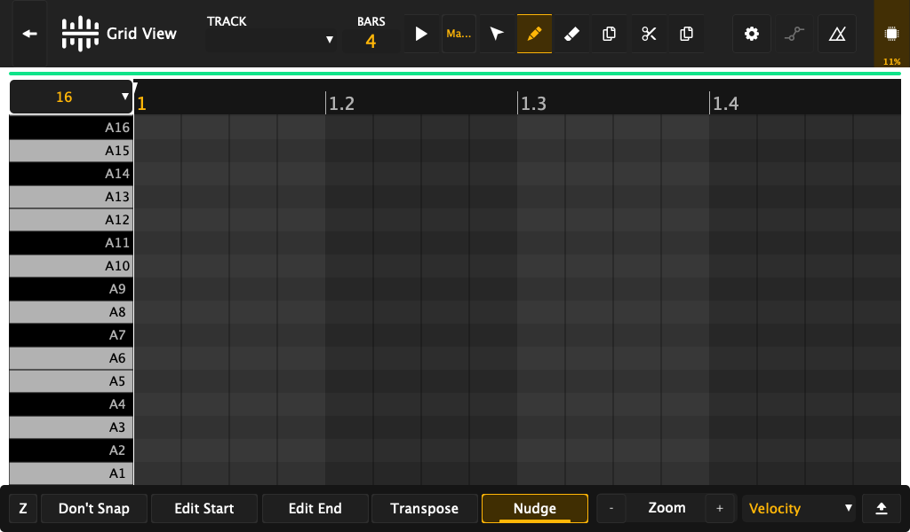

Ez a kézikönyv az **Akai MPC-hez hasonló mélységben**, modulárisan és részletesen mutatja be a **Safian Kick** DAW és szintetizátor munkaállomás használatát, felépítését, valamint a motor működési elvét.

A kézikönyvben a zenészeknek és hangmérnököknek szóló kezelési útmutatók mellett **kiemelt blokkokban találhatók a fejlesztői háttérinformációk** (architektúra, lock-free adatszerkezetek, ALSA/DSP részletek).

---

## 📑 Tartalomjegyzék

1. [Rendszerarchitektúra és Működési Alapok](#1-rendszerarchitektúra-és-működési-alapok)
2. [Főképernyő és Szekvenszer (Home & Grid View)](#2-főképernyő-és-szekvenszer-home--grid-view)
3. [Virtuális Zongora és 61-Billentyűs Kezelés (Piano Mode)](#3-virtuális-zongora-és-61-billentyűs-kezelés-piano-mode)
4. [Mintavételezés és Hangminta-szerkesztés (Sampler & Sample Edit)](#4-mintavételezés-és-hangminta-szerkesztés-sampler--sample-edit)
5. [Program- és Hangszerszerkesztés (Program Edit & CLAP Host)](#5-program--és-hangszerszerkesztés-program-edit--clap-host)
6. [Keverőpult és Pad Mixer (Channel Mixer & Pad Mixer)](#6-keverőpult-és-pad-mixer-channel-mixer--pad-mixer)
7. [XY Pad és Valós Idejű Moduláció (XY View)](#7-xy-pad-és-valós-idejű-moduláció-xy-view)
8. [Élő Előadás és Pad Perform (Pad Perform & Mute Mátrix)](#8-élő-előadás-és-pad-perform-pad-perform--mute-mátrix)
9. [Projektkezelés és Beállítások (Preferences & Cloud Storage)](#9-projektkezelés-és-beállítások-preferences--cloud-storage)

---

## 1. Rendszerarchitektúra és Működési Alapok

A Safian Kick egy **hibrid beágyazott DAW környezet**, amely egyesíti az Akai MPC hardveres stabilitását egy modern, nyílt forráskódú szintetizátor motorral (AudIO) és a JUCE 7-re épülő rugalmas kezelőfelülettel.

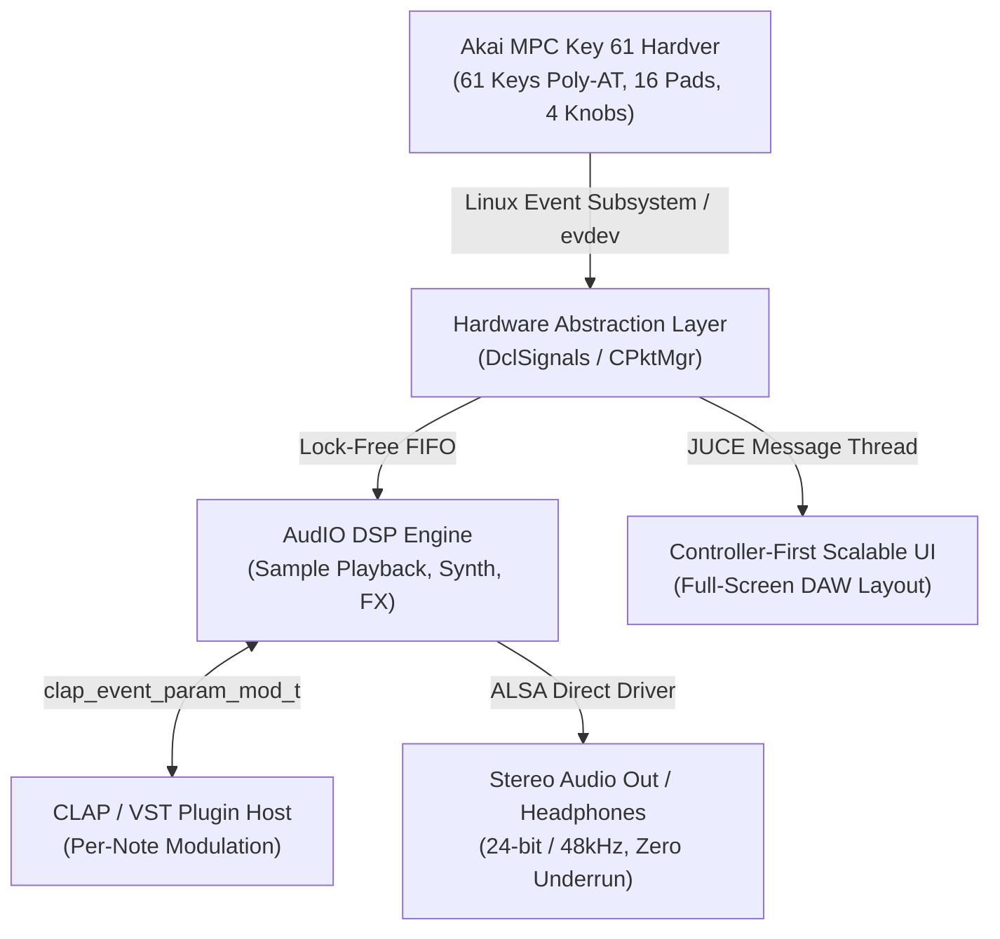

> [!NOTE]
> ### 👨‍💻 Fejlesztői Megjegyzés (Architecture & DSP)
> **Zárolásmentes valós idejű szálkezelés:**
> Az audiofolyam és a grafikus felület kommunikációja szigorúan zárolásmentes (`lock-free single-producer single-consumer FIFO`) gyűrűpufferen keresztül történik. Az audio feldolgozó szálban (`audioDeviceIOCallback`) dinamikus memóriafoglalás (`malloc`/`new`), mutex zárolás vagy rendszerhívás futtatása tilos. A 61 billentyűről beérkező polifónikus aftertouch nyomásadatok közvetlenül a DSP mintafeldolgozó blokkba pumpálódnak sub-millisecond késleltetéssel.

---

## 2. Főképernyő és Szekvenszer (Home & Grid View)

A munkaállomás központi felülete a **Grid Szekvenszer**, ahol a sávok, minták és MIDI adatok vizuálisan szerkeszthetők:

  

### Kezelés és Funkciók:
- **Sávok (Tracks):** 128 szekvencia-sáv támogatása, sávonként független hosszúsággal és kvantálással.
- **Valós idejű felvétel (Real-Time Record):** A csatlakoztatott 61 billentyűs billentyűzetről vagy az érintőképernyőről leütött hangok valós időben rajzolódnak ki a gridre.
- **Kvantálás és Time Correct:** 1/4-től 1/64-es felbontásig, beállítható swing értékkel.

  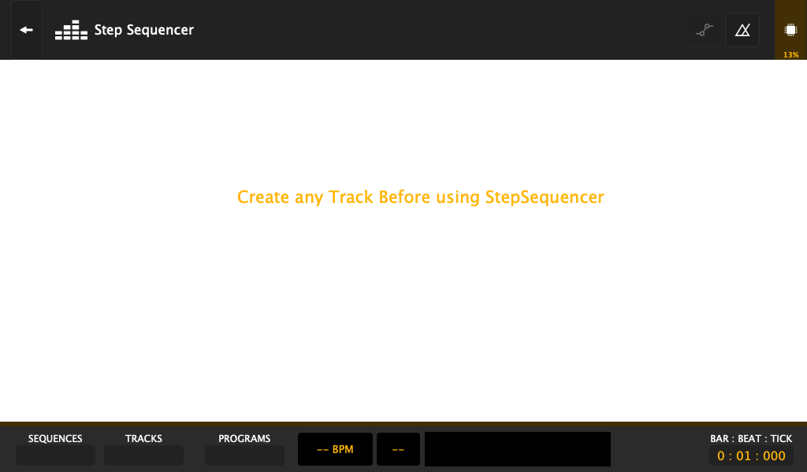

> [!TIP]
> ### 👨‍💻 Fejlesztői Megjegyzés (Sequencer Engine)
> A szekvenszer eseményei időszeletekre (`PPQ / Pulses Per Quarter Note`, alapesetben 960 PPQ felbontásban) vannak indexelve. A rögzítés során a beérkező MIDI és touch eventek egyidejűleg kapnak időkódot és kerülnek a visszavonási verembe (`undoWatcher_`), biztosítva a roncsolásmentes Undo/Redo funkciót élő játék közben is.

---

## 3. Virtuális Zongora és 61-Billentyűs Kezelés (Piano Mode)

A beépített **Piano Mode** mind a képernyőn virtuálisan, mind a fizikai Akai MPC Key 61 billentyűzeten keresztül azonnali billentyűs hangszerélményt nyújt:

  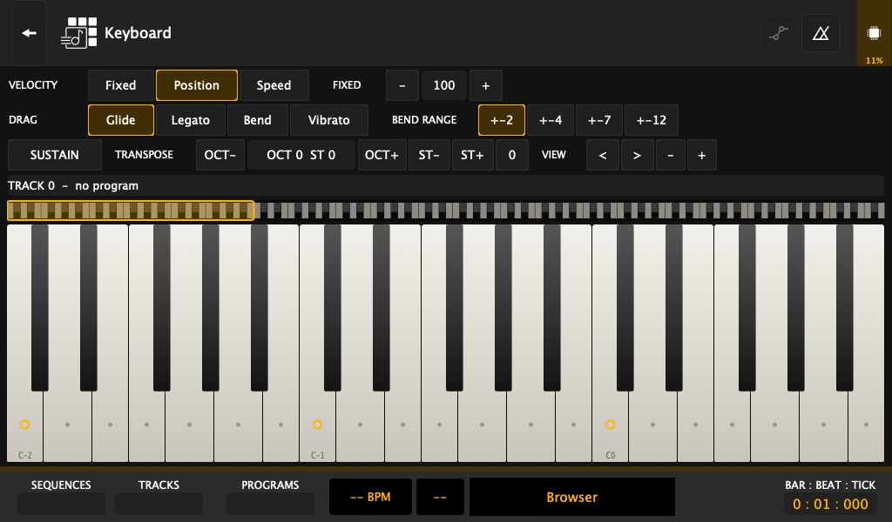

### Jellemzők:
- **Multi-Touch Polifónia:** Egyszerre akár 10 ujj független érintését érzékeli, lebegő hangkimaradás nélkül.
- **Oktávváltás:** Azonnali transzponálás -3 és +3 oktáv között.
- **Fizikai Polyphonic Aftertouch integráció:** A billentyűkre kifejtett egyedi nyomás nem csupán globális hangerőt vagy szűrőt vezérel, hanem billentyűnként független modulációt továbbít a szintetizátor motornak.

---

## 4. Mintavételezés és Hangminta-szerkesztés (Sampler & Sample Edit)

A Safian Kick teljes értékű hardveres samplert tartalmaz külső bemenetről történő valós idejű rögzítéssel:

  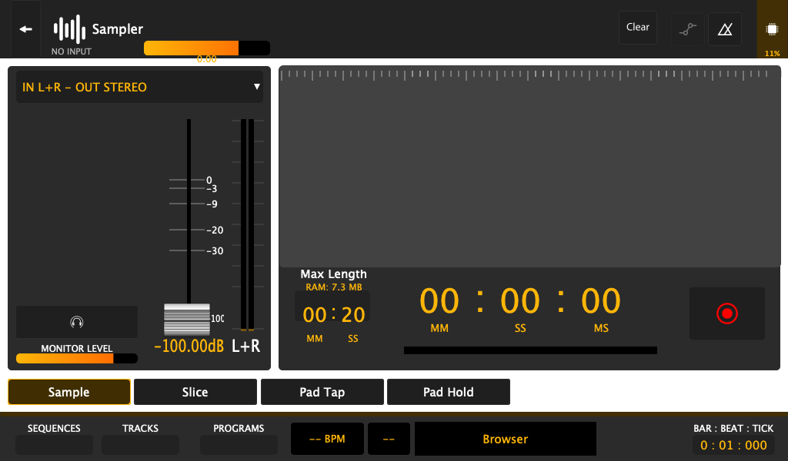
  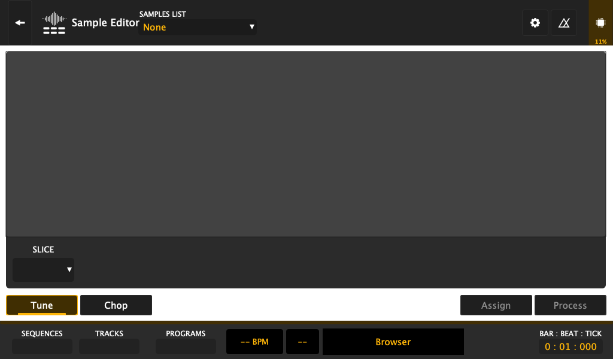

### Hangminta-kezelés:
- **Bemeneti források:** Sztereó vonalbemenet, hangszedő vagy belső resample.
- **Automata vágás (Slice Mode):** Tranziensek alapján szeletekre bontja a dobloopot, és automatikusan leképezi a 16 padra.
- **DSP transzformációk:** Normalizálás, fordítás (Reverse), némítás (Silence), sztereó-monó átalakítás és idényújtás (Time Stretch).

> [!NOTE]
> ### 👨‍💻 Fejlesztői Megjegyzés (Audio File Management)
> A minták betöltése a háttérben futó memóriafolyamon keresztül történik (`AudioFileManager`). Ha egy projektben hivatkozott hangfájl hiányzik, a motor nem áll le, hanem a `metronome.cpp` és `audiofile_manager.cpp` procedurális szintetizátor algoritmusa egy automatikus szinusz/zaj impulzussal helyettesíti azt, így a szekvenszer időzítése garantáltan nem esik szét.

---

## 5. Program- és Hangszerszerkesztés (Program Edit & CLAP Host)

A hangszerek parametrizálása a **Program Edit** felületen történik:

  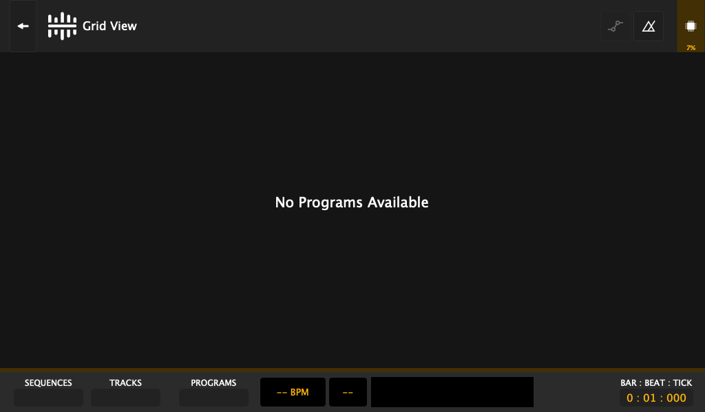

### Burkológörbék és Szűrők:
- **Többmódusú szűrő:** Low-pass, Band-pass, High-pass 12/24 dB meredekséggel, rezonanciával és meghajtással (Drive).
- **ADSR Envelope:** Tiszta exponenciális lecsengési görbék és precíz nulla-attack átmenet (lásd upstream PR #44).
- **CLAP / VST3 integráció:** Natív `.clap` szintetizátor modulok betöltése közvetlenül a programba.
- **A plugin saját felülete:** ha a plugin tudja a `com.safian.bitmap-gui/1` CLAP-bővítményt (a SynthyBoy tudja), a plugin panelje a plugin saját, általa kirajzolt felületét mutatja (1024x600, érintéssel). A fejlécsor `Parameters` gombja az általános paraméterlistára vált át (minden más plugin ezt kapja). A Q-Link potik (1-8) a látható panel `clap.remote-controls` oldalát vezérlik, az oldal címe a fejlécben látszik, a `<` `>` gombokkal lapozható; a 9-16. potik a következő oldalt. Remote-oldalak nélküli plugineknél az 1-4. poti a négy makró. Ha a SynthyBoy modul telepítve van (`/usr/lib/clap` az MPC-n), az nyer a beépített, Vital nélküli változattal szemben ([részletek](../../Kick/clap_host/README.md#plug-in-ui-bitmap-gui)).

> [!TIP]
> ### 👨‍💻 Fejlesztői Megjegyzés (CLAP Architecture)
> A beépített CLAP hoszt az IPC struktúrák közvetlen elérésével dinamikusan olvassa be a Linux `.so` pluginokat a `/data/plugins/` könyvtárból. A paraméterek automatikusan hozzárendelődnek a hardveres Q-Link potméterekhez és az érintőképernyős vezérlőkhöz.

---

## 6. Keverőpult és Pad Mixer (Channel Mixer & Pad Mixer)

A keverés két szinten érhető el: globális sávkeverőként és padonkénti al-keverőként.

  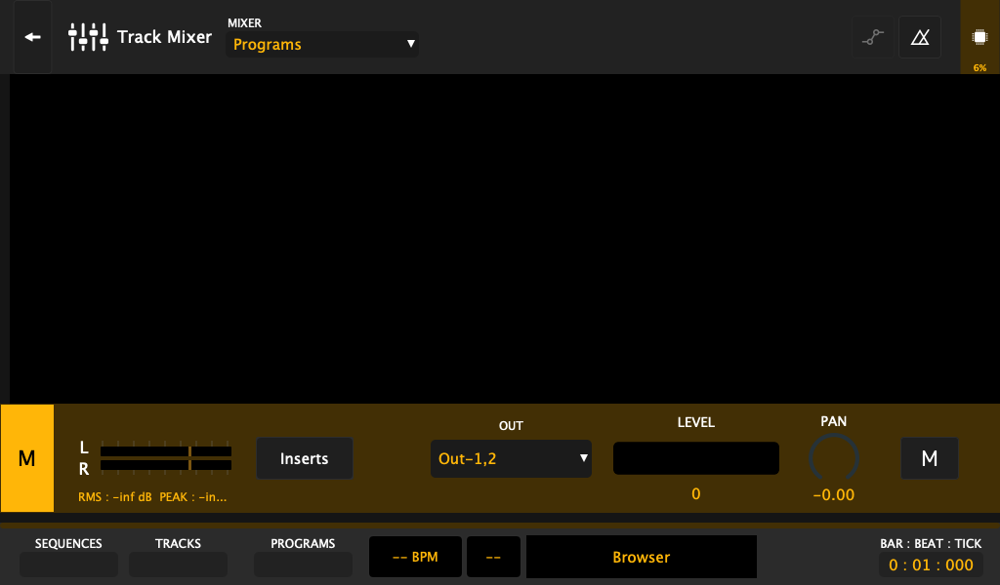
  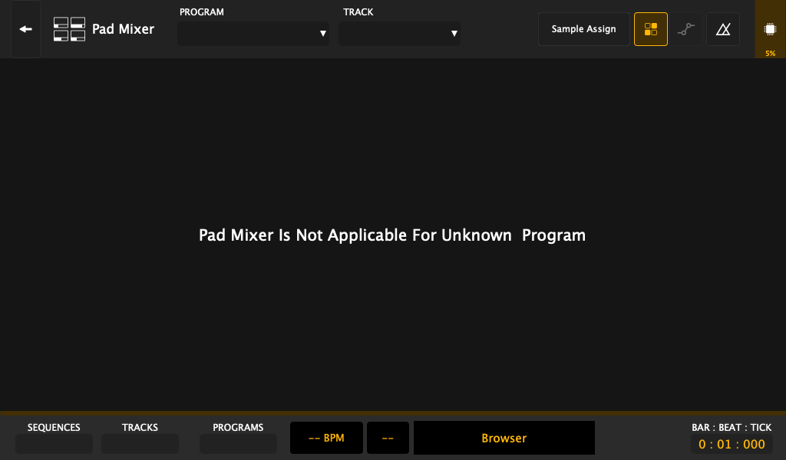

- **Sávkeverő (Channel Mixer):** Hangerő tolópotik, panoráma, Mute/Solo gombok, Send effektek.
- **Pad Keverő (Pad Mixer):** 16 független csatorna a dobszettek egyes elemeinek (Kick, Snare, HiHat) külön effektezésére és szintezésére.

---

## 7. XY Pad és Valós Idejű Moduláció (XY View)

Az érintőképernyő intuitív vezérlőként működik az **XY View** nézetben:

  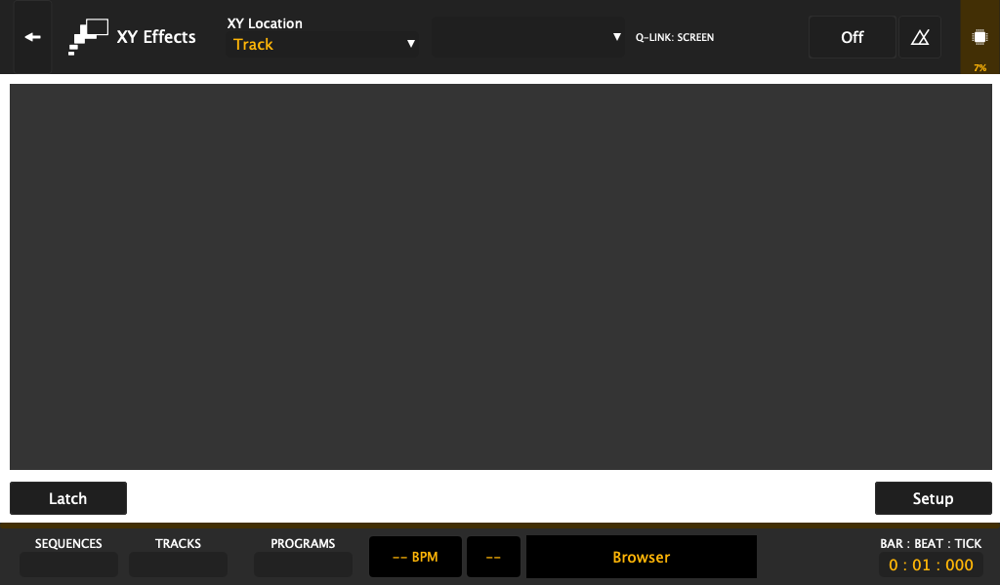

- Két paraméter (pl. szűrő Cutoff és Rezonancia, vagy Reverb méret és Wet/Dry) egyidejű, ujjmozdulattal történő modulálása élő fellépés közben.
- Koordináta rögzítés és visszajátszás automatizációs sávként.

---

## 8. Élő Előadás és Pad Perform (Pad Perform & Mute Mátrix)

A színpadi munkát és a struktúraépítést dedikált nézetek segítik:

  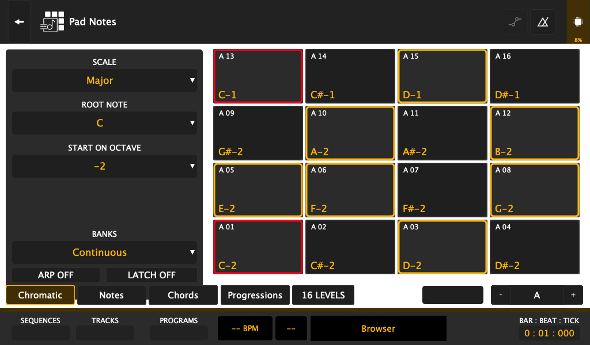
  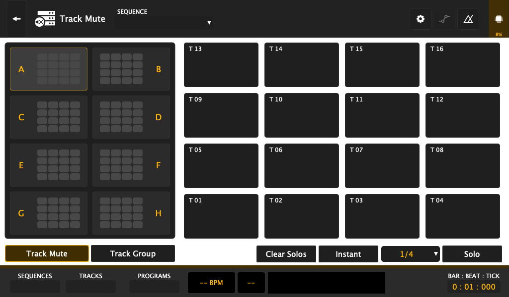

- **Pad Perform:** Skálákhoz igazított billentyűzet- és akkordkiosztás a 16 padra (dúr, moll, pentaton, blues stb.).
- **Track Mute & Pad Mute Mátrix:** Sávok és hangminták valós idejű némítása és feloldása a szekvencia ütemre igazított ritmusában.

---

## 9. Projektkezelés és Beállítások (Preferences & Cloud Storage)

A beállítások menüben a hardveres interfészek, hálózati kapcsolatok és felhőtárhelyek konfigurálhatók:

  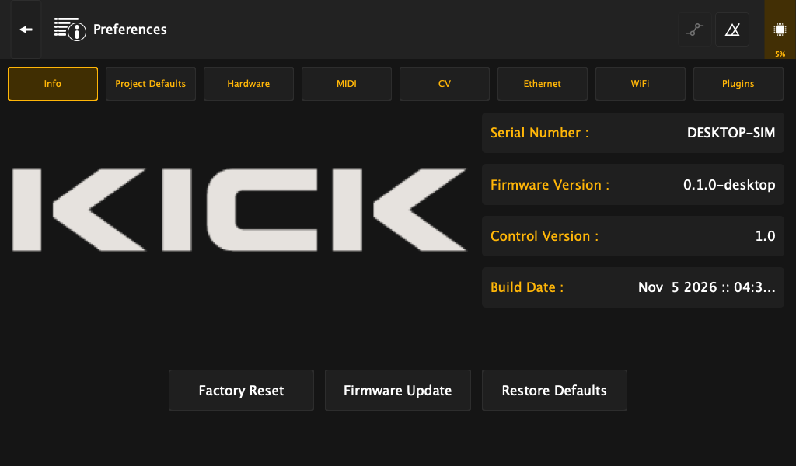

- **Hardveres audio beállítások:** Mintavételezési frekvencia (44.1 kHz / 48 kHz / 96 kHz) és pufferméret (64 .. 512 minta).
- **Hálózati integráció és Tárhely:**
  - Helyi belső flash: `/data/projects/`
  - Külső USB meghajtók automatikus csatolása
  - Felhő és távoli megosztások (WebDAV, Splice, Google Drive útvonalak közvetlenül a fájlböngészőből).

> [!NOTE]
> ### 👨‍💻 Fejlesztői Megjegyzés (Filesystem & Persistence)
> A beállítások a belső flash `/data/prefs/preferences.settingsprj` útvonalán perzisztálódnak JSON/XML formátumban. A felhasználói projektek a `/data/projects/` alatt védettek: még a pendrive-os rendszerfrissítés sem írja felül a felhasználó saját projektállományait.

---

## 📚 Kapcsolódó További Dokumentumok a Repóban

- [Akai MPC Key 61 Pendrive Telepítési Útmutató (pendrive-install.md)](../archive/akai-key61/pendrive-install.md)
- [Hardver Viselkedés és LED Protokoll (hw-behaviour.md)](../archive/akai-key61/hw-behaviour.md)
- [CLAP Plugin Hoszt Építési Útmutató](../../Kick/clap_host/README.md)
